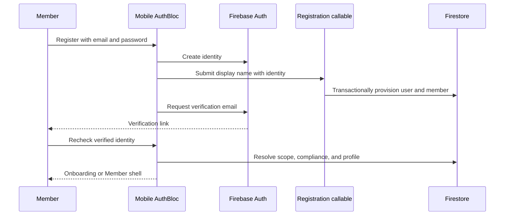

# M01 User account and profile management

**Scope.** Member registration and sign-in, identity recovery, verified role routing, profile/preferences/privacy, and deactivation. Coach identity and Admin provisioning are described in M08 and M11. Source-backed features are implemented but not fully verified as a complete deployed identity journey. The OTP fallback distinction below is material.

## Client composition and workflow

- Member and Coach share one mobile app. `apps/mobile/lib/app/mobile_app.dart:99–181` injects an AuthRepository into AuthBloc and composes MaterialApp routes. The mobile gate (:243–449) handles restoration, verification, pending-deletion recovery, and role selection. A Member proceeds through compliance and fitness-profile gates to the Member shell. Admin Web substitutes an Admin gate (`apps/admin_web/lib/app/admin_app.dart:79–156`).
- `LoginScreen` and `EmailVerificationScreen` handle form submission, error and resend states. `FirebaseAuthRepository` serializes sign-in/restore/sign-out, verifies requested role against restored scope, drops stale session results and sends verification through its gateway (`packages/gainpath_data/lib/src/firebase_auth_repository.dart:89–275`). Google sign-in exchanges the Google account credential with Firebase via the Mobile gateway, where supported.
- Email registration calls Firebase Auth, then `provisionMemberRegistration`; this callable accepts schema version 1 and display name, derives UID and email from Auth, and maps domain failures to callable errors (`functions/src/modules/identity/provision-member-registration.ts:7–37`). Transactional `provisionMember` verifies dataset assignment and existing membership, creates absent identity/organization/branch records, and rejects conflicting assignments (`member-provisioning.ts:36–117`). Registration precedes email verification. Other callable and Rules checks must therefore be described per operation.
- Profile setup collects physical details, activity, experience and numeric goals. `FitnessProfileCubit` and `FirebaseFitnessProfileRepository` implement typed reads/edits. Profile and goal data go to `orgs/{org}/profiles/{uid}` and `goals/{goalId}`, with scoped Rules and goal revisions. Account Settings composes contact edit, photo, preference, account lifecycle and legal/data settings. See `apps/mobile/lib/features/identity/presentation/member/`, `packages/gainpath_data/lib/src/firebase_fitness_profile_repository.dart`, `firebase/firestore.rules:343–447`, and `firebase/storage.rules:52–89`. Read-loading, onboarding and unavailable states depend on real repository results.
- Default password reset is Firebase's email-link path (`mobile_app.dart:158–163,442–446`). Member/Coach OTP screens and callable requests exist behind `ENABLE_PASSWORD_RECOVERY_OTP` (`login_screen.dart:121–147`, `password_recovery_screen.dart:13–16,124–180`). The primary Functions index has no `passwordRecovery` export. The alternate `otp-work` branch contains the OTP commits `65324d1` and `d0a0866`. The active snapshot's OTP workflow is **Partially Implemented** as an end-to-end contract. A deployed OTP backend was unable to be verified. Admin keeps the link-reset workflow.
- At deactivation the server checks a verified, current and appropriately recent Auth identity, a canonical Member assignment, schema, request ID and expected revision. The transaction moves `active` to `pendingDeletion`, writes a receipt and records token-revocation work; cancellation depends on approved grace policy, revocation status, cooldown and window. The policy branches include `pendingApproval` and optional `grace30Days`; a 65-minute security cooldown protects restoration. The client signs out or moves to recovery UI. See `member-account-lifecycle.ts:6–15,96–157,168–216` and `member-account-lifecycle-callables.ts:16–61`. An automated permanent-erasure job and actual retention behavior were unable to be verified.

## Verification, evidence and limitations

- `functions/test/member-provisioning.test.ts` covers invalid/repeated/conflicting provisioning. `functions/test/member-account-lifecycle.test.ts` and callable tests cover expected revision, state and revocation conditions. Flutter tests include `fitness_profile_flow_test.dart`, `member_account_lifecycle_ui_test.dart`, `password_recovery_screen_test.dart`; the last exercises an injected recovery transport.
- Original FR-1.1–1.7, Chapter 4 account flow and the historical Module 1 UAT provide context. Current deployment and physical mail/device behavior remain separate. See [identity excerpt](../evidence/code_snippets/identity-registration.md), [test results](../12_TEST_EXECUTION_RESULTS.md) and [figure checklist](../18_SCREENSHOT_AND_FIGURE_CHECKLIST.md).
