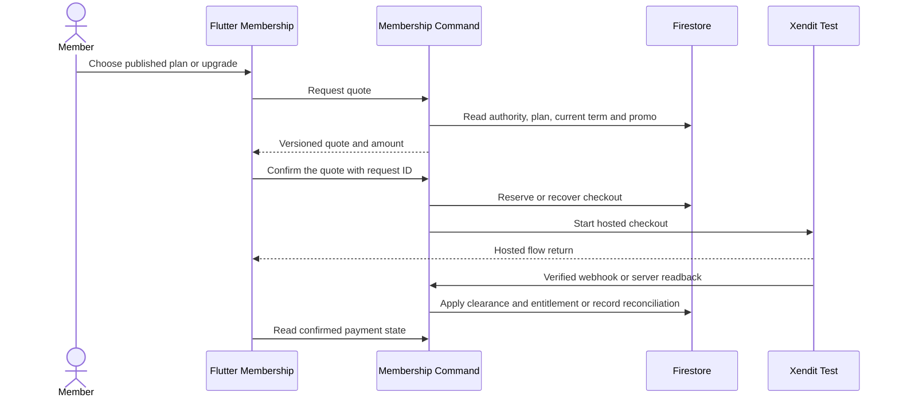

# M04 — Membership and payment

**Status:** Implemented but Not Fully Verified. New checkout targets the Xendit test integration. Legacy Billplz Sandbox readback, callbacks and qualifying historical receipts still have supported code. Production-capable Firebase deployment and sandbox financial settlement are independent. No real-money processing was audited.

The mobile Membership dashboard presents current tier, renewal status/history and plan choices. `PurchasePlanScreen` obtains a backend quote, shows updated terms/price, opens hosted checkout and polls current transaction status after return. Pending/recovery and unresolved entitlement states are presented separately from confirmed success. Client gate `apps/mobile/lib/navigation/membership_access_gate.dart` consumes `FirebaseMembershipAccessRepository`; backend `resolveMembershipEntitlement` and capability checks are authoritative. Admin Payment Review and Refunds present accounting and action state independently from the provider. See `apps/mobile/lib/features/membership/presentation/`, `apps/mobile/lib/infrastructure/firebase/firebase_membership_repository.dart`, and `apps/admin_web/lib/features/membership/`.

## Data and rules

| Entity under `orgs/{org}` | Data and enforcement |
|---|---|
| `members/{uid}`, `membershipAccounts/{uid}` | Organization authority is resolved independently from paid access. Account references a verified term transaction, includes expiry, plan, benefits, and optional future Premium term. An absent paid term gives Free. Expired paid term resolves Free with historical plan facts. Invalid/mismatched evidence yields unknown and restricted capabilities. `functions/src/modules/commerce/membership-entitlement.ts:20–105`. |
| `membershipPlans/{id}`, `promoCodes/{code}` | Active Basic or Premium plan, stable revision, exact 30 days, positive integer MYR minor units. Promo checks validity interval, plan eligibility, allocation limit and discount strictly in (0,100). Amount rounded in minor units. Server validates quote again before checkout. `membership-payment-service.ts:47–131`. |
| `transactions/{id}` | Scoped Member/organization, kind, plan/version snapshot, amount/currency, provider, sandbox environment, billing/external IDs, payment status, fulfillment status, timestamps, refund/review states. Valid entitlement requires matching term, cleared receipt and confirmed or reconciliation-required fulfillment, with no completed refund. `membership-entitlement.ts:87–100`, `membership-payment-service.ts:136–143,222–258`. |
| `membershipBilling/{uid}` | Materialized renewal state, due time, seven-day grace for the bill and expiry/cancel/payment maintenance. Actual expiry still derives from the paid entitlement contract. Bill settlement is a user-driven checkout path. `membership-billing.ts:5–74`. |

**Upgrade:** active Basic may buy Premium now plus a 30-day extension, or prepay a Premium term starting at Basic expiry. Immediate charge in minor units equals Premium term amount plus the non-negative price difference prorated to remaining Basic time, using half-up integer rounding. The next-term option charges only the Premium term amount. Server-side quote expires at the earlier of five minutes or Basic expiry. Upgrade quote binds Member, prior transaction, term and plan versions. Promo codes cannot discount the upgrade. Scheduled activation rechecks the linked `next_term` receipt and 30-day bounds. See [S-M04-01](../evidence/code_snippets/S-M04-01.md) and `membership-payment-service.ts:55–94,261–325`.

**Settlement:** create/recover a transaction intent with owner-scoped idempotency, call the test gateway outside the reservation transaction, and record the provider mapping. Return URL is a UI signal. Xendit callbacks are token-checked and server readback verifies provider identity, matching mapping, amount and paid state. Legacy Billplz uses signature verification and provider readback. Transactional settlement rechecks the current principal, term and timing. Cleared but no longer eligible goes to reconciliation and preserves payment evidence. Refund request/decision/provider outcome are separate. `functions/src/modules/commerce/booking-payment-callables.ts:55–143`, `membership-payment-callables.ts:46–54`, `membership-payment-service.ts:148–351`. Product payment-method metadata alone does not prove a provider rail was actually enabled or used.

**Verification:** `functions/test/membership-entitlement.test.ts`, `membership-flexible-renewal.test.ts`, `membership-commerce-security.test.ts`, `membership-payment.test.ts`, and `apps/mobile/test/membership_commercial_ui_test.dart`, `firebase_membership_repository_test.dart` exercise contract paths. Commit `1cc481f` and `docs/STATUS.md:560–562` report November 23 source-only activation of 25 verified packages and a successful Android Studio build. Exact audited-tree deployment, complete on-device checkout and production money movement remain unverified. The previous Billplz-only interpretation is superseded for new source checkouts.

**Chapter 3 trace.** FR-4.1–4.5 (`c3.md:7283–7298`). These requirements cover purchase, status, cancel renewal, manual renewal and refund request. Scheduled activation and receipt-driven effective-tier resolution are current refinements.

The Xendit runtime flag defaults off in source. Default channel configuration names CIMB FPX, Touch ’n Go and cards, but each environment must enable the gateway and expose valid methods. The same public return endpoint name remains for compatibility. See `functions/src/modules/commerce/xendit-payment-config.ts:1–23`. The current capability resolver distinguishes Free, paid Basic/Premium and Premium-specific reward/check-in/Coach discount eligibility; the benefit still depends on the relevant feature policy. See `functions/src/modules/commerce/membership-capabilities.ts:7–12`.

Synthetic figure capture: Membership → active Basic → compare Upgrade now and Next term, with target dates/amount shown → hosted TEST receipt if a test checkout has already been authorized. Hide member/transaction identifiers. Label screens before provider clearance as pending.

