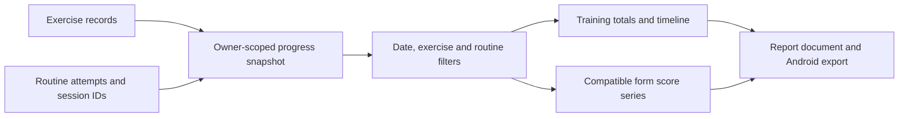

# M05 Member report and analytics

**Scope.** Member-facing activity, training, goals and program/routine progress with a local data source. Admin aggregation is M12. The reports are implemented but complete physical-session provenance, export/share handling and endurance are open. FYP report adapters and fixture demonstrations represent controlled data.

## Data and presentation flow

1. Session/routine completion writes owner-scoped records. `StoredLocalMemberProgressRepository` reads session and routine history and returns a `LocalMemberProgressSnapshot` with availability state, rather than treating every read failure as empty data (source in `apps/mobile/lib/features/analytics/data/`).
2. `MemberProgressCubit` and progress/report routes request the snapshot, guard session ownership and expose loading, error, empty and non-empty views. Main UI includes Training Report, activity timeline, exercise performance, body metrics, goal progress, gamification progress, program adherence and posture-accuracy views. See `apps/mobile/lib/features/analytics/presentation/`; physical-progress and shop data can have different data sources.
3. `MemberWorkoutReport.build` first calculates scoped base progress, then links routine attempts to exercise session IDs. It filters by date, exercise and routine, preserves data-availability signals, groups sessions by report day and emits chronological form series (`apps/mobile/lib/features/analytics/domain/member_workout_report.dart:284–372`). A routine attempt and its child sessions can appear as timeline entities with distinct meanings. Do not sum them as a single count.
4. The member sees counts, partials, active tracking duration, and shape of trends. Captured form scores are grouped by the implemented compatible measurement tuple, including exercise and camera/logic version, before drawing comparisons. Manual/guided activity can still contribute training volume. Missing or incompatible form evidence does not become an inferred form score. Named routines and exercises come from history/catalog labels with fallback.
5. `WorkoutReportExporter` uses a report document assembled from the visible filter. Android invokes a native channel and exports a PDF under account/session guards (`member_workout_report.dart:91–110,400–490`; `apps/mobile/android/app/src/main/kotlin/com/zyang/gainpath/WorkoutReportPlugin.kt`; `WorkoutReportExportGuard.java`). External share handling and device provider acceptance are independent.

For a report day $d$, full repetitions are $R_d=\sum_{s\in d} r_s$, partial attempts are $P_d=\sum_{s\in d} p_s$, and tracked time in microseconds is $T_d=\sum_{s\in d} t_s$. These totals are separated in the calculation (`member_workout_report.dart:337–344`). The report day uses a fixed Malaysian offset in this implementation. A form series reports scores captured by the same compatible contract and is distinct from statistical pose accuracy against external ground truth.

## Tests and deviations

`apps/mobile/test/member_workout_report_test.dart`, `local_member_progress_repository_test.dart`, `workout_report_route_test.dart`, `workout_report_product_test.dart` and `android_workout_report_exporter_test.dart` cover aggregation and report/export boundaries. `fyp_progress_repository_test.dart` addresses the controlled FYP path. Historical renders are listed in the figures index. Local/manual/guided/AI activity types and versioned form series extend the original FR-5 report design. Fresh cloud reconciliation and accessibility across physical devices are pending.
