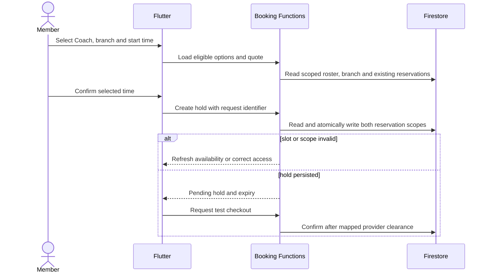

# M07 — Coach booking

**Status:** Implemented but Not Fully Verified. Provider-backed settlement is Test/Sandbox Mode. Historical controlled acceptance is scoped to its named operations. The current dirty worktree's client, payment and cancellation behavior require explicit end-to-end confirmation.

## Member path

Member opens Coaches, searches or filters eligible published profiles, views the chosen Coach, selects a branch/date/time, reviews a server quote and starts checkout. My Bookings displays current/recent sessions and refreshes on demand. Relevant frontend files are `apps/mobile/lib/features/coaching/presentation/member/browse_coaches_screen.dart`, `member_booking_flow.dart`, `booking_schedule_screen.dart`, `booking_payment_screen.dart`, `booking_confirmed_screen.dart`, and shared `live_booking_list_view.dart`. `CoachDirectoryCubit` and `LiveBookingCubit` separate loading/empty/error/restricted and already paid states. `FirebaseBookingRepository` and `FirebaseBookingPaymentRepository` invoke server commands. Current free-tier gate and preserved already-purchased session visibility are separate.

1. Server lists permitted branches, coach options and prices, using published Coach facts, active branch assignments and the current roster.
2. `createBookingHoldService` validates pricing and identity, reads the date grid/coach slot locks and the Member day reservations inside one transaction. It rejects coach or Member overlap and a daily capacity breach. New appointments last 60 minutes; pending hold expires at the earlier of the configured hold interval and appointment start. Historic 30-minute bookings remain readable. It creates the `bookings/{id}` record, a lock for each selected half-hour, a day-reservation update, an idempotency receipt and expiration job. Branch is a booking attribute, while each coach/time lock spans that coach across branches.
3. `createBookingPaymentCommand` uses the configured Xendit test gateway. Hosted return triggers server status checks. Settlement updates the booking and held locks only on a cleared, mapped payment. Late/ineligible receipts can require reconciliation. Billplz mapping and signatures remain relevant to older sandbox orders, as described in M04.
4. Users may cancel or reschedule through current scoped policy. The Member service distinguishes recoverable holds and paid booking changes, verifies owner and uses transaction conflicts and receipts. Confirmed cancellation needs at least 12 hours of notice and rescheduling needs at least 24 hours, with a 1–500-character reason. The expiry worker handles abandoned holds. The lifecycle/review commands preserve historical types and require a completed/eligible booking before reviewing.
5. Once a confirmed/completed relationship meets eligibility, Member and assigned Coach may use shared pair chat. A pair conversation can span bookings. The server checks relationship/current branch/role, distinguishes write windows from historical reading, and uses receipts. A follow-up bound of 48 hours appears in `pair-conversation-service.ts:10–41`.

| Evidence | Contents |
|---|---|
| `functions/src/modules/coaching/booking-service.ts:30–89` | Transactional hold, reservation/lock guards, receipt and expiry |
| `functions/src/modules/coaching/coach-availability-contracts.ts:5,39–58` | 30-minute slots and configured per-Member daily limit/hold minutes |
| `functions/src/modules/coaching/member-booking-change-service.ts` and `booking-lifecycle-service.ts` | Scoped changed/cancelled/expired workflow |
| `functions/src/modules/commerce/booking-payment-service.ts` and `booking-payment-callables.ts:33–143` | Quote, Xendit creation/readback, provider-specific callback dispatch |
| `functions/src/modules/coaching/booking-review-service.ts`, `pair-conversation-service.ts:65–end` | Review and shared communication |
| `docs/STATUS.md:509–524` | Historical 60-minute redesign and older Billplz checkout stage, with predecessor compatibility evidence |

**Tests:** `functions/test/booking.test.ts`, `member-booking-options.test.ts`, `member-booking-change.test.ts`, `booking-payment.test.ts`, `booking-review.test.ts`; `apps/mobile/test/booking_payment_screen_test.dart`, `booking_date_availability_test.dart`, `member_booking_refresh_test.dart`. [S-M07-01](../evidence/code_snippets/S-M07-01.md) illustrates all-or-nothing slot allocation. Report-ready screenshots: synthetic paid Member opens coach profile and picks a current branch/day → secure test-only checkout receipt if authorized → History. Use a pre-existing fixture for expired and unavailable states. Group classes use a distinct group event/capacity/attendance lifecycle and are documented separately.

**Chapter 3 trace.** FR-7.1–7.6 (`c3.md:7356–7372`). These requirements map to directory, booking, history, changes, messaging and reviews. Historical owner sandbox acceptance is retained in `docs/integration/module7-booking-completion.md:55–end`.

