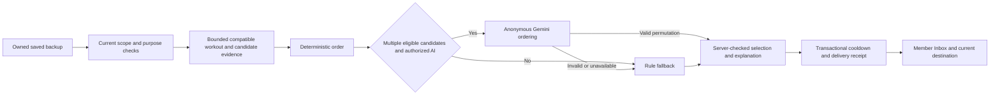

# 5.1.4.9 — Recommendation engine

Three source lineages matter: current workout-backup guidance, Admin manual planning/outreach, and the earlier synthetic semantic bench. The synthetic test engine's 80:20 ranking does not describe the current automatic provider contract.

## Automatic guidance

1. An accepted workout backup-create event and supported consent-change event can schedule eligible evaluation. `workout-backup-recommendation-events.ts:12–95` handles event path/identity, current Member/consent validity and current runtime. `fyp-workout-backup-events.ts` keeps cohort routing separate. A canonical accepted-workout trigger and periodic recovery worker are also exported in `canonical-recommendation-events.ts:40–end`.
2. `readWorkoutSource` validates schema, classification, identity/key, envelope length <=32,768, payload canonical digest, source age <=30 days, occurrence before current time, consent boundary and at least one repetition. Its retained fictional samples can supply context only. An actual compatible form mean requires an allowlisted tuple for bodyweight squat, standing single-arm curl, standing calf raise or wall push-up, matching scoring and detector identity/version, side view, tracking fraction at least .60, and >=3 reps for each scored session. Curl requires its schema 2/arm contract; other eligible metrics here require schema 1. Newer tracking/report formats can supply eligible descriptive context when accepted, without implying comparable scores. `workout-backup-recommendation-runtime.ts:23–86`.
3. Source evaluates bounded recent compatible history, up to five qualified comparable scores, with at least two needed for a mean. \(\bar{s}=\frac{1}{k}\sum_i s_i\) where \(2\le k\le5\). Mean <65 selects movement control, ≥85 progression, otherwise technique foundations. Missing mean also uses technique foundations. Coarse context bands include weekly frequency (0–1 new, 2–5 occasional, ≥6 regular), reps (<6 low, 6–14 moderate, ≥15 high), selected goals, experience, completion, and duration/form where available. These are educational engineering signals. See [S-REC-01](../evidence/code_snippets/S-REC-01.md).
4. Tutorials require the recent exercise in a currently published eligible publication with an active catalogue entry and real tutorial media/steps. Difficulty affects deterministic ordering. Routine candidates parse current published routines with valid entry modes/prescription, rank by difficulty/goal/exercise match/duration and suppress advanced targets for a beginner. Trainer candidates require matching stated goals and repeat practice, validated published profile/certification/identity, eligible scoped branch/access and current suitable slot availability. A single low score does not generate a coach upsell. Pre-workout preference-based suggestions form a different deterministic path. `workout-backup-recommendation-runtime.ts:90–213,315–493`.
5. With consent and provider configuration, `rankWorkoutRecommendations` constructs bounded anonymous labels for the kinds (coach C1–C6, tutorial T1–T6, routine R1–R6) with allowlisted factors, optional difficulty/duration and context enums. No identifiers, raw workouts, landmarks, private profile text or loaned coach IDs are in the payload. It requests `rankedCandidateIds` as a complete permutation, rejects invalid/unknown/duplicate/missing labels and extra fields, and chooses first recognized entry per target kind. Final explanations derive from checked server factors. A single candidate does not require model ranking. Unavailable/malformed provider output, no AI permission and no provider fall back to rule order with recorded provenance where applicable. `workout-recommendation-ranking.ts:72–147,216–end`, `workout-backup-recommendation-runtime.ts:248–295,499–end`. Configured Gemini model overrides the default gemini-3.5-flash-lite. Request cap 8,000 bytes, max 512 output tokens, 15-second timeout, six candidates per kind and secret-bound server configuration.
6. `canonical-recommendation-lifecycle.ts` applies durable deduplication, UTC elapsed-time expiry/cooldown, target rechecks and backend writes. Guidance has seven-day automatic cooldown and 14-day expiry from the runtime; canonical Inbox/recommendation delivery keeps retries idempotent. Rate-limit, consent revocation and invalid targets are distinct from low relevance. Persisted current recommendations and existing notices go through the ordinary Member service. Backup data and recommendation participation permissions remain independently enforceable.

## Admin and research paths

Content Planner aggregates consent-eligible workouts and current catalog facts into bounded candidate content; drafts are reviewed or edited by Admin before ordinary publication. Outreach uses distinct server-owned preview and Send. Server latches consenting recipients, qualified targets and the actor, with 30-minute validity and audited exact retries. Manual Outreach entries carry separate origin and no automatic cooldown mutation. Relevant files `functions/src/modules/recommendation/admin-ai-service.ts`, `admin-ai-assistance.ts`, `canonical-recommendation-admin.ts`, and `docs/integration/module13-ai-content-planner-member-outreach.md`.

Older Batch B/E evaluated a **synthetic-only** deterministic+semantic variant, with 80% rule baseline and 20% validated semantic score in `recommendation-engine.ts`, `recommendation-baseline.ts` and `recommendation-ai-validation.ts`. Held-out assessor packets and a fixture corpus exist without independent ratings for the new cases. Live Curl provider validation, simulated payload checks and rankings' relevance have separate denominators. See the [evaluation](../10_CORE_AI_EVALUATION/RECOMMENDATION_EVALUATION.md).

**Purpose consent fields.** Version 2 tracks four independently granted or revoked permissions, `exerciseInsights`, `recommendationGeneration`, `externalAiInference` and `recommendationDelivery`. Each carries its own revision and retained-history boundary. Written changes validate screen notice/content revision and expected global revision, so a prior stale answer cannot silently replace the current choice. Source `functions/src/modules/recommendation/recommendation-consent-v2.ts:10,52–97,136–177`.

