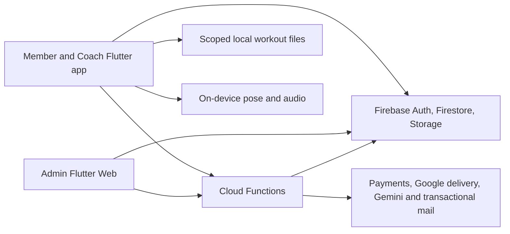
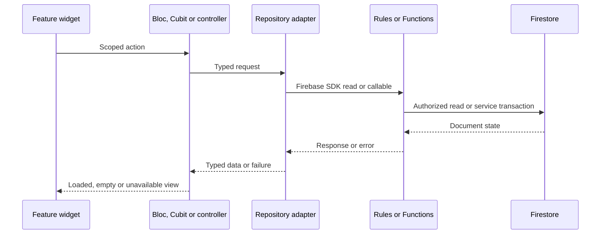
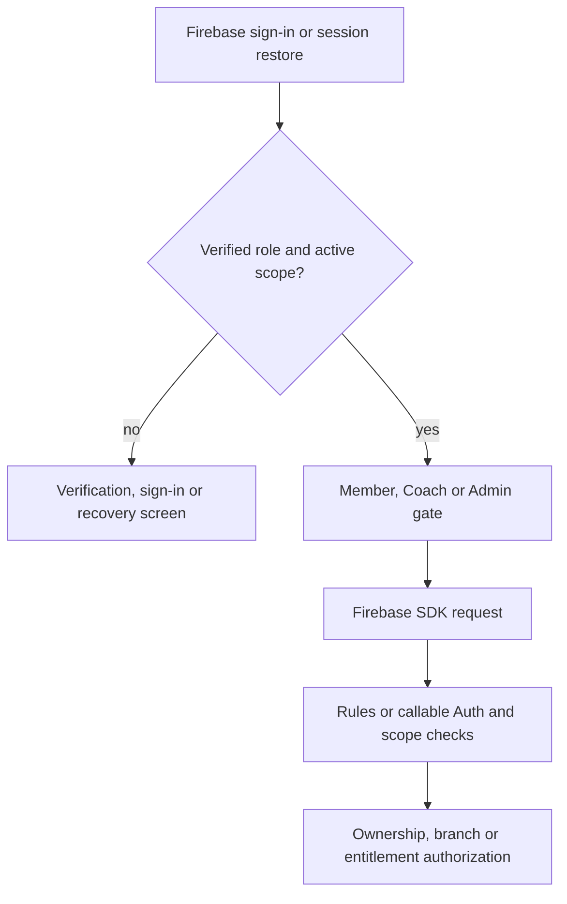
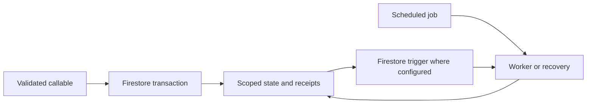
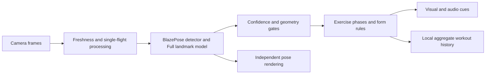
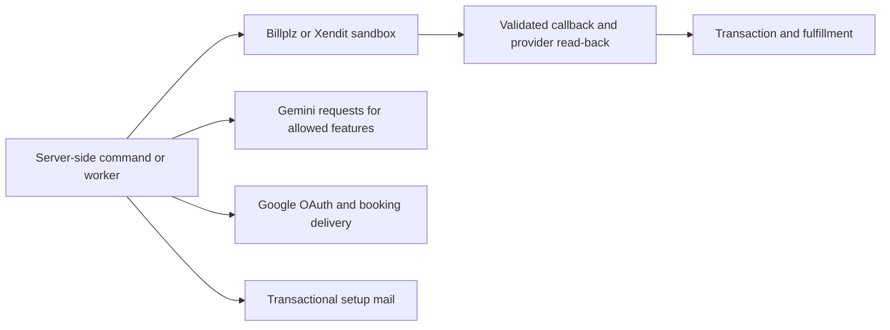
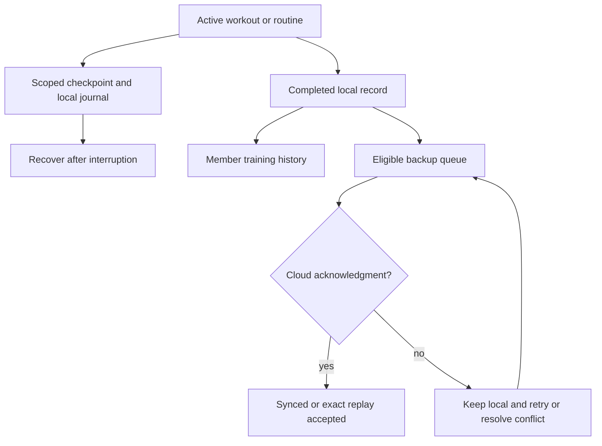

# Architecture diagrams for §5.1.2

## A01 Overall system

Evidence `pubspec.yaml`, both Firebase bootstrap files, `firebase.json`, `functions/src/index.ts`.

## A02 Client to backend

Evidence `apps/mobile/lib/app/mobile_app.dart:99–181`, `firebase/firestore.rules`, `functions/src/modules/analytics/admin-reporting.ts`.

## A03 Identity and authorization

Evidence `packages/gainpath_data/lib/src/firebase_auth_repository.dart:89–275`, `apps/mobile/lib/app/mobile_app.dart:243–449`, `firebase/firestore.rules:5–26`.

## A04 Backend events and transactions

Evidence `booking-expiry-worker.ts:38`, `automatic-google-worker.ts:15`, `canonical-recommendation-events.ts:40–59`, and export inventory.

## A05 On-device pose

Evidence M02 and pose core docs. A held render pose is separate from the analyzer stream.

## A06 External provider boundaries

Evidence `functions/src/modules/commerce/booking-payment-callables.ts`, `chatbot/chatbot-callable.ts`, `coaching/google-gym-callables.ts`, `identity/admin-member-provisioning-callable.ts`.

## A07 Local workout recovery

Evidence `apps/mobile/lib/infrastructure/local/`, backup coordinator and `functions/src/modules/workouts/workout-backup.ts`.
