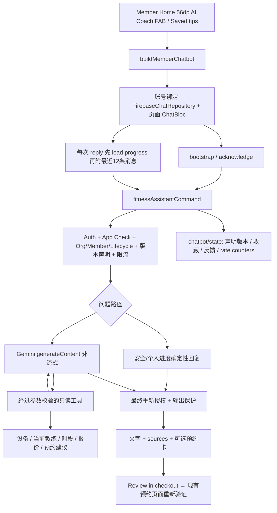

# GainPath AI Chatbot / Fitness Assistant 全面审计与优化方案

审计日期：2026-11-16，Asia/Kuala_Lumpur。审计对象：`C:/Users/Ngzhe/StudioProjects/gainpath` 当前工作树；HEAD 为 `c6ab900fbec58b39b3cb82d2f96727918924662c`，包含既有未提交修改，因此不是纯 HEAD 快照。

本轮仅分析并新增本报告；没有修改生产代码、Firebase 配置、Rules、索引或数据，没有部署、安装 APK、启用收费服务或调用 Gemini。官方价格、配额与 Streaming 文档进行了公开网页核对；没有读取 API Key、账号账单或云端实时运行配置。现网状态引用已有发布记录，不等于本轮重新验证。UI 为源码审计，没有声称已完成手机视觉、键盘或无障碍验收。

## 1. 结论与建议方向

**现有 Chatbot 已有真实 Gemini、可信后端工具、账号隔离、版本化免责声明、收藏、反馈及预约建议，不是纯 UI 原型。主要不足是训练数据整合过浅、默认模式缺少通用多轮上下文、失败恢复和可访问性不完整，以及缺少可测量的延迟与 Token 指标。**

下一阶段应保留现有 Flutter → Firebase callable → Gemini 架构，优先让回答准确地引用现有训练报告、教程、Membership 与 Module 13。无需引入新的推荐引擎、向量数据库、微服务或 Agent 框架。

建议采用以下分工：

- GainPath 负责授权、数据读取、计算、推荐资格、价格和可用时段；事实摘要使用确定性模板或结构化卡片。
- Gemini 负责通用健身教育与解释。默认 public/free 模式继续不接收个人训练上下文；更丰富的个性化可以先在 App / 现有后端完成。
- 页面跳转交给已注册的 Flutter 路由；Booking、Payment、Membership 修改仍由现有业务页面与后端处理。

| 可选路线 | 收益与代价 | 建议 |
|---|---|---|
| A：现有服务＋确定性个人摘要＋通用 AI | 复用最多、个人数据可留在 GainPath、成本和事实风险较低；自由追问能力有限 | **FYP 首选** |
| B：经单独审查的 private-approved 模式＋少量只读个人工具 | 可做自然多轮个性化解释；需供应商数据条款、授权、上下文预算和隐私验证 | 第二阶段按需要评估，不自动开启 |
| C：完整 RAG / 长期云记忆 / 自主业务 Agent | 运维、权限、成本、测试与数据治理明显增加 | 当前没有必要 |

### 优先处理的具体发现

1. **预约时长契约不一致**：Assistant schema/提示仍允许 30/60 分钟，但现有新预约服务只允许 60 分钟。离线探针复现“工具参数合法、业务服务拒绝”。
2. **失败输入恢复不完整**：输入框无 2,000 字符限制；发送即清空，失败后用户气泡又被移除。原问题无法在 UI 中修改，Retry 会重发原失败文本。
3. **Retry 目标可能错误**：旧收藏/评分失败保存在 `_failedAction`，后续提问失败时可能优先重试旧操作。
4. **“训练进度”只返回有限汇总**：旧 accepted cloud sessions 与最近 90 天最多 30 条本地 records，不能回答最近一次训练质量、深蹲具体问题或可比趋势；常规 Routine attempts 未进入聊天投影。
5. **有数据但看不到依据**：`sources` 已传回客户端，却未显示；真实服务没有输出已有设备/进度图附件。
6. **响应链路有可避免的工作**：任何问题都会先加载完整本地进度；预约候选逐个串行读取；存在最终会被模板覆盖的模型续答。

## 2. 当前架构与调用链



### 2.1 Flutter 与 Firebase

- `apps/mobile/lib/app/di/chatbot_factory.dart:29–45`：路由绑定当前 Member scope，创建真实 `FirebaseChatRepository`；Auth 变化时停止使用旧 scope。
- `apps/mobile/lib/infrastructure/firebase/firebase_chat_repository.dart:22–26`：通过 `firebaseCallable('fitnessAssistantCommand')` 调用后端，callable 超时 55 秒。
- `apps/mobile/lib/features/chatbot/application/chat_bloc.dart:140–175`：发送、等待一次性完整回复、错误状态；普通 live 请求没有 mock 分支中的人工 900ms delay。
- `functions/src/modules/chatbot/chatbot-callable.ts:16–55,127–139`：可信后端执行；Node 22，60 秒超时，`maxInstances:2`、`concurrency:10`、`enforceAppCheck:true`。

**区域不能沿用旧文档结论。** 2026-10-21 M6 文档记录首次部署在 `us-central1`；当前 `FunctionEndpointSelector` 将 `fitnessAssistantCommand` 列为 Singapore eligible，默认 `FUNCTIONS_REGION=asia-southeast1`（`packages/gainpath_data/lib/src/function_endpoint.dart:11–49,101–136`）。当前架构说明与 11 月 13 日预约发布记录也描述 Singapore callable。后端该导出本身没有显式 `region`，因此后续打包/部署必须保留实际服务区域，不能仅凭源码默认值推断现网位置或重新创建 US 服务。

已有发布依据：[当前区域架构](../ARCHITECTURE.md)、[预约 consumer 发布记录](../ux/member-coach-booking-consumer-redesign.md)、[早期 M6 发布记录](module6-ai-assistant.md)、[预约建议发布记录](ai-booking-calendar-email.md)。本轮未读取现网 metadata。

### 2.2 生成策略和 System Prompt

实际模型调用集中在 `functions/src/modules/chatbot/chatbot-service.ts:63–111`：

- Provider 是 Google Gemini Developer API，REST `v1beta/models/{model}:generateContent`。
- 模型取 `GEMINI_CHAT_MODEL`，未设置时为 **`gemini-3.5-flash-lite`**；未发现通过 Vertex AI、OpenAI 或 Flutter 直连模型的聊天路径。
- 单条 system instruction：仅英语、健身教育、简洁纯文本、不诊断/处方、不编造个人历史、不执行预约/支付/邮件/日历、将历史与工具内容视为不可信数据。
- `temperature:0.2`，每次模型请求 `maxOutputTokens:1200`；完成答案另有 6,000 字符校验。
- 最多 **5 个 provider turns、4 次工具调用**。旧 M6 文档写的“三轮”已落后于当前源码。
- 每个模型 HTTP 请求最多 15 秒；模型循环预算 40 秒。工具读取和初始/最终授权还占时间，这不是整个 Flutter 请求的严格 40 秒 deadline。
- 保留 Gemini 返回的完整 function-call parts / thought signatures，不能优化时直接删掉。
- 当前未读取 `usageMetadata`、`modelVersion` 或 `finishReason`；因此无法从聊天实现取得真实 Token、计费模型版本、thinking 用量，亦可能把达到输出上限的文本当完整答复。

### 2.3 当前五个工具及权限边界

| 工具 | 实际能力 | 限制 |
|---|---|---|
| `get_my_progress` | 当前 Auth Member 的 accepted sessions/repetitions，以及额外设备汇总 | 默认不向 Gemini 注册；英文个人指标意图可直接由后端计算，不调用模型 |
| `find_equipment` | 当前组织最多 50 项 active gymEquipment 的名称、描述、使用步骤、安全提示 | 无搜索参数，可能把整页设备送给模型；不是教程或弱项推荐工具 |
| `list_coaches` | 分页读取最多 20 个教练候选，按真实资格/分支/报价服务筛选 | 查询取 21 个作 cursor；逐个串行处理；不是全目录或个性化推荐解释 |
| `get_coaching_options` | 当前 Member 可用的教练时段、组织日期/时区、价格 | 复用现有冲突、容量、Membership 与报价规则，不代表占位 |
| `propose_booking` | 对一个重新验证的时段生成短时有效建议及 checkout 卡 | `bookingCreated:false`，需用户审阅，不会创建 booking/hold/payment |

注册和输入校验：`chatbot-service.ts:7–30`。业务复用与建议：`assistant-booking-tools.ts:26–72`。会话中返回的 `bookingContext` 只保留教练、日期、时长、过期时间，最多 5 分钟；后端重新读取事实后才给模型，不信任客户端原始 hint。

### 2.4 保存、加载和 Memory

| 数据 | 当前存放及生命周期 |
|---|---|
| 当前 messages | 页面 `ChatBloc` 内存；退出页面不恢复；重新进入 seed 为空 |
| 发给 GainPath 后端的 history | 最近 12 条非空消息，每条截至 2,000 字符；后端上限 20 条 |
| 发给 Gemini 的 history | **默认完全省略**；仅服务器 `GEMINI_CHAT_DATA_MODE=private-approved` 时启用 |
| 预约 follow-up hint | repository 内存；清聊天、dispose、账号变更会清除；迟到结果不能恢复已清上下文 |
| 收藏 | `orgs/{org}/members/{uid}/chatbot/state`，最多 50 条，每条最多 6,000 字符；bootstrap 载入，增删回写权威列表 |
| 反馈 | 同一 state 内最多 100 条 `responseId/helpful/atMillis`，不保存对应回答正文；本页评分高亮不跨页面恢复 |
| 声明与限流 | 同一 state 的已接受 revision、窗口时间和次数；声明正文来自现有 Admin config |
| 完整云端聊天、conversation list、长期记忆 | **不存在**；Saved advice 不是聊天历史 |

删除当前会话不删除收藏，也不能撤回已发送给供应商的请求。当前保留策略是已有产品约定；新增持久化历史需明确选择与删除策略，不能悄悄开始保存所有对话。

## 3. 实际功能状态对照

状态中的“已实现”指真实主路径接通，不自动代表物理设备和所有现网场景已验收；“仅有 UI”也包括 legacy/mock 数据才能产生的组件。

| 功能 | 状态 | 证据/实际边界 |
|---|---|---|
| 真正 AI 通用健身、计划、营养教育 Q&A | 已实现 | Gemini 路径；不是专业医疗或个人计划执行器 |
| 版本化免责声明与确认 | 已实现 | bootstrap、acknowledge，服务端校验当前 revision |
| Auth/App Check/Member/org/lifecycle 隔离 | 已实现 | 初始、工具前与回复前重新授权；客户端请求前后再核 scope/UID |
| 当前训练记录数量与 repetitions | 部分实现 | accepted cloud＋设备有限样本；不是全量训练报告 |
| 最近一次 workout 评价、逐动作完成度 | 未实现 | 没有 last-workout/逐动作摘要工具 |
| 个体姿势问题与可比趋势 | 未实现 | formScore 字段上传给 GainPath，但当前聚合与回复不使用 |
| 活跃器械事实问答 | 已实现 | `find_equipment`，有界组织数据 |
| 真实教练浏览/时段/报价/预约建议 | 已实现，有契约缺陷 | 已接现有服务；30/60 schema 与 fixed60 新预约不一致 |
| AI 自动创建预约、付款、改 Membership | 未实现，也不应开放 | 无可写工具；checkout 是后续独立用户操作 |
| 个性化教程/教练匹配、解释 Module 13 推荐 | 未实现 | 没有推荐读取/解释工具 |
| Premium 当前权益说明 | 未实现真实整合 | 模型可泛答，但未绑定当前产品或本人 entitlement |
| Conversation history list / 恢复 / 搜索 | 未实现 | 没有 conversation collection 或列表 |
| 清除当前会话 | 已实现 | 保留收藏，屏蔽迟到回复 |
| 保存/删除建议、thumbs up/down | 已实现 | durable、有上限；Saved 页面失败反馈不足 |
| 通用多轮上下文 | 部分实现 | 客户端发12条；默认供应商忽略，预约窄上下文另有实现 |
| 快捷提问与进度按钮 | 已实现，文案不完全匹配能力 | 两个 hardcoded prompts；“trending”会得到汇总而非趋势 |
| 教练建议 checkout 卡与跳转 | 已实现 | 重查时段/价格；过期保护 |
| 设备图片卡/进度图表 | 仅有 UI/legacy mock 路径 | live adapter 只构造 BookingSuggestionAttachment |
| sources 证据标签 | 部分实现 | 后端和 repository 有，气泡未渲染 |
| Streaming / stop generation | 未实现 | 普通 Future、非 streamGenerateContent、无分块状态 |
| Typing animation | 仅有文字占位 | `Thinking...` 气泡；不是流式或动画 |
| Markdown / selectable response / copy | 未实现 | prompt 明确纯文本，正文用普通 `Text` |
| Dark Mode | 未实现主题支持 | 当前 shared theme 为 light，聊天固定颜色 |
| Calendar / Email | Chatbot 未实现可执行能力 | 另有本地 provider adapter/coordinator，但不属于注册模型工具；已有文档明确连接/验收限制 |

## 4. Model、Token、费用与 Quota

### 4.1 能确认与不能确认的项目

| 项目 | 本轮结论 |
|---|---|
| 源码模型默认值 | `gemini-3.5-flash-lite`，服务端环境可覆盖 |
| Key 存放 | `defineSecret('GEMINI_API_KEY')`，通过 Function secrets 绑定；未读取值 |
| 既有部署证据 | 10 月发布记录说明复用 Secret Manager version 2、public/free data mode；11 月 13 日记录更新过 Singapore Assistant |
| 本轮实际部署 env/model、Key 有效性 | 未查询，不能保证仍等于历史状态 |
| Gemini 当前已用金额/剩余额度/项目 tier | 未知；源码和一次历史成功无法证明 |
| 单次 AI 往返 | 纯通用问答通常一次 provider 请求；工具查询可有多轮；最多5次，不是每条 chat 固定一次 |
| 不消耗 Gemini 的路径 | 直接进度汇总、安全拒绝、public 隐私拦截；仍可能消耗 Firebase 调用/读写 |
| 现有成本观测 | 没有聊天 Token/latency 账本，也没有组织级日预算；不能报“当前平均每条费用” |

### 4.2 官方价格快照与估算

2026-11-16 核对的 Standard Gemini 3.5 Flash-Lite 定价为：输入 **US$0.30 / 1M tokens**，输出（含 thinking）**US$2.50 / 1M tokens**；符合条件的 Free Tier 有免费输入/输出，受项目配额约束。Free 与 Paid 的数据使用条件不同。仅作价格快照，不代表本项目已开通、余额充足或个人数据可以发送。[官方价格](https://ai.google.dev/gemini-api/docs/pricing#gemini-3.5-flash-lite)

计算方式：`费用 = Σ(输入tokens × 0.30 + 输出及thinking tokens × 2.50) / 1,000,000`。

| 假设的有偿用量 | 推算费用 | 含义 |
|---|---:|---|
| 一次请求：1,000 input＋300 output，总量不另含未计算 thinking | US$0.00105 | 演算，不是已测单次成本 |
| 1,000 次上述请求 | US$1.05 | 不含 Firebase、网络、构建存储等 |
| 一次请求：3,000 input＋1,200 output | US$0.00390 | 输出拉满的示例，亦不是复杂工具 turn 总价上限 |

五轮工具循环会重复携带 system、schemas、已有工具内容，后续输入通常更长，应逐轮累计。不要把 `maxOutputTokens=1200` 当整段 conversation 的费用上限。

Gemini 配额按 **project**，不是按 Key 或 App：RPM/TPM/RPD 共同约束。实际限额应由现有项目 AI Studio 查看，本轮没有依据填入固定“免费每天 N 条”。本地 Member 每分钟 10 条也不能保证供应商有相同容量；scanner/推荐若使用同一 provider project 会竞争额度。[官方限额](https://ai.google.dev/gemini-api/docs/rate-limits)

Firebase Functions、Firestore reads/writes、网络和构建容器存储与 Gemini 分开计算。Cloud Functions 需要 Blaze；有免费用量不等于零成本，历史发布还记录过 build-image cleanup warning，本轮没有调查其余额或清理资源。[Firebase 费用与 Functions FAQ](https://firebase.google.com/docs/functions/faq-and-troubleshooting)

### 4.3 成本控制方案

先记录每个 provider turn 的 modelVersion、input/output/thinking tokens、duration、tool count、错误码，不记录问题、回答、个人资料或 API Key。可借鉴现有 `gemini-recommendation-ranker.ts:42–91` 的用量解析、超时和有界响应实现；不复用它的排名 prompt 或把聊天转成推荐流水线。

默认不增加自动重试；429 明确等待，402/授权/配置失败停止，不切收费模型。FYP 若需要日预算，优先在现有 state/服务增加简单可配置的组织调用或 Token 预算，不建立新计费系统。预算阈值由未来负责人根据实际额度设定，本轮不改配置。

## 5. Performance Bottleneck 与可测量优化

### 5.1 现有链路预算

`用户点击 → 本地进度加载 → callable/Auth/App Check/网络 → 5文档初始事务 → 意图/模型 → 工具与重复授权 → 3文档最终授权 → 完整响应 → Flutter布局/滚动`。

当前没有 span 数据，所以不能判断“模型一定最慢”或声称某处耗时 X 秒。Singapore 传输已存在，不能把“迁移到 Singapore”重复当新优化；应先核对运行 artifact/实际 endpoint 与 Firestore 区域是否一致。[区域与延迟说明](https://firebase.google.com/docs/functions/locations)

| 瓶颈 | 代码证据和影响 | 简单优化 | 测量与验收 |
|---|---|---|---|
| 每次提问先 load 全部本地进度 | `firebase_chat_repository.dart:129–164`；通用问题也等待，无独立 timeout；cohort loader 甚至可能进行分页网络读 | 只在明确的记录/进度动作准备数据；复用 account-scoped reader与有失效机制的短缓存；可用2秒初始保护目标，失败=unknown | 通用 Q&A 0次 progress load；记录问题不重复 load；分开测 local p50/p95 |
| history 无效传输 | 每次 Flutter→Function 最多12×2000字符；默认在 Function→Gemini 丢弃 | bootstrap 明确 context mode；public 模式不要提交不使用的历史 | public 请求无 history 正文；payload bytes 记录前后对比；不声称节省本来没发给模型的 tokens |
| 单次完整回复 | 非 streaming，一直显示 Thinking | 先减少模型/工具往返，再评估 streaming | 分离 TTFT、完整耗时、UI paint，不能以打字动画冒充 TTFT 改进 |
| 工具后多余生成 | tool执行后又向Gemini求文本，最终 `bookingReadReply`/suggestion/progressText 覆盖它 | 对显式 quick action 或已经满足请求的只读结果直接模板结束；保留确实还需模型选择的步骤 | 教练列表/时段页减少至少1次不必要 provider请求；完整预约链不能误删选择步骤 |
| 教练 N+1 串行 | `assistant-booking-tools.ts:45–53`：最多20候选，逐一 identity、scope、quote | 先缩小相关候选；同一请求内memoize重复公共文档；必要时2–4并发，保持边界及最后授权 | 记录候选数、唯一文档读数、Auth读数和p95；相同候选集结果一致，不能以并发掩盖更多读取 |
| 每轮重复资料/状态读取 | baseline reply初始5读＋最终3读＋1次state写；每工具再授权；事务冲突会重试 | 保留撤销/账号检查；公共目录可短缓存；单请求内仅memoize不会破坏新鲜度的读取 | baseline是源码路径计数，不是实际计费读数；测真实reads/spans再决定是否拆state |
| state 较大 | 每次事务读取/重写收藏与评分，最多约300,000收藏字符加ratings | 暂不拆表；先测大收藏账户payload/事务；确有瓶颈再分开偏好和rate字段文档 | 0/50条收藏对比，事务冲突与传输size；不先做迁移 |
| 设备目录上下文太宽 | `find_equipment`无filter，最多50条×描述/步骤 | 添加可验证的query/category/id参数，按需求返回约3–5项最小投影 | 记录工具payload bytes/输入tokens；不能截断安全注意事项造成误导 |
| timeout层次不齐 | 模型15秒/40秒，callable60秒，SDK55秒；工具与进度读不全受同一个deadline限制 | 明确整体deadline和阶段剩余时间；所有网络/loader有界；UI可停止等待 | 永久pending fake loader/慢工具也能退出；错误仍可编辑重发；不声称UI取消已停止计费 |
| 强制滚动及重建 | 每次状态变化滚到底；消息append和Equatable比较随对话增长 | 仅相关状态重建；新内容/接近底部时跟随；保留lazy ListView.builder和稳定message key | 200条消息，scroll/bookmark/rate不跳位；profile帧预算测量 |

普通无工具 reply 的 8 个逻辑文档读取与 1 写入不含 SDK/重试/传输，也不等于精确账单。进度路径另有一次 3 文档 reauthorize 和最多 101 个 query rows；accepted 是查询后过滤，不能把 rows 数当 accepted 数。

### 5.2 History、Prompt、Cache 与 Summary 是否需要

- **Context trimming 已有**：最近12条＋每条2,000字符；问题是以字符裁切会丢语义，且未向用户说明默认不传给模型。
- **Prompt 不是无限膨胀**：当前固定一段，约数百英文词，尚无完整个人档案注入。先计量，再精简重复措辞；不能删除事实/敏感操作约束来换几百 Token。
- **长对话摘要不是P0**：default public mode不使用历史，额外调用模型摘要会花钱且有隐私问题。先做结构化本次话题状态；private模式未来再考虑“摘要＋最近4–6轮”的Token预算。
- **缓存优先级**：每请求memoization与in-flight去重优先；公共设备/已发布教程可用短TTL并按org/revision失效；个人摘要按scope、数据版本、consent隔离；不可跨Member复用答案。
- **价格和可用时段不得当缓存事实直接执行**：仍在checkout重新验证；缓存到期标签不能代替实际授权。真实Member撤销/生命周期检查不做长期缓存。
- **不建议当前启用 provider explicit context caching**：提示不大、FYP流量低、存在存储费用/门槛；先通过观测确认是否合算。Batch API不适合交互聊天。

### 5.3 Streaming 可行性与限制

目前 Gemini 和 Firebase callable 均未采用流式。项目锁定 `cloud_functions 6.5.0`，本地包 `lib/src/https_callable.dart:66` 已有 `stream<T,R>`，官方也提供对应 API；因此无需因Streaming直接重建服务。后端可评估 `streamGenerateContent`＋现有 callable `sendChunk`，客户端将单次Future演进为Stream。[Flutter callable API](https://pub.dev/documentation/cloud_functions/6.5.0/cloud_functions/HttpsCallable-class.html)、[Firebase streaming](https://firebase.google.com/docs/functions/callable)

但当前安全逻辑会在**完整答案后**替换虚构成绩、错误预约确认及危险内容。原样边生成边展示会让用户先看到本应被替换的内容。建议顺序：

1. 先流出可信阶段状态（“正在读取记录”“正在检查可用时段”），以及后端生成的事实卡；不泄露内部prompt/工具参数。
2. 如仍需文字streaming，仅在明确支持的通用教育路径试点，定义分块/最终校验、错误中断、迟到chunk和账号切换处理；不可将部分回答标为已验证。
3. 需要最终整体校验的路径保持buffered；TTFT收益可能因此有限，应诚实展示。

**无需新增第二个AI代理Cloud Function。** Key、授权和业务工具已有可信边界。修改现有 callable 最经济；是否保持一个入口还是增加一个流式兼容入口，应由SDK/回滚验证决定，不能先增加中转层。也不建议为FYP直接设置常驻`minInstances`来隐藏未经测量的冷启动。

### 5.4 后续测量计划与目标

本轮没有实测现网延迟；下列是下一阶段的**初始目标，不是当前成绩**：

| 指标/场景 | 初始验收目标 |
|---|---|
| 发送后可见反馈 | 100ms内显示发送/等待状态；不等待进度加载才反馈 |
| 显式记录摘要 | warm p50≤2s、p95≤4s；离线本地摘要应可用；未知数据清楚标记 |
| 通用AI完整回复 | warm p50≤4s、p95≤8s，先采样再按真实网络调整 |
| 安全流式试点TTFT | warm p50≤1.5s、p95≤3s；记录端到端首段可见时间 |
| 重复请求 | 收藏/评分/打开卡片不触发Gemini；缓存有效期内同scope同时读取去重 |
| 历史和输出成本 | 按问法记录tokens、tool turns、每成功回答费用；目标先减少不必要调用，暂不承诺百分比 |
| 失败恢复 | 100%保留可编辑的问题；429无自动重试；所有阶段有界；账号切换不显示旧结果 |

采样集：通用问答、记录摘要、设备、教练列表、时段、建议卡、无数据、弱网、429、账户撤销；每类先用注入ports测正确性与调用数。未来有明确推理预算才做少量真实provider采样，分别记录warm与idle-first/疑似cold，不能直接把第一次请求叫冷启动。输出p50/p95须附样本量和设备/网络；小样本只报观察值。

## 6. Fitness Context Integration Gap Analysis

| 数据 | 当前App已有可信来源 | Chatbot当前整合 | 建议最小接法与真实性要求 |
|---|---|---|---|
| Member Profile / Goals | `FitnessProfile`，scoped profiles；numeric goals repository | **未整合**；后端读取member只是授权，不等于读取fitness profile | 按问题只取goal/experience/activity；自报身高体重注明来源/日期未知；目标不是已完成成绩 |
| Workout History | `LocalMemberProgressSnapshot` 的records/summaries/attempts、同步backup | **部分**；仅records投影30条/90天，accepted cloud100条 | 复用现有report/local reader；区分camera session、routine attempt、手动/fictional、备份状态 |
| Completed Exercises / Reps | summary有exerciseId、reps、partial reps；Routine attempt有逐项结果 | **部分**；只返回总reps和数量，没有动作/组别完成详情 | 最近一次训练卡：动作、日期、实际完成、部分完成和来源；不把partial计成完整 |
| Form Score | nullable估计值＋scoring/detector/view/coverage | 字段到达GainPath，但**当前回答不用** | 用已有可比组/有效覆盖计算，null保持未评估；禁止把分数称诊断或精确姿势准确率 |
| Pose Feedback | `WorkoutPoseMetrics` 有partial、tracking/rejection、deviation aggregates | **未整合**；live retained cues不是历史日志 | 只引用保存且支持解释的观测；无数据就给通用要领，不能说“你膝内扣” |
| Training Progress | `calculateLocalMemberProgress`与`MemberWorkoutReport` | **部分**；counts代替trend | 复用兼容版本/视角分组；说明时间窗口、样本量、缺失数据；不能跨规则直接比较分数 |
| Tutorials | published routine/exercise tutorial投影、现有路由 | **未整合**；器械事实不等于教程 | 只返回当前published/active可解析目标，匹配exercise；无结果明确空状态 |
| Coach Profiles / Availability | 已发布目录、资格、分支、时段/报价服务 | **已整合部分真实信息** | 保留重查；新增specialty/推荐解释时复用已有授权投影，不扩张私人Coach资料读取 |
| Membership Benefits | entitlement、capabilities、access/overview、计划/成交快照 | **未整合** | 区分“Premium产品权益”与“我的当前权益”；从权威快照/当前发布计划读，不采用profile tier猜测 |
| Module 13 Recommendations | 当前Member repository/feed/consent/page cache/current-target navigator | **未整合到聊天** | 只读已有推荐、reason/source/window及当前目标，复用20s账号缓存；不在每次聊天生成新推荐 |

### 6.1 当前进度汇总的精确限制

`chatbot-callable.ts:60–64` 是 `where(memberId==Auth UID).limit(101)`，再对前100条过滤 `status==='accepted'`：

- 没有按结束时间排序，不能叫“最近100次”，也不能回答“last workout”。
- 先截断再筛accepted，可能漏掉后续accepted；`truncated`描述的是原查询rows，不是accepted总数。
- server/device只用当前accepted样本的sessionId去重；超出样本的重叠不能排除。
- 设备数据虽然做scope和形状检查，仍是客户端声明，后端不能据此宣称server-accepted。
- synced backup是provisional，不等于accepted；`0 accepted`不能解释成“你没有训练”。

短期应把它清楚命名为“有限记录摘要”，优先让用户看到现有进度/训练报告的真实数据。若继续保留accepted统计，修复查询、排序、分页/聚合语义前，不标为lifetime totals。

### 6.2 Module 13 当前状态：避免使用过时结论

11月14日早期审计中的“ordinary Member推荐不可用”已被后续实现和11月15日发布记录覆盖。当前`module13MemberCommand`/Admin使用`getWorkoutBackupRuntime()`，backup create与consent change事件已接线；11月15日文档记录八个Functions ACTIVE、ordinary Member只读和跨scope拒绝验证。**本轮引用该发布证据，没有重新访问现网。** [最终整合](module13-final-optimization.md)、[15日发布验证](module13-deployment-2026-11-15.md)

仍须区分：

- accepted-workout metric引擎的`enabledTuples:[]`、`listAcceptedIds:[]`、`derive:null`没有被启用为真实姿势证据政策。
- 新的backup-guidance runtime可从provisional synced summaries给一般动作学习建议，确定性匹配，不需要Gemini。它按已审查同意、历史边界、最近30天、有效catalog/目标和现有疲劳策略执行。
- runtime已有可比最近最多5条合格分数、至少2条才作均值的规则；已知scored pairings为Squat/Curl/Calf/Wall。其他受支持summary可以给一般教程；不能把一般guidance升级成已验证分数/临床结论。
- 旧evidence registry里Floor Push-Up不进入accepted/评分推荐政策，不等于新backup policy绝对不能提供该动作的一般教程。各路径按自己的资格与来源标签处理。
- cohort录入历史是fictional/recorded source，runtime明确不把其score当measured。不能在chat DTO里丢失provenance/warnings后称作手机实测。

证据：`workout-backup-recommendation-runtime.ts:21–79,151–253,259–270`；`canonical-recommendation-callables.ts:14–34`；`workout-backup-recommendation-events.ts:34–57`。

### 6.3 六个典型问题：实际能答到哪里

| 用户问题 | 目前行为/缺口 | 升级后应答形式 |
|---|---|---|
| “How was my last workout?” | 英文意图会进progress确定性路径，但只给数量，不读取最后一次 | 最近完成summary卡＋时间/来源/完成详情；无记录则明确未知 |
| “What should I improve in my squats?” | 会走通用AI，未读取个人Squat证据 | “以下为通用建议”；有经授权合格数据时引用具体观测/覆盖/可比窗口，附教程 |
| “Recommend a workout for today.” | 通用生成建议，不知道目标/最近训练/已发布Routine | 复用真实goals、近期记录和现有计划/已发布Routine；最多1–3个候选，用户审阅后进入页面，不自动保存计划 |
| “Show me tutorials for my weak exercises.” | 没有weak-exercise或tutorial工具 | 复用已有qualified report/Module13 focus，列真实目标；无可评估分数时让用户选动作，不能捏造弱项 |
| “Why was this coach recommended to me?” | 没有推荐绑定，模型无法知道真实原因 | 读取该Member现有推荐的reason/source/time/目标资格；没有对应记录就说明无法确认，不自行补造 |
| “What benefits does Premium offer?” | 无产品事实工具，通用模型答案不可靠 | 当前发布Premium计划/权益事实卡；本人access另查，未知就提示打开Membership查看 |

以上路径的missing/empty/revoked/expired必须能区分。自然语言防幻觉正则不能替代数据不存在时的明确拒绝。

## 7. P0 / P1 / P2 功能和修复排序

P0表示在扩大功能/真实用户演示前应修复的问题；风险项不等于已经发生泄漏或财务事故。

### P0 — 必须修复

| 项目 | 最小工作 | 完成标准 |
|---|---|---|
| P0-1 新预约契约 | Assistant schema/描述/欢迎提示/校验统一复用fixed60；保留其他既有历史30分钟reschedule契约 | 新建议30分钟在模型前明确解释或规范成可审阅60分钟；不修改预约政策来迎合AI |
| P0-2 失败文本与Retry | 输入≤2000字符可编辑；保留失败消息/草稿；typed失败状态区分发送/保存/评分/初始化 | 超长粘贴、离线、429、配置失败后可恢复；Retry只作用于用户选定操作 |
| P0-3 Saved Advice反馈 | 删除/收藏有pending、错误和重试；不在被遮盖chat页才显示错误 | 失败后保留列表项并说明；成功按服务端权威列表更新 |
| P0-4 事实和来源边界 | 去掉虚假的“trending”暗示；展示source/window/truncation；不把accepted=0说成没训练 | 无数据、未评估、fictional、provisional、unavailable均不变成个人成绩或权益 |
| P0-5 整体等待有界 | loader与工具读取预算、整体deadline；配置/限额/免责声明分开反馈 | 慢loader不无限卡住；不以billing failed-precondition误导成重复接受声明 |
| P0-6 隐私与scope扩展门槛 | public模式不额外上传无关个人history/progress；明确支持语言/启发式限制；cohort使用正确scope或清楚不可用 | 不启用private-approved；不同Member/org/cohort与撤销用例拒绝；已发送请求不能被声称“已撤回” |

### P1 — 高价值、适合 FYP

1. **最近训练摘要 / Workout Insights**：复用snapshot/report事实，包括Routine、日期、动作、reps/partial、同步状态、nullable Form Score；先做无模型事实卡。
2. **基于已有目标的建议**：选择真实published Routine/当前Program与有限候选，不编造可执行Routine ID；记录“建议”，不自动更改训练计划。
3. **教程与Form Guidance**：仅引用已有保存的合格观测；复用Module13/教程目标解析，打开教程。无个人证据给通用指导。
4. **解释已有推荐**：从当前Member推荐读真实reason code与来源时间，复用现有cache/consent/target resolve；不重新排名或自动Send。
5. **Membership事实问答**：产品权益与本人entitlement分开；App现有policy允许所有Member使用digital fitness，不能自行创建“AI仅Premium”限制。
6. **可信快捷动作与跳转**：Recent workout、My progress、Find tutorials、Find a coach、Membership；选择动作不依赖模型猜意图，点击结果走现有导航。
7. **基础聊天体验升级**：可信来源标签、可复制文本、按需自动滚动、失败消息卡、可访问输入、轻量阶段状态。

### P2 — 可选体验增强

- 有选择的安全Streaming试点；受最终输出保护约束。
- 单设备可选会话历史、rename/delete/search；先明确现有session-only策略变化。跨设备Firestore全历史不是P1必要条件。
- private-reviewed部署后再做摘要＋短上下文；不默认记忆身体数据或所有对话。
- Dark Mode、轻量haptics/typing动画、时间分组和small avatar；不需要重动画或3D背景。
- 语音输入、图片/视频分析、AI直接业务写入暂不排入MVP。现有离线workout voice是另一个模块，不等于Chatbot已有语音。

## 8. UI/UX Comprehensive Audit 与设计建议

### 8.1 当前页面的事实与问题

| 区域 | 已有实现 | 问题与建议 |
|---|---|---|
| Floating button | 首页56dp圆形紫色FAB、mascot、tooltip、现有路由；body已有底部clearance | **未发现证据可断言正在遮挡**；保留既有56dp圆形选择，不加全局悬浮层；后续实测小屏/底导航/键盘/目标卡最后一行 |
| Header | AI coach＋About/Progress/Saved/Clear多个图标 | 小屏层次拥挤风险；主栏保留返回、名称、overflow；Saved/About/New chat放菜单，Progress移快捷卡 |
| Empty state | 简单icon＋一句介绍＋两个ActionChip | 缺能力边界；“trending”超出实际；改成短标题＋3–4个真实支持动作，未接功能不做可点击承诺 |
| Conversation list | 没有 | 当前不应把Saved tips画成Conversation history；有选项历史需求时才增加 |
| Bubbles | User品牌紫、AI白底细边；80%宽；14.5sp/1.45行高；非对称16dp圆角 | 品牌基础合理；AI长文80%偏窄，建议AI可用约90–100%内容列，user约80%；主题bodyLarge约16sp、1.5–1.6行高 |
| Avatar / 时间 | 消息无avatar/timestamp | AI首条/分组可用小mascot；不必每气泡重复；时间需真实发送/生成时间字段，不能用build时刻冒充历史 |
| 内容结构 | 普通Text；Booking有结构卡 | 先`SelectableText/SelectionArea`和copy；训练/教程/权益使用typed card。Markdown不是P0，若添加只支持安全子集，不开放任意HTML/模型URL |
| Actions | Save/Helpful/Not helpful用tiny InkWell Row | 文字12sp、padding很小，未保证48dp；200%字可能溢出。改Wrap或overflow、标准IconButton语义与触控区 |
| Input | 单行TextField、send键、发送后disabled | 无长度保护；无多行draft；send icon无tooltip。建议1–5行可增长输入、显式标签、长度提示、48dp发送键，等待时仍允许写下一条草稿 |
| Loading | 顶部loading和Thinking文字气泡 | 没有阶段/typing/stop；用小状态行或低成本3dot，未知等待不显示假百分比；阶段状态来自真实进度 |
| Error / Retry | 全局banner＋Retry | 失败用户问题被删；操作类型混淆；改按消息/保存操作定位错误，区分网络/限流/声明/权限/配置 |
| Saved advice | 持久列表、删除入口、empty提示 | 无局部错误和pending；需失败可见与重试，避免用户反复点删 |
| Scroll | ListView.builder为lazy；每次状态都animate到底 | 收藏/评分也打断阅读；仅用户发送或原来接近底部跟随；否则“新回复↓” |
| Keyboard / Empty | Scaffold默认resize，composer加系统bottom padding | 无明确focus dismiss/drag dismiss；empty Column不滚动，键盘/大字溢出需验证；采用SafeArea、滚动empty、保持输入可见 |
| Long conversation | UI完整消息一直append；模型只取12条 | 无limit/分段说明；保持lazy列表、stable keys、selective rebuild；200条压测后再考虑分页，不先重写列表 |
| Dark / Accessibility | 共享主题light，固定AppColors | Dark缺失；不能因使用Theme.of就宣称支持。测试TalkBack、48dp、4.5:1文本对比、2倍文字、reduce motion |

UI证据：`chatbot_screen.dart:62–65,121–148,159–320,355–466`；`saved_advice_screen.dart:24–96`；`chatbot_about_sheet.dart:85–89`；`member_home_screen.dart:246–270`。

### 8.2 Modern / Premium / Fitness-focused 视觉方向

沿用当前`AppColors`：primary `#6D28D9`、background `#FAF8FF`、primaryTint `#EDE7FB`、ink `#190F2E`；继续共享现有字体/语义tokens，避免给chat另起一套品牌。gold只用于已有奖励/庆祝语义，不把每张AI卡都装成付费Premium权益。

建议用“教练式简短结论＋真实数据卡＋下一步动作”，形成GainPath自身特点。示意布局：

```text
‹   GainPath Assistant                        ⋯
    Fitness guidance · Uses your permitted records

    Ready for your next session?
    [ Last workout ]  [ Find tutorials ]
    [ My progress  ]  [ Find a coach  ]

                          How was my last workout?

  [ Last workout · date/time from the record       ]
  [ actual exercises / completed + partial reps   ]
  [ Estimated Form Score only when qualified      ]
  [ Source: device / synced summary · time window ]
  [ View workout report ]

  Copy   Save   Helpful                         ⋯

  [ Ask GainPath…                         ] [↑]
  Guidance can be incomplete. Review source records.
```

这是未来信息结构，不是现有功能截图；无资料时卡片显示“没有可用记录/未评估”，不填示例成绩。顶部“Uses your permitted records”只在相应能力真实接通后使用；public/free的外部数据流必须在About说明。

实现尺寸建议：页面gutter16dp、卡片内16dp、bubble12–16dp、消息间12–16dp、分组24dp，Android触控至少48×48dp。tablet内容列上限约720dp；320/360/390/412dp与横屏分别验证。动作/Chip允许换行，不能固定一行挤压大字。

动画只用于状态说明：按压80–150ms、淡入/状态过渡约150–220ms；尊重系统reduce motion。stream更新可按约50–100ms合并再局部重建，实际频率以设备profile为准，不逐token重建整个页面。不要对每条消息做持续昂贵渐变/模糊/循环大动画。

设计建议结合`ui-ux-pro-max`的native/mobile规则；本机Python解释器不可用，未取得设计数据库搜索结果，因此上述配色来自项目现有tokens，其余为技能通用指导与源码审计判断，未声称自动设计库给出已验证匹配。

### 8.3 UI验收清单

- 320dp窄屏、普通/大屏、横屏、100%/200%文字、键盘打开时都可输入/发送/查看声明。
- 短问题、2,000字符边界、长答案、0/50收藏、200条消息、零数据和弱网。
- 阅读旧消息时Save/Helpful不会跳底；新回复可见提示；回复未完不会抢走选择/复制。
- TalkBack能识别user/assistant、发送/停止/重试、pending/失败；不要逐字符播报stream。
- 分别验收light/dark对比；Dark未做前按未支持记录，不静默启用不完整主题。
- FAB不盖住首页最后内容、主CTA或底部导航；保留现有SafeArea clearance，并用真实设备确认。

## 9. Architecture & Security 评估

### 9.1 已有保护值得保留

- Secret在后端，Flutter无聊天Key；客户端只有Firebase transport，不应改成直连Gemini来省一次跳转。
- 服务端从Auth取UID，限制当前组织/active Member/verified email/lifecycle；模型不能传另一个memberId或任意org作为工具参数。
- `validateInput`拒绝未知顶层字段，工具注册表含只读标记和专属参数验证；未知工具拒绝执行；总工具调用有界。
- 初始、工具前、返回前重新授权，支持处理中撤销；客户端检查UID/scope，`mobile_app.dart:136–138`身份键可移除旧Navigator routes。
- state由Admin SDK服务写；Firestore没有为chatbot state增加客户端开放规则。免责声明CRUD已有Admin/Staff作者规则（`firebase/firestore.rules:532–575`）。Admin SDK绕过Rules，因此必须保留handler授权。
- 预约建议返回结构化真实事实；模型声称“booked/paid/emailed”等会被替换；checkout重查价格和时段，不因点击建议就扣款。

### 9.2 剩余风险和边界

| 风险 | 现状 / 所需控制 |
|---|---|
| Prompt injection | system声明history/tool content不可信、工具白名单和参数验证有效；自然语言仍可能被诱导错误。持久教程/设备描述同样视为数据，不能让描述决定权限、工具名或路由 |
| 个人事实幻觉 | 英文intent/output regex＋确定性覆盖降低风险，但不是语义保证；“我的深蹲哪里有问题”等未必进入个人指标路径。新功能必须由事实DTO和缺失状态约束，不能只扩regex |
| 隐私过滤不完整 | 当前email/phone/medical/measurements英文regex不是PII匿名化；中文或其他形式可能漏掉。UI说明不要提交私人信息；未来扩语言先验证guard，不能写“public模式不会发送任何个人数据” |
| public工具分类太粗 | 设备一般是组织公开资料；coaching options虽无Member ID，却按本人membership/conflicts筛选，选择偏好也可能敏感。应重新审查最小public投影，不能仅因registry写public就认为毫无隐私影响 |
| 个人数据去向 | 当前deviceProgress/history仍发GainPath Function，即使不发Gemini。默认按需上传可减少暴露和等待；扩DTO保留provenance/consent，不转发全部snapshot |
| cohort scope不一致 | progress factory能读取fictional cohort，但ChatRepository用plain callable，backend读canonical paths；fypScopedOperations没有Assistant映射。需明确deny/unavailable或新增已有scoped transport映射；这是待验证的scope契约风险，**不是已证实跨账号泄漏** |
| 输出结构与导航 | 当前live只有trusted booking attachment；新增教程/推荐卡由后端/现有resolver返回typed target，前端只允许已有路由。不得执行模型拼出的deep link、URL、Firestore path或JSON命令 |
| Medical/unsafe建议 | 现有safety regex是英文启发式，不能代表临床验证；只提供教育，痛症/伤病不给个人诊断或强行训练建议 |
| Rate与成本 | per-Member10/min、防并发UI已有，但无组织日预算、无请求id幂等；手动Retry可能产生另一推理/计费请求；state内transactions也可能重试。不要无差别自动重试 |
| 输出响应大小/完成度 | 模型body用`response.json()`后才查文字长度，没有有界body或明确finishReason处理；可复用现有ranker模式，区分blocked/truncated/provider failure |
| 声明与授权不等价 | 接受Chat免责声明≠相机/备份/Module13目的同意≠同意发个人信息到外部AI；每个用途按现有consent执行 |

会员身份的`requireActiveMembership`是组织账号角色检查，不等于Basic/Premium产品已付费。当前`membershipCapabilities`明确`canUseDigitalFitness:true`；不要借AI优化重新设订阅门槛。

### 9.3 敏感操作明确分界

| AI当前可做 | AI当前不可做 | 用户下一步 |
|---|---|---|
| 已接通的记录汇总、设备/教练/时段事实、一般建议、未预约的session suggestion；推荐解释仍是未来P1 | 建booking/hold、扣款/refund、换会员、发邮件/日历、修改consent/goal/训练记录 | 打开现有对应页面，查看当前事实并显式确认 |

未来所谓“recommendation read”也要审查副作用：某些现有get/status服务可能触发settlement/recovery，不能仅凭函数名get就交给模型。推荐mark-read/dismiss/history replay和同意变更是业务动作，不混入普通解释工具。

## 10. 建议复用的代码与 Firebase Services

| 目的 | 现有文件/服务 | 复用方式 |
|---|---|---|
| 聊天状态与会话边界 | `chat_bloc.dart`、`chat_event.dart`、`chat_state.dart`、domain `chat_repository.dart` | 扩typed状态/事实卡，保留clear/account迟到保护，不换状态框架 |
| Firebase接入 | `firebase_chat_repository.dart`、`chatbot_factory.dart`、`firebase_function_transport.dart`、`FunctionEndpointSelector` | 增按需context与兼容模式，保留当前endpoint选择与App Check |
| 后端AI工具 | `chatbot-service.ts`、`chatbot-callable.ts`、`assistant-booking-tools.ts` | 在小registry增加少量确定性只读能力，保留授权和限额 |
| 模型用量/响应边界 | `functions/src/modules/recommendation/gemini-recommendation-ranker.ts` | 借鉴usage解析、modelVersion、deadline/有界body；不直接共用推荐缓存或prompt |
| Profile / goals | `packages/gainpath_data/lib/src/firebase_fitness_profile_repository.dart`、`apps/mobile/lib/infrastructure/firebase/firebase_fitness_profile_gateway.dart`、`apps/mobile/lib/infrastructure/firebase/firebase_numeric_fitness_goal_gateway.dart` | 按scope读取最少字段，目标/自报体重与实际训练分开 |
| 训练与Routine摘要 | `createLocalMemberProgressRepository`、`features/analytics/data/local_member_progress_repository.dart`、`features/analytics/domain/member_workout_report.dart` | 直接构建bounded摘要，不新建第二套history存储或计算 |
| 可比分数 | `packages/gainpath_domain/lib/src/analytics/local_member_progress.dart:113–163,213`、`workout_pose_metrics.dart` | 复用exercise/scoring/detector/view/arm分组和nullable score |
| 教程 | `functions/src/modules/content/exercise-tutorial.ts`、`firebase_published_routine_repository.dart`、`ExerciseTutorialRoute` | 当前发布投影和typed目标；不让模型编教程链接 |
| Coaches / booking | `getMemberBookingOptionsService`、`getBookingPaymentQuote`、`openMemberBooking`、`MemberRecommendationNavigator` | 不重建slot/discount/conflict逻辑，价格在checkout再取 |
| Membership | `membership-entitlement.ts`、`membership-capabilities.ts`、`membership-access-service.ts`及现有overview/quote | 产品事实与当前授权分开，读取cleared snapshot/正式计划 |
| Module13 | `member_recommendation_repository.dart`、`member_recommendation_page_cache.dart`、`firebase_member_recommendations.dart`、canonical backend/current target resolver | 解释已有推荐，复用20s scoped cache/consent/eligibility；不再生成或发送一轮 |
| 页面导航 | `MemberWorkoutReportRoute`、`MemberProgressRoute`、`ExerciseTutorialRoute`、`member_recommendation_navigator.dart`、`feature_navigation.dart` | 受控view report/tutorial/coach/membership CTA |
| 品牌/UI | `packages/gainpath_ui/lib/src/tokens/app_theme.dart`、现有Panel/StatusChip/按钮 | 保持现有Purple主题，按需增加chat语义token，不整体重构共享UI |
| 声明管理 | `firebase_chatbot_disclaimer_repository.dart`、Admin `chatbot_disclaimer_screen.dart` | 复用当前revision编辑/发布；只有数据流/保留政策真实变化才更新措辞 |

## 11. 最小可行分阶段实施计划

工期为一名熟悉项目开发者的粗估，不包含外部审批/供应商等待与完整设备UAT；下一轮应以实际拆任务校准。不是本轮执行授权。

| 阶段 | 工作和可演示产物 | 估计 | 验收 / 后端需求 |
|---|---|---:|---|
| 0：修复与观测 | P0契约/输入/Retry/Saved/超时、sources、移除错误能力暗示；metadata timings/token采集 | 1.5–2.5天 | offline失败/授权/30→fixed60回归；修改现有Assistant后需scoped Function发布；无Rules/数据迁移 |
| 1：真实训练理解 | Last workout / progress卡，复用reports/routines；清晰provisional/unknown/form资格；View report | 2–3天 | 比对同一账号实际报告；无跨account/fixture冒充；本地投影和导航可仅Flutter；若读云端需现有backend新增只读action |
| 2：业务上下文 | 教程、已有Module13推荐原因、Membership权益；today workout选择真实Routine；quick actions | 2–3天 | 无匹配/撤销/expired目标正确；不自动generate/Send/book/pay；尽量现有API/repo，不新增推荐服务 |
| 3：UI打磨 | 新welcome、typed card、composer/scroll/a11y、可复制与状态反馈；保留FAB | 1–2天，可与1/2小步整合 | 320–412dp/横屏/200%文字/键盘/TalkBack/200消息；无后端改动 |
| 4：可选优化 | 安全streaming、可选local history、private上下文或Dark Mode | 按需另估 | 有明确测量收益才做；Streaming改现有Function；历史/隐私策略另行审查 |

**FYP MVP可停在阶段0–3**：演示“上次训练→真实摘要→教程”“今天训练→现有Routine”“已有推荐→真实原因”“Premium→真实权益”“教练→当前时段→用户审阅checkout”。无需依赖付费模型个人推理或完整历史云同步。

建议验证分层：纯domain摘要/兼容分组 → repository/Bloc失败恢复 → Auth/App Check/Member/org/cohort与工具参数 → 目标撤销和checkout无副作用 → widget小屏/大字/键盘 → Android实体设备体验 → 未来有预算时的有限provider观测。测量前不承诺“快X%”。

## 12. 预计文件与后端部署范围

以下均为**未来可能涉及**，本轮未修改：

| 文件组 | 预计变更 | 是否需要发布后端 |
|---|---|---|
| `apps/mobile/lib/features/chatbot/application/{chat_bloc,chat_event,chat_state}.dart` | typed retry/failed message、阶段状态、事实卡请求与局部重建 | 否 |
| `apps/mobile/lib/features/chatbot/presentation/member/{chatbot_screen,saved_advice_screen,widgets/chatbot_about_sheet}.dart` | welcome/输入/scroll/copy/a11y/source/卡片 | 否 |
| `apps/mobile/lib/infrastructure/firebase/firebase_chat_repository.dart` | 按需context、loader期限、sources/mode、可选stream adapter | 通信契约变化时需配套 |
| `apps/mobile/lib/app/di/chatbot_factory.dart` | 注入已有profile/progress/recommendation/navigation依赖 | 否；scope新映射按既有契约处理 |
| `packages/gainpath_domain/lib/src/chatbot/{entities/chat_message,repositories/chat_repository}.dart` | 小型typed fact/result、能力模式与可选stream接口 | 否；兼容legacy测试adapter |
| `functions/src/modules/chatbot/{chatbot-service,chatbot-callable,assistant-booking-tools}.ts` | fixed60、context/DTO、预算/telemetry、少量只读工具、错误分类 | **是，修改既有fitnessAssistantCommand** |
| `functions/src/modules/recommendation/*` | 原则上不改排名/自动推荐；仅必要的受控只读投影复用 | 只有现有API缺所需安全事实时才scoped更新，不动事件/Send政策 |
| `packages/gainpath_ui/lib/src/tokens/app_theme.dart` | 仅必要chat语义token；Dark放P2避免牵连全App | 否 |
| `apps/mobile/lib/app/home/member_home_screen.dart` | 仅FAB clearance/快捷入口需实测修复时改；保留当前既有改动 | 否 |
| 现有chatbot/repository/widget/backend测试 | 覆盖本文缺口与新事实边界 | 无需部署 |

默认**不需要**新增collection、Rules、Storage权限、Firestore索引、Cloud Function中转、OAuth或新Key。若后续真的引入排序/过滤组合查询，先用现有查询方案确认需要哪一个最小索引；不能提前建议批量索引。选择云端聊天历史才可能需要owner-only collection/Rules/retention，当前MVP不包含。

任何未来部署需保留现有Singapore服务设置、secret binding、App Check、IAM和回滚artifact；不因源码无region而部署到错误区域。不能复用本轮报告来授权部署、配置调整、付费推理或数据写入。

## 13. 本轮验证证据与仍待验证事项

### 13.1 新鲜离线验证

在`functions/`运行：

```text
node node_modules/vitest/vitest.mjs run test/chatbot.test.ts test/chatbot-callable.test.ts test/assistant-booking-tools.test.ts test/assistant-booking-callable.test.ts --maxWorkers=1 --minWorkers=1
```

结果：**4个文件、31项测试通过**，退出码0。provider fetch、Firestore/Store和Auth reader为注入mock/in-memory；没有调用真实Gemini或Firebase。它们覆盖基本权限、限流、声明、privacy mode、tool whitelist、签名parts、指标防幻觉、预约建议和迟到上下文，但不证明所有本文缺口已覆盖。

另运行纯内存TypeScript探针（无文件/网络写入）：`validBookingToolArgs(get_coaching_options,{coachId:fixture,durationMinutes:30})`返回true；真实`getMemberBookingOptionsService`在访问store之前拒绝，错误为`New coaching sessions last 60 minutes.`。典型问题意图探针证实last-workout走总量路径、Squat改进/today计划/Premium/推荐原因走通用模型路径。

曾尝试在`apps/mobile/`运行`flutter test --no-pub test/module6_chat_flow_test.dart test/module6_chat_repository_test.dart test/legacy/chatbot/chat_bloc_test.dart --reporter compact`。启动后持续未输出，随后中断，退出码1；没有取得测试结果，不能记为通过，也不能据此认定测试断言失败。该启动问题原因未定位，本轮未扩大到SDK修复或依赖安装。

### 13.2 尚不能作的成功声明

- 本轮没有真实AI回复质量、Token平均值、费用、TTFT或现网p95测量。
- 没有实际手机/Android emulator运行Chatbot或UI截图验收；小屏/大字/键盘问题中部分是结构风险，尚未现场复现。
- 没有重新确认云端实际模型env、provider quota、billing、当前notice revision或区域metadata。
- 已有10月AI/目录smoke与11月15日Module13发布验证是历史证据，不是本轮新鲜通过。
- 启发式安全与PII规则不是数学保证；真实可用数据与目的授权必须成为个性化回答的前置条件。

### 13.3 主要依据索引

| 编号 | 可复核源码/文档 |
|---|---|
| E1 | `functions/src/modules/chatbot/chatbot-service.ts:7–30,36–59,63–111`：工具、校验、privacy、model/prompt/budget |
| E2 | `functions/src/modules/chatbot/chatbot-callable.ts:16–139`：授权、state、进度事实、最终覆盖、运行设置 |
| E3 | `functions/src/modules/chatbot/assistant-booking-tools.ts:10–72`；`functions/src/modules/coaching/member-booking-options-service.ts:26–42`：建议与fixed60真实契约 |
| E4 | `apps/mobile/lib/infrastructure/firebase/firebase_chat_repository.dart:22–26,57–76,129–218`：transport、scope、数据/历史/attachment |
| E5 | `apps/mobile/lib/features/chatbot/application/chat_bloc.dart:38–81,140–225`：clear、retry、发送、收藏评分 |
| E6 | `apps/mobile/lib/features/chatbot/presentation/member/chatbot_screen.dart:62–65,121–148,201–320,355–466`；同目录`saved_advice_screen.dart:24–96` |
| E7 | `apps/mobile/lib/app/di/local_member_progress_factory.dart:13–42`；`apps/mobile/lib/features/analytics/domain/local_member_progress_repository.dart:8–30`；其data实现与`member_workout_report.dart` |
| E8 | `packages/gainpath_domain/lib/src/analytics/local_member_progress.dart:113–163,213`；`apps/mobile/lib/features/workout/domain/workout_pose_metrics.dart:49–65,139–156` |
| E9 | `functions/src/modules/commerce/membership-entitlement.ts:51–69`；`membership-capabilities.ts:6–23`；`membership-access-service.ts:43–64` |
| E10 | `functions/src/modules/recommendation/workout-backup-recommendation-runtime.ts:21–79,151–270`；`canonical-recommendation-callables.ts:14–34`；`canonical-recommendation-lifecycle.ts:124–138` |
| E11 | `apps/mobile/lib/app/notifications/member_recommendation_navigator.dart:18–83`；`apps/mobile/lib/features/recommendation/application/member_recommendation_page_cache.dart` |
| E12 | `packages/gainpath_data/lib/src/function_endpoint.dart:11–49,101–136`；`apps/mobile/lib/infrastructure/firebase/firebase_function_transport.dart:9–58`；`docs/ARCHITECTURE.md`区域章节 |
| E13 | [M6实现/早期发布](module6-ai-assistant.md)、[预约建议](ai-booking-calendar-email.md)、[11月13日预约consumer更新](../ux/member-coach-booking-consumer-redesign.md) |
| E14 | [Module13最终整合](module13-final-optimization.md)、[11月15日部署/隔离验证](module13-deployment-2026-11-15.md)；优先于14日较早审计的已失效状态 |
