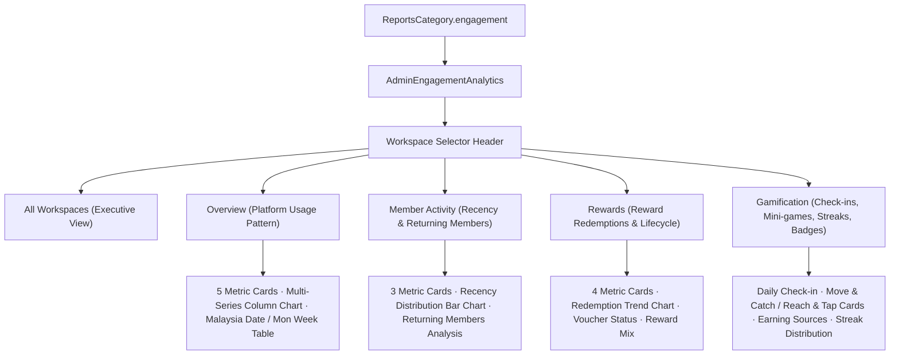

# GainPath Admin Portal — Member Engagement Intelligence Dashboard Redesign Report

**Date:** 21 November 2026\
**Status:** Complete & Verified\
**Target:** GainPath Admin Portal (`apps/admin_web`)\
**Scope:** `ReportsCategory.engagement` (`AdminEngagementAnalytics`)

---

## 1. Executive Summary

The GainPath Admin Engagement Analytics module has been redesigned and elevated from a monolithic, vertically stacked reporting page into a professional **Member Engagement Intelligence Dashboard**. The redesign addresses excessive vertical scrolling, weak visual hierarchy, harsh black dividers, and repetitive layouts by introducing a clean **4-Workspace Architecture** with an executive **All Workspaces** view, modern metric tiles, segmented trend controls, and subtle data tables.

All data contracts, distinct unique member deduplication rules, Monday-based calendar weeks, server-authoritative observation cutoffs, and strict non-predictive recency semantics are 100% preserved.

---

## 2. Workspace Architecture & Feature Parity

| Workspace | Component / Section | Metrics & Visual Elements | Disclosures & Semantics | Export Target | Parity Status |
| :--- | :--- | :--- | :--- | :--- | :--- |
| **All Workspaces** | Executive View | Unified layout with all 4 workspaces arranged with clean 24px vertical separation | Full operational scope across all 4 reporting domains | `gainpath-engagement.csv` | 100% Preserved |
| **Overview** | Platform Usage Pattern | 5 KPI Cards (`Current Member cohort`, `Check-in claims`, `Bookings created`, `Recorded game starts`, `Backed-up camera captures`), Daily/Weekly choice chips, Multi-series Column Chart, Malaysia date/Monday week table | Observation cutoff in Malaysia time; only server-backed events (not gym attendance or login telemetry) | `observable-activity.csv` | 100% Preserved |
| **Member Activity** | Recorded Engagement & Returning Members | 3 KPI Cards (`Current Member cohort`, `Observed within 7 days`, `No observed activity / unknown`), Recency Distribution Bar Chart (0–6d, 7–29d, 30+d, Unobserved), Returning Members Comparison Card | Return rate = `returning / previous * 100`; explainable recency without AI churn scores or dropout prediction | `recorded-engagement.csv` | 100% Preserved |
| **Rewards** | Reward Redemptions | 4 KPI Cards (`Vouchers issued`, `Vouchers collected`, `Vouchers expired`, `Points spent`), Trend Chart, Status Distribution (Outstanding, Collected, Expired, Expiry unavailable), Reward Mix Table | Event timing disclosure (issued/spent use issue time, collected uses fulfilment time, expired uses uncollected voucher expiry date) | `gainpath-reward-redemptions.csv` | 100% Preserved |
| **Gamification** | Gamification Engagement | Daily Check-in (3 KPIs, Daily/Weekly chart, table), Mini-game participation cards (`Move & Catch`, `Reach & Tap` with genuine 0 handling), Confirmed Earning Sources table, Real Check-in Badges, Current & Longest Streak distributions | Streak metrics cover current active Members, ignore selected date range; claim yesterday keeps streak alive | `gainpath-gamification-engagement.csv` | 100% Preserved |

---

## 3. Visual Verification Artifacts

The test suite generated deterministic 1440×1100 captures for each dedicated workspace under both `build/analytics-20261121/` and the artifact directory:

- [engagement_analytics_overview_1440.png](file:///C:/Users/Ngzhe/.gemini/antigravity/brain/2e9bce9b-03ec-4533-aa97-83c6a91f9314/engagement_analytics_overview_1440.png)
- [engagement_analytics_member_activity_1440.png](file:///C:/Users/Ngzhe/.gemini/antigravity/brain/2e9bce9b-03ec-4533-aa97-83c6a91f9314/engagement_analytics_member_activity_1440.png)
- [engagement_analytics_rewards_1440.png](file:///C:/Users/Ngzhe/.gemini/antigravity/brain/2e9bce9b-03ec-4533-aa97-83c6a91f9314/engagement_analytics_rewards_1440.png)
- [engagement_analytics_gamification_1440.png](file:///C:/Users/Ngzhe/.gemini/antigravity/brain/2e9bce9b-03ec-4533-aa97-83c6a91f9314/engagement_analytics_gamification_1440.png)

1. **Overview Workspace (`engagement_analytics_overview_1440.png`):**
   - High-density header with updated subtitle: `"Recorded member engagement, rewards and activity insights."`
   - Workspace selector pill bar (`All Workspaces`, `Overview`, `Member Activity`, `Rewards`, `Gamification`).
   - 5 KPI tiles displaying cohort and source counts with `AppColors.primary` highlights.
   - Observation cutoff callout and multi-series column chart using `adminReportPalette`.

2. **Member Activity Workspace (`engagement_analytics_member_activity_1440.png`):**
   - 3 KPI tiles displaying active cohort, recent 7-day observed members, and unobserved members.
   - Recency distribution horizontal bar chart with categorized tiers.
   - Returning Members analysis panel with authoritative return rate calculation and preceding period comparison.

3. **Rewards Workspace (`engagement_analytics_rewards_1440.png`):**
   - 4 KPI tiles for issued, collected, expired vouchers and spent points.
   - Event timing lifecycle disclosures.
   - Multi-series redemption trend chart with expandable event table.
   - Status breakdown and most redeemed rewards table with subtle hairline borders.

4. **Gamification Workspace (`engagement_analytics_gamification_1440.png`):**
   - Daily Check-in KPIs and trend chart.
   - Side-by-side mini-game cards for `Move & Catch` and `Reach & Tap` (displaying genuine 0 counts without hiding).
   - Confirmed earning sources and real badge unlock tables.
   - Current streak and longest streak distribution panels with `ProgressRow` bars.

---

## 4. Key Files Changed & Created

1. **New Component:** [`admin_engagement_analytics.dart`](file:///C:/Users/Ngzhe/StudioProjects/gainpath/apps/admin_web/lib/features/analytics/presentation/admin/admin_engagement_analytics.dart)
   - Created `AdminEngagementAnalytics` with `EngagementTab` enumeration.
   - Implemented high-density workspace tab selector with active indicators.
   - Supports both operational and non-operational (demo/mock) fallbacks.
2. **Page Screen Update:** [`reports_screen.dart`](file:///C:/Users/Ngzhe/StudioProjects/gainpath/apps/admin_web/lib/features/analytics/presentation/admin/reports_screen.dart#L423-L448)
   - Integrated `AdminEngagementAnalytics` under `ReportsCategory.engagement`.
   - Updated subtitle to `'Recorded member engagement, rewards and activity insights.'`.
   - Removed unused import of `operations_sections.dart`.
3. **Table & Styling Refinements:**
   - [`admin_remaining_analytics.dart`](file:///C:/Users/Ngzhe/StudioProjects/gainpath/apps/admin_web/lib/features/analytics/presentation/admin/admin_remaining_analytics.dart#L204-L215): Replaced default dividers with `AppColors.hairline` and `Color(0xFFF8FAFC)` heading rows.
   - [`admin_engagement_widgets.dart`](file:///C:/Users/Ngzhe/StudioProjects/gainpath/apps/admin_web/lib/features/analytics/presentation/admin/admin_engagement_widgets.dart#L14-L25): Enhanced `_table` with subtle borders and clean header styling.
   - [`admin_check_in_analytics.dart`](file:///C:/Users/Ngzhe/StudioProjects/gainpath/apps/admin_web/lib/features/analytics/presentation/admin/admin_check_in_analytics.dart#L232-L242): Replaced default DataTable dividers with subtle hairline styling.
4. **Automated Verification Suite:** [`engagement_analytics_redesign_render_test.dart`](file:///C:/Users/Ngzhe/StudioProjects/gainpath/apps/admin_web/test/engagement_analytics_redesign_render_test.dart)
   - Comprehensive multi-workspace render test with font stubs and 1440px viewport captures.

---

## 5. Verification & Compliance Matrix

- **Unit & Integration Tests:**
  - `admin_check_in_reporting_test.dart` (4/4 passed)
  - `admin_check_in_reporting_ui_test.dart` (4/4 passed)
  - `admin_engagement_extension_test.dart` (9/9 passed)
  - `admin_remaining_analytics_test.dart` (8/8 passed)
  - `engagement_analytics_redesign_render_test.dart` (1/1 passed, 4 screenshots saved)
  - **Total:** 26/26 tests passed.
- **Static Analysis:**
  - `flutter analyze`: 0 issues, 0 warnings, 0 errors.
- **Production Build:**
  - `flutter build web --no-tree-shake-icons`: Clean compilation.
