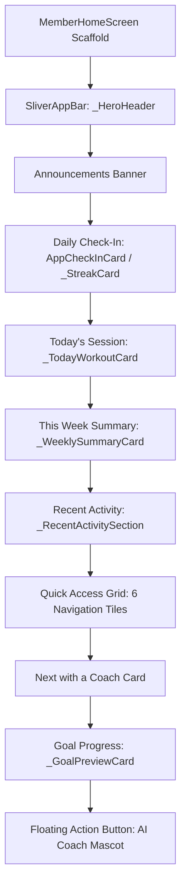
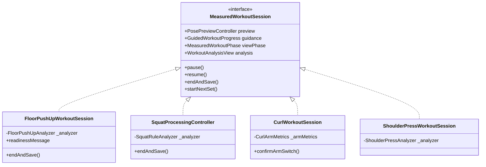
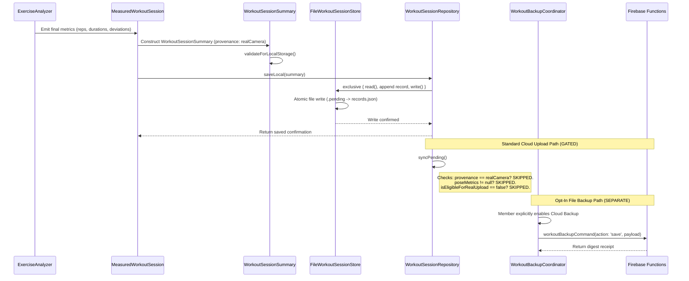
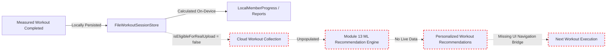
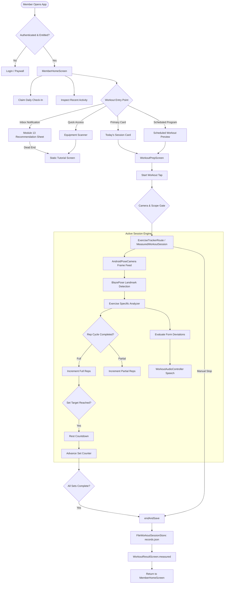
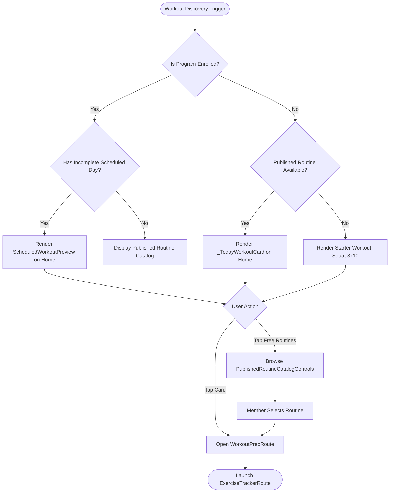
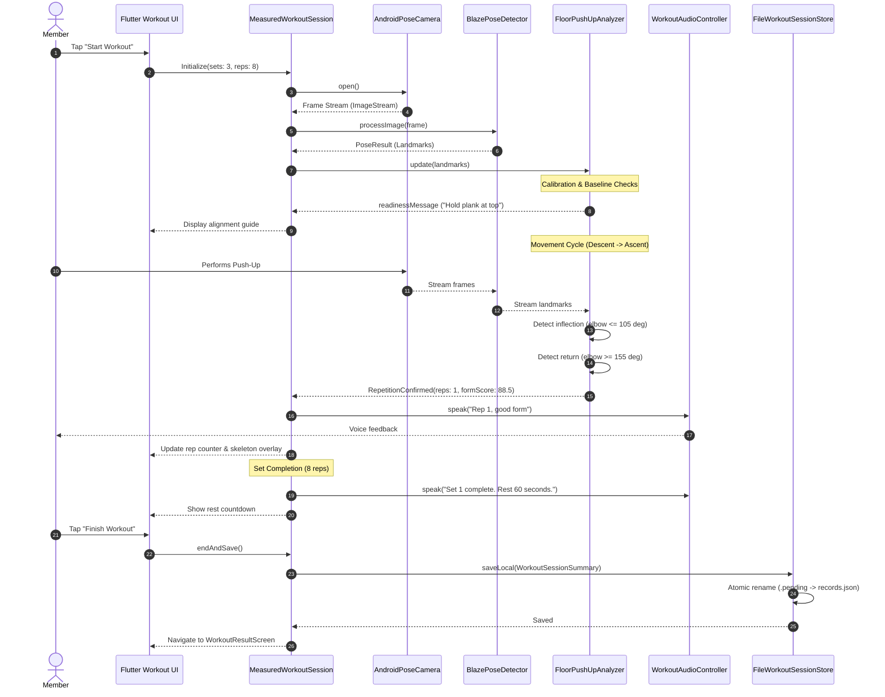
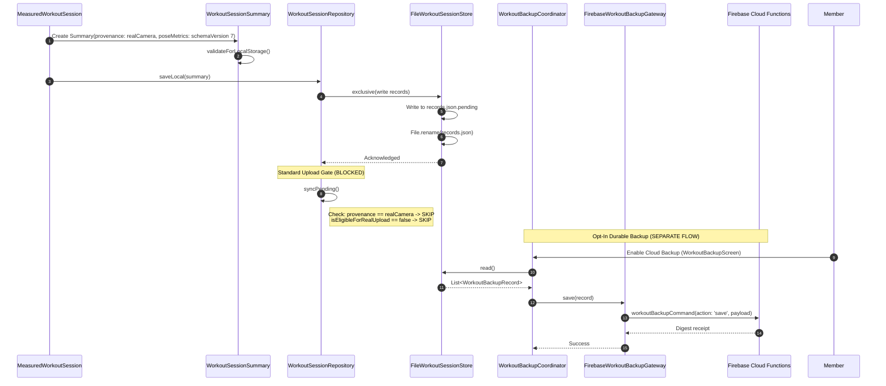
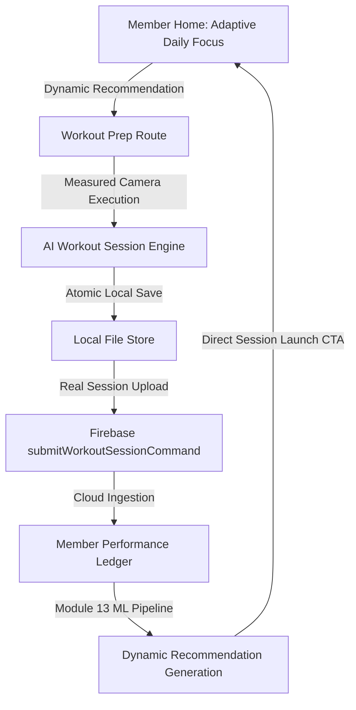

# GainPath — End-to-End Member Workout Journey, Lifecycle & Personalization Strategy Audit

**Audit Date:** 6 November 2026  
**Auditor:** Antigravity AI  
**Scope:** Read-only inspection of the active GainPath codebase (`apps/mobile`, `packages/gainpath_domain`, `packages/gainpath_data`, `packages/gainpath_pose`, `apps/admin_web`, and Firebase cloud functions/rules).  
**Evidence Standard:** Every major assertion is traced to concrete source files, class definitions, method logic, or data models.  
**Classification Standards:**
- **VERIFIED:** Code implementation exists, is wired into the runtime UI/service tree, and has consistent execution semantics.
- **CODE-IMPLEMENTED-BUT-UNTESTED:** Code is fully written and syntactically valid, but lacks live device verification or real server deployment validation.
- **PARTIAL:** Components are implemented or wired only in specific sub-flows, lacking complete end-to-end integration or fallbacks.
- **DISABLED:** Feature or data path is deliberately gated, flagged off, or hardcoded to return non-functional/stubbed values in production builds.
- **MISSING:** Architectural capability, UI route, or data pipeline does not exist in the codebase.
- **UNKNOWN:** Live database state, production Firestore document contents, or external cloud deployment configuration cannot be confirmed purely via read-only repository inspection.

---

## Executive Summary & Core Verdict

### The Core Question
> **Does GainPath currently deliver a coherent end-to-end, personalized Member Workout Journey, or is it mainly a collection of independently working workout features?**

### The Definitive Finding
GainPath is **not currently a closed-loop personalized workout system**. It is predominantly **a high-performance preset workout application with on-device AI tracking (Classification A) paired with an independent, local-first analytics and reporting engine (Classification D hybrid)**.

The codebase features sophisticated, production-grade engineering in isolated subsystems:
1. **Module 2 On-Device Computer Vision & Pose Analysis:** BlazePose integration, strict geometric form evaluation, multi-phase repetition counting, real-time audio cue arbiters, and robust local session state machines across 9 exercises (e.g. Squat, Single-Arm Curl, Standard Floor Push-Up).
2. **Published Routine Engine & Checkpoint Orchestration:** A resilient routine journey engine (`RoutineJourneyController`) that coordinates multi-exercise workouts, preserves plan signatures, and manages per-exercise status and manual set logging.
3. **Module 12 Local Analytics & Reporting:** Comprehensive, honest reporting (`MemberWorkoutReport`) aggregating sessions into strictly segregated form score series based on exact camera angle, model version, and scoring rules.
4. **Module 13 Recommendation Infrastructure:** Robust client-side recommendation parsing, inbox states (delivered, read, acknowledged, dismissed), and transaction RPCs.

### The Broken Closed-Loop
Despite these advanced modules, the **end-to-end personalization loop is severed at two foundational junctions**:
1. **The Cloud Data Ingestion Gate is Closed:** In `WorkoutSessionSummary`, `isEligibleForRealUpload` is hardcoded to `false`. Furthermore, `WorkoutSessionRepository.syncPending()` explicitly skips all sessions originating from `realCamera` or containing `poseMetrics`. Consequently, real measured member workout data **never leaves the mobile device** via the standard workout sync pipeline.
2. **The Recommendation-to-Workout Execution Bridge Does Not Exist:** In `MemberRecommendationSheet`, tapping "View Tutorial" on an AI content recommendation opens only a static tutorial video viewer (`ExerciseTutorialScreen`). There is no mechanism or route callback to configure, launch, or seed a live measured workout session from an AI recommendation.
3. **Automatic Recommendations are Disconnected or Disabled:** For exercises like Standard Floor Push-Up, automatic recommendations are explicitly flagged as disabled (`workout_result_screen.dart:384`), and production mobile builds wire `UnavailableMemberRecommendationRepository` by default.

---

## Part 1 — Member Entry Point and Home Experience

### 1.1 Post-Authentication & Membership Verification
- **Authentication Handshake:** Handled via `FirebaseAuthGateway` feeding `AuthBloc`.
- **Membership Entitlement Gate:** Routes and workout execution features are wrapped with `MembershipAccessGate` (`apps/mobile/lib/navigation/membership_access_gate.dart`), enforcing feature access (`MembershipAccessFeature.exercise`) based on subscription entitlements.
- **Default Landing Page:** Once authenticated and authorized, `MemberHomeScreen` (`apps/mobile/lib/app/home/member_home_screen.dart`) is instantiated as the primary application scaffold.

### 1.2 Home Screen Architecture and Layout Hierarchy
`MemberHomeScreen` renders a `CustomScrollView` with a fixed sliver list (lines 265–425) in the following order:



### 1.3 Personalization Breakdown: Static vs. Dynamic
| Home Section | Implemented Behavior | Personalization Status | Underlying Source / Class |
|---|---|---|---|
| **Hero Greeting** | Time-of-day greeting ("Good morning") + first name | Minimal (Rule-based string) | `_greeting` getter in `MemberHomeScreen` |
| **Points / Streak** | Displays gamification points balance and check-in streak | Dynamic (User gamification state) | `GamificationBloc`, `RewardPolicy` |
| **Today's Session** | Displays `widget.publishedRoutine` if available; otherwise static starter fallback | **Generic / Static** (No ML/AI recommendation) | `_TodayWorkoutCard`, `PublishedRoutine` |
| **This Week** | Aggregates rep counts and tracked minutes for current week | Dynamic (Local device history) | `MemberLocalProgress`, `_WeeklySummaryCard` |
| **Recent Activity** | Lists recent local workout sessions | Dynamic (Local device history) | `WorkoutRepository.loadHistory()` |
| **Quick Access** | Static shortcuts to Equipment, Coaches, Bookings, Progress, Rewards | Static (Hardcoded navigation grid) | `_QuickActionsGrid` |
| **Goal Progress** | Shows comparison of target vs actual if `liveProfile.goals` is populated | Dynamic (User-entered profile goals) | `_GoalPreviewCard`, `FitnessProfile` |
| **AI Coach FAB** | Persistent floating button launching chatbot | Static entry point | `ChatbotScreen` / `buildMemberChatbot()` |

### 1.4 New Member vs. Returning Member Experience
- **New Member (Zero Workout History):**
  - "This Week" displays 0 reps, 0 minutes.
  - "Recent Activity" displays an empty state.
  - "Today's Session" displays the default published routine loaded from Firestore (or static Lower Body Strength starter if offline/unloaded).
  - No onboarding questionnaire, physical readiness assessment (PAR-Q), or equipment profile prompt is triggered automatically on Home.
- **Returning Member (Existing Workout History):**
  - "This Week" card updates with aggregated local statistics.
  - "Recent Activity" shows completed local sessions.
  - "Today's Session" does **not** dynamically adapt to past fatigue, muscle group frequency, or user performance trends. It continues to display the single published routine fetched by `PublishedRoutineCatalogCubit`.

---

## Part 2 — Workout Discovery and Selection Strategies

### 2A. Personalized / AI Recommendation Path (Module 13)
- **Architecture Status:** **PARTIAL / DISCONNECTED AT EXECUTION**.
- **Service Interfaces:**
  - `MemberRecommendationRepository` (`apps/mobile/lib/features/recommendation/application/member_recommendation_repository.dart`) defines contracts for `get()`, `resolve()`, and `act()`.
  - Normal production dependency injection injects `UnavailableMemberRecommendationRepository` (`enabled = false`, throwing `MemberRecommendationUnavailable`).
  - Synthetic/test compositions use `RpcMemberRecommendationRepository`, communicating with cloud functions (`schemaVersion: 1`, `mode: 'synthetic_local'`).
- **Data Flow & Presentation:**
  - Recommendations appear in the Member Notification Center / Inbox.
  - Tapping an item opens `MemberRecommendationSheet` (`member_recommendation_sheet.dart`).
- **The Execution Dead-End:**
  - Recommendations support two kinds: `RecommendationKind.trainer` ("View Coach") and `RecommendationKind.content` ("View Tutorial").
  - For `content`, the call-to-action is strictly `onOpenTarget` which maps to `ExerciseTutorialScreen`.
  - **There is no code path connecting `MemberRecommendationDetail` to `WorkoutPrepRoute`, `RoutineJourneyRoute`, or `ExerciseTrackerRoute`.**
  - Automatic recommendations are explicitly disabled for Floor Push-Up (`workout_result_screen.dart:384`).

### 2B. Preset / Published Routine Path
- **Architecture Status:** **VERIFIED (Fully Functional)**.
- **Data Provenance:**
  - Routines originate in Admin Portal (`apps/admin_web`) as `RoutineBlueprint` entities and are published to Firestore: `organizations/{orgId}/content/{routineId}` (`schemaVersion: 1`, `kind: 'routine'`, `status: 'published'`).
- **Member Retrieval:**
  - Read via `FirebasePublishedRoutineRepository.loadPage()` (`firebase_published_routine_repository.dart:52-71`).
  - Transferred to `PublishedRoutineCatalogCubit` and rendered in `WorkoutPrepRoute`.
- **Structure & Target Specification:**
  - Represented by `PublishedRoutine` and `PublishedRoutineExercise` (`published_routine_view.dart:6-46`).
  - Encapsulates sets, reps, rest seconds (`restSeconds`, defaulting to 60s), exercise order, day numbers (`dayNumber`), target cues, and video URLs.
- **Multi-Exercise Journey Management:**
  - Handled by `RoutineJourneyController` (`routine_journey_controller.dart`).
  - Uses an immutable plan signature (`_signature`, line 51) hashing routine ID, blueprint ID, exercise IDs, days, sets, reps, and rest intervals.
  - Tracks exercise status: `notStarted`, `partial`, `completed`, `selfReportedCompleted`, `selfReportedPartial`, `skipped`, and `instructionsReviewed`.
- **Standard Floor Push-Up Case:**
  - Defined in `floor_push_up_catalog.dart` as `standardFloorPushUp`: 3 sets × 8 reps, 60s rest, side-view tracking.
  - Correctly resolved through `ExerciseTrackerDispatcher` to `ExerciseTracker.sideViewFloorPushUp`.

### 2C. Self-Selected Exercise / Workout Tools Path
- **Architecture Status:** **PARTIAL / CONSTRAINED**.
- **Independent Exercise Selection:**
  - There is no dedicated "Free Exercise Picker" screen allowing arbitrary selection from the 9 AI-tracked exercises outside of a published routine context.
  - When `WorkoutPrepRoute` operates without a loaded `PublishedRoutine` (or in demo mode), it falls back to `WorkoutPlan.starter` (Bodyweight Squat, 3 sets × 10 reps).
  - An alternative discovery path is `EquipmentScannerScreen`, where members scan QR codes/gym equipment; however, scanning navigates to equipment tutorials rather than initiating an unconstrained tracked session.
- **Measurement Parity:**
  - If initiated via `ExerciseTrackerRoute`, a self-selected or starter session executes on the exact same `MeasuredWorkoutSession` engine as routine sessions.
  - The resulting `WorkoutSessionSummary` records `publishedRoutineId: null`.

### 2D. Other Entry Paths
- **Program Scheduled Workouts:** `WorkoutHubProgram` (`workout_hub_program.dart`) coordinates structured multi-week training programs (`ProgramEnrollmentStore`). If enrolled, the scheduled day's routine is surfaced on `WorkoutPrepRoute` as a `ScheduledWorkoutPreview`.
- **Routine History Resumption:** In `RoutineHistoryScreen`, past unfinished routine attempts can be reopened via `openAttempt(id)` on `RoutineJourneyController`.

---

## Part 3 — Complete Workout Session Lifecycle

### 3.1 Architectural Foundation: Shared vs. Exercise-Specific
Workout execution is governed by a unified contract implemented through specialized controllers:



- **Shared Components:**
  - `PosePreviewController`: Manages camera frame feeds, BlazePose model inference lifecycle, and landmark smoothing.
  - `GuidedWorkoutProgress`: Tracks completed sets, reps within current set, and rest interval countdowns.
  - `WorkoutAudioController`: Arbiter-regulated audio cue delivery with bounded start latencies.
  - `SkeletonPainter`: Shared canvas painter for rendering real-time landmark overlays.
- **Exercise-Specific Components:**
  - Geometric angle calculation (e.g. elbow flexion vs knee flexion vs shoulder abduction).
  - Repetition state machines (TOP, DESCENT, BOTTOM, ASCENT).
  - Form deviation evaluators and weighted scoring algorithms.

### 3.2 Detailed Step-by-Step Lifecycle Trace

1. **Pre-Workout Preparation (`WorkoutPrepScreen`):**
   - Displays exercise overview, targets (sets/reps/rest), and setup guidance.
   - User confirms camera positioning (Side View vs. Front View).
2. **Consent & Entitlement Verification:**
   - Validated against `MembershipAccessGate`.
   - Requires verified session scope (`SessionScope`).
   - Camera consent tied to `workoutConsentVersion = 'pose-local-summary-v1'`.
3. **Pose Detection Initialization:**
   - Camera starts via `AndroidPoseCamera`.
   - `BlazePoseDetector` loads TFLite models (`blazepose_detector.dart`).
   - Landmark streaming commences at 30 FPS.
4. **Calibration & Readiness Detection:**
   - Session remains in `needsCalibration = true` until subject is fully in frame with requisite keypoints detected above confidence thresholds.
   - Text cues (e.g. "Step back into frame", "Hold plank at top") guide the user.
5. **Exercise Execution & AI Repetition Counting:**
   - Analyzer processes incoming `PoseResult` frames.
   - Strict geometric gates prevent false counts:
     - Floor Push-Up requires full extension (TOP ≥ 155°) to establish baseline, descent to BOTTOM (≤ 105°), and return.
     - Partial reps are counted if inflection occurs without full completion.
6. **Form Evaluation & Scoring:**
   - Evaluated dynamically per repetition.
   - Standard Floor Push-Up calculates a weighted 4-component score:
     - Range of Motion (40%)
     - Body Alignment / Plank Integrity (35%)
     - Movement Control / Cadence (15%)
     - Arm Extension Quality (10%)
   - Lateral Raise, Shoulder Press, Row, and Reverse Lunge are tracked for cadence and repetition count but are strictly **unscored** (`formScorePercent = null`).
7. **Audio & Visual Feedback:**
   - Audio feedback mediated by `AudioCueArbiter` with a 6-second cooldown to avoid auditory fatigue.
   - Real-time skeleton turns green on valid alignment and orange/red on detected deviations (e.g. hip sagging, piking, trunk lean).
8. **Set Completion & Rest Intervals:**
   - When rep target is reached, `GuidedWorkoutProgress` transitions phase to rest.
   - Audio prompt announces set completion; rest countdown begins (e.g. 60 seconds).
   - User can tap "Skip Rest" or wait for timer expiration.
9. **Pause, Resume & Recalibration:**
   - Manual pause halts pose inference while retaining camera feed.
   - `beginRecalibration()` allows repositioning without resetting set counters.
10. **Session Completion & Persistence Trigger:**
    - Triggered automatically upon completing all planned sets, or manually via "Finish Workout".
    - `endAndSave()` invokes analyzer summary generation, validates metrics consistency, and writes to durable local storage.
11. **Early Exit & Interruption Handling:**
    - Exiting without tapping finish prompts confirmation; discarding drops live frame buffers without writing records.
    - App lifecycle backgrounding pauses the session; termination during tracking results in unpersisted session loss (no write-ahead journal for mid-set frames).

---

## Part 4 — Workout Results and Data Persistence

### 4.1 Live Measurement to Persisted Summary Flow



### 4.2 The Domain Object Hierarchy & Schema Compatibility
The persisted domain object is `WorkoutSessionSummary` (`workout_contracts.dart:59-245`), backed by `WorkoutPoseMetrics` (`workout_pose_metrics.dart`):

- **Core Summary Fields:**
  - `sessionId`: String UUID (idempotency key).
  - `userId`, `organizationId`: Account scope identifiers.
  - `exerciseId`: Registered tracker identifier.
  - `repetitions`: Total full reps completed.
  - `accuracy`: Rounded integer representation of `formScorePercent` (or 0 if unscored).
  - `startedAt`, `endedAt`: ISO-8601 UTC timestamps.
  - `provenance`: `WorkoutProvenance.realCamera` | `recordedFixture` | `simulated`.
  - `summarySchemaVersion`: `2` (legacy without metrics) or `3` (measured with pose metrics).
- **WorkoutPoseMetrics Versioning:**
  - `schemaVersion: 1`: Basic Squat, Calf Raise, Wall Push-Up.
  - `schemaVersion: 2`: Single-Arm Curl (includes `CurlArmMetrics`).
  - `schemaVersion: 3`: Single-Arm Row (`rowSide`: left/right).
  - `schemaVersion: 4`: Dumbbell Shoulder Press (bilateral front).
  - `schemaVersion: 5`: Reverse Lunge (`lungeSide`: left/right).
  - `schemaVersion: 6`: Standing Lateral Raise (bilateral front).
  - `schemaVersion: 7`: **Standard Floor Push-Up** (includes `FloorPushUpMetrics`, 4-component scores, and specific deviation counters: `insufficientDescent`, `hipSagging`, `hipPiking`, `incompleteExtension`).

### 4.3 Storage Technology & Multi-Tenant Scoping
- **Local Technology:** `FileWorkoutSessionStore` (`file_workout_session_store.dart`).
  - Path format: `<appSupportDir>/workouts-v2/<orgId_hex>/<userId_hex>/records.json`.
  - Atomic File Safety: Writes to a `.pending` file and uses `pending.rename()` to prevent partial corruption during power loss.
  - Process Concurrency: Protected by `FileLock.blockingExclusive` on `records.lock`.
- **Deduplication:**
  - Enforced in `saveLocal()`: if `sessionId` exists, the write is a no-op if identical, or throws `StateError` if payload diverges.
- **Account Isolation:**
  - Path segmenting by hex ensures complete physical separation between distinct user IDs or organization tenants on the same device.

### 4.4 Cloud Upload vs. Cloud Backup: The Critical Distinction
The codebase implements two completely distinct cloud-bound workout systems:

1. **Standard Workout Upload (`WorkoutSessionRepository.syncPending` / `submitWorkoutSessionCommand`):**
   - **STATUS: DISABLED FOR REAL WORKOUTS.**
   - Gated in `WorkoutSessionSummary` (line 155):
     ```dart
     bool get isEligibleForRealUpload => false;
     ```
   - Gated in `WorkoutSessionRepository` (lines 145–149):
     ```dart
     if (record.summary.provenance == WorkoutProvenance.realCamera ||
         record.summary.provenance == WorkoutProvenance.recordedFixture ||
         record.summary.poseMetrics != null) {
       continue; // Measured real/fixture results stay local
     }
     ```
   - Real camera sessions **never upload via this pipeline**; their sync status remains permanently `pending`.

2. **Durable Cloud Backup (`WorkoutBackupCoordinator` / `workoutBackupCommand`):**
   - **STATUS: VERIFIED (OPT-IN ONLY).**
   - A separate backup pipeline intended for device transfer / recovery.
   - Disabled by default; member must explicitly enable it via `WorkoutBackupScreen`.
   - Sends exact JSON record blobs to cloud functions (`workoutBackupCommand`), returning cryptographic digest receipts (`save` action).
   - Does not map records into public queryable workout collections; stores them as backup archive blobs.

---

## Part 5 — History, Progress, Analytics and Feedback Loop

### 5.1 Member Screens Displaying Workout Results
- **Post-Workout Result Screen:** `WorkoutResultScreen.measured()` (`workout_result_screen.dart`). Displays full/partial reps, tracked time, estimated form percentage, component breakdowns, and detected form issues.
- **Home Recent Activity:** `_RecentActivitySection` on `MemberHomeScreen` renders up to 3 recent workout records.
- **Full History & Timeline:** `ActivityTimelineScreen` (`activity_timeline_screen.dart`) lists all historical events.
- **Analytical Performance:** `WorkoutPerformanceScreen` (`workout_performance_screen.dart`) renders rep volume charts.
- **Formal Progress Reports:** `WorkoutReportScreen` (`workout_report_screen.dart`) generates filtered analytical documents and CSV exports via `MemberWorkoutReport`.

### 5.2 Form Score Handling & Cross-Session Trends
- **Safe Metric Grouping:**
  `MemberWorkoutReport.build()` groups form scores strictly by compatible series:
  $$\text{Series Key} = (\text{exerciseId}, \text{scoringVersion}, \text{detectorId}, \text{detectorVersion}, \text{cameraView})$$
- **Unscored Exercises:**
  Shoulder Press, Lateral Raise, Row, and Lunge records contain `formScorePercent: null`. They contribute to volume (reps and duration) but are cleanly excluded from form score averages and charts.
- **Missing Score Gaps:**
  Trend lines render gaps rather than interpolating or inventing 0% values when an unassessed attempt occurs.

### 5.3 The Broken Feedback Loop
The audit identified a complete break in the feedback loop from workout completion to future recommendations:



1. **Upload Severed:** Real workout results stay on-device; the cloud database lacks historical measured records.
2. **Recommendation Generation Starved:** Without cloud workout history, backend recommendation workers cannot evaluate fatigue, weakness, or progression.
3. **Execution Severed:** Even if recommendations are pushed to the member inbox, they can only open tutorial videos, not start a workout session.

---

## Part 6 — Admin Portal and Backend Relationship

### 6.1 Catalog Management & Hardcoded App Dispatcher
- **Admin Authoring:** Admins define exercises and routines in `apps/admin_web`.
- **The Tracking Registry Dependency:**
  The mobile app does not dynamically discover tracking capabilities from Admin database fields. Instead, `ExerciseTrackingRegistry` (`packages/gainpath_domain/lib/src/workout/exercise_tracking.dart:54-78`) maintains a strict compile-time mapping:
  - `gainpath/standing-lateral-raise-front-v1` $\rightarrow$ `frontViewLateralRaise`
  - `gainpath/bodyweight-reverse-lunge-side-v1` $\rightarrow$ `sideViewReverseLunge`
  - `gainpath/dumbbell-shoulder-press-front-v1` $\rightarrow$ `frontViewShoulderPress`
  - `gainpath/F3b8xIr8ynBDd3gEICKX` $\rightarrow$ `sideViewSquat`
  - `gainpath/standing-single-arm-curl-side-v1` $\rightarrow$ `sideViewCurl`
  - `gainpath/standing-calf-raise-side-v1` $\rightarrow$ `sideViewCalfRaise`
  - `gainpath/wall-push-up-side-v1` $\rightarrow$ `sideViewWallPushUp`
  - `gainpath/standard-floor-push-up-side-v1` $\rightarrow$ `sideViewFloorPushUp`
  - `gainpath/single-arm-dumbbell-row-side-v1` $\rightarrow$ `sideViewRow`
- If an Admin creates a new exercise ID in Firestore that is not in this registry, the mobile app treats it as `guidedOnly` (instructional video + manual set logging only).

### 6.2 Routine Publication & Member Availability
- When an Admin marks a routine as `status: 'published'`, it becomes immediately readable to members via `FirebasePublishedRoutineRepository.loadPage()`.
- Routines define targets (sets, reps, rest seconds) which directly initialize `GuidedWorkoutProgress` on mobile.

### 6.3 Module 12 Admin Reporting vs. Mobile Analytics
- Module 12 Admin reporting (`apps/admin_web`) reads aggregated business metrics, attendance, and member progress.
- Because mobile client sessions do not upload via `submitWorkoutSessionCommand`, Admin reporting relies on data synchronized through backup aggregates, coach notes, or simulated dataset cohorts.

---

## Part 7 — Module Interaction and Personalization Architecture

### 7.1 Cross-Module Interplay Matrix

| Module | Consumes From | Provides To | Operational State |
|---|---|---|---|
| **Member Profile** | User Input / Firestore | Home Greetings, Goal Progress Cards | **VERIFIED** |
| **Published Routines** | Admin Portal / Firestore | WorkoutPrepScreen, RoutineJourneyController | **VERIFIED** |
| **Module 2 (AI Tracking)** | Camera Frames, BlazePose TFLite | Live Reps/Scores, Local Session Store | **VERIFIED** |
| **Workout Persistence** | Module 2 Analyzers | Local FileStore, Local Analytics | **VERIFIED** (Local) / **DISABLED** (Upload) |
| **Module 12 (Analytics)** | Local FileStore | On-Device Reports, CSV Exports | **VERIFIED** |
| **Module 13 (Rec Engine)** | Fictional Cohort / Cloud DB | Notification Inbox Sheets | **PARTIAL** (Isolated) |
| **Program Enrollment** | Admin Program Blueprints | Scheduled Routine Previews | **VERIFIED** |

### 7.2 System Classification Verdict
GainPath currently functions as **Classification A (Preset Workout Application with AI Tracking) combined with Classification D (Hybrid Architecture with Disconnected Modules)**:
- It excels at presenting Admin-curated, structured routines and executing real-time computer vision tracking on-device.
- It fails to operate as **Classification C (Personalized AI Workout Recommendation System)** because the recommendation engine is isolated from workout execution and real workout history.

---

## Part 8 — Concrete Member Journey Scenarios

### Scenario 1: New Member (First-Time User)
1. **Entry:** Member opens app post-registration; lands on `MemberHomeScreen`.
2. **Experience:**
   - Streak is 0. Weekly summary is empty.
   - "Today's Session" displays the default published routine (e.g. Standard Floor Push-Up or Lower Body Squat).
   - No onboarding questionnaire or physical fitness assessment appears.
3. **Execution:**
   - Member taps "Start Workout" $\rightarrow$ opens `WorkoutPrepScreen`.
   - Taps "Start" $\rightarrow$ camera opens with pose overlay and calibration prompt.
   - Completes reps $\rightarrow$ receives real-time voice and visual feedback.
4. **Persistence & Post-Workout:**
   - Taps "Finish" $\rightarrow$ saved locally to `records.json`.
   - `WorkoutResultScreen` displays form score and reps.
   - Taps "Back to home" $\rightarrow$ returns to Home. Recent Activity now shows 1 session.
   - **Gaps:** No follow-up guidance, no prompt to schedule the next workout, and no profile calibration triggered.

### Scenario 2: Returning Member (Trained 2 Days Ago)
1. **Entry:** Member opens app; lands on `MemberHomeScreen`.
2. **Experience:**
   - Weekly summary shows 1 session completed, total reps, and tracked time.
   - "Recent Activity" lists the previous workout.
   - "Today's Session" shows the **exact same preset routine** as day 1 (does not adapt based on muscle recovery or recent volume).
3. **Execution:**
   - Member can start the preset routine, or navigate to `RoutineHistoryScreen` to inspect past form charts.
4. **Gaps:** The system does not suggest a complementary routine (e.g. upper body after lower body), nor does it congratulate the member on form progression on the Home screen.

### Scenario 3: Published Standard Floor Push-Up Routine
1. **Entry:** Member navigates to `WorkoutPrepRoute` with `publishedRoutine` set to Standard Floor Push-Up (3 sets × 8 reps, 60s rest).
2. **Execution:**
   - `FloorPushUpWorkoutSession` initializes with Side View requirement.
   - Cues member to assume plank position; waits for steady TOP baseline (arm extension $\ge 155^\circ$, body plank alignment).
   - Member descends $\le 105^\circ$ $\rightarrow$ BOTTOM credit; returns $\rightarrow$ rep 1 counted.
   - Voice announces: *"Rep 1, good form"*.
   - After 8 reps, set 1 completes $\rightarrow$ 60-second rest countdown displays.
   - Completes sets 2 and 3 $\rightarrow$ auto-completion detected.
3. **Persistence:**
   - `WorkoutSessionSummary` constructed with `schemaVersion: 7`, containing `FloorPushUpMetrics`.
   - Saved locally to `records.json`.
4. **Result Screen:**
   - `WorkoutResultScreen.measured()` displays 4-component score (e.g. Range of Motion: 85%, Body Alignment: 90%, Control: 80%, Extension: 95%).
   - Explicitly notes: *"Automatic recommendations are disabled"*.
   - Routine checkpoint marks exercise as `completed`.
5. **Gaps:** Cloud sync remains in `pending` status indefinitely.

### Scenario 4: Personalized Recommendation Journey
1. **Entry:** Member receives a Module 13 recommendation notification in Notification Center.
2. **Sheet Presentation:**
   - Member taps notification $\rightarrow$ `MemberRecommendationSheet` opens.
   - Shows recommendation title (e.g. *"Push-Up Form Correction: Prevent Hip Sagging"*), explanation reasons, and coach photo.
3. **The Dead-End:**
   - Member taps "View Tutorial".
   - App opens `ExerciseTutorialScreen` showing a video player and static text steps.
   - **There is no button to "Start Recommended Workout" or launch camera tracking.**
4. **Gaps:** The member must manually exit, navigate to the Workout tab, and locate a routine containing that exercise.

---

## Part 9 — Required Architecture & Lifecycle Diagrams

### Diagram 1: Member Workout Journey Flowchart


### Diagram 2: Workout Selection Decision Tree


### Diagram 3: Workout Session Sequence Diagram


### Diagram 4: Workout Data Persistence Sequence Diagram


### Diagram 5: Complete Module Integration Diagram
```mermaid
flowchart TD
    subgraph "Admin & Cloud Services"
        AdminWeb[Admin Web Portal] -->|Publishes Blueprints| FS_Content[(Firestore: content/)]
        AdminWeb -->|Schedules Programs| FS_Programs[(Firestore: programs/)]
        CloudFunctions[Firebase Cloud Functions]
    end

    subgraph "Mobile Client Discovery & Preparation"
        FS_Content -->|FirebasePublishedRoutineRepository| CatalogCubit[PublishedRoutineCatalogCubit]
        FS_Programs -->|FirebaseWorkoutProgramCatalog| ProgCubit[WorkoutProgramController]
        CatalogCubit --> PrepRoute[WorkoutPrepRoute]
        ProgCubit --> PrepRoute
    end

    subgraph "Mobile Client Execution Engine (Module 2)"
        PrepRoute -->|RealWorkoutLaunch| TrackerRoute[ExerciseTrackerRoute]
        TrackerRoute --> SessionHost[MeasuredWorkoutSession]
        SessionHost --> Camera[AndroidPoseCamera]
        Camera --> PoseDetector[BlazePoseDetector]
        PoseDetector --> ExerciseAnalyzer[Exercise-Specific Analyzers]
        ExerciseAnalyzer --> AudioFeedback[WorkoutAudioController]
    end

    subgraph "Local Persistence & Analytics (Module 12)"
        SessionHost -->|endAndSave| FileStore[FileWorkoutSessionStore: records.json]
        FileStore --> LocalProgress[LocalMemberProgressRepository]
        LocalProgress --> AnalyticsUI[WorkoutReportScreen & Performance Charts]
    end

    subgraph "Recommendation Engine (Module 13 - Isolated)"
        CloudFunctions -.->|Unconnected| RecRepo[RpcMemberRecommendationRepository]
        RecRepo --> RecSheet[MemberRecommendationSheet]
        RecSheet -->|View Tutorial Only| TutorialScreen[ExerciseTutorialScreen]
    end

    FileStore -.->|isEligibleForRealUpload = false| CloudFunctions
    RecSheet -.x|Missing Bridge| PrepRoute

    style FileStore fill:#fff3e0,stroke:#f57c00
    style RecSheet fill:#fce4ec,stroke:#c2185b
    style TutorialScreen fill:#f3e5f5,stroke:#7b1fa2
```

---

## Part 10 — Architecture and UX Gap Analysis

| Issue ID | Classification | Severity | Component Affected | Root Cause & Impact Analysis |
|---|---|---|---|---|
| **GAP-01** | Confirmed Defect | **P0** | `workout_contracts.dart:155` | `isEligibleForRealUpload` is hardcoded to `false`. Real measured camera workouts cannot sync to cloud collections, blinding backend analytics and recommendation models. |
| **GAP-02** | Incomplete Integration | **P0** | `member_recommendation_sheet.dart` | No workout execution bridge exists on recommendations. Tapping CTA opens static tutorial instead of launching the recommended exercise session. |
| **GAP-03** | Incomplete Integration | **P1** | `workout_session_repository.dart:145` | `syncPending()` explicitly skips all records where `provenance == realCamera` or `poseMetrics != null`. Local measured records remain permanently marked `pending`. |
| **GAP-04** | Feature Disabled | **P1** | `workout_result_screen.dart:384` | Automatic recommendations are explicitly disabled for Floor Push-Up and unsupported exercises. |
| **GAP-05** | Confirmed Defect | **P1** | `workout_result_screen.dart:147` | Non-measured / legacy result screen computes per-exercise form scores using arbitrary hash jitter (`hashCode % 11 - 5`), presenting fabricated accuracy numbers to users. |
| **GAP-06** | Missing Feature | **P1** | `member_home_screen.dart` | Zero dynamic personalization on Home. "Today's Session" displays a static routine regardless of user fatigue, previous workout dates, or fitness profile goals. |
| **GAP-07** | Missing Feature | **P1** | `workout_prep_screen.dart` | No new-member onboarding flow or initial fitness baseline assessment to configure starting routine difficulty. |
| **GAP-08** | UX Weakness | **P2** | `workout_prep_route.dart` | Confusing triple-entry architecture: Scheduled Program, Published Routine, and Free Practice coexist with overlapping, poorly differentiated controls. |
| **GAP-09** | UX Weakness | **P2** | `workout_result_screen.dart` | Post-workout dead-end: The only completion option is "Back to home". Lacks guidance on recovery or next recommended session. |
| **GAP-10** | Missing Feature | **P2** | `apps/mobile` | No dedicated "Free Exercise" catalog browser allowing members to select an individual AI-tracked exercise without opening a published routine. |
| **GAP-11** | Unverified Behavior | **P2** | `file_workout_session_store.dart` | Unsaved session loss on unexpected app termination. Lack of mid-set write-ahead logging loses data if process is killed. |

---

## Part 11 — Recommended Target Workout Strategy

### 11.1 Target Journey Architecture
The recommended target architecture for GainPath is a **True Closed-Loop Adaptive Fitness Engine**:



### 11.2 Implementation Action Plan

#### 1. Already Implemented — Retain Without Modification
- On-device BlazePose computer vision pipeline and 9 exercise analyzers.
- `RoutineJourneyController` multi-exercise orchestration and checkpoint state machine.
- `FileWorkoutSessionStore` atomic local persistence and concurrency locks.
- Module 12 local analytical reporting (`MemberWorkoutReport`).
- Firebase published routine catalog delivery pipeline.

#### 2. Implemented but Disconnected — Immediate Integration Needed
- **Bridge Recommendation to Execution (P0):**
  Add an `onLaunchWorkout` callback to `MemberRecommendationSheet`. When an AI recommendation suggests an exercise (e.g. Floor Push-Up), resolve its capability via `ExerciseTrackerDispatcher` and navigate directly to `WorkoutPrepRoute(exercise: target)`.
- **Enable Cloud Workout Sync (P0):**
  Implement the backend validation handler for `submitWorkoutSessionCommand` to accept measured summaries (schemaVersion 3/7) and flip `isEligibleForRealUpload` to `true` for consented sessions.
- **Link Cloud Backup to Member Onboarding (P1):**
  Prompt members to enable Cloud Backup during initial sign-up so local files are automatically synchronized across devices.

#### 3. Missing Features — New Development Required
- **Home Adaptive Daily Focus:**
  Replace the static `_TodayWorkoutCard` loader with an adaptive selector evaluating:
  1. Active program schedule.
  2. Last trained date (rest day detection).
  3. Form score weaknesses from the most recent session.
- **Post-Workout Next-Step Card:**
  Add a "Next Suggested Session" action in `WorkoutResultScreen` linking to the subsequent routine day.
- **Dedicated Exercise Practice Browser:**
  Add a standalone "Free Practice" tab displaying all 9 supported AI trackers with custom set/rep pickers.

---

## Complete Source File & Code Reference Index

| Architectural Domain | Concrete Implementation File | Line References | Key Classes / Functions |
|---|---|---|---|
| **Member Home UI** | [`apps/mobile/lib/app/home/member_home_screen.dart`](file:///c:/Users/Ngzhe/StudioProjects/gainpath/apps/mobile/lib/app/home/member_home_screen.dart) | L43–97, L226–428 | `MemberHomeScreen`, `_TodayWorkoutCard`, `_RecentActivitySection` |
| **Workout Prep Route** | [`apps/mobile/lib/app/routing/workout_prep_route.dart`](file:///c:/Users/Ngzhe/StudioProjects/gainpath/apps/mobile/lib/app/routing/workout_prep_route.dart) | L28–51, L127–173 | `WorkoutPrepRoute`, `_reload()`, `_startScheduled()` |
| **Workout Prep View** | [`apps/mobile/lib/features/workout/presentation/member/workout_prep_screen.dart`](file:///c:/Users/Ngzhe/StudioProjects/gainpath/apps/mobile/lib/features/workout/presentation/member/workout_prep_screen.dart) | L18–49, L134–149 | `WorkoutPrepScreen`, `_WorkoutOverview` |
| **Routine Journey** | [`apps/mobile/lib/features/workout/application/routine_journey_controller.dart`](file:///c:/Users/Ngzhe/StudioProjects/gainpath/apps/mobile/lib/features/workout/application/routine_journey_controller.dart) | L11–63, L174–209 | `RoutineJourneyController`, `_signature`, `_reload()` |
| **Routine Domain Models** | [`apps/mobile/lib/features/workout/domain/published_routine_view.dart`](file:///c:/Users/Ngzhe/StudioProjects/gainpath/apps/mobile/lib/features/workout/domain/published_routine_view.dart) | L6–27, L30–121 | `PublishedRoutineExercise`, `PublishedRoutine.fromDocument` |
| **Routine Firestore Repo**| [`apps/mobile/lib/infrastructure/firebase/firebase_published_routine_repository.dart`](file:///c:/Users/Ngzhe/StudioProjects/gainpath/apps/mobile/lib/infrastructure/firebase/firebase_published_routine_repository.dart) | L11–29, L52–71 | `FirebasePublishedRoutineRepository.loadPage()` |
| **Session Engine Contract**| [`apps/mobile/lib/features/workout/application/measured_workout_session.dart`](file:///c:/Users/Ngzhe/StudioProjects/gainpath/apps/mobile/lib/features/workout/application/measured_workout_session.dart) | L27–45, L47–72 | `WorkoutAnalysisView`, `MeasuredWorkoutSession` |
| **Floor Push-Up Session** | [`apps/mobile/lib/features/workout/application/floor_push_up_workout_session.dart`](file:///c:/Users/Ngzhe/StudioProjects/gainpath/apps/mobile/lib/features/workout/application/floor_push_up_workout_session.dart) | L21–70, L400–450 | `FloorPushUpWorkoutSession`, `endAndSave()` |
| **Floor Push-Up Catalog** | [`apps/mobile/lib/features/workout/domain/floor_push_up_catalog.dart`](file:///c:/Users/Ngzhe/StudioProjects/gainpath/apps/mobile/lib/features/workout/domain/floor_push_up_catalog.dart) | L6–37 | `standardFloorPushUp` (3 sets × 8 reps, 60s rest) |
| **Tracker Registry** | [`packages/gainpath_domain/lib/src/workout/exercise_tracking.dart`](file:///c:/Users/Ngzhe/StudioProjects/gainpath/packages/gainpath_domain/lib/src/workout/exercise_tracking.dart) | L3–52, L54–79 | `ExerciseTrackingCapability`, `ExerciseTrackingRegistry` |
| **Tracker Dispatcher** | [`apps/mobile/lib/features/workout/domain/exercise_tracker_dispatcher.dart`](file:///c:/Users/Ngzhe/StudioProjects/gainpath/apps/mobile/lib/features/workout/domain/exercise_tracker_dispatcher.dart) | L5–15, L65–78 | `ExerciseTracker`, `ExerciseTrackerDispatcher.resolve()` |
| **Workout Contracts** | [`apps/mobile/lib/features/workout/domain/workout_contracts.dart`](file:///c:/Users/Ngzhe/StudioProjects/gainpath/apps/mobile/lib/features/workout/domain/workout_contracts.dart) | L59–89, L155, L255–280 | `WorkoutSessionSummary`, `isEligibleForRealUpload`, `WorkoutSessionRecord` |
| **Workout Pose Metrics** | [`apps/mobile/lib/features/workout/domain/workout_pose_metrics.dart`](file:///c:/Users/Ngzhe/StudioProjects/gainpath/apps/mobile/lib/features/workout/domain/workout_pose_metrics.dart) | L48–150, L158–187 | `WorkoutPoseMetrics` (Schema versions 1–7) |
| **Session Local Repo** | [`apps/mobile/lib/features/workout/data/workout_session_repository.dart`](file:///c:/Users/Ngzhe/StudioProjects/gainpath/apps/mobile/lib/features/workout/data/workout_session_repository.dart) | L63–82, L99–122, L135–174 | `WorkoutSessionRepository`, `saveLocal()`, `syncPending()` |
| **File Local Store** | [`apps/mobile/lib/infrastructure/local/file_workout_session_store.dart`](file:///c:/Users/Ngzhe/StudioProjects/gainpath/apps/mobile/lib/infrastructure/local/file_workout_session_store.dart) | L10–35, L37–58, L82–95 | `FileWorkoutSessionStore`, `exclusive()`, atomic rename |
| **Cloud Backup Gateway** | [`apps/mobile/lib/infrastructure/firebase/firebase_workout_backup_gateway.dart`](file:///c:/Users/Ngzhe/StudioProjects/gainpath/apps/mobile/lib/infrastructure/firebase/firebase_workout_backup_gateway.dart) | L7–35, L66–82 | `FirebaseWorkoutBackupGateway.save()` |
| **Real Workout Gateway** | [`apps/mobile/lib/infrastructure/firebase/firebase_real_workout_gateway.dart`](file:///c:/Users/Ngzhe/StudioProjects/gainpath/apps/mobile/lib/infrastructure/firebase/firebase_real_workout_gateway.dart) | L10–35, L106–114 | `FirebaseRealWorkoutGateway.submit()` |
| **Progress Reporting** | [`apps/mobile/lib/features/analytics/domain/member_workout_report.dart`](file:///c:/Users/Ngzhe/StudioProjects/gainpath/apps/mobile/lib/features/analytics/domain/member_workout_report.dart) | L167–240, L240–340 | `MemberWorkoutReport.build()`, metric grouping series |
| **Recommendation Repo** | [`apps/mobile/lib/features/recommendation/application/member_recommendation_repository.dart`](file:///c:/Users/Ngzhe/StudioProjects/gainpath/apps/mobile/lib/features/recommendation/application/member_recommendation_repository.dart) | L8–47, L190–212 | `MemberRecommendationDetail`, `UnavailableMemberRecommendationRepository` |
| **Recommendation Sheet**| [`apps/mobile/lib/features/recommendation/presentation/member/member_recommendation_sheet.dart`](file:///c:/Users/Ngzhe/StudioProjects/gainpath/apps/mobile/lib/features/recommendation/presentation/member/member_recommendation_sheet.dart) | L36–56, L215–236, L384–405 | `MemberRecommendationSheet`, `_open()` dead-end |
| **Result Screen UI** | [`apps/mobile/lib/features/workout/presentation/member/workout_result_screen.dart`](file:///c:/Users/Ngzhe/StudioProjects/gainpath/apps/mobile/lib/features/workout/presentation/member/workout_result_screen.dart) | L19–30, L238–395 | `WorkoutResultScreen.measured()`, component score renders |
| **Scheduled Program Hub**| [`apps/mobile/lib/features/workout/application/workout_hub_program.dart`](file:///c:/Users/Ngzhe/StudioProjects/gainpath/apps/mobile/lib/features/workout/application/workout_hub_program.dart) | L21–64 | `WorkoutHubProgram`, `ScheduledWorkoutPreview` |
