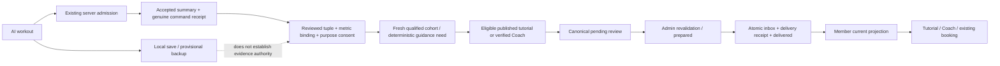
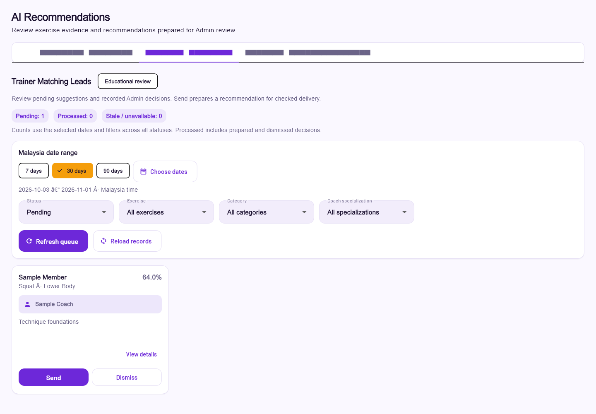
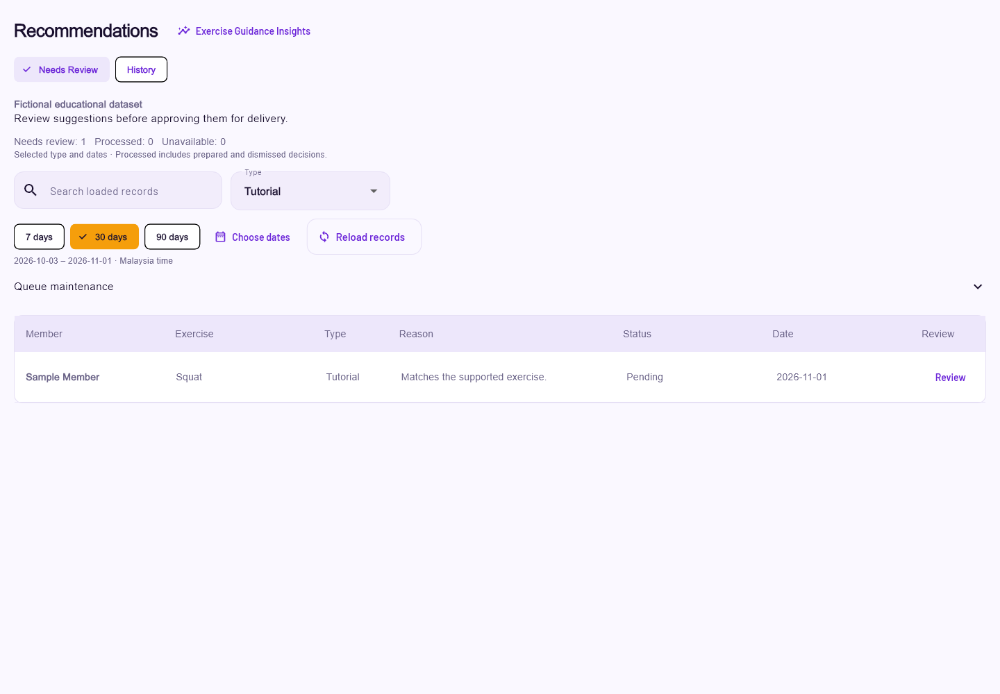
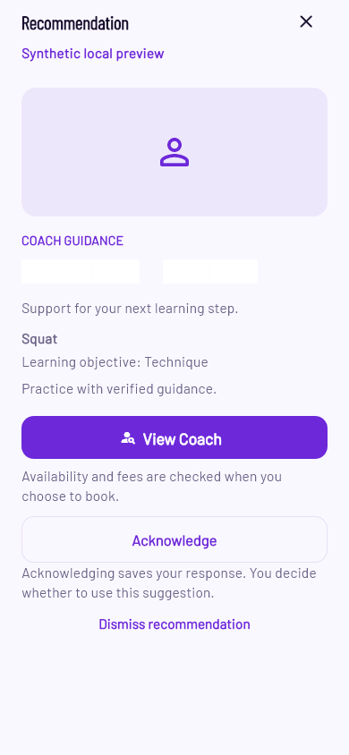
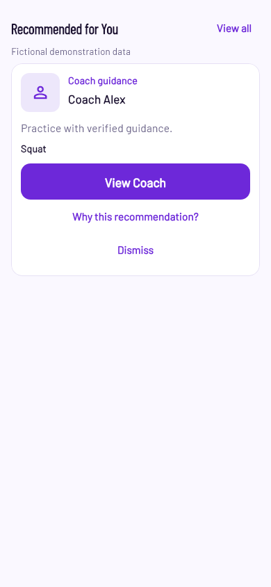

# Module 13 consumer recommendation optimization

Implementation checkpoint, 14 November 2026. Source changes and local verification only. Nothing in this checkpoint has been deployed, installed on a phone, or enabled for ordinary production workout admission. No production records were changed and no billable Gemini requests were made.

## Outcome and release boundary

The existing evidence engine, fictional FYP review workflow, Member destination navigation and receipts are reused. A separate accepted-workout lifecycle, callable boundary and Flutter repositories are implemented and exercised locally. Production activation is deliberately blocked by missing reviewed evidence and target policies. This is **not full consumer release acceptance**.

| Area | Implemented behavior | Activation / remaining limitation |
|---|---|---|
| Evidence correctness | The same fresh, exact-compatible, coverage-qualified cohort controls minimum evidence, decision averages and observation fingerprints. Null scores are excluded, never zero-filled. | No new exercise/model/rule tuple is admitted. |
| Ranking | Existing semantic ranker contributes at most 20%; deterministic ranking retains at least 80%, eligibility classes and fallback authority. Abstention cannot remove a valid deterministic candidate. | Existing synthetic/FYP adapter remains isolated. Canonical runtime currently derives deterministically; enabling Gemini there still needs a reviewed asynchronous ranking composition, consent and aggregate cost budget. |
| Personalization | Explicit stated goal/experience mapping, educational content first, optional eligible Coach alternative, stable deterministic tie-breaks and verified explanation templates. | Real catalog suitability/specialization mappings must be reviewed before registration. No invented availability or specialization. |
| Real-record lifecycle | Genuine acceptance receipt validation, automatic-event seam, transactional review, prepared-to-inbox delivery, recovery, read/dismiss receipts, cooldown and current consent/target checks. | Server runtime registration is empty. Exported events return before source reads while disabled. |
| Admin | Recommendations → Needs Review / History, loaded-record counts, search/type/history filters, focused fresh detail, approval/dismissal, recovery action and collapsed technical information. | Canonical Member display names are not hydrated; “Member account” with the actual ID in Technical Details avoids inventing an identity. Counts are explicitly loaded-page counts, not global totals. |
| Member | Home cards, full feed/history, direct tutorial/Coach navigation, booking through existing navigation, dismissal, independent privacy purposes and current target validation. | Client feature flag defaults off. Genuine production cards cannot appear until reviewed server composition and delivery exist. |
| Notifications | Canonical Module9 projector shares the same current Member projection as Home. Only committed inbox notification plus matching delivery receipt counts as delivered. | This is in-app delivery, not proof of FCM push, notification display, reading, video playback or booking. No Coach outreach or workout disclosure was added. |

## Source map

All paths below are repository-relative.

| Responsibility | Source |
|---|---|
| Shared qualified decision cohort | `functions/src/modules/recommendation/evidence-learning-need.ts` → `qualifiedDecisionEvidence`, `deriveLearningNeedFromEvidence` |
| Stable lead identity independent of unrelated catalog revisions | `functions/src/modules/recommendation/evidence-queue-source.ts` |
| 80/20 ranking, provider origin and fallback | `recommendation-engine.ts`, `recommendation-ranking-contracts.ts`, `gemini-recommendation-ranker.ts` in the same directory |
| Goal/experience mappings and content-first policy | `recommendation-personalization.ts` → `selectPersonalizedRecommendation` |
| Explicit interpretation of accepted v2 summaries | `canonical-reviewed-derivation.ts` → `deriveReviewedAcceptedSuggestion` |
| Accepted provenance, review, delivery, redacted history and responses | `canonical-recommendation-lifecycle.ts` → `readAcceptedCanonicalSession`, `createCanonicalRecommendationLifecycle` |
| Member/Admin authorization and strict wire contracts | `canonical-recommendation-backend.ts`, `canonical-recommendation-admin.ts`, `canonical-recommendation-callables.ts` |
| Single unregistered server composition | `canonical-recommendation-runtime.ts` → `getReviewedCanonicalRuntime` |
| Automatic evaluation and bounded prepared-delivery recovery | `canonical-recommendation-events.ts` |
| Safe notification projection | `canonical-notice-projection.ts`, `functions/src/modules/coaching/module9-member-callable.ts` |
| Canonical Admin repository and review UI | `apps/admin_web/lib/features/recommendation/application/canonical_admin_recommendation_repository.dart`, `presentation/admin/canonical_admin_recommendation_panel.dart` |
| Shared Admin information architecture and legacy FYP queue | `apps/admin_web/lib/features/recommendation/presentation/admin/admin_recommendation_screens.dart`, `recommendation_queue_panel.dart` |
| Canonical Member transport | `apps/mobile/lib/infrastructure/firebase/firebase_member_recommendations.dart` |
| Home/full feed, destinations and privacy | `apps/mobile/lib/app/di/member_recommendation_factory.dart`, `features/recommendation/presentation/member/member_recommendations_view.dart`, `member_recommendation_sheet.dart`, `personalized_recommendation_settings_screen.dart` |

## Data and authorization

Canonical collections live in the **default database** under `orgs/{organizationId}`. Accepted records are in `workoutSessions/{keyOf(memberId, sessionId)}` and their original `commandReceipts`. New server-owned collections are `canonicalRecommendations`, `canonicalRecommendationCommands`, `canonicalRecommendationDeliveries` and `canonicalRecommendationFatigue`; inbox records remain in `notifications`.

No client Rules access was added for the canonical collections. App Check, verified/fresh Auth, current organization/member role, account lifecycle, ownership and rejection of dataset-assigned accounts precede privileged commands. Admin remains the existing exact Admin role; Staff is not silently granted authority.

The lifecycle verifies the accepted input fingerprint, owner, exact tuple, timestamps and matching successful `submitWorkoutSession` receipt. A cloud backup, a copied provenance string, or a renamed fictional row cannot substitute. Evidence is bounded to 200 server-selected records and lists to 25 records. Production selection adapters must query a bounded compatible cohort rather than scan arbitrary Member history.

Review authorization is separate from delivery. Sending prepares a record; only an atomic notification/receipt/record commit establishes delivery. Recovery retries that same operation, so response loss cannot create another notice. Current-target resolution is repeated before sensitive actions. Member read does not acknowledge advice or assert that a video was watched. Replaying an old read command returns the **current redacted projection**, preventing a previously returned destination from resurfacing after dismissal/revocation.

Revoked permission blocks evidence scans and send/recovery. Member history retains minimal metadata and hides explanations/targets. Admin history retains a redacted withdrawn row instead of silently dropping it. Stale pending suggestions cannot be approved; cleanup dismissal remains possible. Evidence expiry is evaluated dynamically, not presented as a new successful delivery.

## Evidence compatibility and activation prerequisites

`ENABLED_WORKOUT_TUPLES` is unchanged and empty. `CANONICAL_RECOMMENDATION_RELEASE.enabled` is false. `getReviewedCanonicalRuntime()` returns undefined. `GAINPATH_RECOMMENDATIONS_ENABLED` defaults false in both apps. Client visibility is not server acceptance authority.

| Assessment | Accepted-v2 derivation support | Required decision |
|---|---|---|
| Squat | Explicit schema-1, side-view, scored binding can be reviewed | Validate actual capture/model/rule tuple and summary semantics before admission. |
| Standing Calf Raise | Same limited binding support | Separate exercise-specific policy validation required. |
| Legacy Wall Push-up | Same limited binding support | Not evidence that current Floor Push-up scores are supported. |
| Biceps Curl | Rejected by accepted-v2 derivation | Arm/mode compatibility cannot be reconstructed from missing fields. |
| Standard Floor Push-up | Unsupported for this decision path | Its provisional schema-7 local score must not inherit legacy Wall Push-up compatibility. |
| Standing Lateral Raise | Unscored | Null Form Score cannot generate a low-score guidance need. |
| Dumbbell Shoulder Press | Unscored | Null Form Score cannot generate a low-score guidance need. |
| Legacy Row / Reverse Lunge | Unscored | Preserve the existing unsupported/unscored rules. |

The canonical emulator uses an **emulator-only** reviewed fixture requiring 3 assessed sessions across 3 distinct days, 24 completed repetitions as a conservative lower bound, coverage ≥75%, freshness ≤7 days and an explicitly configured threshold. These values are test policy, not an approved production fitness standard. No clinical injury probability or pose accuracy claim follows from estimated Form Score.

Before activation, register and independently test the exact accepted metric binding, exercise-specific evidence/freshness policy, approved purpose notice/history window, and real default-database candidate/target adapters. Verify verified-Coach specialization, branch, availability and booking eligibility against current records. Review Firestore query indexes, expiry/recovery scheduling and aggregate Gemini cost limits. Merely flipping a Boolean cannot supply these prerequisites.

## Gemini safeguards

The existing adapter retains structured JSON/schema validation and anonymized eligible candidate evidence. It has bounded response/token sizes, a maximum 15-second timeout, a five-minute valid-result cache/coalescing, no automatic retries, and at most 20 distinct attempts per adapter instance. Cached results report zero reused usage. Invalid output, unknown candidates, timeout and unavailable provider fall back to deterministic ranking. Provenance distinguishes genuine Gemini from mock/recorded output.

The per-instance cap is **not a deployment-wide monetary budget**. Cross-instance rate/cost governance and the reviewed canonical asynchronous enrichment composition remain activation blockers. Raw video, camera frames, contact details and unneeded identity are not added to requests. Friendly explanations use validated reason templates; unconstrained Gemini claims are never displayed.

## Local verification

Evidence logs and build outputs are retained in ignored `build/module13-consumer/`. Toolchain: Flutter SDK at `C:/flutter`, TypeScript source/test checks, Node 22.23.4 for the complete backend regression. The workstation default Node 24 causes the existing exact-Node22 archive assertion to fail; sandboxed loopback also caused unrelated HTTP tests to fail. These were rerun with the correct runtime and local-port permission, rather than changing those tests.

| Check | Result |
|---|---|
| Backend non-emulator regression | 178 files / 2,165 tests passed |
| Canonical Firestore/Rules emulator | 12 tests passed, dedicated loopback demo project, no live fallback |
| Mobile relevant widget/repository/navigation/privacy and render regression | 87 tests passed |
| Admin queue/canonical/privacy-history and render regression | 45 tests passed |
| TypeScript source and test compilation | Passed |
| Changed recommendation Flutter scope | Mobile and Admin scoped analysis checked; unrelated full-app informational lint debt is retained |
| Android Debug | Built from isolated exported source with new build output; final-source rebuild also checked |
| Admin Web Release | Built from isolated exported source with new build output; final-source rebuild also checked |

Independent review identified an Admin revoke/regrant history disclosure. It was corrected by comparing the consent fingerprint for every Admin history state and redacting stale pending/prepared records too; a revoke/regrant regression was added. Pending generation now reserves the same need-level cooldown as delivery/dismissal, so new compatible evidence cannot create another pending review during that period. A changed evidence cohort still invalidates the older approval, prioritizing freshness over repeated outreach.

Emulator scenarios include concurrent acceptance idempotency, exact producer acceptance receipts, prepared crash/recovery, notification transaction failure, response-loss retries, concurrent Admin decisions, Member command replay after dismissal, privacy-before-scan, redacted Admin/inbox history, changed targets, cross-role/org rejection, fresh Auth/App Check, disabled release behavior and client Rules rejection. Engine tests cover low coverage, null scores, incompatible versions, stale evidence, unknown modes, goal relevance, optional ranking, invalid JSON and fallback.

The protected historical Batch E evaluator keeps its frozen original 40/60 replay policy and wording for historical artifacts only. Current ranking uses 80/20. Historical expected files were not regenerated to disguise a policy change.

## Visual evidence and limits

These are actual Flutter widget renders with explicit fixtures, **not signed-in production browser/device screenshots**. No actual Member was represented by a fixture. Mobile uses bundled Barlow; the offline Admin harness uses Arial and the existing test font substitution for unavailable Google fonts. Baseline screenshots were reconstructed from baseline source. Some baseline tab glyphs/encoding are imperfect; they are not evidence of a production typography defect. Normal final tests do not import ignored baseline source.

Reviewed viewport coverage includes mobile 320/360/390dp at 100% and 200%, Admin desktop and narrow layouts, detail actions and scroll reachability. At large text, layout deliberately grows and scrolls. The complete rendered sequences stay in the build evidence directory.

| Before | After |
|---|---|
|  |  |
|  |  |

Additional reviewed renders: [canonical detail](module13-consumer-evidence/admin-canonical-review.png), [Admin 360dp / 200%](module13-consumer-evidence/admin-360-200.png), [Member 320dp / 200%](module13-consumer-evidence/member-320-200.png), [tutorial 320dp / 200%](module13-consumer-evidence/member-content-320-200.png).

Remaining acceptance requires approved production adapters/admission policies, deployed integration checks under real authorized accounts, signed-in browser and physical-device navigation/accessibility verification, real candidate availability tests and operational recovery monitoring. Source readiness, locally tested behavior and deployed functionality are deliberately separate.
