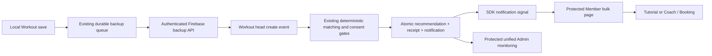

# Module 13 — Final hybrid integration and verification

Date: 2026-11-14. Baseline: `e557db9`. Scope: existing Module 2/13 integration, eight release entrypoints, no live deployment, no live Rules edits, no account/data edits and no billable Gemini calls.

## Implemented

- Merged ordinary owner-only history replay into `module13MemberCommand` (`member.history.replay`). FYP retains its existing scoped replay operation in `fypDatasetCommand`. Removed the standalone replay export.
- Ordinary Member/Admin pages now project up to 25 records in one read-only transaction, batch-prefetch records and memoize document reads within that transaction only. Authorization, consent, delivery proof and current target eligibility still run. Sensitive mutations retain their original transactions and command receipts.
- FYP Member Home/history use one bulk `member.recommendation.list` request instead of Inbox plus one detail RPC per recommendation. Both legacy delivered recommendations and new workout-summary recommendations are preserved. Work inside a page is bounded to four concurrent projections.
- Removed Admin's initial access-probe round trip. List itself authorizes server-side. Removed the duplicate full Admin detail projection. Refresh retains existing rows; tab/filter changes use loaded records.
- Ordinary Admin monitoring reuses the existing unified Admin read authorization/API to show ordinary and FYP automatic recommendations. FYP Admin remains cohort-scoped. The merge respects each source's scanned frontier so filtered/empty pages cannot hide subsequent records. Existing legacy monitoring remains accessible.
- Member Home and Recommendations share a 20-second account-scoped page cache and in-flight requests. Consent-settings return, notification signals and Member actions invalidate the cache. Target opening always resolves afresh on the server. Cache does not survive host/account disposal.
- Notification updates use the existing authorized Firestore SDK listener, with a 250 ms debounce and pending-refresh handling. FYP Inbox now has the same real listener. Removed the redundant 30-second Inbox poll. Production Home no longer performs its four post-workout polls when a listener is supplied; the old bounded fallback remains for injected/offline test compositions without a listener.
- Published Tutorial destinations reuse `FirebasePublishedRoutineRepository` for both account types. Internal recommendations, consent documents, matching and mutations remain behind protected APIs. No additional Rules or indexes were introduced.
- Fixed a confirmed lifecycle bug: revoked/unavailable Coach/Tutorial targets could produce `state: available` with `target: null`. Current-target validation now returns `unavailable`, avoiding an invalid DTO that could break the Member page.
- Android Studio Member Android and Admin Chrome configurations are unchanged.

## Automatic flow and storage

| Record | Ordinary Member | FYP Member |
|---|---|---|
| Workout heads | `orgs/gainpath/members/{uid}/workoutBackups/session-{id}` | `orgs/gainpath/cohorts/fyp-v1/members/{uid}/workoutBackups/session-{id}` |
| Recommendation | `orgs/gainpath/canonicalRecommendations/{id}` | Same collection beneath the FYP root |
| Delivery receipt | `orgs/gainpath/canonicalRecommendationDeliveries/{id}` | Same collection beneath the FYP root |
| Inbox | `orgs/gainpath/notifications/{id}` | Same collection beneath the FYP root |
| Purpose consent | `orgs/gainpath/recommendationConsent/{uid}` | Same collection beneath the FYP root |

These are provisional synced summaries, **not server-accepted pose evidence**. They support exercise-context guidance. The existing score eligibility/compatibility checks remain unchanged, missing scores remain missing, and no model/rule acceptance policy was activated. Local-first records and backup consent are preserved. Offline/foreground retry behavior remains in the existing durable scheduler.

Matching remains deterministic: exact exercise published Tutorial first; qualified compatible recent scores can choose foundational, movement-control or advanced guidance. Unscored exercise summaries still receive general guidance. Optional coaching requires repeat practice, a stated goal match, verified active credentials, permitted branch and an available booking slot. No Admin review/batch is required for these automatic records. Seven-day fatigue, stable consent-bound identities, dismissal and atomic receipts are preserved. Optional Gemini remains auxiliary; it was neither called nor required for any validation here.

## Measured performance

Baseline compiled backend was archived before edits at `build/module13-final-optimization/baseline-lib`. An emulator-only baseline callable loaded that archived code. It is excluded from the release entrypoint. Measurements used authenticated HTTP, the same records, warmed endpoints, three interleaved rounds and no billable AI. These are local emulator latencies, **not live Firebase or device rendering measurements**.

| Path | Requests before → after | Median before → after | Reduction |
|---|---:|---:|---:|
| FYP Member page, four recommendations including legacy history | 5 → 1 | 3716 → 709 ms | 80.9% |
| FYP Admin initial canonical monitoring page | 2 → 1 | 1786 → 563 ms | 68.5% |
| Immediate Home/full-page repeat within cache lifetime | Repeated page request → cached page | Unit-tested; not a device timing measurement | No duplicate page RPC |
| Idle Inbox | Listener + 30-second polling → listener only | No polling latency claim | Removes 2 poll requests/minute |

Raw samples: `build/module13-final-optimization/performance.json`. Ordinary cross-source Admin latency is not claimed by the FYP-only comparison. Billable Firestore read totals were not metered; the unit test verifies one underlying read per distinct memoized document within a projection page. No production cost reduction percentage is claimed.

## Verification evidence

| Check | Result / artifact |
|---|---|
| Backend recommendation, matching/Gemini fallback, delivery, consent, scope and release regressions | 373 tests passed across 37 files; `backend-final.log` |
| TypeScript source/test check | Passed (`tsc -p functions/tsconfig.test.json --noEmit`) |
| Auth + Firestore + Functions emulator full suite | 34 passed, 1 optional Flutter-composition test skipped; `emulator-final.log`, `full-emulator-proof.json` |
| Ordinary and FYP authenticated backup → actual Firestore event → receipt/Inbox → Admin | Passed in full suite; synthetic summary input, not a camera workout |
| Legacy + new bulk history, owner denial, replay, repeated saves, dismissal, consent changes, Rules isolation and idempotent seeding | Passed in full suite |
| Latest target-withdrawal fix | Added verified Coach/availability and credential revocation regressions; ordinary/FYP automatic-flow emulator recheck: 2 passed, 12 intentionally unselected; `emulator-target-final.log` |
| Member feed/cache/inbox/navigation regressions | 32 passed; `member-final.log` |
| Workout backup/offline retry/scope and consent/settings regressions | 66 passed; `workout-consent-regression.log` |
| Member actual widget renders | Passed, 320/360/390 dp and 100/200% scaling; `member-render-tests.log` |
| Admin monitoring and authorization regressions | 13 passed; `admin-final.log` |
| Admin actual responsive renders | 12 passed, 320–1920 px and 100/200% text; `admin-render-tests.log` |
| Changed Mobile Dart analysis | No issues; `member-analysis-final.log` |
| Changed Admin Dart analysis | Zero errors/warnings; one existing braces-style info; `admin-analysis-final.log` |
| Android Debug build | Passed, 27.7 s; `android-debug-build.log` |
| Admin Web Release build | Passed, 51.2 s; existing Cupertino font warning; `admin-web-release-build.log` |

Logs above are under `build/module13-final-optimization/`. The full emulator evidence was copied before the small targeted recheck resets its loopback data. No existing project records were touched. The emulator's App Check token proves emulator wiring, not production attestation.

Actual Flutter screenshots reviewed:

- `build/module13-consumer/member-after/feed-390-100-0.png`
- `build/module13-consumer/member-after/content-320-200-0.png`
- `build/module13-admin-performance/screenshots/monitor-1440-100.png`
- `build/module13-admin-performance/screenshots/monitor-320-200.png`
- Responsive detail captures are beside those files. These are actual widget renders of controlled fixtures, not live signed-in device screenshots.

A fresh independent code review found the filtered-page pagination defect; it was fixed with a regression test. No review findings were deferred.

## Final eight entrypoints

All remain in `asia-southeast1`, existing project `gainpath-0619`, database `(default)`.

1. `fypDatasetCommand` — existing scoped API, bulk Member feed and unified Admin monitoring/history.
2. `module13MemberCommand` — ordinary Member recommendations, consent, actions and merged history replay.
3. `module13AdminCommand` — protected ordinary monitoring API, retained for compatibility/composition.
4. `module9MemberCommandCallable` — existing ordinary Inbox with protected recommendation projection.
5. `module13WorkoutBackupCreated` — ordinary summary create event.
6. `module13WorkoutConsentChanged` — ordinary consent-grant history replay.
7. `module13FypWorkoutBackupCreated` — scoped FYP summary create event.
8. `module13FypWorkoutConsentChanged` — scoped FYP consent-grant history replay.

`workoutBackupCommand` is an existing prerequisite, not a ninth new Module 13 deployment. Existing session/directory/booking/payment APIs remain intact. `module13ReplayWorkoutHistory` is no longer a standalone release entrypoint. Existing accepted-evidence triggers/recovery functions are not activated by this package.

## Prepared release, activation and rollback — approval required

Run `node tools/functions/module13-release.cjs` to compile and verify exactly eight exports. It prepares only local files, never deploys. The prepared package is `build/module13-final-release/package`, with `lib/workout-recommendation-release-index.js` as main and Node 22 declared. `firebase.review.json` contains only Functions source configuration; no Rules/Hosting sections. `release-manifest.json` seals file hashes and records each endpoint's runtime settings. Existing `fypDatasetCommand` (512 MiB, CPU 1, concurrency 4, max 1, 540 s) and Module 9 (256 MiB, CPU 1, concurrency 80, max 20, 60 s) settings are preserved.

Reviewed archive: `build/module13-final-release/source.zip`.
SHA-256: `A558020419EAA8FEA22ACCF3C2BB2EFCF8793727B50FE9FDA287989829F0FC3A`.

Before an explicitly approved deployment:

1. Capture deployed source archives, revision/IAM/App Check/environment and current settings for the two existing shared callables. Verify the configured project, database, FYP release manifest and existing unified-Admin authorization gate. Do not enable blocked model policies or create new permission grants as an implicit deployment step.
2. Deploy **only these eight named Functions** using the reviewed package/config. Do not use a broad deploy, delete unrelated endpoints, change Rules or deploy Hosting. No automatic production data/history seed is part of this release.
3. Smoke-test normal and FYP logins; current-purpose consent; a real camera workout save; automatic Tutorial/optional eligible Coach; receipt/Inbox ID equality; corresponding unified Admin record; Coach availability/Booking and Tutorial navigation.
4. Repeat a save and a second workout, test unscored exercise guidance, Dismiss, permission revocation and offline save/reconnect. Verify no duplicate notice and no disclosure after revocation. Check 320/360/390 dp and large text on the device.
5. For rollback, stop/disable the four newly added event handlers first using the approved deployment tooling; restore the two shared callables from their captured deployed source/settings; remove only new Module 13 callables if required; return the local client recommendation flag to its earlier state. Preserve all backup, recommendation, receipt, notification, payment and booking records. Do not reset data, relax Rules or change evidence admission policies. Already committed notifications remain auditable history.

## Remaining acceptance boundary

The implementation and local tests/builds are complete. **Live Android camera Workout → deployed automatic recommendation is not yet accepted.** No new Functions were deployed by this task. A physical Android device is now detected by ADB, but no camera workout or live offline/reconnect demonstration was performed here. The previously described emulator storage issue is not used as a claim about that physical device. Live activation requires the user's explicit deployment approval, then the checklist above. Production cryptographic App Check and real-device timing also remain live checks.

Daily local UI workflow remains: open repository root in Android Studio → select **GainPath Member — Android** or **GainPath Admin — Chrome** → select Android device/Chrome → Run. Hot Reload uses local Flutter source. Backend code changes still require the separately approved Functions deployment.
