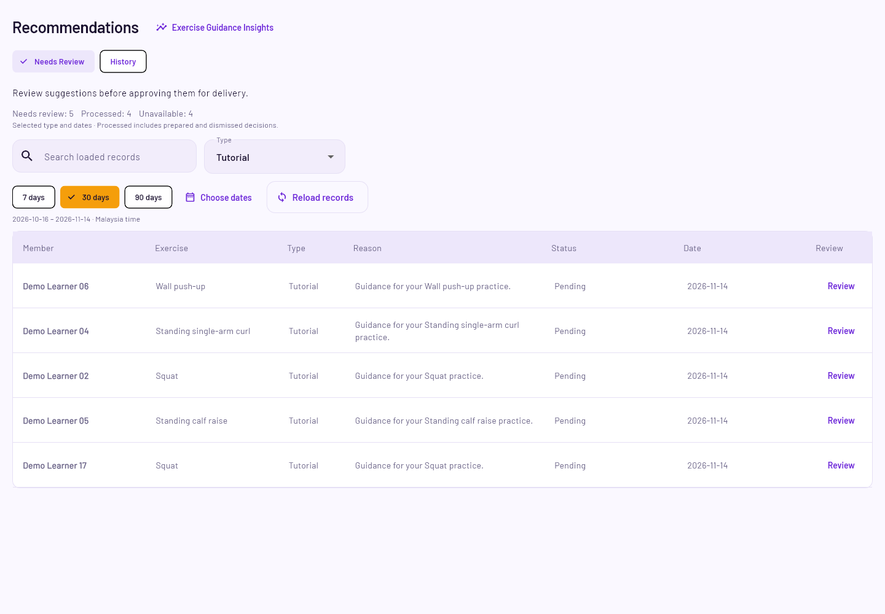
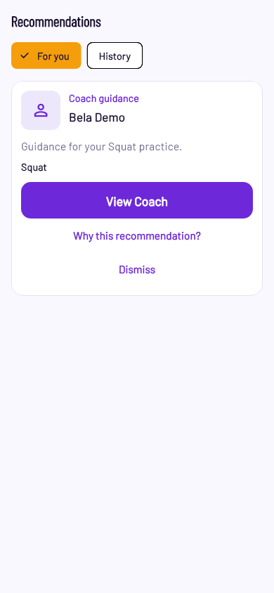

# Module 13 — existing-project presentation integration

14 November 2026, Malaysia. Continuation of [consumer optimization](module13-consumer-optimization.md).

## Delivery status

The existing-project FYP workflow is populated and verified with genuine Firebase Auth and App Check: generation → Admin review/send → Member inbox → current Coach/tutorial → Member dismissal. The ordinary Flutter screens were rendered using those actual Firebase records. **Actual-camera automatic recommendation activation remains disabled.** No Cloud Function or live security rule was deployed, and no previously blocked workout-evidence policy was enabled.

| Area | Result |
|---|---|
| Existing project | Confirmed `gainpath-0619`, project number `879719977530`, Firestore `(default)` |
| Account/data scope | Existing `orgs/gainpath/cohorts/fyp-v1`, 18 Members, 8 Coaches, 1 Admin; no separate project/database created |
| Source data | Appended 52 internally classified synthetic observations and 24 future Coach availability days; existing 12 tutorials/profiles reused |
| Generation | Existing deployed protected FYP callable generated 7 content and 7 trainer recommendations; insufficient/unsupported/non-consenting cases abstained |
| Admin | Authenticated approval/send of two recommendations, exact command replays and dismissal of a separate pending suggestion verified |
| Member | Member01 received both new notices, resolved the published tutorial/Coach, dismissed the tutorial with exact replay, and retained the Coach suggestion |
| Ownership | Member01 was denied access to Member02’s recipient record |
| Booking | Real protected read returned 7 available 60-minute options for the suggested Coach on 15 November; no hold, booking, payment or financial record created |
| UI | Normal recommendation banners, generation/maintenance controls and mock-provider terminology removed; original provenance retained internally/inside Technical Details |

The existing synthetic account names, such as “Demo Learner 01” and “Bela Demo”, were preserved rather than silently rewriting existing user identities. These are account names, not new environment badges. Source records, exports and operator artifacts retain their truthful synthetic classification. Existing sample profiles have no usable photos/thumbnails; neutral existing icon fallbacks remain instead of fabricated images or credentials.

## Exact live mutations and preservation

`functions/tools/module13-presentation.cjs` independently checks the configured project in `.firebaserc` and both Flutter Firebase options, confirms the active Google Cloud project ID/number, and checks the existing release/seed-run binding, exact 27 assigned Auth identities and source ownership digests.

The dry-run plan digest is `423956efc4bfb535e2a416a5084455905ca1f640130742dadf6d490d79d3e009`, with anchor `2026-11-14T00:00:00.000Z`. Apply atomically creates the 76 new source records, their ownership sidecars and a `presentationSeeds` audit, and updates only the owned source index plus its digest. Its fictional generation window ends at that anchor, and booking-date selection uses 15 November. Reviewed thresholds, consent/history permissions, release metadata and the original seed-run digest remain unchanged.

A second actual apply returned `alreadyApplied:true` and `sourceIndexUpdated:false`. Drift, occupied append paths, revoked assignments, missing audit/proofs and wrong projects fail closed. Existing successful delivery records, bookings, payments and ordinary user documents were not overwritten or reset. New recommendation decisions and Member actions were created by the existing protected callable services, not fabricated Firestore receipt inserts.

The old password vault was absent. Attempted temporary-token login was denied by existing IAM signing permissions; no IAM role was granted. The owner explicitly approved password resets for **only** `demo-m13-admin` and `demo-m13-member-01`. Those two passwords were regenerated and stored outside the repository using Windows CurrentUser DPAPI and a user-only ACL. Other 25 Auth accounts were unchanged. No password, token or private App Check configuration is committed or displayed here.

## Implemented source changes

| Source | Change |
|---|---|
| `functions/tools/module13-presentation-core.cjs`, `.cjs`, `.test.cjs` | Bounded fixed-project source planning, ownership validation, atomic/idempotent append, five regression tests |
| `module13-presentation-credentials.cjs` / `.ps1` | Explicitly approved two-account reset and local encrypted credential access; reruns preserve completed resets |
| `module13-presentation-walkthrough.cjs` | Real email/password login, Firebase-signed App Check, repeatable generation and review/Member walkthrough with saved command intents |
| `module13-presentation-read.cjs` | Exact delivered Coach read and replay, without acknowledgment or booking |
| `module13-presentation-render-server.cjs`, `test_support/live_presentation_bridge.dart` | Read-only loopback bridge for actual Firebase-backed Flutter render tests; tokens stay server-side |
| `module13-presentation-admin.cjs` | Private ordinary Admin preview on port 7364; existing local Admin service preserved |
| `functions/src/modules/recommendation/demo-firestore-adapters.ts` | Shared FYP source now defaults to deterministic ranking; an explicitly composed optional real ranker can use the existing bounded 80/20 engine. Historical isolated recorded-provider fixtures remain distinct. This source change is not deployed. |
| Admin queue and presentation-copy helper | Normal maintenance controls hidden, compact review/history retained, legacy mapping boilerplate translated to helpful exercise-context text; original reasons remain in Technical Details |
| Member feed/sheet/settings and presentation-copy helper | Product language without provenance badges, useful ordinary explanations preserved, scope/history notice presented in plain language |
| `apps/mobile/lib/infrastructure/firebase/firebase_function_transport.dart` | An assigned account’s unmapped operation now fails closed instead of falling through to canonical Functions |
| Booking factory/flow and recommendation navigator | Recommended Coach can open the existing booking screen. FYP scope permits availability browsing, while quote/review/reservation/checkout are explicitly disabled until a corresponding scoped writer exists. Ordinary booking/pricing/payment behavior is preserved. |

The Rules emulator fixtures were corrected to respect the already-existing paid Coach-directory restriction: free Members cannot enumerate that directory, while the appropriate Admin query stays scoped. No entitlement was fabricated and no Rules were relaxed.

## Important deployment difference

The actual deployed FYP generation response still reports the historical `experimental-40-baseline-60-semantic-v1` policy and `gainpath-demo-structured-mock-v1` recorded provider. This is **not genuine Gemini inference**, and the updated interface does not present it as such. No billable Gemini request was executed.

The corrected shared evidence cohort, 80/20 policy, deterministic-by-default FYP composition and optional bounded assistant exist in tested source. Updating that deployed behavior requires explicit approval to replace **`fypDatasetCommand`**. Source-only package prepared at:

`build/module13-presentation/fyp-function-prepared.zip`

SHA-256: `0dcc3e7e3c5da54903b9db4a1453c871a29a31dd539e888f14e7026c23d4785b`.

The package was compiled with Node 22 and inspected: its only exported endpoints are `fypDatasetCommand` and `fypDatasetSessionCommand`, retaining Singapore region, 540-second timeout, max instances 1 and concurrency 4. The next release must target only the approved changed endpoint and preserve the existing live service configuration/IAM. The historical deployment operator’s source-hash restrictions were not bypassed or weakened. No deploy command was run.

**Automatic genuine AI-workout generation is a separate activation.** The existing `module13AcceptedWorkoutCreated` handler and canonical lifecycle stay behind the disabled server release and unregistered reviewed runtime. Local saves/provisional backups do not become accepted evidence. Before approving activation, the exact accepted metric/model/rule tuple, history-purpose policy and real target adapters must be registered and validated. Deploying the FYP callable alone does not turn on ordinary camera-workout admission. This presentation checkpoint generated synthetic-source recommendations through the protected operator workflow, not an activated real-camera trigger.

FYP new booking/payment writes are likewise absent from the deployed scoped backend. The app therefore truthfully offers session browsing and explains that online checkout is unavailable for this account. It does not create fake successful bookings or route those writes into ordinary Member/payment services.

## Verification

| Check | Observed result |
|---|---|
| Backend complete non-emulator suite | 178 files, 2,165 tests passed on Node 22 |
| Source seeder tests | 5 passed, including exact existing workout/availability validators |
| FYP Auth/Firestore/Functions emulator suite | 31 passed; one pre-existing opt-in whole-client test skipped; direct live-backed Flutter render tests run separately |
| Relevant Mobile regression | 87 passed |
| Relevant Admin regression | 39 passed |
| Actual Firebase-backed Flutter render tests | Both passed; 8 Admin and 18 Member PNGs generated |
| TypeScript source/test compilation | Passed |
| Changed Flutter source and render helpers | Scoped analysis clean |
| Android Debug / Admin Web Release | Both final-source builds passed |
| Actual authentication/inbox/navigation/actions | Passed using the two approved existing-project sample accounts |
| Repeat source apply | No duplicate source rows/index writes |

Full logs remain in ignored `build/module13-presentation/`. Sanitized evidence, command IDs and artifact hashes are in [verification.json](module13-presentation-evidence/verification.json). Independent read-only review found no P0/P1 issue in the bounded seed/credential/transport scope. Its P2 walkthrough replay finding was fixed: an already-dismissed tutorial remains dismissed on rerun, instead of issuing another Send.

The first relative-output Admin build failed because the shader compiler could not write the requested relative destination. The final absolute-output release build passed. Initial old emulator directory assertions incorrectly expected free access to paid Coach enumeration; the tests were corrected to verify the current authorization boundary without changing Rules.

## Actual screenshots and acceptance limits

These are real production Flutter widgets supplied through real authenticated Firebase reads, with no fabricated recommendation rows. The Member screenshots show one currently available delivered Coach card after the tutorial was dismissed. The Admin screenshots show 5 content and 6 trainer suggestions still pending after the walkthrough.

| Admin | Member |
|---|---|
|  |  |

[Admin review](module13-presentation-evidence/admin-review.png), [Admin 360px / 200%](module13-presentation-evidence/admin-360-200.png), [Member 320px / 200%](module13-presentation-evidence/member-320-200.png), [Member detail 320px / 200%](module13-presentation-evidence/member-detail-320-200.png).

Representative desktop/narrow/large-text screenshots were visually inspected. The offline render harness uses the existing bundled Barlow substitution for unavailable Admin Google fonts. These are not whole-browser, physical Android, video-playback or push-notification acceptance claims. Computer Use stopped because it could not confidently determine the active Windows browser URL; browser interaction ended there and was not replaced by another browser-control mechanism. No APK was installed.

## Presentation access and repeatability

Private latest Admin preview: `http://localhost:7364/`. It serves the ordinary app entrypoint; the authenticated FYP Admin can review and send. Canonical Admin access to this cohort retains its existing read-only boundary.

Use the helper below to copy one approved account’s password locally, then paste it into the ordinary GainPath sign-in screen. No plaintext password is stored in source or printed by the helper:

```powershell
functions/tools/module13-presentation-credentials.ps1 -Uid demo-m13-admin -CopyPassword
# Member login uses demo-m13-member-01 instead.
```

The emails are `demo-m13-admin@gainpath-demo.invalid` and `demo-m13-member-01@gainpath-demo.invalid`. They are synthetic existing Auth identities. Resetting the other accounts or enabling blocked features is not part of this checkpoint.

Operator sequence (existing saved plan is reused; apply rejects unexpected drift):

```text
Node22 functions/tools/module13-presentation.cjs inspect
Node22 functions/tools/module13-presentation.cjs dry-run
Node22 functions/tools/module13-presentation.cjs apply
Node22 functions/tools/module13-presentation.cjs validate
Node22 functions/tools/module13-presentation-walkthrough.cjs generate
Node22 functions/tools/module13-presentation-walkthrough.cjs walkthrough
```

`Node22` above denotes the existing Node 22 executable recorded in the verification logs. The credential reset command is intentionally separate and was executed only after the explicit two-account approval.
