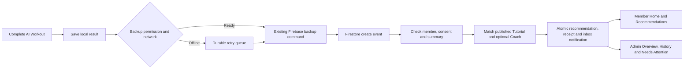

# Module 2 and Module 13 automatic workout recommendations

> Final optimization update: the [eight-entry release and verification report](module13-final-optimization.md) supersedes this report's nine-entry package and polling descriptions. This document retains the original implementation evidence.

The implementation connects synced workout summaries to automatic exercise guidance and the existing Member inbox. Deployment is pending explicit owner approval.

## Data and normal workflow

| Data | Existing or reused collection |
| --- | --- |
| Ordinary Member session summaries | `orgs/gainpath/members/{uid}/workoutBackups/session-{sessionId}` |
| FYP Member session summaries | `orgs/gainpath/cohorts/fyp-v1/members/{uid}/workoutBackups/session-{sessionId}` |
| Existing FYP sample history | `orgs/gainpath/cohorts/fyp-v1/members/{uid}/syntheticObservations/{id}` |
| Recommendations | `{organizationRoot}/canonicalRecommendations/{id}` |
| Actual delivery receipts | `{organizationRoot}/canonicalRecommendationDeliveries/{id}` |
| Existing in-app notifications | `{organizationRoot}/notifications/{id}` |
| Personalization permissions | `{organizationRoot}/recommendationConsent/{uid}` |

The existing immutable backup head contains `schemaVersion`, `kind`, `id`, `key`, `digest`, `payloadJson`, `classification` and `updatedAtMillis`. The session payload contains the authenticated owner's UID and organization, exact exercise ID, repetitions, start/end times, provenance, and versioned pose metrics. Metrics include tracking/rejected duration, partial repetitions, optional estimated Form Score, detector/scoring versions and camera view. The legacy `accuracy` value remains stored with its existing semantics. The recommendation policy uses the optional estimated Form Score where qualified.

Local results are saved first. The existing account-scoped backup scheduler discovers saves, retries temporary failures with bounded delays, and wakes on app foreground/network recovery. Backup permission remains an explicit one-time Member choice. An existing opt-out remains effective. Android Studio's Member configuration enables the backup capability. New FYP session saves use the existing protected dataset callable. Their local scope is rebound from the authenticated account on file reads, while the saved summary wire format stays compatible.

## Triggers and history

- `module13WorkoutBackupCreated` watches ordinary session backup heads.
- `module13FypWorkoutBackupCreated` watches FYP session backup heads. It reuses the existing assignment, verified Auth, seed and scoped-store checks.
- `module13WorkoutConsentChanged` and `module13FypWorkoutConsentChanged` process recent history when all three summary-personalization purposes become authorized. A Member can therefore enable personalization after saving workouts.
- `module13ReplayWorkoutHistory` provides an authenticated, owner-only, paginated ordinary history replay. FYP history uses `workout.member.history.replay` on `fypDatasetCommand`. Both reuse the same lifecycle and stable identities.

The consent notice `workout-backup-guidance-v1` authorizes recent synced summaries and retained history. Existing fictional-only grants require an explicit Member update before real summaries are used. The three required purposes are exercise insights, recommendation generation and recommendation delivery. External AI inference remains optional.

FYP historical replay reads the existing sample observations through their separate validator and seed ownership proof. Those records provide exercise context with an explicit internal `recorded_history` source. Their scores do not enter measured-score decisions. Their source records retain their original provenance. New actual camera summaries retain `synced_summary` provenance. Routine checkpoint backup for FYP accounts remains outside this session integration.

## Recommendation policy

- Consider validated summaries from the last 30 days with at least one completed repetition and an active catalog exercise.
- Always allow general exact-exercise Tutorial matching for unscored or otherwise unqualified assessments.
- Use at most the five latest compatible qualified Form Scores. Qualification requires at least three repetitions, tracking coverage of 60% or higher, and the known exercise/scoring/schema/view pairing.
- Two qualified compatible assessments are needed for a score-based learning focus. An average below 65 selects movement control. An average of 85 or higher permits progression content, subject to stated experience and available publication difficulty. Other cases use technique foundations.
- Compatibility binds the actual exercise, scoring version, detector/version, metric schema, camera view and Curl arm mode. Unscored records contribute no numeric score.
- Squat, Curl, Calf Raise and Wall Push-Up have the explicit scored pairings used here. Row, Shoulder Press, Reverse Lunge, Lateral Raise and other valid unscored summaries receive general guidance. Floor Push-Up also receives general guidance under this policy.
- Tutorials must come from an active exercise catalog and a current published Routine snapshot with matching exercise/index/day and authored steps or a valid video.
- Coaching is optional. It requires repeated practice, a stated goal matching published specialty/tags, active verified Auth, published profile, current approved certifications, shared active branch, and a currently bookable 30-minute option within the three-day lookahead. Existing booking capacity, conflicts and slot-lock logic are reused. Opening a Coach rechecks availability.
- A single low score alone cannot create coaching outreach.
- Deterministic matching works with no Gemini request. The existing bounded Gemini adapter/ranking implementation remains available to its existing callers. This new event composition does not invoke Gemini.

Recommendation identity binds owner, source session, kind and consent fingerprint. A transaction rechecks permission and target eligibility, applies a seven-day exercise/kind cooldown, and creates recommendation, receipt and notification together. Concurrent events retry through Firestore transactions. Replaying a source under the same consent creates no second notification. Explicitly renewed permission can generate a replacement after cooldown. Dismissal participates in the same cooldown.

## Member and Admin behavior

Home refreshes when returning from Workout, then performs four bounded background refreshes over the following 65 seconds to discover delayed events. Tutorials open the existing tutorial route. Coach recommendations open the existing profile/availability/booking navigation. The Member can dismiss recommendations or inspect history and privacy settings.

Admin retains Overview, History and Needs Attention. Workout recommendations use the existing canonical panel with Member labels, exact target, reason, timestamps and receipt-backed delivery state. Earlier records remain accessible separately. The earlier monitoring view also remains available while the backend update is pending. Permission withdrawal, expiry and unavailable targets remain distinguishable in the protected projections.

## Main changed source

| Area | Files |
| --- | --- |
| Deterministic summary matching | `functions/src/modules/recommendation/workout-backup-recommendation-runtime.ts` |
| Ordinary events and consent replay | `functions/src/modules/recommendation/workout-backup-recommendation-events.ts` |
| FYP events and consent replay | `functions/src/modules/recommendation/fyp-workout-backup-events.ts` |
| Atomic lifecycle and projections | `canonical-recommendation-lifecycle.ts`, `canonical-recommendation-backend.ts`, `canonical-notice-projection.ts` |
| FYP backup, inbox, monitoring and consent routing | `functions/src/modules/dataset/fyp-backend.ts` |
| Scoped Member summary persistence | `apps/mobile/lib/features/workout/domain/workout_contracts.dart`, measured session controllers and local session/routine stores |
| Member synchronization and feed | `firebase_workout_backup_gateway.dart`, `workout_cloud_save_status.dart`, `member_progress_route.dart`, `member_recommendations_view.dart` |
| Admin routing and record details | `canonical_admin_recommendation_factory.dart`, canonical repository/panel and `admin_recommendation_screens.dart` |
| Scoped release entrypoint | `functions/src/workout-recommendation-release-index.ts` |

## Release scope and rollback

The existing project is `gainpath-0619`, database `(default)`. Read-only Firebase metadata confirms database location `asia-southeast1`. The four new Firestore event functions use that region. The prepared package entrypoint exports only the following nine names.

| Function | Change | Region |
| --- | --- | --- |
| `module13WorkoutBackupCreated` | New Firestore create trigger | `asia-southeast1` |
| `module13WorkoutConsentChanged` | New consent-change trigger | `asia-southeast1` |
| `module13FypWorkoutBackupCreated` | New FYP Firestore create trigger | `asia-southeast1` |
| `module13FypWorkoutConsentChanged` | New FYP consent-change trigger | `asia-southeast1` |
| `module13ReplayWorkoutHistory` | New owner-only callable | `asia-southeast1` |
| `module13MemberCommand` | New protected summary runtime and Member reads | `asia-southeast1` |
| `module13AdminCommand` | New protected monitoring reads | `asia-southeast1` |
| `fypDatasetCommand` | Add Member backup and workout recommendation operations | `asia-southeast1` |
| `module9MemberCommandCallable` | Add protected recommendation notice projection | Preserve existing `asia-southeast1` |

Before release, capture the two existing callables' deployed source archives and current service/IAM/App Check/environment settings. Deploy the reviewed source only to these names, retaining each existing callable's settings. New triggers require the ordinary Eventarc/Firestore integration supplied by Firebase Functions. Keep the existing accepted-workout events and model allowlist in their current disabled state.

Verify with a selected FYP Member that one real camera session reaches its scoped backup, creates receipt-backed guidance and appears in the same Admin monitor. Re-save/replay that session and confirm stable notification IDs. Check a second session, an unscored exercise, permission withdrawal, and device offline/reconnect.

If release verification fails, disable/delete the four new event functions, restore the two prior callable sources and disable the three new callables. Retain all workout results, recommendation audit records and delivered notifications. No reset, Rules change, account change or payment data operation is part of rollback.

## Verification boundary

Local tests use explicit synthetic emulator accounts and generated summary payloads. The Firestore emulator invokes the actual automatic event handlers. This verifies transport, authorization, transactions and inbox delivery. A physical camera workout and live Firebase event delivery remain for the approved release verification. No Cloud Functions deployment, Security Rules change, paid Gemini request or production data mutation was executed during implementation.

## Recorded verification results

| Verification | Result | Local evidence |
| --- | --- | --- |
| Auth/Firestore/Functions Emulator integration | 11 passed, one optional Flutter-emulator render test skipped | `build/module13-workout-emulator-final.log` |
| Backend policy, permission and compatibility regression | 90 passed | `build/module13-workout-backend-final.log` |
| Mobile backup, scope, routine recovery and destination navigation | 54 passed | `build/module13-workout-mobile-final.log` |
| Nine AI workout controllers and delivered feed refresh | 66 passed | `build/module13-workout-trackers-final.log` |
| Consent, updated notice, delayed delivery and scoped persistence | 47 passed | `build/module13-workout-consent-final.log` |
| Admin monitoring and responsive preservation | 17 passed | `build/module13-workout-admin-final.log` |
| TypeScript source/test check | Passed | `tsc -p functions/tsconfig.test.json --noEmit` |
| Changed Flutter-file analysis | No errors or warnings; 12 existing braces-style info diagnostics | `build/module13-workout-analysis-final.log` |
| Member Android Debug build | Passed | `build/module13-workout-android-build-final.log` |
| Admin Web Release build with existing private App Check file | Passed | `build/module13-workout-admin-build-final.log` |

The Flutter suite counts describe separate runs with some overlapping cases. The legacy batch integration has a 300-second timeout because it still evaluates the full fixture cohort through the existing slow maintenance path. The new per-workout and permission-replay cases completed in approximately 12 and 10 seconds respectively in the authenticated emulator run. The emulator used host Node 24; the prepared deployed runtime remains Node 22.

One independent code review found the renewed-consent identity issue. The corrected implementation includes a regression for retained workouts, cooldown and duplicate replay. The follow-up review found no further concrete blocking issue.

## Android Studio demonstration after approved activation

Open the repository root and use **GainPath Member — Android** or **GainPath Admin — Chrome**. Both configurations run local source with `GAINPATH_RECOMMENDATIONS_ENABLED=true`. Existing Admin App Check inputs stay in the ignored private build file.

For the selected Member, enable Workout Backup once and authorize the three summary-personalization purposes in Personalized Recommendations. Existing prior grants offer **Update permission**. These choices authorize future automatic processing; no per-workout Admin action is involved.

To demonstrate a fresh recommendation on an already populated FYP account, choose an exercise outside that account's current cooldown context. Complete the real camera session, save it and return Home. Compare the same recommendation ID and actual receipt in Admin. Repeat the source/save and verify that its notification ID stays unchanged. Use an unscored tracked exercise to demonstrate general guidance. Disable the device network during a save, then reconnect and observe the persisted queue synchronize.

Live Firebase execution of this complete camera workflow remains pending. The existing Pixel 9 emulator previously lacked installation space, and the second emulator remained offline. Android installation, real camera assessment and network toggling were not claimed from the build or generated emulator payloads.

## Prepared source archive

`build/module13-workout-release/source.zip` contains `package.json` and compiled `lib`, with Node 22 declared and `lib/workout-recommendation-release-index.js` as its entrypoint. Loading the package locally confirmed exactly the nine exports listed above.

SHA-256 `D4782D2B0786EF2BD625435915559B7B58DB4F9A9D4DF9D26D085A45AAD25A23`.

Read-only deployed metadata confirmed `fypDatasetCommand` currently uses 512 MiB, one CPU, concurrency four, maximum one instance and a 540-second timeout. `module9MemberCommandCallable` currently uses 256 MiB, one CPU, concurrency 80, maximum 20 instances and a 60-second timeout. The prepared source declares those existing settings explicitly. Both are in `asia-southeast1`. The two Module 13 canonical callables are currently absent from the deployment and are new endpoints in this release.
