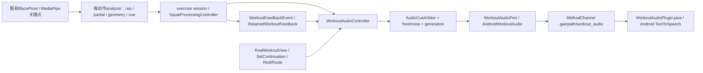

# GainPath Module 2 — AI Voice Feedback 优化分析与语音素材规划

分析日期：2026-11-15（Asia/Kuala_Lumpur）。默认声音包：**GainPath AI Coach — English Voice Pack**。

本次仅分析和规划，只创建本报告。未修改Flutter/Android/pose/rep/scoring代码、依赖或配置；未下载模型、生成音频、运行语音服务或部署。保留工作区已有其他修改。以下“现有”指本次工作区源码；未把历史文档、测试夹具或UI文字当作实际口播。本轮没有真机听音或延迟测量。

## 1. 结论与精确计数口径

建议电脑用Kokoro预生成单一默认英文声音，手机离线播放资产；Android离线TTS仅兜底动态文本/缺失资产。保留现有授权、生命周期、accepted-event和启动期限，升级语音策略，不换姿态算法。

| 统计项 | 数量 | 定义 |
|---|---:|---|
| 当前独立口播模板 | **41** | 38条固定文案＋3个参数模板，C01–C41 |
| 当前Cue-ID家族 | **33** | 9个动作合计31＋共享boundary 1＋transition 1 |
| 可枚举具体Cue ID | **35** | lunge_start_{seconds}展开3/2/1，其余家族无动态Cue ID |
| 当前口播语义分支 | **50** | 同ID不同口播原因/模板拆开；33−press_setup 1−共享2＋setup 12＋共享8 |
| 固定句＋有限关节展开 | **46** | 38条固定句＋8条关节实例；数字/动作名仍是动态 |
| 当前预制Workout Coach音频 | **0** | 未找到该模块wav/mp3/ogg/m4a或资产播放器依赖 |
| 需要策略性优化/替换的固定文案 | **30 / 38** | Ready.、Set complete.及6条已清楚的纠正句可保留；其余重写/合并/由数字代替 |
| 动态模板处理 | **3 / 3** | 数字→素材库；动作名→默认通用过渡；关节名→按需TTS |
| 推荐鼓励音频 | **10** | 3事件族；9条New＋1条从Good repetition改写的Rewritten |
| 推荐纠正音频 | **48** | 16个现有依据的反馈族×3；6条基础原句＋10条基础改写＋32条新增变体 |
| 新增姿态判定类型 | **0** | 不新增姿势、负重、Form Score推断 |
| 完整数字音频 | **100** | 1–100；>100整句TTS，不限制实际计数 |
| Ready/Start/Set/Rest/Transition/Completion | **30** | 8族×3＝24＋左右换臂2族×3＝6；倒计时复用数字 |
| Setup＋Tracking | **33** | 7族setup×3＝21；4族tracking×3＝12 |
| 完整推荐独立音频总数 | **221** | 100＋30＋33＋48＋10，逐文件列于第6节 |
| 第一版最低必要文件总数 | **70** | 数字1–30＋40条基础语句；>30离线TTS |
| 完整版比第一版多 | **151** | 多70数字＋81句变体 |
| 非音频fallback模板 | **3** | 不计入70/221 |

“41”是有限源码模板数，不声称运行时只会说41句话。数字和动作名有参数取值，关节模板有8种已知展开；不同动作共用同一句只算一次。33是cue家族，50是按口播原因/模板细分后的语义分支，两者不能相加。所有数量都是可达候选，不代表每次都能通过仲裁并真正发声。

221是下一阶段的完整录音数量，不是当前资产数量，也不是一场训练的播放次数。70是覆盖当前9个动作路径的最低版本，不是仅Squat演示版。建议先验证70个，再扩展221个；都是同一个声音，无多语音包。

## 2. 现有架构及问题

### 2.1 实际调用链



- 实际是自定义Java Android TextToSpeech，不是flutter_tts；pubspec也未引入audioplayers/just_audio。不能仅把speak文本改成文件路径。
- 当前pose侧是既有BlazePose TFLite/MediaPipe landmark contract。语音只消费既有结果；不需要实时LLM，不上传画面/关键点/训练记录到TTS服务。
- native筛选**已安装、不要求网络的英文Voice**，优先Locale.US，再按name排序。没有适合声音则unavailable；不同设备声音会不同。未显式设置coach voice/语速/音高/情绪。
- port Future表示completed/cancelled/unavailable，不是“已入队即完成”。Java使用QUEUE_FLUSH、onStart/onDone、generation/epoch、AudioFocus，Activity暂停时停止。
- native保存多个SpeechSession，未来资产播放器与TTS必须共享唯一voice owner；不能两个后端各建一套队列。

### 2.2 实际9条路径与6个retained接口

dispatcher目前availableTrackers包含9种，不能用历史“保留6种”说明覆盖实际代码。

| 路径 | 当前音频策略 | 同ID冷却 | 跨ID quiet | 统一Ready/Continuation |
|---|---|---:|---:|---|
| Squat、Curl、Calf Raise、Lateral Raise、Shoulder Press、Floor Push-up | retained accepted outcome＋boundedStarts | 6s | 2s，高优先级可穿透 | 实现WorkoutVoiceSession/continuation |
| Wall Push-up、Row、Reverse Lunge | legacy直接consume analyzer cues | 2s | 0 | 不实现可选接口；Lunge另有camera-check倒计时 |

默认Muted。Full Coaching允许所有候选；Alerts Only当前只过滤encouragement，correction/warning仍可播，所以Lunge的correction倒计时/Ready.Begin也可能在Alerts Only出现。未来应明确这种语义，保留用户选择，不擅自开声音。

Single/Routine共用实际session；Routine主要增加Exercise complete/Workout complete上下文与between-exercise rest提示。Video Timed controller/screen自身没有WorkoutAudioPort调度；视频原声另算，Routine过渡可以提示下一timed动作。Manual logger无AI rep/form语音。

### 2.3 已存在的防重与时限

| 机制 | 当前行为 |
|---|---|
| 优先级 | warning 3 > correction 2 > encouragement 1；同级/低级不打断active |
| 冷却 | arbiter默认2s；6条retained路径6s |
| 缓冲 | 每次clearPending，只取当前batch一条，不是无界FIFO |
| 跨ID | retained有2s quiet，高优先级可打断 |
| 事件期限 | WorkoutFeedbackEvent最长500ms**启动**有效期，非播放时长 |
| 异步启动 | pendingStartTimeout默认500ms；6条路径boundedStarts，native时钟映射扣除准备/通道等待 |
| 生命周期 | pause、后台、logout、account/session/geometry/source失效取消generation |
| 完成边界 | finishSet保留accepted最后rep，合并rest或补一次fresh boundary，不要求rest reset后仍校准 |
| 准备/结束 | prepare至多3s；native播放20s兜底；durable save后settleFeedback最多等1.5s |
| 有界集合 | seenEvents近期64项；arbiter pending上限32/history上限128 |

500ms事件期限、250ms pose freshness、2/6s冷却各有用途，不能合并成同一常量。保留monotonic时间、observed/capture/delivery区分及授权检查。

### 2.4 发现的问题及证据边界

1. **多数retained动作不逐rep读数字。** Squat改成Good repetition；Curl/Calf/Lateral/Press改成Repetition counted；Floor只有完整且无记录issue时才floor_good。直接挂资产不会自动实现逐次数字。
2. **legacy数字同ID受2s冷却、active同ID抑制。** 快速rep会漏播，不是所有旧数字正在排队；新方案数字不能沿用6s冷却。
3. Repetition counted / Partial movement recorded偏系统通知。数字应承担确认；纠正应短而可执行，无证据时只能generic reset。
4. 长纠正与下一rep竞争，同优先级active时新候选会丢弃。TTS实际启动/播放延迟本轮未测，不能给出已验证数值。
5. press_setup把多种原因放同ID，6s冷却也会压制新定位原因；但不能每个变体新ID绕过频率保护。
6. 没有halfway/few-left、变体轮换、每组鼓励预算、同问题逐次放缓提醒策略。
7. 很多calibrationCue/readinessMessage只显示UI。多数watchdog只是invalidateSource，**并不等于播出tracking lost**。不能声称现有所有定位提示都已有声音。
8. transition要求Full Coaching、空闲及有效上下文；finishSet需要fresh outcome。忙时会省略，避免过期，不保证每个边界总有语音。
9. 新UI的Ready/Tracking Ready/Rep Counted动画不等于额外spoken events。
10. **cue缺席不等于恢复正确。** squat_trunk一周期只发一次，下一帧无cue不能触发Good Form；当前公共snapshot没有统一持久issue-clear信号。
11. 新coach与视频原声需共享focus/ducking，不能为语音暂停视频或更改视频有效训练时间。
12. 用户示例Repetition completed.和Incorrect posture detected.不是本次实际口播路径的原句，不计入现有数量。
13. 当前已有QUEUE_FLUSH/focus/epoch；本次没有实测证据证明一定重叠。主要风险是未来两种后端并播、迟到回调，或legacy非事件提示缺少同等级native deadline。

## 3. 完整现有Voice Events与文案

### 3.1 Cue-ID清单

| 路径 | ID家族数 | 完整Cue-ID家族 | 事件 |
|---|---|---|---|
| Squat | 4 | squat_trunk; squat_rep; squat_depth; squat_tracking_lost | 躯干偏差；accepted full/partial；lost边沿 |
| Curl | 4 | curl_upper_arm; curl_trunk; curl_rep; curl_partial | 已有几何偏差与accepted outcome |
| Calf Raise | 3 | calf_knee; calf_rep; calf_partial | 膝部条件及accepted outcome |
| Lateral Raise | 2 | lateral_raise_rep; lateral_raise_partial | accepted full/partial |
| Shoulder Press | 3 | shoulder_press_rep; shoulder_press_partial; press_setup | accepted outcome；setup有12个口播原因/模板 |
| Floor Push-up | 6 | floor_tracking; floor_sag; floor_pike; floor_depth; floor_extension; floor_good | 几何拒绝、髋部偏差、范围/伸展、无记录issue的完整rep |
| Wall Push-up | 3 | wall_body; wall_rep; wall_partial | body-line；数字；generic partial |
| Row | 2 | row_rep; row_partial | 数字；generic partial |
| Reverse Lunge | 4 | reverse_lunge_rep; reverse_lunge_partial; lunge_begin; lunge_start_{seconds} | 数字、partial、camera-check开始与3秒倒计时 |
| 共享boundary | 1 | workout_set_complete | Set complete / Set complete. Rest / Exercise complete / Workout complete |
| 共享transition | 1 | workout_transition | tracking-ready / rest-ending / prepare-set / next-exercise |

合计33家族。press_setup的12个口播模板是C20–C30的11条固定句＋C39关节模板；共享8分支是C31、C33–C38、C41。Lunge倒计时家族展开为3个ID，但共用数字资产，不能再加3个音频文件。

### 3.2 实际口播、触发、动作与频率

**R**＝retained同ID6s、跨ID2s；**L**＝legacy同ID2s、无跨IDquiet；**B**＝boundary/transition专用arbiter cooldown 0，但有上下文一次性latch、busy、500ms、Full Coaching约束。全部还受active、foreground、授权、偏好和source有效性过滤，表中为候选而非保证发声。

| 编号 | 当前实际口播文案／模板 | Cue ID / path | 适用动作 | 触发依据 | 当前优先级／频率 |
|---|---|---|---|---|---|
| C01 | Keep your chest up. | squat_trunk | Squat | 躯干倾斜超阈值并满足 dwell；同动作周期只发一次 | correction / R |
| C02 | Good repetition. | squat_rep; floor_good | Squat / Floor Push-up | 完整 accepted attempt；Floor 还需本次 issue 为空 | encouragement / R |
| C03 | Lower a little more on the next squat. | squat_depth | Squat | 已记录 partial attempt，原始 analyzer 文案被 processing 重写 | correction / R |
| C04 | Tracking lost. Stand fully in view to recalibrate. | squat_tracking_lost | Squat | healthy/degraded→lost 边沿；不是每帧重发 | warning / R |
| C05 | Keep your upper arm steady. | curl_upper_arm | Curl | 上臂相对校准基线偏移 >15° | correction / R |
| C06 | Keep your body steady. Avoid leaning. | curl_trunk | Curl | 躯干相对校准基线偏移 >15° | correction / R |
| C07 | Repetition counted. | curl_rep; calf_rep; lateral_raise_rep; shoulder_press_rep | Curl / Calf Raise / Lateral Raise / Shoulder Press | accepted 完整 attempt；前三者经 retainedCoachingCue 替换数字 | encouragement / R |
| C08 | Curl a little farther and hold briefly before lowering. | curl_partial | Curl | accepted partial attempt，不能据此推断未测得的握力/负重 | correction / R |
| C09 | Keep your knees steady without bending. | calf_knee | Calf Raise | 当前可评估膝部几何不满足动作规则 | correction / R |
| C10 | Raise your heels farther and hold briefly before lowering. | calf_partial | Calf Raise | accepted partial attempt | correction / R |
| C11 | Raise both arms to shoulder height and hold briefly before lowering. | lateral_raise_partial | Lateral Raise | accepted partial attempt；仅可见范围/停留提示 | correction / R |
| C12 | On the next repetition, press both arms fully overhead before lowering. | shoulder_press_partial | Shoulder Press | accepted partial attempt，session 重写原始 Partial movement 文案 | correction / R |
| C13 | Adjust your camera position. | floor_tracking | Floor Push-up | 当前帧/时序/几何不可接受，analyzer 调用 _warning | warning / R |
| C14 | Keep your hips aligned. | floor_sag | Floor Push-up | 可见侧髋部 signed displacement 超出 sag 容差 | correction / R |
| C15 | Lower your hips slightly. | floor_pike | Floor Push-up | 可见侧髋部 signed displacement 超出 pike 容差 | correction / R |
| C16 | Lower your chest a little more. | floor_depth | Floor Push-up | attempt 结束，未满足有效下降条件；需 accepted outcome | correction / R |
| C17 | Extend your arms fully. | floor_extension | Floor Push-up | attempt 结束，未达到可见侧完整伸展；需 accepted outcome | correction / R |
| C18 | Keep your body in a straight line. | wall_body | Wall Push-up | 可评估 body-line 几何不满足现有容差 | correction / L |
| C19 | Partial movement recorded. | wall_partial; row_partial; reverse_lunge_partial | Wall Push-up / Row / Reverse Lunge | 已确认 partial 周期；当前仍是 encouragement，未重写 | encouragement / L |
| C20 | Face front · reset both hands above bent elbows at shoulder height | press_setup | Shoulder Press | _invalidate 后被下一次 _consume 作为 setup warning 提交 | warning / R |
| C21 | Camera frames delayed · hold the starting position | press_setup | Shoulder Press | 输入 capture age 超限；非 watchdog-only 文案 | warning / R |
| C22 | Camera or body moved · hold the starting position to recalibrate | press_setup | Shoulder Press | 可见 body anchor 不稳定，需重新校准 | warning / R |
| C23 | Hold steady · both hands above bent elbows at shoulder height | press_setup | Shoulder Press | 有效起始姿势正在校准，尚未就绪 | warning / R |
| C24 | Move both arms together · return to shoulder height to restart | press_setup | Shoulder Press | 双臂不同步，进入 bottom reset | warning / R |
| C25 | Return both hands above bent elbows at shoulder height to restart | press_setup | Shoulder Press | requiresBottomReset，等待稳定底部姿势 | warning / R |
| C26 | Camera geometry unavailable · reposition and recalibrate | press_setup | Shoulder Press | 镜像/尺寸等不满足几何前提 | warning / R |
| C27 | Body tracking uncertain · improve lighting and hold still | press_setup | Shoulder Press | 整体 pose confidence 不足 | warning / R |
| C28 | Move closer · keep both hips and overhead hands in view | press_setup | Shoulder Press | 身体尺寸/图像分辨率不足 | warning / R |
| C29 | Face the camera straight on · keep your torso upright | press_setup | Shoulder Press | 有效几何未满足 front-upright 前提 | warning / R |
| C30 | Keep both forearms upward · hands above elbows | press_setup | Shoulder Press | 其余拒绝几何原因对应的起始姿势引导 | warning / R |
| C31 | Ready. | workout_transition / tracking-ready-{set} | 6 retained trackers | RealWorkoutView + WorkoutVoiceSession；active/tracking/healthy/已校准/本组0 reps，Full Coaching，每组首次成功提交一次 | encouragement / B |
| C32 | Ready. Begin. | lunge_begin | Reverse Lunge | 3 秒有效起始姿势 camera check 完成 | correction / L |
| C33 | Rest ending. Get ready. | workout_transition / rest-ending-{set} | 6 retained trackers | 组间剩余 rest 1–3s，restEndingAnnounced latch 一次；不要求 auto-continue 已开启 | encouragement / B |
| C34 | Hold steady. Wait for ready. | workout_transition / prepare-set-{set} | 6 retained trackers，Curl 双臂例外 | auto-continue 开启、rest 到0、fresh starting-pose probe 首次成立，进入3秒准备期 | encouragement / B |
| C35 | Set complete. | workout_set_complete | 6 retained trackers | 无后续 rest 的 set 边界，或 controller 默认 fallback；fresh accepted outcome 可用时 | encouragement / B |
| C36 | Set complete. Rest. | workout_set_complete | 6 retained trackers | 组完成且确有剩余 rest；coalesce final outcome 或补一次 boundary cue | encouragement / B |
| C37 | Workout complete. | workout_set_complete | 6 retained trackers | guidance complete；单动作或 routine 最后动作的 completionAnnouncement | encouragement / B |
| C38 | Exercise complete. | workout_set_complete | 6 retained trackers in routine | 当前动作 complete 且 routineContext.nextExerciseName 非空 | encouragement / B |
| C39 | Show {joint name} clearly · adjust framing or lighting | press_setup | Shoulder Press | 依 joints 顺序选第一个 confidence<0.65 的关节；8 种具体名称 | warning / R；动态模板 |
| C40 | {n} | wall_rep; row_rep; reverse_lunge_rep; lunge_start_{seconds} | Wall Push-up / Row / Reverse Lunge | 完整 rep 的累计整数；Reverse Lunge camera-check 倒计时3、2、1共享数字文本 | encouragement / L；倒计时为 correction / L |
| C41 | Get ready for {exercise name}. | workout_transition / next_exercise_preparation | Routine between-exercise rest | Full Coaching；8秒内预热，afterTick且剩余3–5秒首次请求，授权/foreground/route 都有效 | encouragement / B；动态模板 |

C39可展开的8个名称：left shoulder、right shoulder、left elbow、right elbow、left wrist、right wrist、left hip、right hip。每帧只取geometry.joints顺序中第一个confidence<0.65的关节，不会8句连播。C40的3/2/1既可作倒计时也可作rep数字，不重复计固定文案。

### 3.3 源码有、但不另计实际口播的内容

- Squat原始Repetition {n}. / That was a partial repetition.被processing重写为C02/C03。
- Curl/Calf/Lateral原始数字及Partial movement recorded.被retainedCoachingCue重写；C19仍在另3条legacy路径使用，只算一次。
- Press初始Face the camera · hold both elbows bent at shoulder height、healthy工作时Press both arms overhead · return with control，未找到经过session setup筛选直达口播的路径。
- Press watchdog的Camera tracking delayed · reset both arms只写状态，_tickAnalysis仅做source失效；不计。输入stale-frame的C21则有直接语音路径。
- 其他动作准备说明/校准百分比、camera sheet文字、错误页、推送、游戏及demo Bloc视觉cue不计Workout实际口播。

## 4. 智能Voice Feedback Strategy（拟议，未实现）

### 4.1 轻量manager与事件源

以现有WorkoutAudioController为基础升级：**事件适配器 → 语义规则/轮换 → 唯一仲裁器 → HybridWorkoutAudioPort**。不建立第二个竞争队列，不引入实时LLM。内部内容表与临时统计属于语音层，不改训练记录、PoseFrame、rep规则或Form Score结构。

候选至少关联account/session、routine entry/exercise、set、arm/side、accepted序号、observedAt/expiry、semantic family、voice ID、priority、clip duration。去重按事件身份，冷却按语义族而非v1/v2/v3文件名。换session/账户清空；换组/手臂只重置对应局部状态。

事件必须来自既有accepted full-rep增量、已有form cue/reason、明确phase/transition。不能由UI数字动画、原始关键点抖动、任意formScore波动或LLM猜测驱动。普通动作用本组full reps；双臂Curl用当前臂现有显示计数/其适配值，**不能用totalReps ~/2当当前臂数字**。accepted累计序号做去重，partial不加进数字。

### 4.2 Priority、Cooldown、Interrupt、TTL

| 等级 | 类别 | Trigger / cooldown | 启动TTL与Interrupt |
|---|---|---|---|
| P5 | 已有tracking/camera拒绝，Press不同步重置 | 原因仍存在；同语义≥8s；新的更严重原因可替换 | 新鲜≤500ms；可打断低级，取消未播数字/鼓励；不得播过期原因 |
| P4 | 有依据form correction | 同问题≥8s；全局纠正间隔≥4s；同原因第3次起≥15s | ≤500ms；只取最明确一条；打断P1/P2；P3若仅剩≤100ms可结束后重验，不多条排队 |
| P3 | accepted full-rep数字 | 唯一accepted事件一次；**不套2/6s冷却** | 目标≤150ms启动、硬TTL建议250ms；一个latest-number槽，禁止FIFO；新数字淘汰未播旧数 |
| P2 | Ready/Start/Set/Rest/Transition/Completion/Setup | 对应phase/边界一次；setup持续未就位≥8s才重提醒 | transition启动≤500ms且受phase-expiry；进working取消旧rest；不抢P4/P5 |
| P1 | 鼓励/milestone | 全局≥12s、同句≥60s、每组最多2条，短组可0条 | 空闲且仍相关才播，最多等待500ms；新rep/P4/P5抢占，不能跨phase补播 |

这些是下一阶段调优目标，不是已实测保证。P4/P5与计数同时发生时问题提示优先，数字可能省略。极快rep与较长数字读音重叠时也用latest-wins，宁可少一条声音而不报旧数；**不能同时保证任意速度每次全播、永不重叠、绝不延迟**。UI与原始计数始终保留全部真实rep。

### 4.3 A — Rep Counting

1. accepted full-rep序号变化立即选整数clip；不能只监听Good repetition/floor_good，否则Floor带记录issue但仍full的rep会漏掉。
2. 自动进入rest/complete会reset analyzer校准；最后一次accepted rep仍是真的。保留accepted事件原始有效期，不用reset后的health否决它；manual pause、source loss、explicit recalibration、logout则取消。
3. 完整库1–100；最低版1–30。最低版31以上、完整版101以上用已安装英文离线TTS整句报数。不得按素材上限裁剪真实计数；TTS来不及或缺失时只保留UI，不等待联网/下载。
4. 31、47、100等各是一个完整clip，不拼“thirty”+“one”两段。减少组合空隙、奇怪重音和额外文件依赖。
5. 只保留最新数字。开始回调检查generation和期限，取消后的迟到回调不能复活旧音频。
6. 换组/臂数字从1重新开始；累计accepted序号用于防重。计数回退/历史snapshot只重建baseline，不重播历史。
7. 不在每个数字后接Nice one；只有慢节奏空隙且满足P1预算时才鼓励。

### 4.4 B — Form Correction与恢复

- 必须有当前analyzer的明确cue/reason；沿用原阈值、dwell、capture/delivery freshness。
- 同问题首次及时提示，之后至少8s，第3次起至少15s。换变体不重置冷却。多个问题只挑最严重且最确定的一条，其余需等待新的真实观察，不能囤旧frame。
- partial是范围/停留/周期未被完整确认，不等于弯腰、受伤或负重过大。Wall/Row/Lunge未暴露具体原因时只generic reset，不编造夹肩胛/膝盖内扣等判断。
- Curl/Calf/Lateral范围类文案是下一次的目标指令，覆盖原范围/短暂停留要求，不断言某个未暴露的细分原因必然出现。Press sync只能接既有arms_out_of_sync。
- **本包不新增Good Form/恢复正确语音族，数量0。** cue消失不足以证明恢复。以后有可复用、明确持续的typed issue-clear/等效证据时再规划3条Nice adjustment式、只针对该问题的反馈，未列入221，不能提前启用。
- Keep your chest up只用于现有Squat trunk gate；不可套给其他动作。可见侧/2D条件不能证明全身安全、脊柱3D状态、关节负重或临床正确性。

### 4.5 C — Encouragement/Motivation

3族10条：一般努力4条、halfway3条、few-left3条。只采用真实事件，不猜测疲劳/心率。

| 事件 | 条件 | 保护 |
|---|---|---|
| 一般rep努力 | accepted full reps跨越5的倍数，健康有效输入，无active warning/correction | ≥12s全局；有自然空隙才播，不跟每个rep |
| Halfway | 已知目标≥6，首次跨过ceil(target/2) | 每组一次；变更目标/提前结束不补播 |
| Few-left | 已知目标≥8且剩余2次，尚未结束 | 每组一次；不说“已完成” |
| 无空隙/短组 | 3-rep等短组或快速连续rep | 可以0条鼓励，优先数字与真实问题 |

轮换用session内shuffle bag或确定性轮换，排除最近2句；同句60s、全局12s、每组最多2条。**实际开始**才扣鼓励预算；未播即过期不消耗全部预算。里程碑重叠时只选一个，不加塞三句。

不播perfect form、未测卡路里、injury prevention、身体变化或奖励声称。Nice one/Good effort只是努力确认，不等于Form Score背书。

### 4.6 D — Start、Rest、Transition与Completion

- 3→2→1只在**已有有效准备阶段**播，复用number_003/002/001。沿用Lunge camera-check及auto-continuation原probe/生命周期条件。
- 不给没有准备phase的Single Exercise硬加阻塞3秒闸门。可在tracking ready时短Ready，若首rep已发生立即淘汰。Ready和Start非必然连续播放；有真实倒计时隔开才两者都用，否则择一。
- Full Coaching才播准备、数数和鼓励；Alerts Only保留警告/纠正语义，倒计时不再借correction等级绕过偏好。Muted不发声不打开不必要的fallback。
- 有rest时边界选rest_begin，**不再set_complete＋rest_begin＋鼓励三连播**；无rest用短set_complete。最后数字/边界语音保持原final-event coalescing思路。
- Rest ending不代表追踪已准备好；开始由原starting-pose检查控制。后台、pause、授权撤回取消旧倒计时，恢复后不补旧3/2/1。
- 下一动作默认通用next_exercise＋卡片名称，不为每个exercise生成重复完整句。可选动态念名字要符合剩余准备窗口，否则退短通用句。
- 双臂Curl只在既有awaitingArmSwitch、nextArm明确时提示对应左右；不自动跳过用户确认/相机检查。
- Complete只接真实全目标完成。提前退出/partial保存不播放完整完成庆祝；声音完成不代表保存/云端上传成功。
- 当前save后settle最多1.5s。final-boundary clip优先实测≤1.2s并预热；1.4s变体需验证，超预算退短v1或视觉完成，不为长句延迟保存/改变导航。将来summary页较长庆祝须单独规划音频owner交接。
- 视频训练不可靠音频播放器判断active时间。Coach只在原phase事件提供短提示；duck原声须验证，不能改视频进度/计时业务。

## 5. 默认Voice Pack与文案规范

**唯一包：GainPath AI Coach — English Voice Pack**。目标Natural、Friendly、Energetic、Motivational、Professional。默认选同一American English音色完成全部数字/句子；不克隆某位真人，不混入第二“supportive”包。

文案采用短口语、清楚动词和受证据约束的目标指令。普通工作中尽量一句≤2s；少量定位/准备句可较长，但不允许挤占连续数数。纠正不是责备，不说Incorrect posture detected；也不把“AI”放进每句话。

第6节已给所有英文定稿，核心例子：
- 计数确认：**One. / Two. / Three.** 取代每rep的Repetition counted。
- 努力：**Nice one! / That's it, keep going! / Keep it going! / Good effort!**
- 真正过半：**You're halfway there! / Halfway through this set! / That's half the set done!**
- 即将结束：**Just a few more! / Nearly there. Keep going! / You're close to the end of this set!**
- 休息：**Take a breather. / Relax and catch your breath. / Nice effort. Time to rest.**
- 完成：**Workout complete! / You finished. Well done! / All done. Nice work!**
- 纠正用16族×3个变体，不为每个exercise重复一套通用句。Good Form/Nice control未作为默认无条件夸赞加入，以免没有证据时暗示姿势质量。

声音模型通常不支持把“energetic coach”随意写成SSML/情绪标签就得到指定效果。语气主要靠所选音色、短句、标点和小幅语速控制；后续需试听。文案和声音风格目标不等于本次已完成声音测评。

### 5.1 现有文案迁移与复用映射

可直接保留的8条固定文案为C01、C14、C15、C16、C17、C18、C31、C35；其余30条固定文案按下表改写、合并或由数字代替。保留清楚的纠正句比为改而改更适合FYP；新增变体仍共用同一个semantic cooldown。

| 现有条目 | 新素材族/处理 | 理由 |
|---|---|---|
| C01 | squat_chest | 保留v1，新增2变体 |
| C02 | number_{n}；稀疏encourage_rep | 不再每rep说Good repetition；单个数字承担确认 |
| C03 | squat_depth | 缩短下一次目标指导 |
| C04 | tracking_lost | 自然短句，失去追踪事实不变 |
| C05–C06 | curl_upper / curl_trunk | 短指令；沿用上臂/躯干已有依据 |
| C07 | number_{n} | Repetition counted不再生成独立通用文件 |
| C08–C12 | curl_range / calf_knees / calf_range / lateral_range / press_range | 按动作已有范围/停留/伸展依据重写 |
| C13 | camera_adjust | 不把相机拒绝说成用户form错误 |
| C14–C18 | floor_sag / floor_pike / floor_depth / floor_extension / wall_line | 5条清楚原句保留，各加2变体 |
| C19 | partial_general | generic reset，不猜测partial具体原因 |
| C20 / C23 / C25 / C30 | setup_press | 共享起始/重置目标；保留UI中的精确reason |
| C21 | tracking_delay | 与真实输入延迟reason绑定 |
| C22 / C26 / C28 | camera_adjust | 共用短相机提示，UI保留移动/距离/几何细分说明 |
| C24 | press_sync | 仅实际不同步/重置条件触发 |
| C27 | tracking_visibility | 低置信度定位，不暗示全身form不合格 |
| C29 | setup_front | 沿用正面相机前提 |
| C31 | ready | v1保留Ready. |
| C32 | start | Lunge实际camera-check完成事件；无额外业务闸门 |
| C33 | rest_ending | 自然准备句 |
| C34 | setup_* 或 ready（依现有准备阶段） | 不单独生成Wait for ready重复句 |
| C35 | set_complete | v1保留Set complete. |
| C36 | rest_begin | 只选一条边界提示，避免两句拼播 |
| C37–C38 | workout_complete / exercise_complete | 短庆祝，区分整套/当前动作与partial |
| C39 | dynamic_joint / tracking_visibility | 可选具体关节TTS；不预生成8×3文件 |
| C40 | number_001–100＋dynamic_number | 数字/倒计时共享；>30/100兜底，不限制计数 |
| C41 | next_exercise / dynamic_next_exercise | 通用句默认，必要时短动态名字 |

## 6. 完整Voice Asset Manifest

### 6.1 表的定义与最低版选择

- 每行一个**完整独立clip**，Voice ID全局唯一。推荐版取所有221行；最低版只取“V1最低＝是”的70行。数字无v1/v2音色变化，语句族通常3变体，一般鼓励4变体。
- Existing＝内容/数字语义已可由当前TTS表达，并非已有文件；Rewritten＝既有提示的基础改写；New＝新变体/原来仅UI的准备口播/新里程碑。**下一阶段全部221个音频文件本身都需要生成**。
- 全包内容状态：Existing **108**（含100个动态数字展开、Ready/Set complete及6条清楚纠正原句），Rewritten **23**，New **90**；合计221。这个状态统计不能与源码41模板混算。
- 表内TTS“可”是缺失/动态fallback能力，不表示运行时优先使用TTS。必须满足当前授权、generation、时限；未安装离线英文voice时跳过声音而保留UI。
- Duration是剪辑/试听建议，不是已经合成的测量。数字需依节奏裁剪静音，保持完整发音；不可为了强行满足目标而切掉音节。
- Priority为第4节拟议等级，与原CuePriority的1/2/3不是同一个枚举；后续实现需显式映射，不能直接把数字硬塞旧enum。
- P2共享数字倒计时不增加文件。setup_press亦可供已有bottom reset复用；动态关节名称不要误映射成无证据的form correction。


### 6.2 221个独立音频文件（全量；最低版按最后一列筛选）

| Voice ID | Category | English Script | Trigger Event | Applicable Exercise | Priority | Cooldown | Duration建议 | 预生成 | 动态TTS | 状态 | V1最低 |
|---|---|---|---|---|---|---|---|---|---|---|---|
| number_001 | Numbers | One. | accepted full rep；亦复用有效倒计时 | 全部 AI；倒计时亦用于 timed | P3；倒计时为 P2 | 事件去重；无6s rep冷却；不排FIFO | 0.25–0.8s | 是 | 可，但超过启动TTL就丢弃 | Existing | 是 |
| number_002 | Numbers | Two. | accepted full rep；亦复用有效倒计时 | 全部 AI；倒计时亦用于 timed | P3；倒计时为 P2 | 事件去重；无6s rep冷却；不排FIFO | 0.25–0.8s | 是 | 可，但超过启动TTL就丢弃 | Existing | 是 |
| number_003 | Numbers | Three. | accepted full rep；亦复用有效倒计时 | 全部 AI；倒计时亦用于 timed | P3；倒计时为 P2 | 事件去重；无6s rep冷却；不排FIFO | 0.25–0.8s | 是 | 可，但超过启动TTL就丢弃 | Existing | 是 |
| number_004 | Numbers | Four. | accepted full rep | 全部 AI；倒计时亦用于 timed | P3；倒计时为 P2 | 事件去重；无6s rep冷却；不排FIFO | 0.25–0.8s | 是 | 可，但超过启动TTL就丢弃 | Existing | 是 |
| number_005 | Numbers | Five. | accepted full rep | 全部 AI；倒计时亦用于 timed | P3；倒计时为 P2 | 事件去重；无6s rep冷却；不排FIFO | 0.25–0.8s | 是 | 可，但超过启动TTL就丢弃 | Existing | 是 |
| number_006 | Numbers | Six. | accepted full rep | 全部 AI；倒计时亦用于 timed | P3；倒计时为 P2 | 事件去重；无6s rep冷却；不排FIFO | 0.25–0.8s | 是 | 可，但超过启动TTL就丢弃 | Existing | 是 |
| number_007 | Numbers | Seven. | accepted full rep | 全部 AI；倒计时亦用于 timed | P3；倒计时为 P2 | 事件去重；无6s rep冷却；不排FIFO | 0.25–0.8s | 是 | 可，但超过启动TTL就丢弃 | Existing | 是 |
| number_008 | Numbers | Eight. | accepted full rep | 全部 AI；倒计时亦用于 timed | P3；倒计时为 P2 | 事件去重；无6s rep冷却；不排FIFO | 0.25–0.8s | 是 | 可，但超过启动TTL就丢弃 | Existing | 是 |
| number_009 | Numbers | Nine. | accepted full rep | 全部 AI；倒计时亦用于 timed | P3；倒计时为 P2 | 事件去重；无6s rep冷却；不排FIFO | 0.25–0.8s | 是 | 可，但超过启动TTL就丢弃 | Existing | 是 |
| number_010 | Numbers | Ten. | accepted full rep | 全部 AI；倒计时亦用于 timed | P3；倒计时为 P2 | 事件去重；无6s rep冷却；不排FIFO | 0.25–0.8s | 是 | 可，但超过启动TTL就丢弃 | Existing | 是 |
| number_011 | Numbers | Eleven. | accepted full rep | 全部 AI；倒计时亦用于 timed | P3；倒计时为 P2 | 事件去重；无6s rep冷却；不排FIFO | 0.25–0.8s | 是 | 可，但超过启动TTL就丢弃 | Existing | 是 |
| number_012 | Numbers | Twelve. | accepted full rep | 全部 AI；倒计时亦用于 timed | P3；倒计时为 P2 | 事件去重；无6s rep冷却；不排FIFO | 0.25–0.8s | 是 | 可，但超过启动TTL就丢弃 | Existing | 是 |
| number_013 | Numbers | Thirteen. | accepted full rep | 全部 AI；倒计时亦用于 timed | P3；倒计时为 P2 | 事件去重；无6s rep冷却；不排FIFO | 0.25–0.8s | 是 | 可，但超过启动TTL就丢弃 | Existing | 是 |
| number_014 | Numbers | Fourteen. | accepted full rep | 全部 AI；倒计时亦用于 timed | P3；倒计时为 P2 | 事件去重；无6s rep冷却；不排FIFO | 0.25–0.8s | 是 | 可，但超过启动TTL就丢弃 | Existing | 是 |
| number_015 | Numbers | Fifteen. | accepted full rep | 全部 AI；倒计时亦用于 timed | P3；倒计时为 P2 | 事件去重；无6s rep冷却；不排FIFO | 0.25–0.8s | 是 | 可，但超过启动TTL就丢弃 | Existing | 是 |
| number_016 | Numbers | Sixteen. | accepted full rep | 全部 AI；倒计时亦用于 timed | P3；倒计时为 P2 | 事件去重；无6s rep冷却；不排FIFO | 0.25–0.8s | 是 | 可，但超过启动TTL就丢弃 | Existing | 是 |
| number_017 | Numbers | Seventeen. | accepted full rep | 全部 AI；倒计时亦用于 timed | P3；倒计时为 P2 | 事件去重；无6s rep冷却；不排FIFO | 0.25–0.8s | 是 | 可，但超过启动TTL就丢弃 | Existing | 是 |
| number_018 | Numbers | Eighteen. | accepted full rep | 全部 AI；倒计时亦用于 timed | P3；倒计时为 P2 | 事件去重；无6s rep冷却；不排FIFO | 0.25–0.8s | 是 | 可，但超过启动TTL就丢弃 | Existing | 是 |
| number_019 | Numbers | Nineteen. | accepted full rep | 全部 AI；倒计时亦用于 timed | P3；倒计时为 P2 | 事件去重；无6s rep冷却；不排FIFO | 0.25–0.8s | 是 | 可，但超过启动TTL就丢弃 | Existing | 是 |
| number_020 | Numbers | Twenty. | accepted full rep | 全部 AI；倒计时亦用于 timed | P3；倒计时为 P2 | 事件去重；无6s rep冷却；不排FIFO | 0.25–0.8s | 是 | 可，但超过启动TTL就丢弃 | Existing | 是 |
| number_021 | Numbers | Twenty-one. | accepted full rep | 全部 AI；倒计时亦用于 timed | P3；倒计时为 P2 | 事件去重；无6s rep冷却；不排FIFO | 0.4–1.1s | 是 | 可，但超过启动TTL就丢弃 | Existing | 是 |
| number_022 | Numbers | Twenty-two. | accepted full rep | 全部 AI；倒计时亦用于 timed | P3；倒计时为 P2 | 事件去重；无6s rep冷却；不排FIFO | 0.4–1.1s | 是 | 可，但超过启动TTL就丢弃 | Existing | 是 |
| number_023 | Numbers | Twenty-three. | accepted full rep | 全部 AI；倒计时亦用于 timed | P3；倒计时为 P2 | 事件去重；无6s rep冷却；不排FIFO | 0.4–1.1s | 是 | 可，但超过启动TTL就丢弃 | Existing | 是 |
| number_024 | Numbers | Twenty-four. | accepted full rep | 全部 AI；倒计时亦用于 timed | P3；倒计时为 P2 | 事件去重；无6s rep冷却；不排FIFO | 0.4–1.1s | 是 | 可，但超过启动TTL就丢弃 | Existing | 是 |
| number_025 | Numbers | Twenty-five. | accepted full rep | 全部 AI；倒计时亦用于 timed | P3；倒计时为 P2 | 事件去重；无6s rep冷却；不排FIFO | 0.4–1.1s | 是 | 可，但超过启动TTL就丢弃 | Existing | 是 |
| number_026 | Numbers | Twenty-six. | accepted full rep | 全部 AI；倒计时亦用于 timed | P3；倒计时为 P2 | 事件去重；无6s rep冷却；不排FIFO | 0.4–1.1s | 是 | 可，但超过启动TTL就丢弃 | Existing | 是 |
| number_027 | Numbers | Twenty-seven. | accepted full rep | 全部 AI；倒计时亦用于 timed | P3；倒计时为 P2 | 事件去重；无6s rep冷却；不排FIFO | 0.4–1.1s | 是 | 可，但超过启动TTL就丢弃 | Existing | 是 |
| number_028 | Numbers | Twenty-eight. | accepted full rep | 全部 AI；倒计时亦用于 timed | P3；倒计时为 P2 | 事件去重；无6s rep冷却；不排FIFO | 0.4–1.1s | 是 | 可，但超过启动TTL就丢弃 | Existing | 是 |
| number_029 | Numbers | Twenty-nine. | accepted full rep | 全部 AI；倒计时亦用于 timed | P3；倒计时为 P2 | 事件去重；无6s rep冷却；不排FIFO | 0.4–1.1s | 是 | 可，但超过启动TTL就丢弃 | Existing | 是 |
| number_030 | Numbers | Thirty. | accepted full rep | 全部 AI；倒计时亦用于 timed | P3；倒计时为 P2 | 事件去重；无6s rep冷却；不排FIFO | 0.4–1.1s | 是 | 可，但超过启动TTL就丢弃 | Existing | 是 |
| number_031 | Numbers | Thirty-one. | accepted full rep | 全部 AI；倒计时亦用于 timed | P3；倒计时为 P2 | 事件去重；无6s rep冷却；不排FIFO | 0.4–1.1s | 是 | 可，但超过启动TTL就丢弃 | Existing | 否 |
| number_032 | Numbers | Thirty-two. | accepted full rep | 全部 AI；倒计时亦用于 timed | P3；倒计时为 P2 | 事件去重；无6s rep冷却；不排FIFO | 0.4–1.1s | 是 | 可，但超过启动TTL就丢弃 | Existing | 否 |
| number_033 | Numbers | Thirty-three. | accepted full rep | 全部 AI；倒计时亦用于 timed | P3；倒计时为 P2 | 事件去重；无6s rep冷却；不排FIFO | 0.4–1.1s | 是 | 可，但超过启动TTL就丢弃 | Existing | 否 |
| number_034 | Numbers | Thirty-four. | accepted full rep | 全部 AI；倒计时亦用于 timed | P3；倒计时为 P2 | 事件去重；无6s rep冷却；不排FIFO | 0.4–1.1s | 是 | 可，但超过启动TTL就丢弃 | Existing | 否 |
| number_035 | Numbers | Thirty-five. | accepted full rep | 全部 AI；倒计时亦用于 timed | P3；倒计时为 P2 | 事件去重；无6s rep冷却；不排FIFO | 0.4–1.1s | 是 | 可，但超过启动TTL就丢弃 | Existing | 否 |
| number_036 | Numbers | Thirty-six. | accepted full rep | 全部 AI；倒计时亦用于 timed | P3；倒计时为 P2 | 事件去重；无6s rep冷却；不排FIFO | 0.4–1.1s | 是 | 可，但超过启动TTL就丢弃 | Existing | 否 |
| number_037 | Numbers | Thirty-seven. | accepted full rep | 全部 AI；倒计时亦用于 timed | P3；倒计时为 P2 | 事件去重；无6s rep冷却；不排FIFO | 0.4–1.1s | 是 | 可，但超过启动TTL就丢弃 | Existing | 否 |
| number_038 | Numbers | Thirty-eight. | accepted full rep | 全部 AI；倒计时亦用于 timed | P3；倒计时为 P2 | 事件去重；无6s rep冷却；不排FIFO | 0.4–1.1s | 是 | 可，但超过启动TTL就丢弃 | Existing | 否 |
| number_039 | Numbers | Thirty-nine. | accepted full rep | 全部 AI；倒计时亦用于 timed | P3；倒计时为 P2 | 事件去重；无6s rep冷却；不排FIFO | 0.4–1.1s | 是 | 可，但超过启动TTL就丢弃 | Existing | 否 |
| number_040 | Numbers | Forty. | accepted full rep | 全部 AI；倒计时亦用于 timed | P3；倒计时为 P2 | 事件去重；无6s rep冷却；不排FIFO | 0.4–1.1s | 是 | 可，但超过启动TTL就丢弃 | Existing | 否 |
| number_041 | Numbers | Forty-one. | accepted full rep | 全部 AI；倒计时亦用于 timed | P3；倒计时为 P2 | 事件去重；无6s rep冷却；不排FIFO | 0.4–1.1s | 是 | 可，但超过启动TTL就丢弃 | Existing | 否 |
| number_042 | Numbers | Forty-two. | accepted full rep | 全部 AI；倒计时亦用于 timed | P3；倒计时为 P2 | 事件去重；无6s rep冷却；不排FIFO | 0.4–1.1s | 是 | 可，但超过启动TTL就丢弃 | Existing | 否 |
| number_043 | Numbers | Forty-three. | accepted full rep | 全部 AI；倒计时亦用于 timed | P3；倒计时为 P2 | 事件去重；无6s rep冷却；不排FIFO | 0.4–1.1s | 是 | 可，但超过启动TTL就丢弃 | Existing | 否 |
| number_044 | Numbers | Forty-four. | accepted full rep | 全部 AI；倒计时亦用于 timed | P3；倒计时为 P2 | 事件去重；无6s rep冷却；不排FIFO | 0.4–1.1s | 是 | 可，但超过启动TTL就丢弃 | Existing | 否 |
| number_045 | Numbers | Forty-five. | accepted full rep | 全部 AI；倒计时亦用于 timed | P3；倒计时为 P2 | 事件去重；无6s rep冷却；不排FIFO | 0.4–1.1s | 是 | 可，但超过启动TTL就丢弃 | Existing | 否 |
| number_046 | Numbers | Forty-six. | accepted full rep | 全部 AI；倒计时亦用于 timed | P3；倒计时为 P2 | 事件去重；无6s rep冷却；不排FIFO | 0.4–1.1s | 是 | 可，但超过启动TTL就丢弃 | Existing | 否 |
| number_047 | Numbers | Forty-seven. | accepted full rep | 全部 AI；倒计时亦用于 timed | P3；倒计时为 P2 | 事件去重；无6s rep冷却；不排FIFO | 0.4–1.1s | 是 | 可，但超过启动TTL就丢弃 | Existing | 否 |
| number_048 | Numbers | Forty-eight. | accepted full rep | 全部 AI；倒计时亦用于 timed | P3；倒计时为 P2 | 事件去重；无6s rep冷却；不排FIFO | 0.4–1.1s | 是 | 可，但超过启动TTL就丢弃 | Existing | 否 |
| number_049 | Numbers | Forty-nine. | accepted full rep | 全部 AI；倒计时亦用于 timed | P3；倒计时为 P2 | 事件去重；无6s rep冷却；不排FIFO | 0.4–1.1s | 是 | 可，但超过启动TTL就丢弃 | Existing | 否 |
| number_050 | Numbers | Fifty. | accepted full rep | 全部 AI；倒计时亦用于 timed | P3；倒计时为 P2 | 事件去重；无6s rep冷却；不排FIFO | 0.4–1.1s | 是 | 可，但超过启动TTL就丢弃 | Existing | 否 |
| number_051 | Numbers | Fifty-one. | accepted full rep | 全部 AI；倒计时亦用于 timed | P3；倒计时为 P2 | 事件去重；无6s rep冷却；不排FIFO | 0.4–1.1s | 是 | 可，但超过启动TTL就丢弃 | Existing | 否 |
| number_052 | Numbers | Fifty-two. | accepted full rep | 全部 AI；倒计时亦用于 timed | P3；倒计时为 P2 | 事件去重；无6s rep冷却；不排FIFO | 0.4–1.1s | 是 | 可，但超过启动TTL就丢弃 | Existing | 否 |
| number_053 | Numbers | Fifty-three. | accepted full rep | 全部 AI；倒计时亦用于 timed | P3；倒计时为 P2 | 事件去重；无6s rep冷却；不排FIFO | 0.4–1.1s | 是 | 可，但超过启动TTL就丢弃 | Existing | 否 |
| number_054 | Numbers | Fifty-four. | accepted full rep | 全部 AI；倒计时亦用于 timed | P3；倒计时为 P2 | 事件去重；无6s rep冷却；不排FIFO | 0.4–1.1s | 是 | 可，但超过启动TTL就丢弃 | Existing | 否 |
| number_055 | Numbers | Fifty-five. | accepted full rep | 全部 AI；倒计时亦用于 timed | P3；倒计时为 P2 | 事件去重；无6s rep冷却；不排FIFO | 0.4–1.1s | 是 | 可，但超过启动TTL就丢弃 | Existing | 否 |
| number_056 | Numbers | Fifty-six. | accepted full rep | 全部 AI；倒计时亦用于 timed | P3；倒计时为 P2 | 事件去重；无6s rep冷却；不排FIFO | 0.4–1.1s | 是 | 可，但超过启动TTL就丢弃 | Existing | 否 |
| number_057 | Numbers | Fifty-seven. | accepted full rep | 全部 AI；倒计时亦用于 timed | P3；倒计时为 P2 | 事件去重；无6s rep冷却；不排FIFO | 0.4–1.1s | 是 | 可，但超过启动TTL就丢弃 | Existing | 否 |
| number_058 | Numbers | Fifty-eight. | accepted full rep | 全部 AI；倒计时亦用于 timed | P3；倒计时为 P2 | 事件去重；无6s rep冷却；不排FIFO | 0.4–1.1s | 是 | 可，但超过启动TTL就丢弃 | Existing | 否 |
| number_059 | Numbers | Fifty-nine. | accepted full rep | 全部 AI；倒计时亦用于 timed | P3；倒计时为 P2 | 事件去重；无6s rep冷却；不排FIFO | 0.4–1.1s | 是 | 可，但超过启动TTL就丢弃 | Existing | 否 |
| number_060 | Numbers | Sixty. | accepted full rep | 全部 AI；倒计时亦用于 timed | P3；倒计时为 P2 | 事件去重；无6s rep冷却；不排FIFO | 0.4–1.1s | 是 | 可，但超过启动TTL就丢弃 | Existing | 否 |
| number_061 | Numbers | Sixty-one. | accepted full rep | 全部 AI；倒计时亦用于 timed | P3；倒计时为 P2 | 事件去重；无6s rep冷却；不排FIFO | 0.4–1.1s | 是 | 可，但超过启动TTL就丢弃 | Existing | 否 |
| number_062 | Numbers | Sixty-two. | accepted full rep | 全部 AI；倒计时亦用于 timed | P3；倒计时为 P2 | 事件去重；无6s rep冷却；不排FIFO | 0.4–1.1s | 是 | 可，但超过启动TTL就丢弃 | Existing | 否 |
| number_063 | Numbers | Sixty-three. | accepted full rep | 全部 AI；倒计时亦用于 timed | P3；倒计时为 P2 | 事件去重；无6s rep冷却；不排FIFO | 0.4–1.1s | 是 | 可，但超过启动TTL就丢弃 | Existing | 否 |
| number_064 | Numbers | Sixty-four. | accepted full rep | 全部 AI；倒计时亦用于 timed | P3；倒计时为 P2 | 事件去重；无6s rep冷却；不排FIFO | 0.4–1.1s | 是 | 可，但超过启动TTL就丢弃 | Existing | 否 |
| number_065 | Numbers | Sixty-five. | accepted full rep | 全部 AI；倒计时亦用于 timed | P3；倒计时为 P2 | 事件去重；无6s rep冷却；不排FIFO | 0.4–1.1s | 是 | 可，但超过启动TTL就丢弃 | Existing | 否 |
| number_066 | Numbers | Sixty-six. | accepted full rep | 全部 AI；倒计时亦用于 timed | P3；倒计时为 P2 | 事件去重；无6s rep冷却；不排FIFO | 0.4–1.1s | 是 | 可，但超过启动TTL就丢弃 | Existing | 否 |
| number_067 | Numbers | Sixty-seven. | accepted full rep | 全部 AI；倒计时亦用于 timed | P3；倒计时为 P2 | 事件去重；无6s rep冷却；不排FIFO | 0.4–1.1s | 是 | 可，但超过启动TTL就丢弃 | Existing | 否 |
| number_068 | Numbers | Sixty-eight. | accepted full rep | 全部 AI；倒计时亦用于 timed | P3；倒计时为 P2 | 事件去重；无6s rep冷却；不排FIFO | 0.4–1.1s | 是 | 可，但超过启动TTL就丢弃 | Existing | 否 |
| number_069 | Numbers | Sixty-nine. | accepted full rep | 全部 AI；倒计时亦用于 timed | P3；倒计时为 P2 | 事件去重；无6s rep冷却；不排FIFO | 0.4–1.1s | 是 | 可，但超过启动TTL就丢弃 | Existing | 否 |
| number_070 | Numbers | Seventy. | accepted full rep | 全部 AI；倒计时亦用于 timed | P3；倒计时为 P2 | 事件去重；无6s rep冷却；不排FIFO | 0.4–1.1s | 是 | 可，但超过启动TTL就丢弃 | Existing | 否 |
| number_071 | Numbers | Seventy-one. | accepted full rep | 全部 AI；倒计时亦用于 timed | P3；倒计时为 P2 | 事件去重；无6s rep冷却；不排FIFO | 0.4–1.1s | 是 | 可，但超过启动TTL就丢弃 | Existing | 否 |
| number_072 | Numbers | Seventy-two. | accepted full rep | 全部 AI；倒计时亦用于 timed | P3；倒计时为 P2 | 事件去重；无6s rep冷却；不排FIFO | 0.4–1.1s | 是 | 可，但超过启动TTL就丢弃 | Existing | 否 |
| number_073 | Numbers | Seventy-three. | accepted full rep | 全部 AI；倒计时亦用于 timed | P3；倒计时为 P2 | 事件去重；无6s rep冷却；不排FIFO | 0.4–1.1s | 是 | 可，但超过启动TTL就丢弃 | Existing | 否 |
| number_074 | Numbers | Seventy-four. | accepted full rep | 全部 AI；倒计时亦用于 timed | P3；倒计时为 P2 | 事件去重；无6s rep冷却；不排FIFO | 0.4–1.1s | 是 | 可，但超过启动TTL就丢弃 | Existing | 否 |
| number_075 | Numbers | Seventy-five. | accepted full rep | 全部 AI；倒计时亦用于 timed | P3；倒计时为 P2 | 事件去重；无6s rep冷却；不排FIFO | 0.4–1.1s | 是 | 可，但超过启动TTL就丢弃 | Existing | 否 |
| number_076 | Numbers | Seventy-six. | accepted full rep | 全部 AI；倒计时亦用于 timed | P3；倒计时为 P2 | 事件去重；无6s rep冷却；不排FIFO | 0.4–1.1s | 是 | 可，但超过启动TTL就丢弃 | Existing | 否 |
| number_077 | Numbers | Seventy-seven. | accepted full rep | 全部 AI；倒计时亦用于 timed | P3；倒计时为 P2 | 事件去重；无6s rep冷却；不排FIFO | 0.4–1.1s | 是 | 可，但超过启动TTL就丢弃 | Existing | 否 |
| number_078 | Numbers | Seventy-eight. | accepted full rep | 全部 AI；倒计时亦用于 timed | P3；倒计时为 P2 | 事件去重；无6s rep冷却；不排FIFO | 0.4–1.1s | 是 | 可，但超过启动TTL就丢弃 | Existing | 否 |
| number_079 | Numbers | Seventy-nine. | accepted full rep | 全部 AI；倒计时亦用于 timed | P3；倒计时为 P2 | 事件去重；无6s rep冷却；不排FIFO | 0.4–1.1s | 是 | 可，但超过启动TTL就丢弃 | Existing | 否 |
| number_080 | Numbers | Eighty. | accepted full rep | 全部 AI；倒计时亦用于 timed | P3；倒计时为 P2 | 事件去重；无6s rep冷却；不排FIFO | 0.4–1.1s | 是 | 可，但超过启动TTL就丢弃 | Existing | 否 |
| number_081 | Numbers | Eighty-one. | accepted full rep | 全部 AI；倒计时亦用于 timed | P3；倒计时为 P2 | 事件去重；无6s rep冷却；不排FIFO | 0.4–1.1s | 是 | 可，但超过启动TTL就丢弃 | Existing | 否 |
| number_082 | Numbers | Eighty-two. | accepted full rep | 全部 AI；倒计时亦用于 timed | P3；倒计时为 P2 | 事件去重；无6s rep冷却；不排FIFO | 0.4–1.1s | 是 | 可，但超过启动TTL就丢弃 | Existing | 否 |
| number_083 | Numbers | Eighty-three. | accepted full rep | 全部 AI；倒计时亦用于 timed | P3；倒计时为 P2 | 事件去重；无6s rep冷却；不排FIFO | 0.4–1.1s | 是 | 可，但超过启动TTL就丢弃 | Existing | 否 |
| number_084 | Numbers | Eighty-four. | accepted full rep | 全部 AI；倒计时亦用于 timed | P3；倒计时为 P2 | 事件去重；无6s rep冷却；不排FIFO | 0.4–1.1s | 是 | 可，但超过启动TTL就丢弃 | Existing | 否 |
| number_085 | Numbers | Eighty-five. | accepted full rep | 全部 AI；倒计时亦用于 timed | P3；倒计时为 P2 | 事件去重；无6s rep冷却；不排FIFO | 0.4–1.1s | 是 | 可，但超过启动TTL就丢弃 | Existing | 否 |
| number_086 | Numbers | Eighty-six. | accepted full rep | 全部 AI；倒计时亦用于 timed | P3；倒计时为 P2 | 事件去重；无6s rep冷却；不排FIFO | 0.4–1.1s | 是 | 可，但超过启动TTL就丢弃 | Existing | 否 |
| number_087 | Numbers | Eighty-seven. | accepted full rep | 全部 AI；倒计时亦用于 timed | P3；倒计时为 P2 | 事件去重；无6s rep冷却；不排FIFO | 0.4–1.1s | 是 | 可，但超过启动TTL就丢弃 | Existing | 否 |
| number_088 | Numbers | Eighty-eight. | accepted full rep | 全部 AI；倒计时亦用于 timed | P3；倒计时为 P2 | 事件去重；无6s rep冷却；不排FIFO | 0.4–1.1s | 是 | 可，但超过启动TTL就丢弃 | Existing | 否 |
| number_089 | Numbers | Eighty-nine. | accepted full rep | 全部 AI；倒计时亦用于 timed | P3；倒计时为 P2 | 事件去重；无6s rep冷却；不排FIFO | 0.4–1.1s | 是 | 可，但超过启动TTL就丢弃 | Existing | 否 |
| number_090 | Numbers | Ninety. | accepted full rep | 全部 AI；倒计时亦用于 timed | P3；倒计时为 P2 | 事件去重；无6s rep冷却；不排FIFO | 0.4–1.1s | 是 | 可，但超过启动TTL就丢弃 | Existing | 否 |
| number_091 | Numbers | Ninety-one. | accepted full rep | 全部 AI；倒计时亦用于 timed | P3；倒计时为 P2 | 事件去重；无6s rep冷却；不排FIFO | 0.4–1.1s | 是 | 可，但超过启动TTL就丢弃 | Existing | 否 |
| number_092 | Numbers | Ninety-two. | accepted full rep | 全部 AI；倒计时亦用于 timed | P3；倒计时为 P2 | 事件去重；无6s rep冷却；不排FIFO | 0.4–1.1s | 是 | 可，但超过启动TTL就丢弃 | Existing | 否 |
| number_093 | Numbers | Ninety-three. | accepted full rep | 全部 AI；倒计时亦用于 timed | P3；倒计时为 P2 | 事件去重；无6s rep冷却；不排FIFO | 0.4–1.1s | 是 | 可，但超过启动TTL就丢弃 | Existing | 否 |
| number_094 | Numbers | Ninety-four. | accepted full rep | 全部 AI；倒计时亦用于 timed | P3；倒计时为 P2 | 事件去重；无6s rep冷却；不排FIFO | 0.4–1.1s | 是 | 可，但超过启动TTL就丢弃 | Existing | 否 |
| number_095 | Numbers | Ninety-five. | accepted full rep | 全部 AI；倒计时亦用于 timed | P3；倒计时为 P2 | 事件去重；无6s rep冷却；不排FIFO | 0.4–1.1s | 是 | 可，但超过启动TTL就丢弃 | Existing | 否 |
| number_096 | Numbers | Ninety-six. | accepted full rep | 全部 AI；倒计时亦用于 timed | P3；倒计时为 P2 | 事件去重；无6s rep冷却；不排FIFO | 0.4–1.1s | 是 | 可，但超过启动TTL就丢弃 | Existing | 否 |
| number_097 | Numbers | Ninety-seven. | accepted full rep | 全部 AI；倒计时亦用于 timed | P3；倒计时为 P2 | 事件去重；无6s rep冷却；不排FIFO | 0.4–1.1s | 是 | 可，但超过启动TTL就丢弃 | Existing | 否 |
| number_098 | Numbers | Ninety-eight. | accepted full rep | 全部 AI；倒计时亦用于 timed | P3；倒计时为 P2 | 事件去重；无6s rep冷却；不排FIFO | 0.4–1.1s | 是 | 可，但超过启动TTL就丢弃 | Existing | 否 |
| number_099 | Numbers | Ninety-nine. | accepted full rep | 全部 AI；倒计时亦用于 timed | P3；倒计时为 P2 | 事件去重；无6s rep冷却；不排FIFO | 0.4–1.1s | 是 | 可，但超过启动TTL就丢弃 | Existing | 否 |
| number_100 | Numbers | One hundred. | accepted full rep | 全部 AI；倒计时亦用于 timed | P3；倒计时为 P2 | 事件去重；无6s rep冷却；不排FIFO | 0.4–1.1s | 是 | 可，但超过启动TTL就丢弃 | Existing | 否 |
| ready_v1 | Ready | Ready. | fresh calibrated tracking 首次可开始；每组/每臂一次 | 全部 AI（9） | P2 | 同组/臂一次 | 0.4–1.2s | 是 | 可，限缺失且仍新鲜 | Existing | 是 |
| ready_v2 | Ready | You're ready. | fresh calibrated tracking 首次可开始；每组/每臂一次 | 全部 AI（9） | P2 | 同组/臂一次 | 0.4–1.2s | 是 | 可，限缺失且仍新鲜 | New | 否 |
| ready_v3 | Ready | All set. | fresh calibrated tracking 首次可开始；每组/每臂一次 | 全部 AI（9） | P2 | 同组/臂一次 | 0.4–1.2s | 是 | 可，限缺失且仍新鲜 | New | 否 |
| start_v1 | Start | Let's get moving. | 有效准备倒计时结束且实际进入 working | 全部 AI / Video Timed | P2 | 每次有效开始一次 | 0.7–1.8s | 是 | 可，限缺失且仍新鲜 | Rewritten | 是 |
| start_v2 | Start | Let's begin. | 有效准备倒计时结束且实际进入 working | 全部 AI / Video Timed | P2 | 每次有效开始一次 | 0.7–1.8s | 是 | 可，限缺失且仍新鲜 | New | 否 |
| start_v3 | Start | Here we go. | 有效准备倒计时结束且实际进入 working | 全部 AI / Video Timed | P2 | 每次有效开始一次 | 0.7–1.8s | 是 | 可，限缺失且仍新鲜 | New | 否 |
| set_complete_v1 | Set complete | Set complete. | 达到本组目标；没有立即进入休息时选此族 | 全部带组目标训练 | P2 | 每组一次 | 0.8–2.2s | 是 | 可，限缺失且仍新鲜 | Existing | 是 |
| set_complete_v2 | Set complete | That's your set. | 达到本组目标；没有立即进入休息时选此族 | 全部带组目标训练 | P2 | 每组一次 | 0.8–2.2s | 是 | 可，限缺失且仍新鲜 | New | 否 |
| set_complete_v3 | Set complete | Set finished. Nice effort. | 达到本组目标；没有立即进入休息时选此族 | 全部带组目标训练 | P2 | 每组一次 | 0.8–2.2s | 是 | 可，限缺失且仍新鲜 | New | 否 |
| rest_begin_v1 | Rest | Take a breather. | 实际进入 resting；替代同一边界的 set_complete，二选一 | 全部带休息目标训练 | P2 | 每段休息一次 | 1.0–2.5s | 是 | 可，限缺失且仍新鲜 | Rewritten | 是 |
| rest_begin_v2 | Rest | Relax and catch your breath. | 实际进入 resting；替代同一边界的 set_complete，二选一 | 全部带休息目标训练 | P2 | 每段休息一次 | 1.0–2.5s | 是 | 可，限缺失且仍新鲜 | New | 否 |
| rest_begin_v3 | Rest | Nice effort. Time to rest. | 实际进入 resting；替代同一边界的 set_complete，二选一 | 全部带休息目标训练 | P2 | 每段休息一次 | 1.0–2.5s | 是 | 可，限缺失且仍新鲜 | New | 否 |
| rest_ending_v1 | Rest ending | Rest is nearly over. Get ready. | 现有剩余3秒提醒；不表示已可自动开始 | 全部带休息目标训练 | P2 | 每段休息一次 | 1.0–2.2s | 是 | 可，限缺失且仍新鲜 | Rewritten | 是 |
| rest_ending_v2 | Rest ending | Get set for the next round. | 现有剩余3秒提醒；不表示已可自动开始 | 全部带休息目标训练 | P2 | 每段休息一次 | 1.0–2.2s | 是 | 可，限缺失且仍新鲜 | New | 否 |
| rest_ending_v3 | Rest ending | Take a breath and get ready. | 现有剩余3秒提醒；不表示已可自动开始 | 全部带休息目标训练 | P2 | 每段休息一次 | 1.0–2.2s | 是 | 可，限缺失且仍新鲜 | New | 否 |
| next_exercise_v1 | Transition | Next exercise. Get into position. | 实际进入下一动作准备窗口；名称用UI，默认通用句 | Routine，含 AI / timed / manual | P2 | 每次 handoff 一次 | 1.0–2.4s | 是 | 可，限缺失且仍新鲜 | Rewritten | 是 |
| next_exercise_v2 | Transition | Let's get ready for the next move. | 实际进入下一动作准备窗口；名称用UI，默认通用句 | Routine，含 AI / timed / manual | P2 | 每次 handoff 一次 | 1.0–2.4s | 是 | 可，限缺失且仍新鲜 | New | 否 |
| next_exercise_v3 | Transition | Time for your next exercise. | 实际进入下一动作准备窗口；名称用UI，默认通用句 | Routine，含 AI / timed / manual | P2 | 每次 handoff 一次 | 1.0–2.4s | 是 | 可，限缺失且仍新鲜 | New | 否 |
| exercise_complete_v1 | Exercise complete | Exercise complete! | 完成当前动作且还有下一动作 | Routine，当前动作完整达到目标 | P2 | 每动作一次 | 0.9–1.2s | 是 | 可，限缺失且仍新鲜 | Rewritten | 是 |
| exercise_complete_v2 | Exercise complete | That's this exercise done. | 完成当前动作且还有下一动作 | Routine，当前动作完整达到目标 | P2 | 每动作一次 | 1.0–1.4s | 是 | 可，限缺失且仍新鲜 | New | 否 |
| exercise_complete_v3 | Exercise complete | Nice work. Exercise done! | 完成当前动作且还有下一动作 | Routine，当前动作完整达到目标 | P2 | 每动作一次 | 1.0–1.4s | 是 | 可，限缺失且仍新鲜 | New | 否 |
| workout_complete_v1 | Workout complete | Workout complete! | 实际完整完成训练；不用于提前退出或仅保存 partial | Single / Routine，全目标完成 | P2 | 每次完整训练一次 | 1.0–1.2s | 是 | 可，限缺失且仍新鲜 | Rewritten | 是 |
| workout_complete_v2 | Workout complete | You finished. Well done! | 实际完整完成训练；不用于提前退出或仅保存 partial | Single / Routine，全目标完成 | P2 | 每次完整训练一次 | 1.0–1.4s | 是 | 可，限缺失且仍新鲜 | New | 否 |
| workout_complete_v3 | Workout complete | All done. Nice work! | 实际完整完成训练；不用于提前退出或仅保存 partial | Single / Routine，全目标完成 | P2 | 每次完整训练一次 | 1.0–1.4s | 是 | 可，限缺失且仍新鲜 | New | 否 |
| switch_left_v1 | Arm switch | Switch to your left arm. | awaitingArmSwitch 且下一臂为左；等待用户确认 | 双臂 Curl | P2 | 每次换臂一次 | 1.0–2.6s | 是 | 可，限缺失且仍新鲜 | New | 是 |
| switch_left_v2 | Arm switch | Left arm next. Take your position. | awaitingArmSwitch 且下一臂为左；等待用户确认 | 双臂 Curl | P2 | 每次换臂一次 | 1.0–2.6s | 是 | 可，限缺失且仍新鲜 | New | 否 |
| switch_left_v3 | Arm switch | Get your left arm ready. | awaitingArmSwitch 且下一臂为左；等待用户确认 | 双臂 Curl | P2 | 每次换臂一次 | 1.0–2.6s | 是 | 可，限缺失且仍新鲜 | New | 否 |
| switch_right_v1 | Arm switch | Switch to your right arm. | awaitingArmSwitch 且下一臂为右；等待用户确认 | 双臂 Curl | P2 | 每次换臂一次 | 1.0–2.6s | 是 | 可，限缺失且仍新鲜 | New | 是 |
| switch_right_v2 | Arm switch | Right arm next. Take your position. | awaitingArmSwitch 且下一臂为右；等待用户确认 | 双臂 Curl | P2 | 每次换臂一次 | 1.0–2.6s | 是 | 可，限缺失且仍新鲜 | New | 否 |
| switch_right_v3 | Arm switch | Get your right arm ready. | awaitingArmSwitch 且下一臂为右；等待用户确认 | 双臂 Curl | P2 | 每次换臂一次 | 1.0–2.6s | 是 | 可，限缺失且仍新鲜 | New | 否 |
| setup_front_v1 | Setup | Face the camera and hold still. | 用户打开对应正面相机引导；一次，不由姿势质量推断 | Lateral Raise / Shoulder Press | P2 | 每次相机准备一次 | 1.2–2.7s | 是 | 可，限缺失且仍新鲜 | Rewritten | 是 |
| setup_front_v2 | Setup | Stand facing the camera. | 用户打开对应正面相机引导；一次，不由姿势质量推断 | Lateral Raise / Shoulder Press | P2 | 每次相机准备一次 | 1.2–2.7s | 是 | 可，限缺失且仍新鲜 | New | 否 |
| setup_front_v3 | Setup | Keep facing the camera as you get ready. | 用户打开对应正面相机引导；一次，不由姿势质量推断 | Lateral Raise / Shoulder Press | P2 | 每次相机准备一次 | 1.2–2.7s | 是 | 可，限缺失且仍新鲜 | New | 否 |
| setup_side_v1 | Setup | Turn side-on to the camera. | 已有对应 side-view 设置页面的准备事件；一次 | Squat / Curl / Calf / Wall / Row / Lunge | P2 | 每次相机准备一次 | 1.0–2.4s | 是 | 可，限缺失且仍新鲜 | New | 是 |
| setup_side_v2 | Setup | Stand with your side facing the camera. | 已有对应 side-view 设置页面的准备事件；一次 | Squat / Curl / Calf / Wall / Row / Lunge | P2 | 每次相机准备一次 | 1.0–2.4s | 是 | 可，限缺失且仍新鲜 | New | 否 |
| setup_side_v3 | Setup | Get into your side-view position. | 已有对应 side-view 设置页面的准备事件；一次 | Squat / Curl / Calf / Wall / Row / Lunge | P2 | 每次相机准备一次 | 1.0–2.4s | 是 | 可，限缺失且仍新鲜 | New | 否 |
| setup_floor_v1 | Setup | Set the camera beside you near floor level. | 已有地面相机设置提示，不代表自动证明地面安全 | Floor Push-up | P2 | 每次相机准备一次 | 1.4–3.0s | 是 | 可，限缺失且仍新鲜 | New | 是 |
| setup_floor_v2 | Setup | Place the camera low, with your side in view. | 已有地面相机设置提示，不代表自动证明地面安全 | Floor Push-up | P2 | 每次相机准备一次 | 1.4–3.0s | 是 | 可，限缺失且仍新鲜 | New | 否 |
| setup_floor_v3 | Setup | Use a low side view for this exercise. | 已有地面相机设置提示，不代表自动证明地面安全 | Floor Push-up | P2 | 每次相机准备一次 | 1.4–3.0s | 是 | 可，限缺失且仍新鲜 | New | 否 |
| setup_curl_v1 | Setup | Lower your selected arm and hold still. | 选择手臂后准备校准；沿用既有 starting-pose 要求 | Curl | P2 | 每组/臂准备一次 | 1.0–2.5s | 是 | 可，限缺失且仍新鲜 | New | 是 |
| setup_curl_v2 | Setup | Start with your selected arm down. | 选择手臂后准备校准；沿用既有 starting-pose 要求 | Curl | P2 | 每组/臂准备一次 | 1.0–2.5s | 是 | 可，限缺失且仍新鲜 | New | 否 |
| setup_curl_v3 | Setup | Let your arm hang down while we get ready. | 选择手臂后准备校准；沿用既有 starting-pose 要求 | Curl | P2 | 每组/臂准备一次 | 1.0–2.5s | 是 | 可，限缺失且仍新鲜 | New | 否 |
| setup_heels_v1 | Setup | Start with both heels down. | 已有 heels-down 校准准备，不声称已检测地面材质 | Calf Raise | P2 | 每组准备一次 | 0.9–2.3s | 是 | 可，限缺失且仍新鲜 | New | 是 |
| setup_heels_v2 | Setup | Set your heels down and hold steady. | 已有 heels-down 校准准备，不声称已检测地面材质 | Calf Raise | P2 | 每组准备一次 | 0.9–2.3s | 是 | 可，限缺失且仍新鲜 | New | 否 |
| setup_heels_v3 | Setup | Keep your heels down while you get ready. | 已有 heels-down 校准准备，不声称已检测地面材质 | Calf Raise | P2 | 每组准备一次 | 0.9–2.3s | 是 | 可，限缺失且仍新鲜 | New | 否 |
| setup_press_v1 | Setup | Bring your hands above bent elbows at shoulder height. | 已有 neutral / bottom-reset 提示，可用于 setup/reset | Shoulder Press | P2 | 一次；持续未就位≥8s才重提醒 | 1.8–3.4s | 是 | 可，限缺失且仍新鲜 | Rewritten | 是 |
| setup_press_v2 | Setup | Hold your hands above your elbows at shoulder height. | 已有 neutral / bottom-reset 提示，可用于 setup/reset | Shoulder Press | P2 | 一次；持续未就位≥8s才重提醒 | 1.8–3.4s | 是 | 可，限缺失且仍新鲜 | New | 否 |
| setup_press_v3 | Setup | Reset at shoulder height with your hands above your elbows. | 已有 neutral / bottom-reset 提示，可用于 setup/reset | Shoulder Press | P2 | 一次；持续未就位≥8s才重提醒 | 1.8–3.4s | 是 | 可，限缺失且仍新鲜 | New | 否 |
| setup_lateral_v1 | Setup | Start with both arms by your sides. | 已有双臂垂下 starting-pose 准备要求 | Lateral Raise | P2 | 每组准备一次 | 1.0–2.2s | 是 | 可，限缺失且仍新鲜 | New | 是 |
| setup_lateral_v2 | Setup | Lower both arms and hold still. | 已有双臂垂下 starting-pose 准备要求 | Lateral Raise | P2 | 每组准备一次 | 1.0–2.2s | 是 | 可，限缺失且仍新鲜 | New | 否 |
| setup_lateral_v3 | Setup | Keep both arms down while you get ready. | 已有双臂垂下 starting-pose 准备要求 | Lateral Raise | P2 | 每组准备一次 | 1.0–2.2s | 是 | 可，限缺失且仍新鲜 | New | 否 |
| tracking_lost_v1 | Tracking | Move back into the camera's view. | 既有 lost 或明确拒绝；提示不说明身体动作错误 | 全部 AI；只接既有失去追踪/不可继续信号 | P5 | 同类≥8s；只在原因仍存在时 | 1.1–2.8s | 是 | 可，限缺失且仍新鲜 | Rewritten | 是 |
| tracking_lost_v2 | Tracking | Come back into view so we can track you. | 既有 lost 或明确拒绝；提示不说明身体动作错误 | 全部 AI；只接既有失去追踪/不可继续信号 | P5 | 同类≥8s；只在原因仍存在时 | 1.1–2.8s | 是 | 可，限缺失且仍新鲜 | New | 否 |
| tracking_lost_v3 | Tracking | Keep your movement in the camera's view. | 既有 lost 或明确拒绝；提示不说明身体动作错误 | 全部 AI；只接既有失去追踪/不可继续信号 | P5 | 同类≥8s；只在原因仍存在时 | 1.1–2.8s | 是 | 可，限缺失且仍新鲜 | New | 否 |
| camera_adjust_v1 | Tracking | Adjust the camera so your movement stays in view. | 已有 geometry/framing 拒绝，不能凭空判断具体关节 | 全部 AI，特别 Floor / Press | P5 | 同类≥8s；改变原因可替换 | 1.2–2.8s | 是 | 可，限缺失且仍新鲜 | Rewritten | 是 |
| camera_adjust_v2 | Tracking | Give the camera a clear view of your movement. | 已有 geometry/framing 拒绝，不能凭空判断具体关节 | 全部 AI，特别 Floor / Press | P5 | 同类≥8s；改变原因可替换 | 1.2–2.8s | 是 | 可，限缺失且仍新鲜 | New | 否 |
| camera_adjust_v3 | Tracking | Check your camera position before continuing. | 已有 geometry/framing 拒绝，不能凭空判断具体关节 | 全部 AI，特别 Floor / Press | P5 | 同类≥8s；改变原因可替换 | 1.2–2.8s | 是 | 可，限缺失且仍新鲜 | New | 否 |
| tracking_delay_v1 | Tracking | Hold your starting position while tracking resets. | 旧输入/当前不可追踪状态；不是网络状况猜测 | 已有 stale/watchdog 拒绝的 AI | P5 | 同类≥8s | 0.9–2.6s | 是 | 可，限缺失且仍新鲜 | Rewritten | 是 |
| tracking_delay_v2 | Tracking | Stay in your starting position for a moment. | 旧输入/当前不可追踪状态；不是网络状况猜测 | 已有 stale/watchdog 拒绝的 AI | P5 | 同类≥8s | 0.9–2.6s | 是 | 可，限缺失且仍新鲜 | New | 否 |
| tracking_delay_v3 | Tracking | Give tracking a moment. Hold steady. | 旧输入/当前不可追踪状态；不是网络状况猜测 | 已有 stale/watchdog 拒绝的 AI | P5 | 同类≥8s | 0.9–2.6s | 是 | 可，限缺失且仍新鲜 | New | 否 |
| tracking_visibility_v1 | Tracking | Keep your shoulders, hips and hands in view. | 已有对应 reason；具体 joint name 仍可动态 TTS | Shoulder Press，已有低置信度/关节缺失原因 | P5 | 同类≥8s | 1.5–3.0s | 是 | 可，限缺失且仍新鲜 | Rewritten | 是 |
| tracking_visibility_v2 | Tracking | Make sure the camera can see your upper body and hands. | 已有对应 reason；具体 joint name 仍可动态 TTS | Shoulder Press，已有低置信度/关节缺失原因 | P5 | 同类≥8s | 1.5–3.0s | 是 | 可，限缺失且仍新鲜 | New | 否 |
| tracking_visibility_v3 | Tracking | Check that your upper body and hands are clearly visible. | 已有对应 reason；具体 joint name 仍可动态 TTS | Shoulder Press，已有低置信度/关节缺失原因 | P5 | 同类≥8s | 1.5–3.0s | 是 | 可，限缺失且仍新鲜 | New | 否 |
| squat_chest_v1 | Form correction | Keep your chest up. | squat_trunk 的已确认躯干偏移 | Squat | P4 | 每语义原因≥8s；全局纠正间隔≥4s；不变原因第3次≥15s | 0.8–2.8s | 是 | 可，限缺失且仍新鲜 | Existing | 是 |
| squat_chest_v2 | Form correction | Lift your chest a little. | squat_trunk 的已确认躯干偏移 | Squat | P4 | 每语义原因≥8s；全局纠正间隔≥4s；不变原因第3次≥15s | 0.8–2.8s | 是 | 可，限缺失且仍新鲜 | New | 否 |
| squat_chest_v3 | Form correction | Keep your chest lifted. | squat_trunk 的已确认躯干偏移 | Squat | P4 | 每语义原因≥8s；全局纠正间隔≥4s；不变原因第3次≥15s | 0.8–2.8s | 是 | 可，限缺失且仍新鲜 | New | 否 |
| squat_depth_v1 | Form correction | Lower a little more on your next squat. | squat_depth accepted partial outcome | Squat | P4 | 每语义原因≥8s；全局纠正间隔≥4s；不变原因第3次≥15s | 0.8–2.8s | 是 | 可，限缺失且仍新鲜 | Rewritten | 是 |
| squat_depth_v2 | Form correction | Go a little deeper on the next one. | squat_depth accepted partial outcome | Squat | P4 | 每语义原因≥8s；全局纠正间隔≥4s；不变原因第3次≥15s | 0.8–2.8s | 是 | 可，限缺失且仍新鲜 | New | 否 |
| squat_depth_v3 | Form correction | Aim a little lower on your next squat. | squat_depth accepted partial outcome | Squat | P4 | 每语义原因≥8s；全局纠正间隔≥4s；不变原因第3次≥15s | 0.8–2.8s | 是 | 可，限缺失且仍新鲜 | New | 否 |
| curl_upper_v1 | Form correction | Keep your upper arm still. | curl_upper_arm 已确认上臂偏移 | Curl | P4 | 每语义原因≥8s；全局纠正间隔≥4s；不变原因第3次≥15s | 0.8–2.8s | 是 | 可，限缺失且仍新鲜 | Rewritten | 是 |
| curl_upper_v2 | Form correction | Hold your upper arm steady. | curl_upper_arm 已确认上臂偏移 | Curl | P4 | 每语义原因≥8s；全局纠正间隔≥4s；不变原因第3次≥15s | 0.8–2.8s | 是 | 可，限缺失且仍新鲜 | New | 否 |
| curl_upper_v3 | Form correction | Keep that upper arm in place. | curl_upper_arm 已确认上臂偏移 | Curl | P4 | 每语义原因≥8s；全局纠正间隔≥4s；不变原因第3次≥15s | 0.8–2.8s | 是 | 可，限缺失且仍新鲜 | New | 否 |
| curl_trunk_v1 | Form correction | Keep your body steady. | curl_trunk 已确认躯干偏移 | Curl | P4 | 每语义原因≥8s；全局纠正间隔≥4s；不变原因第3次≥15s | 0.8–2.8s | 是 | 可，限缺失且仍新鲜 | Rewritten | 是 |
| curl_trunk_v2 | Form correction | Avoid leaning as you curl. | curl_trunk 已确认躯干偏移 | Curl | P4 | 每语义原因≥8s；全局纠正间隔≥4s；不变原因第3次≥15s | 0.8–2.8s | 是 | 可，限缺失且仍新鲜 | New | 否 |
| curl_trunk_v3 | Form correction | Hold your torso still. | curl_trunk 已确认躯干偏移 | Curl | P4 | 每语义原因≥8s；全局纠正间隔≥4s；不变原因第3次≥15s | 0.8–2.8s | 是 | 可，限缺失且仍新鲜 | New | 否 |
| curl_range_v1 | Form correction | Curl a little farther and hold briefly. | curl_partial 现有范围/停留不足信号 | Curl | P4 | 每语义原因≥8s；全局纠正间隔≥4s；不变原因第3次≥15s | 0.8–2.8s | 是 | 可，限缺失且仍新鲜 | Rewritten | 是 |
| curl_range_v2 | Form correction | Bring the curl a little higher, then hold. | curl_partial 现有范围/停留不足信号 | Curl | P4 | 每语义原因≥8s；全局纠正间隔≥4s；不变原因第3次≥15s | 0.8–2.8s | 是 | 可，限缺失且仍新鲜 | New | 否 |
| curl_range_v3 | Form correction | Curl fully and pause briefly before lowering. | curl_partial 现有范围/停留不足信号 | Curl | P4 | 每语义原因≥8s；全局纠正间隔≥4s；不变原因第3次≥15s | 0.8–2.8s | 是 | 可，限缺失且仍新鲜 | New | 否 |
| calf_knees_v1 | Form correction | Keep your knees steady. | calf_knee 已确认膝角不满足要求 | Calf Raise | P4 | 每语义原因≥8s；全局纠正间隔≥4s；不变原因第3次≥15s | 0.8–2.8s | 是 | 可，限缺失且仍新鲜 | Rewritten | 是 |
| calf_knees_v2 | Form correction | Avoid bending your knees. | calf_knee 已确认膝角不满足要求 | Calf Raise | P4 | 每语义原因≥8s；全局纠正间隔≥4s；不变原因第3次≥15s | 0.8–2.8s | 是 | 可，限缺失且仍新鲜 | New | 否 |
| calf_knees_v3 | Form correction | Hold your knees steady as you rise. | calf_knee 已确认膝角不满足要求 | Calf Raise | P4 | 每语义原因≥8s；全局纠正间隔≥4s；不变原因第3次≥15s | 0.8–2.8s | 是 | 可，限缺失且仍新鲜 | New | 否 |
| calf_range_v1 | Form correction | Lift your heels higher and hold briefly. | calf_partial 现有范围/停留不足 | Calf Raise | P4 | 每语义原因≥8s；全局纠正间隔≥4s；不变原因第3次≥15s | 0.8–2.8s | 是 | 可，限缺失且仍新鲜 | Rewritten | 是 |
| calf_range_v2 | Form correction | Rise a little higher and hold briefly. | calf_partial 现有范围/停留不足 | Calf Raise | P4 | 每语义原因≥8s；全局纠正间隔≥4s；不变原因第3次≥15s | 0.8–2.8s | 是 | 可，限缺失且仍新鲜 | New | 否 |
| calf_range_v3 | Form correction | Lift your heels fully, then pause briefly. | calf_partial 现有范围/停留不足 | Calf Raise | P4 | 每语义原因≥8s；全局纠正间隔≥4s；不变原因第3次≥15s | 0.8–2.8s | 是 | 可，限缺失且仍新鲜 | New | 否 |
| lateral_range_v1 | Form correction | Raise both arms to shoulder height and hold. | lateral_raise_partial 现有范围/停留不足 | Lateral Raise | P4 | 每语义原因≥8s；全局纠正间隔≥4s；不变原因第3次≥15s | 0.8–2.8s | 是 | 可，限缺失且仍新鲜 | Rewritten | 是 |
| lateral_range_v2 | Form correction | Bring both arms to shoulder height, then pause. | lateral_raise_partial 现有范围/停留不足 | Lateral Raise | P4 | 每语义原因≥8s；全局纠正间隔≥4s；不变原因第3次≥15s | 0.8–2.8s | 是 | 可，限缺失且仍新鲜 | New | 否 |
| lateral_range_v3 | Form correction | Raise to shoulder height and hold briefly. | lateral_raise_partial 现有范围/停留不足 | Lateral Raise | P4 | 每语义原因≥8s；全局纠正间隔≥4s；不变原因第3次≥15s | 0.8–2.8s | 是 | 可，限缺失且仍新鲜 | New | 否 |
| press_range_v1 | Form correction | Press both arms fully overhead. | shoulder_press_partial 已确认未达到完整 overhead cycle | Shoulder Press | P4 | 每语义原因≥8s；全局纠正间隔≥4s；不变原因第3次≥15s | 0.8–2.8s | 是 | 可，限缺失且仍新鲜 | Rewritten | 是 |
| press_range_v2 | Form correction | Reach overhead with both arms. | shoulder_press_partial 已确认未达到完整 overhead cycle | Shoulder Press | P4 | 每语义原因≥8s；全局纠正间隔≥4s；不变原因第3次≥15s | 0.8–2.8s | 是 | 可，限缺失且仍新鲜 | New | 否 |
| press_range_v3 | Form correction | Finish the press overhead before lowering. | shoulder_press_partial 已确认未达到完整 overhead cycle | Shoulder Press | P4 | 每语义原因≥8s；全局纠正间隔≥4s；不变原因第3次≥15s | 0.8–2.8s | 是 | 可，限缺失且仍新鲜 | New | 否 |
| press_sync_v1 | Form correction | Move both arms together. | 现有 arms_out_of_sync + bottom reset 信号 | Shoulder Press | P5 | 每语义原因≥8s；全局纠正间隔≥4s；不变原因第3次≥15s | 0.8–2.8s | 是 | 可，限缺失且仍新鲜 | Rewritten | 是 |
| press_sync_v2 | Form correction | Keep both arms moving at the same time. | 现有 arms_out_of_sync + bottom reset 信号 | Shoulder Press | P5 | 每语义原因≥8s；全局纠正间隔≥4s；不变原因第3次≥15s | 0.8–2.8s | 是 | 可，限缺失且仍新鲜 | New | 否 |
| press_sync_v3 | Form correction | Reset at shoulder height, then press together. | 现有 arms_out_of_sync + bottom reset 信号 | Shoulder Press | P5 | 每语义原因≥8s；全局纠正间隔≥4s；不变原因第3次≥15s | 0.8–2.8s | 是 | 可，限缺失且仍新鲜 | New | 否 |
| floor_sag_v1 | Form correction | Keep your hips aligned. | floor_sag 已确认可见侧髋部下沉 | Floor Push-up | P4 | 每语义原因≥8s；全局纠正间隔≥4s；不变原因第3次≥15s | 0.8–2.8s | 是 | 可，限缺失且仍新鲜 | Existing | 是 |
| floor_sag_v2 | Form correction | Bring your hips back into line. | floor_sag 已确认可见侧髋部下沉 | Floor Push-up | P4 | 每语义原因≥8s；全局纠正间隔≥4s；不变原因第3次≥15s | 0.8–2.8s | 是 | 可，限缺失且仍新鲜 | New | 否 |
| floor_sag_v3 | Form correction | Keep your hips in line with your body. | floor_sag 已确认可见侧髋部下沉 | Floor Push-up | P4 | 每语义原因≥8s；全局纠正间隔≥4s；不变原因第3次≥15s | 0.8–2.8s | 是 | 可，限缺失且仍新鲜 | New | 否 |
| floor_pike_v1 | Form correction | Lower your hips slightly. | floor_pike 已确认可见侧髋部过高 | Floor Push-up | P4 | 每语义原因≥8s；全局纠正间隔≥4s；不变原因第3次≥15s | 0.8–2.8s | 是 | 可，限缺失且仍新鲜 | Existing | 是 |
| floor_pike_v2 | Form correction | Bring your hips down a little. | floor_pike 已确认可见侧髋部过高 | Floor Push-up | P4 | 每语义原因≥8s；全局纠正间隔≥4s；不变原因第3次≥15s | 0.8–2.8s | 是 | 可，限缺失且仍新鲜 | New | 否 |
| floor_pike_v3 | Form correction | Lower your hips back into line. | floor_pike 已确认可见侧髋部过高 | Floor Push-up | P4 | 每语义原因≥8s；全局纠正间隔≥4s；不变原因第3次≥15s | 0.8–2.8s | 是 | 可，限缺失且仍新鲜 | New | 否 |
| floor_depth_v1 | Form correction | Lower your chest a little more. | floor_depth accepted partial 下降范围信号 | Floor Push-up | P4 | 每语义原因≥8s；全局纠正间隔≥4s；不变原因第3次≥15s | 0.8–2.8s | 是 | 可，限缺失且仍新鲜 | Existing | 是 |
| floor_depth_v2 | Form correction | Go a little lower on the next push-up. | floor_depth accepted partial 下降范围信号 | Floor Push-up | P4 | 每语义原因≥8s；全局纠正间隔≥4s；不变原因第3次≥15s | 0.8–2.8s | 是 | 可，限缺失且仍新鲜 | New | 否 |
| floor_depth_v3 | Form correction | Bring your chest a little closer to the floor. | floor_depth accepted partial 下降范围信号 | Floor Push-up | P4 | 每语义原因≥8s；全局纠正间隔≥4s；不变原因第3次≥15s | 0.8–2.8s | 是 | 可，限缺失且仍新鲜 | New | 否 |
| floor_extension_v1 | Form correction | Extend your arms fully. | floor_extension accepted partial 伸展信号 | Floor Push-up | P4 | 每语义原因≥8s；全局纠正间隔≥4s；不变原因第3次≥15s | 0.8–2.8s | 是 | 可，限缺失且仍新鲜 | Existing | 是 |
| floor_extension_v2 | Form correction | Finish by straightening your arms. | floor_extension accepted partial 伸展信号 | Floor Push-up | P4 | 每语义原因≥8s；全局纠正间隔≥4s；不变原因第3次≥15s | 0.8–2.8s | 是 | 可，限缺失且仍新鲜 | New | 否 |
| floor_extension_v3 | Form correction | Reach full arm extension at the top. | floor_extension accepted partial 伸展信号 | Floor Push-up | P4 | 每语义原因≥8s；全局纠正间隔≥4s；不变原因第3次≥15s | 0.8–2.8s | 是 | 可，限缺失且仍新鲜 | New | 否 |
| wall_line_v1 | Form correction | Keep your body in a straight line. | wall_body 已确认可见 body-line 偏差 | Wall Push-up | P4 | 每语义原因≥8s；全局纠正间隔≥4s；不变原因第3次≥15s | 0.8–2.8s | 是 | 可，限缺失且仍新鲜 | Existing | 是 |
| wall_line_v2 | Form correction | Hold a straight body line. | wall_body 已确认可见 body-line 偏差 | Wall Push-up | P4 | 每语义原因≥8s；全局纠正间隔≥4s；不变原因第3次≥15s | 0.8–2.8s | 是 | 可，限缺失且仍新鲜 | New | 否 |
| wall_line_v3 | Form correction | Keep your body aligned as you move. | wall_body 已确认可见 body-line 偏差 | Wall Push-up | P4 | 每语义原因≥8s；全局纠正间隔≥4s；不变原因第3次≥15s | 0.8–2.8s | 是 | 可，限缺失且仍新鲜 | New | 否 |
| partial_general_v1 | Form correction | That one was partial. Reset and try again. | 现有 partial outcome；不假设未暴露的具体原因 | Wall / Row / Reverse Lunge | P4 | 每语义原因≥8s；全局纠正间隔≥4s；不变原因第3次≥15s | 0.8–2.8s | 是 | 可，限缺失且仍新鲜 | Rewritten | 是 |
| partial_general_v2 | Form correction | Reset your starting position before the next one. | 现有 partial outcome；不假设未暴露的具体原因 | Wall / Row / Reverse Lunge | P4 | 每语义原因≥8s；全局纠正间隔≥4s；不变原因第3次≥15s | 0.8–2.8s | 是 | 可，限缺失且仍新鲜 | New | 否 |
| partial_general_v3 | Form correction | Take a moment to reset, then try again. | 现有 partial outcome；不假设未暴露的具体原因 | Wall / Row / Reverse Lunge | P4 | 每语义原因≥8s；全局纠正间隔≥4s；不变原因第3次≥15s | 0.8–2.8s | 是 | 可，限缺失且仍新鲜 | New | 否 |
| encourage_rep_v1 | Encouragement | Nice one! | 每累计5个 accepted full reps，距任意鼓励≥12s且无警告/纠正，慢节奏空隙才播 | 全部 AI | P1 | ≥12s全局；同句≥60s | 0.6–1.8s | 是 | 可，限缺失且仍新鲜 | Rewritten | 是 |
| encourage_rep_v2 | Encouragement | That's it, keep going! | 每累计5个 accepted full reps，距任意鼓励≥12s且无警告/纠正，慢节奏空隙才播 | 全部 AI | P1 | ≥12s全局；同句≥60s | 0.6–1.8s | 是 | 可，限缺失且仍新鲜 | New | 否 |
| encourage_rep_v3 | Encouragement | Keep it going! | 每累计5个 accepted full reps，距任意鼓励≥12s且无警告/纠正，慢节奏空隙才播 | 全部 AI | P1 | ≥12s全局；同句≥60s | 0.6–1.8s | 是 | 可，限缺失且仍新鲜 | New | 否 |
| encourage_rep_v4 | Encouragement | Good effort! | 每累计5个 accepted full reps，距任意鼓励≥12s且无警告/纠正，慢节奏空隙才播 | 全部 AI | P1 | ≥12s全局；同句≥60s | 0.6–1.8s | 是 | 可，限缺失且仍新鲜 | New | 否 |
| encourage_halfway_v1 | Encouragement | You're halfway there! | 目标≥6；跨越ceil(target/2)一次；健康有效输入；不判断整体form | 有明确 rep 目标的 AI | P1 | 每组一次；全局≥12s | 0.8–1.9s | 是 | 可，限缺失且仍新鲜 | New | 是 |
| encourage_halfway_v2 | Encouragement | Halfway through this set! | 目标≥6；跨越ceil(target/2)一次；健康有效输入；不判断整体form | 有明确 rep 目标的 AI | P1 | 每组一次；全局≥12s | 0.8–1.9s | 是 | 可，限缺失且仍新鲜 | New | 否 |
| encourage_halfway_v3 | Encouragement | That's half the set done! | 目标≥6；跨越ceil(target/2)一次；健康有效输入；不判断整体form | 有明确 rep 目标的 AI | P1 | 每组一次；全局≥12s | 0.8–1.9s | 是 | 可，限缺失且仍新鲜 | New | 否 |
| encourage_finish_v1 | Encouragement | Just a few more! | 目标≥8；剩余2次，尚未完成；一次且与其他鼓励分开 | 有明确 rep 目标的 AI | P1 | 每组一次；全局≥12s | 0.6–1.8s | 是 | 可，限缺失且仍新鲜 | New | 是 |
| encourage_finish_v2 | Encouragement | Nearly there. Keep going! | 目标≥8；剩余2次，尚未完成；一次且与其他鼓励分开 | 有明确 rep 目标的 AI | P1 | 每组一次；全局≥12s | 0.6–1.8s | 是 | 可，限缺失且仍新鲜 | New | 否 |
| encourage_finish_v3 | Encouragement | You're close to the end of this set! | 目标≥8；剩余2次，尚未完成；一次且与其他鼓励分开 | 有明确 rep 目标的 AI | P1 | 每组一次；全局≥12s | 0.6–1.8s | 是 | 可，限缺失且仍新鲜 | New | 否 |

### 6.3 动态TTS模板（0个预制音频）

| Voice ID | Category | English Script | Trigger Event | Applicable Exercise | Priority | Cooldown | Duration建议 | 预生成 | 动态TTS | 状态 |
|---|---|---|---|---|---|---|---|---|---|---|---|
| dynamic_number | Dynamic number | {whole integer in English} | 最低版n>30；完整包n>100；或数字资产缺失 | 全部AI | P3 | 事件去重，不排FIFO | 0.4–1.5s；超TTL丢弃 | 否 | 是，仅已安装离线voice | Existing |
| dynamic_next_exercise | Dynamic transition | Next: {exercise name}. | 明确下一动作＋准备窗口足够；默认仍优先通用clip | Routine | P2 | 每handoff一次 | 建议≤2s，过长用通用clip | 否 | 是 | Rewritten |
| dynamic_joint | Dynamic position | Show your {joint name} clearly. | 现有Press具体关节低置信度reason；8个可信enum名称之一 | Shoulder Press | P5 | 同语义≥8s | 1.0–2.2s | 否 | 是 | Rewritten |

普通clip缺失时也可对该行English Script做TTS fallback，这不再产生“新动态模板”或新预生成文件。不要念技术ID、百分比串、URL或任意诊断字符串；动态文本只来自已批准脚本、当前公开动作名和可信关节enum，且必须仍新鲜。

### 6.4 汇总、去重与第一版

| 分类 | 完整包文件 | 最低版文件 | 复用说明 |
|---|---|---|---|
| Numbers | 100 | 30 | 1–100完整整数；最低版31以上TTS |
| Ready / Start / Set complete / Rest / Rest ending / Next / Exercise complete / Workout complete | 24 | 8 | 8族×3；最低版各取v1 |
| Arm switch | 6 | 2 | left/right各3；最低版各取v1 |
| Setup | 21 | 7 | 7族×3；最低版各v1 |
| Tracking | 12 | 4 | 4族×3；最低版各v1 |
| Form correction | 48 | 16 | 16族×3；最低版各v1 |
| Encouragement | 10 | 3 | 4＋3＋3；最低版各族v1 |
| 总计 | 221 | 70 | 221−70＝151 |

具体最低版＝number_001–number_030＋**其余40个语句族的_v1**。不是每个exercise都生成40句。倒计时直接引用数字1/2/3，没有countdown_1/2/3副本；训练名字不生成专属句子；关节名不增加8×3条录音；通用partial、rest、完成语音跨动作共用。

需新增的鼓励内容：9条真正New变体/里程碑脚本＋1条已有确认句改写，共10个文件。纠正：6条Existing基础句＋10条Rewritten基础句＋32条New变体，共48文件；**新增form判定种类0**。Start/Ready/Rest/Transition/Completion及换臂共30文件；倒计时占用已算过的数字，不再加。

完整包221条英文脚本与Voice ID均唯一。文件数不包含manifest.json、license/README、生成工程或电脑上的WAV母版；如果OGG同时保存WAV母版，也只把OGG那一份带入APK，不算两条用户可播放素材。

## 7. 免费离线生成方案（已核对官方资料；本轮未下载安装）

### 7.1 工具对比与选择

| 方案 | 优点 | FYP实际取舍 | 本项目决定 |
|---|---|---|---|
| Kokoro-82M，本地电脑预生成 | 单一英文音色批量脚本，手机无需合成模型；官方weights为Apache-2.0 | 初次要安装Python/依赖并下载；CPU生成时间与电脑有关；短数字要逐个试听，不能保证“教练情绪” | **首选** |
| Piper，本地电脑预生成 | 本地CLI、适合批量离线流程 | 当前引擎GPL-3.0-or-later；voice/data许可需查各自MODEL_CARD，不能把引擎license当所有voice授权；自然度要试听 | 若Kokoro依赖安装困难则备选 |
| 现有Android离线TTS | 已集成，无需引入手机端新神经模型 | 音色受设备和已安装voice影响，缺voice时不能假装可用 | 动态/缺失fallback，非默认声音 |
| 在线免费demo/Spaces | 可用于将来试听少量非私人文案 | 免费额度/排队/可用性不稳定，不能当离线生产依赖 | 不作为训练时服务，也不作为保证免费的批量流水线 |

Kokoro官方模型卡列出82M参数和Apache-2.0，示例使用24kHz输出；**82M是参数数，不等于82MB包体**。只在开发电脑生成最终clips，Flutter APK不带Kokoro模型。此选择是对本FYP目标的建议，并非本次已经完成自然度对比。[Kokoro模型卡](https://huggingface.co/hexgrad/Kokoro-82M)、[官方实现](https://github.com/hexgrad/kokoro)

默认候选音色选American English **af_heart**，整包固定一个voice/model revision，最终以试听批准为准。官方voice说明特别提示极短utterance可能较弱；数字与短Ready必须检查漏词、重音和尾音。可比较直接单句与小批有停顿数字序列后分割两种方式，但只有分割后每个clip发音完整才采用。不要假设任意emotion/SSML标记都有效。[官方Voices说明](https://huggingface.co/hexgrad/Kokoro-82M/blob/main/VOICES.md)

Piper的当前引擎许可与每个声音模型的许可是两回事。若后续选择它，记录所选voice及其MODEL_CARD和所需说明；不笼统宣称“所有Piper声音都能任意分发”。本阶段不下载voice，也不将任何生成器嵌入APK。[Piper官方许可说明](https://github.com/OHF-Voice/piper1-gpl/blob/main/docs/LICENSING.md)

### 7.2 建议格式与质量控制

| 格式 | 用途/代价 | 建议 |
|---|---|---|
| PCM WAV，mono、24kHz、16bit | 易检查/剪静音；未压缩占用较大；对短数词管理简单 | **100个数字最终资产**，也是电脑母版 |
| OGG Vorbis，mono、24kHz、约48kbps | 句子明显节约体积；需要预加载/解码，仍需设备验收 | **121条语句最终资产** |
| MP3，mono、约48–64kbps | 兼容性方便，但短clip要检查编码头尾静音/启动差异 | 如果工具链不便OGG则替代；每句只打包一种编码 |
| 手机现场Kokoro/Piper合成 | 需模型/运行库，增加CPU、启动与APK体积 | 不采用 |

录音制作要求：
1. 同voice、同采样率和音量目标，禁止背景音乐、混响、欢呼声；完成感来自语气，而非嘈杂音效。
2. 统一感知响度但避免过度压缩；可从约−18 LUFS、峰值不超过−1 dBFS的制作目标开始，再以实际手机扬声器试听调整。极短数字不能仅凭LUFS读数自动定响度。
3. 数字头部静音目标≤30–50ms；短句≤80ms；保留尾音和适量呼吸，不能硬裁音节。长头静音会被用户误认为识别延迟。
4. 数字语速可比rest略快，rest略放松；不逐次动态time-stretch数字来追赶用户，生成时先得到完整自然的读音。
5. 文件旁的制作记录保存voice/model revision、脚本hash、最终audio hash、实际durationMs和trim信息；manifest内duration来自成品测量，不沿用本报告的估计。
6. 完成语音需满足当前1.5s settle约束；过长的v2/v3不合格就重制或暂不启用，优先短v1，不扩大导航等待。
7. 各clip在扬声器与耳机试听；英文数字的teen/ty、21、31、47、100尤其检查辨识度。

**包体估计（非测量）**：PCM24kHz×16bit×mono约48,000字节/秒；48kbps OGG约6,000字节/秒（另有封装开销）。以100个短数字与121句的建议时长估算，完整包可先按约3–7MB预算，最低包约1–2MB；压缩APK/codec/真实时长会改变结果。全部OGG可能更小，但必须用解码缓存验证数字启动延迟。最终以实际文件字节和APK diff为准，不包含生成模型或电脑母版。

### 7.3 目录与命名（下一阶段才创建）

```text
apps/mobile/assets/audio/coach_en/default_v1/
  numbers/number_001.wav ... number_100.wav
  lifecycle/ready_v1.ogg ... workout_complete_v3.ogg
  lifecycle/switch_left_v1.ogg ... switch_right_v3.ogg
  setup/setup_front_v1.ogg ... setup_lateral_v3.ogg
  tracking/tracking_lost_v1.ogg ... tracking_visibility_v3.ogg
  correction/squat_chest_v1.ogg ... partial_general_v3.ogg
  encouragement/encourage_rep_v1.ogg ... encourage_finish_v3.ogg
  manifest.json
  README.md
  licenses/
```

Voice ID就是文件basename；numbers用三位补零。一个版本内不静默替换脚本而保留旧hash。pubspec后续显式声明这些目录；不用网络URL、不把模型列入flutter assets。最低版仅包含本表70个文件，其余manifest条目可以标成未随包提供，不能把未生成文件声明为已就绪。

## 8. Flutter集成建议与下一阶段实施步骤（本阶段不执行）

### 8.1 对当前Android工程的首选

**首选复用现有WorkoutAudioPlugin及port，在同一native生命周期/AudioFocus/epoch下增加预加载本地MediaPlayer资产分支。** 这利用已存在的Android通道与启动时限，避免额外Flutter播放器与TTS分别抢声音。Flutter端仍通过WorkoutAudioPort使用资产，业务层不感知具体播放器。用FlutterAssets解析asset path；MediaPlayer的prepare/complete/error回调均关联当前request generation，在prepared后启动前再次检查deadline。[FlutterAssets官方API](https://api.flutter.dev/javadoc/io/flutter/embedding/engine/plugins/FlutterPlugin.FlutterAssets.html)、[Android MediaPlayer](https://developer.android.com/reference/android/media/MediaPlayer)

- 起步只用有界热缓存/至多两个准备中的player：一个播放，一个预热下一数字或高频提示，绝不同时发声。预取next number只影响缓存，不算一次rep，不触发语音。
- 资产读取/必要cache-copy/解码只在prepare/后台准备，不在每个camera frame做磁盘扫描。state监听只处理事件/轻量表查找。
- 显式stop/error/expiry也要完成port Future，不能仅等待正常onCompletion导致永久busy。关闭时release所有player、focus、计时器和回调。
- 新后端如果不能满足start deadline，不声称保留了旧native保证；必须有prepared回调后的同一native时钟检查。分发时间与真正可听到的延迟分别测。
- 若实测MediaPlayer数字启动仍达不到目标，再只针对数字探索SoundPool；它有sample/stream管理，不能当长句统一播放器，也不能假设有与MediaPlayer相同的自然完成回调。使用实际clip duration、stop/epoch和验证过的生命周期契约。[Android SoundPool](https://developer.android.com/reference/android/media/SoundPool)

**希望减少Java维护时的备选**：单个预热just_audio资产player＋现有Android TTS，二者必须受同一个Dart owner/stop barrier控制。它支持asset source及completion状态，但要另行验证native启动期限，不能把Dart playing状态冒充实际声音起始时间。该方案与上面的native主方案二选一，不同时安装多套播放器。[just_audio官方文档](https://pub.dev/documentation/just_audio/latest/index.html)

audioplayers同样可播assets，AudioPool可预加载一个source；**一个pool不等于缓存全部不同数字**。其当前源码还标注lowLatency路径的弃用/平台限制，legacy lowLatency不发duration/position/completion事件。不能为了“低延迟”直接打开该mode并假设符合现有port完成语义，也不能建100个无界player池。[AudioPool官方源码](https://raw.githubusercontent.com/bluefireteam/audioplayers/main/packages/audioplayers/lib/src/audio_pool.dart)、[PlayerMode官方说明](https://raw.githubusercontent.com/bluefireteam/audioplayers/main/packages/audioplayers_platform_interface/lib/src/api/player_mode.dart)

### 8.2 Hybrid port契约

- prepare：加载manifest＋必要热资产；不要求所有221文件都解码进内存。不在Muted时无意义启动TTS。
- playCurrent：核验scope/session/generation/expiry→选本地voice ID→准备已缓存asset→再次查native deadline→start；返回真实completed/cancelled/unavailable。
- 若asset不存在/损坏，只在剩余预算允许时fallback TTS；不能先等3秒资产失败，再报出已经过期的数字。
- fallback保持现有“已安装英文离线voice”选择，不走网络合成，不后台下载voice。最小版接近30或完整版接近100时可在当前session内提前预热TTS，仍受偏好/生命周期控制。
- stop：同时停止asset和TTS，清latest-number槽、P1候选和过期transition，旧request全部无效。不能只停当前“可能在播”的一个后端。
- one-owner：asset/TTS绝不并播。TTS不可用但assets可用时仍能正常使用已打包句子；不要把单一fallback失败误显示成整包都不可用。
- 音频丢弃不更改rep、计时、completion、保存、云端同步或reward状态。

### 8.3 按依赖顺序实施

1. 冻结本报告的70/221清单、选定单一音色与许可记录；初次试听使用现有脚本子集，不凭试听新增大量同义句。
2. 生成电脑WAV母版、剪静音、统一音量、逐句QA，导出最终WAV/OGG与hash/duration manifest；只打包所选版本。
3. 增加资产resolver与HybridWorkoutAudioPort/单一owner，保留现有Prepared/Timed/Retryable接口语义；不碰analyzer判定。
4. 接入既有accepted full-rep事件；绕开原普通cue6s冷却，使用独立数字去重/TTL；测试双臂、换组、Floor最后一rep与自动reset。
5. 映射现有form cue/reason到语义族，落实持续问题退避、全局quiet与variant bag。没有明确恢复信号不启用恢复夸赞。
6. 加入halfway/few-left/稀疏努力鼓励；0–3rep短组不播里程碑，数数密集时不强行鼓励。
7. 在已有phase事件接Ready/Start/rest/transition/complete；不新增阻塞计数的业务阶段，不替代原auto-continue probe。
8. 设置页保留Full Coaching/Alerts Only/Muted与已有账户/consent范围；本轮未决定新增用户设置。
9. 运行现有语音回归及新资产port/priority测试，完成真机离线/时序验收后才决定接入正常APK；不需要Firebase Functions、实时TTS API或付费服务。

### 8.4 必须覆盖的验收场景

| 场景 | 预期 |
|---|---|
| 1、2、3、30、31、47、100、101 | 数字正确；31不拼碎片；101fallback或无声保留UI，无硬上限 |
| 连续快速rep | 不FIFO；至多一个最新候选；无过期数字/音频重叠；UI计数不丢 |
| 双臂Curl / 新组 | 说当前臂/本组数字，不说totalReps ~/2；历史计数不重播 |
| Floor accepted full带issue | 数字基于accepted full增量，不只依赖floor_good；纠正仍按优先级 |
| 自动rest reset / 最后rep | 允许最后accepted事实的短反馈；不因校准reset误删；手动pause则取消 |
| 多个纠正/持续同问题 | 只一条有依据的提示；8s/15s退避；换v2不绕过冷却 |
| 追踪失去/姿势低置信度 | 不播放Good Form，不把不可评估当form错误 |
| 3rep短组 / milestone | 不播放虚假halfway/few-left；真实跨阈值一次且可因忙碌省略 |
| Pause/background/logout/切用户 | 两后端都stop；迟到onPrepared/onStart不能复活 |
| Rest skip / 缺frame / 授权撤回 | 取消旧准备语音，仍由既有安全条件决定下一阶段 |
| 视频原声 | 无coach叠音轰炸；不改视频播放进度/有效时长计算 |
| 缺资产/坏文件/无离线TTS | 不crash、不长等、不强制网络；UI正常，正确标识可用性 |
| partial提前结束 | 不播完整完成庆祝、不声称积分或云端成功 |
| Completion长句 | 不拖延保存/导航；超过1.5s现有等待预算降级短句 |
| 飞行模式/低端Android/耳机 | 资产路径不联网；记录cold/warm start p50/p95、丢弃原因、CPU/内存/相机frame time |

建议性能目标：warm数字event→可听起始p95≤150ms，超过250ms硬丢弃；asset内存缓存初始预算≤16MB且players有界；相机帧耗时变化须与同设备同动作原版比较。这些均是拟议验收指标，当前未跑真机，不能写成达成结果。测量至少区分event、仲裁、prepare、native start与可听起始，不用“speak已调用”代替听见了声音。

## 9. 源码依据与本轮核验记录

源码入口（相对仓库；本报告位于docs/integration）：

| 文件 | 支持的结论 |
|---|---|
| [workout_audio_controller.dart](../../apps/mobile/lib/features/workout/application/workout_audio_controller.dart) | 三模式、仲裁/quiet、accepted events、500ms、boundary/transition、prepare3s/settle1.5s、generation |
| [workout_audio_port.dart](../../apps/mobile/lib/features/workout/domain/workout_audio_port.dart) | port与Prepared/Timed/Retryable完成语义 |
| [audio_cue_arbiter.dart](../../packages/gainpath_pose/lib/src/pose/audio_cue_arbiter.dart) | warning/correction/encouragement、默认2s、队列/历史上限 |
| [android_workout_audio.dart](../../apps/mobile/lib/infrastructure/audio/android_workout_audio.dart) | MethodChannel、native时钟期限、prepare/stop/close |
| [WorkoutAudioPlugin.java](../../apps/mobile/android/app/src/main/java/com/zyang/gainpath/WorkoutAudioPlugin.java) | 已安装英文offline voice、QUEUE_FLUSH、Focus/epoch、20s超时 |
| [workout_audio_lifecycle.dart](../../apps/mobile/lib/infrastructure/audio/workout_audio_lifecycle.dart) | Flutter foreground绑定 |
| [workout_feedback_event.dart](../../apps/mobile/lib/features/workout/domain/workout_feedback_event.dart) | accepted observation最长500ms |
| [retained_workout_feedback.dart](../../apps/mobile/lib/features/workout/domain/retained_workout_feedback.dart) | Curl/Calf/Lateral重写与outcome防重复 |
| [squat_processing_controller.dart](../../apps/mobile/lib/features/workout/application/squat_processing_controller.dart) | Squat原始rep/depth文案重写和lost边沿 |
| [workout_set_continuation.dart](../../apps/mobile/lib/features/workout/application/workout_set_continuation.dart) | set/rest/end文案、fresh probe、auto-continue倒计时 |
| [real_workout_view.dart](../../apps/mobile/lib/features/workout/presentation/member/real_workout_view.dart) | Ready触发、Routine完成文案选择 |
| [between_exercise_rest_route.dart](../../apps/mobile/lib/app/routing/between_exercise_rest_route.dart) | 剩余3–5s动态next exercise提示、取消规则 |
| [exercise_tracker_dispatcher.dart](../../apps/mobile/lib/features/workout/domain/exercise_tracker_dispatcher.dart) | 9个可达tracker |
| [workout_voice_session.dart](../../apps/mobile/lib/features/workout/application/workout_voice_session.dart) | 6个retained可选voice接口 |
| [shoulder_press_workout_session.dart](../../apps/mobile/lib/features/workout/application/shoulder_press_workout_session.dart) | press_setup动态原因、outcome改写、watchdog不直接说话 |
| [shoulder_press_geometry.dart](../../packages/gainpath_pose/lib/src/shoulder_press/shoulder_press_geometry.dart) | 8关节枚举及rejectionCue |
| [shoulder_press_analyzer.dart](../../packages/gainpath_pose/lib/src/shoulder_press/shoulder_press_analyzer.dart) | 校准、同步、bottom reset原因 |
| [curl_workout_session.dart](../../apps/mobile/lib/features/workout/application/curl_workout_session.dart) | 双臂totalReps/2只作guidance，当前臂数字不可由此推断 |
| [floor_push_up_workout_session.dart](../../apps/mobile/lib/features/workout/application/floor_push_up_workout_session.dart) | accepted attempt cue集合、source validity、final boundary |
| [reverse_lunge_workout_session.dart](../../apps/mobile/lib/features/workout/application/reverse_lunge_workout_session.dart) | correction优先级camera-check3/2/1与Ready.Begin |
| [guided_timed_workout_controller.dart](../../apps/mobile/lib/features/workout/application/guided_timed_workout_controller.dart) | timed video流程没有Coach音频调度 |
| [pubspec.yaml](../../apps/mobile/pubspec.yaml) | 无flutter_tts/audioplayers/just_audio依赖；本轮不修改 |

9个analyzer的CueRequest逐一核查：squat、curl、calf_raise、lateral_raise、shoulder_press、floor_push_up、wall_push_up、row、reverse_lunge，均位于packages/gainpath_pose/lib/src对应目录。对所有mobile lib语音调用、Android TextToSpeech注册及静态文案进行了交叉检索。原始analyzer文案经session重写后才计入C01–C41。

现有相关测试入口也已阅读，包括workout_audio_controller、android_workout_audio、workout_voice_readiness、retained_workout_feedback、workout_feedback_event及floor/reverse-lunge语音测试。本阶段没有修改生产代码，不重新运行整套Flutter/Android测试，也不把以前任务的测试结果当成此次音频集成验收。

本报告的算术核验：221个唯一Voice ID、221条唯一最终English Script、70个最低版标记；Numbers100＋Lifecycle30＋Setup21＋Tracking12＋Correction48＋Encouragement10＝221；最低版30＋10＋7＋4＋16＋3＝70。当前口播表41行；Cue-ID计数33（具体35），不同口播原因/模板分支50。语音模型自然度与手机播放延迟留给下一阶段实测，不以文案规划替代验证。
