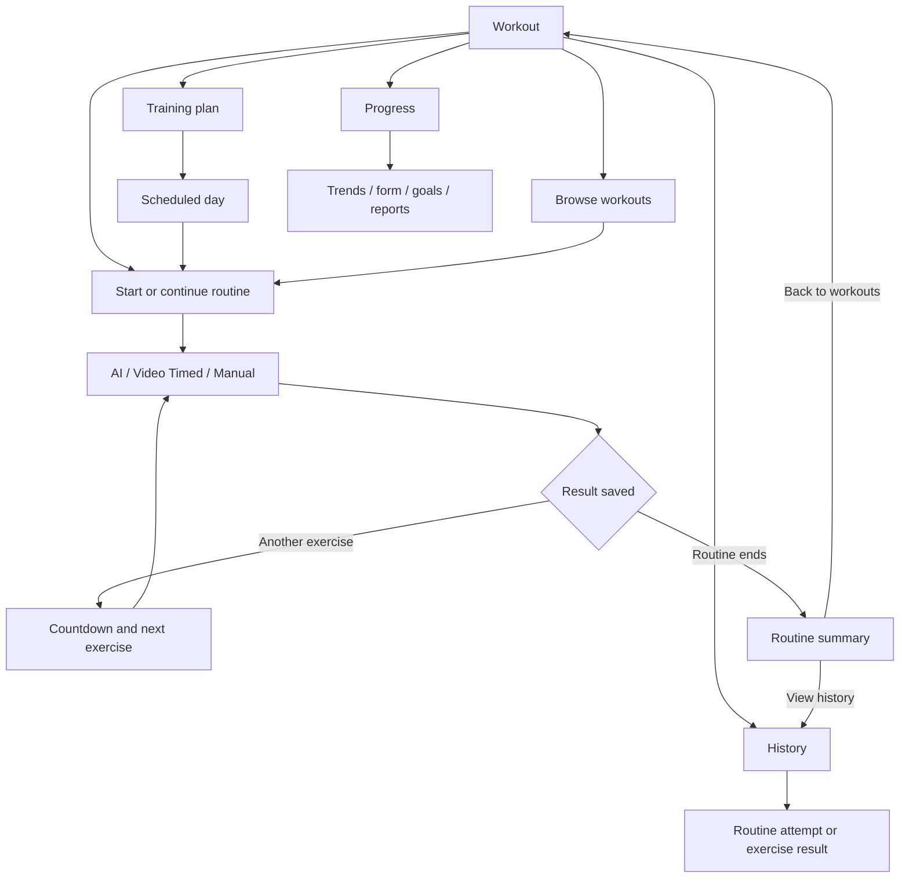

# GainPath Workout 页面层级、交互审查与优化计划

**审查日期** 2026-11-11
**审查版本** Flutter Member 端当前工作树，基线 `056872a`，包含近期未提交的 Workout 导航和动作切换改动。
**目标** 让用户从 Workout 首页快速找到要做的训练，完成后自然接上下一项，并能从固定入口查看这一次的记录和长期趋势。
**实施范围** 路由、显示状态、页面层级、操作反馈和对应回归测试。以现有 GainPath 组件和账号隔离为基础，沿用现有处方、追踪、计数、完成判定及历史格式。
**验证范围** 依据当前路由、状态投影、页面组件和本地 Flutter fixture。42 项既有测试通过，包含 Hub、休息页渲染和历史、Program、Progress、训练连续性的组件测试。两处 P0 冲突来自源码检查，仍需在实施阶段用混合来源 fixture 复现。真机、已安装 APK 版本及线上目录内容待单独验收。

## 建议的页面层级

| 层级 | 页面 | 用户在这一层要做什么 |
|---|---|---|
| L0 | 底部导航 **Workout** | 看今天或上次未完成的训练，执行主要操作。 |
| L1 | **Training plan**、**Browse workouts**、**History**、**Progress**、**Workout settings**、**Equipment** | 分别管理排程、找自由训练、查记录、看趋势、改偏好、查器材。Training plan、History、Progress 放在 Workout 首屏。设置仍在页头。 |
| L2 | 排程某天、自由训练详情、历史中的单次结果、器材详情、具体趋势 | 展开有明确身份的对象。查看某笔记录的目标是两次点击，从 Workout 进 History 再选记录。 |
| L3 | 动作教学、单个动作的测量详情、报告预览、隐私说明 | 按需深入。查看说明可直接从相关页面打开，返回时恢复选中的日期、动作或筛选条件。 |
| 训练中的状态 | AI 相机、Video Timed、手动记组、动作间倒数、Routine Summary | 这些属于同一次训练。下一项和返回动作应持续携带当前 attempt、训练日和排程身份。 |

保留现有底部导航。Progress 从 Workout 直接可达，首页与个人资料的现有捷径继续指向同一个仪表板。History 与 Progress 处于同一层。Workout 首屏按「继续或开始」「排程、历史、趋势」「动作列表」「器材及帮助」排序。

## 优先修正的逻辑冲突

1. **P0 · 排程和自由训练共用记录来源。** 自由训练首页和 `openLatest` 按账号、routine ID、计划签名和日期挑最新 checkpoint，过滤条件没有排除 Program 已关联的 attempt。历史的 Resume、Repeat、Next day 也只传 `attemptId`，而 Program 路由通过 `programAttemptId` 才会锁定排程上下文。同一模板同时用于排程和自由训练时，存在从自由入口打开排程记录、或从历史以自由模式继续的路径。目标是用现有 enrollment 的 `dayKey → attemptId` 识别来源，从任意入口恢复同一笔排程尝试。已结束的排程结果仍可查看，恢复了记录但缺少排程关联时按已知信息展示来源。 [自由训练投影](../../../apps/mobile/lib/features/workout/application/workout_hub_attempt.dart#L13) · [Journey 选择记录](../../../apps/mobile/lib/features/workout/application/routine_journey_controller.dart#L112) · [历史跳转](../../../apps/mobile/lib/app/routing/member_progress_route.dart#L602) · [排程入口](../../../apps/mobile/lib/app/routing/workout_program_route.dart#L90)
2. **P0 · 排程卡片可能用自由训练的进度。** 排程没有自己的 attempt 时，卡片的完成数、分母和状态会回退到 `freeAttempt`。用户看到的进度可能属于另一笔记录，点击主按钮却仍会开始排程。应由同一个显示模型提供名称、日期、分母、完成数和操作；排程未开始时以当日目标显示 0/N。 [卡片状态](../../../apps/mobile/lib/features/workout/presentation/member/workout_prep_screen.dart#L630) · [进度回退](../../../apps/mobile/lib/features/workout/presentation/member/workout_prep_screen.dart#L662)
3. **P1 · 多日自由训练的卡片和启动目标口径不一致。** Hub 的动作与组数汇总所有训练日；进度投影和 Journey 使用当前一天。提议默认只显示将启动或继续的那一天，提供明确的「全部训练日」入口。计划总估时和当日估时也要有不同标签；缺少当日估时时，可省略该数值。 [Hub 列表范围](../../../apps/mobile/lib/features/workout/presentation/member/workout_prep_screen.dart#L83) · [当日进度](../../../apps/mobile/lib/features/workout/application/workout_hub_attempt.dart#L27)
4. **P1 · Start workout 和 View routine 产生重复层级。** 首屏已有动作列表，View routine 又打开一份查看用清单；从其中点动作才到教学。Start workout 则打开可执行的 Journey，进入后还要操作当前动作。建议把自由训练详情和执行准备合到同一个 Journey 页面。点 Start workout 后可直接进入当天首个可执行动作及必要的授权或准备；手动首项直接显示记组。用户点 Continue workout 时恢复准确的尝试和动作，已暂停的计时或相机状态继续等待主动恢复。查看教学和全部训练日作为可选分支。 [查看清单](../../../apps/mobile/lib/features/workout/presentation/member/workout_prep_screen.dart#L124) · [首屏主动作](../../../apps/mobile/lib/app/routing/workout_prep_route.dart#L337)
5. **P1 · History、Saved sessions 和 Activity timeline 的范围不清楚。** 现有 Routine history 列出整套尝试；Workout 的 Saved sessions 会进入 Activity timeline，已登录时该页的 Log 实际是相机记录，而仪表板副标题写着「Everything you have logged」。此外，Progress 的最近 routine 卡片进入详情时省略了动作会话解析参数，直接从 Routine History 进入时却会传入。统一 History 的两种记录列表和详情入口，名称如实表达覆盖范围。 [Saved sessions 路由](../../../apps/mobile/lib/app/routing/saved_squat_sessions_route.dart#L25) · [Timeline 记录](../../../apps/mobile/lib/features/analytics/presentation/member/activity_timeline_screen.dart#L41) · [Progress 跳转](../../../apps/mobile/lib/app/routing/member_progress_route.dart#L495)
6. **P1 · 排程、历史和设置的重要入口层级不均。** Workout 的 Progress 和 Routine history 已可直接访问；Training plan 仍放在动作列表后的工具区。换回计划训练还可能需要先打开 Change workout。休息、自动继续两个选项放在标题为 Privacy & AI Tracking 的页面，音量模式则主要在相机菜单。建议直接显示 Training plan，并把 Workout settings 的训练偏好、语音及隐私拆成清楚的区块。 [Hub 工具区](../../../apps/mobile/lib/features/workout/presentation/member/workout_prep_screen.dart#L294) · [切换动作来源](../../../apps/mobile/lib/features/workout/presentation/member/published_routine_catalog_controls.dart#L64) · [设置](../../../apps/mobile/lib/features/workout/presentation/member/workout_privacy_settings_screen.dart#L196)
7. **P1 · 同样叫“下一项”，后续操作却可能不同。** 自动倒数已经存在，默认开启；倒数结束后 AI 打开相机，计时动作等视频就绪，手动动作回到选中该动作的记组界面。上屏文案要分别说明是否自动打开、何时开始计数、还要不要选手臂或记组。Auto-Continue 关闭时保留主动选择，并与倒数页使用同一套下一动作摘要。 [切换路由](../../../apps/mobile/lib/app/routing/routine_journey_route.dart#L365) · [休息页](../../../apps/mobile/lib/features/workout/presentation/member/between_exercise_rest_screen.dart#L31)
8. **P2 · 计划日按钮对状态表达不充分。** Day 卡只凭是否完成和有没有 attempt 决定 Start／Resume；被跳过的计划日依然可能显示 Start，点击会覆盖 `skipped` 为新的 day progress。这可能是有意允许补练，建议把行为写明为「补做此训练」，并显示跳过和改期分别会影响哪一天。Progress 的空态开始入口实际通往计划页，CTA 应按目标明确显示「打开训练计划」或真正回到 Workout。 [计划日卡](../../../apps/mobile/lib/features/workout/presentation/member/workout_program_screen.dart#L622) · [计划动作](../../../apps/mobile/lib/features/workout/application/workout_program_controller.dart#L187) · [Progress 动作](../../../apps/mobile/lib/app/routing/member_progress_route.dart#L453)

## 逐页审查

| 页面或状态 | 现状与建议 |
|---|---|
| **Workout 首页** | 开始、Progress、Routine History 已有直接入口。把 Training plan 提到同一区域；先显示今日排程或未完成训练，再显示动作与工具。卡片仅展示对应来源的状态。自由与计划来源在首页直接可见。 |
| **Change workout / Browse workouts** | 底部弹层同时容纳自由目录和返回当前计划。将高频的「返回计划」放回首页；目录保留难度、日期范围、动作模式、加载更多、刷新与已选状态。空目录、离线缓存和无权限有各自反馈。列表选择后的返回保持滚动位置。 |
| **View routine / RoutineScreen** | 和首页、Journey 都列动作。保留一个可执行的 Routine 详情作为主要目标；只读预览仅服务目录浏览，并标为 Preview。预览从发布快照读数据，查看时避免创建 attempt。 |
| **Training plan / Program 列表及报名** | 活跃计划、选择计划、选日期和预览目前集中在一个页面的不同状态。层级上保留同一入口；有计划时首先展示下一次训练和日历，无计划时引导选择。选择、安排日期、预览和提交按顺序显示，改选或结束放次级操作。 |
| **每周排程 / 选定日期** | 现有周列表下面同时展示选定日的动作、结果和操作。选某日后让选定日期、状态、当前主动作保持在同一可见区域。完成日用「查看结果」；未完成、错过、已跳过、休息/恢复日各有准确文案。改期和跳过保留确认与结果反馈。 |
| **Routine Journey / 动作清单** | 当前动作详情和固定操作区都提供 Tutorial，滚动时重复。保留一次辅助教学入口和一个动作主按钮；把当前项、接下来一项、完成数量放在可扫读区域。查看已完成动作时允许看结果，去下一未完成项也要明确。 |
| **Exercise Tutorial / 视频和图文** | 首页动作点击打开只读版，训练内同一教学组件可以返回并启动动作。保留两种权限与返回结果，入口名称分别写「看教学」「从这里开始」。优先展示目标、设备、简明步骤；区分无视频、视频加载失败和文字可用。 |
| **手动动作 / 记组** | 与训练清单共页，倒数后会选中该项。切换后直接把当前手动动作及「记录第 N 组」放在可见区，保留撤销。把「已读说明」放入教学上下文；该操作和记录完成使用不同状态。 |
| **首次 AI 隐私同意 / Android 权限** | 独立、必要的授权层。保留第一次确认、撤回与系统权限；相机开启前做检查。拒绝后说明如何返回训练或进入系统权限页；账户切换后回到当前账号范围。 |
| **相机说明 / 动作特定设置 / 预览** | 四步 Camera setup 是静态说明；实时预览是另一个受开关控制的诊断入口。用户可见标签用「相机摆位指南」，由 Workout 帮助、相机故障和 Recalibrate 相关位置打开。六个保留动作继续在相机画面给前视或侧视提示；弯举保留选手与换手。旧 Tracker 的特殊确认有各自路径，先验证再改。 |
| **AI Live / 相机失败 / 暂停重校准** | 大数字与 READY 已存在。首屏优先显示当前状态、计数、一个可执行提示，以及 Pause／Stop；相机问题在顶部附明确动作。按权限、上一相机尚在关闭、设备不可用和模型失败展示恢复建议；保留无需等硬件关闭即可退出的路径。此审查没有确认特定设备失败的硬件根因。 |
| **Video Timed / 播放失败** | 目前同时有工作、组间休息、暂停、退出和 Skip。分别显示「当前组有效计时」「组间休息」，按钮区分 Retry video 与 Retry save。倒数后自动启动仍等播放器 ready；失败时显示继续/返回，记录按实际有效时间保存。 |
| **动作间倒数 / 手动下一项** | 倒数有 Pause、Skip Rest、View routine；短休息已保留 3 秒准备。减少顶部与卡片重复的 Up next；按 AI、计时、手动说明下一步。Skip Rest 与 Skip exercise 保持独立术语。保留后台暂停和授权检查。 |
| **Routine Summary** | 已移除全局 View progress，并把 Routine history 提到摘要附近。继续把 Summary 定位为这一次结果：按状态突出返回、继续未完成或下一训练日中的一个主要动作；History 次级。重复训练和更细的测量收进次级区，避免长列表底部又出现相同的返回操作。 |
| **History / Routine attempts** | 当前已有 All／Completed／Unfinished 和最近排序，单日计划已去掉 Day 1。统一标题为 History，默认打开 Routines，另有 Exercise sessions。每条显示名称、计划日（多日时）、日期、状态、完成数和来源。记录增多时可按计划筛选；优先复用现有筛选状态。 |
| **Routine result / 关联的动作详情** | 整套结果显示不同完成证据并可关联测量会话；跳转来源会影响关联是否可点。统一用同一 scoped 详情入口；排程记录提供对应计划日路径，自由记录提供 Repeat 或 Resume；返回保留原列表筛选和滚动。 |
| **Exercise sessions / Activity timeline** | 当前兼做记录列表和周图。History 里的 Exercise sessions 专注逐条查找和打开结果，训练周趋势继续由 Progress 展示。已有 Saved sessions 深链接指向该列表。对计时/手动是否进入此列表，应按真实数据能力决定；现有记录和来源标签保持可区分。 |
| **Session summary / 单个动作测量结果** | 单项与整套的标题相似，通用结果还有 Back to home。标题统一为 Exercise result，并按从训练、历史、报告进入显示对应返回路径。展示已保存状态、追踪范围、局部动作结果；无法提供的估算评分使用明确的无数据状态。 |
| **Progress 总览** | 入口已独立；页面包含训练、历史捷径、目标、健康和工具。首屏优先显示时间范围、趋势、目标摘要；历史入口只承担跳转。目标、积分、身体指标保持各自去处，减少将历史列表和多个工具都当作同等级主要动作的呈现。 |
| **Workout performance / Estimated form** | 属于 Progress 深入页。趋势使用统一时段/动作筛选，分别解释有效时长、完整/部分次数及评分的适用版本。无可比分数与真实低分采用不同空态；继续执行已有权限检查。 |
| **Goal progress / Fitness targets / Points & streak / Body metrics** | 都从 Progress 可达。目标查看和编辑保持相邻；积分保留 Rewards 侧入口，身体指标保留个人资料入口。Progress 可展示摘要或链接，用词明确这些数据来自目标、积分或身体记录。 |
| **Workout report / PDF** | 现有趋势、Timeline 和仪表板都能打开报告。报告归到 Progress 工具区；子页的导出携带当前筛选，PDF 预览展示时间范围和包含的记录，分享或保存前可确认。 |
| **Workout backup** | 当前从 Progress 与历史可达。可从 History 保留一条低优先级链接，并从 Settings 的数据区打开。打开即说明本机保存、已备份、冲突及失败分别代表什么，以及训练排程、偏好等未包含项。 |
| **Workout settings** | 页名现在强调 Privacy & AI Tracking，休息与继续开关在下方。改为 Workout settings，首屏分「训练节奏」「语音」「AI 隐私」「备份与数据」。说明动作间自动继续与组间自动继续的差别；声量和模式快捷切换继续可在实时训练中使用。 |
| **Equipment / Scanner / Browse / Equipment detail** | Workout 工具目前写 Scan equipment，浏览能力藏在扫描页面内部。Equipment 工具的入口同时提供 Browse 和 Scan；相机拒绝后仍可浏览。详情把用途、怎么用、安全、视频按先后排列；已发布目录缺少与动作的真实链接时如实显示，保留从原页面返回。 |

### 渲染核对

- 390dp 常规字号下，示例 Hub 的标题、指标、进度、开始按钮和动作列表有清楚的视觉顺序。320dp／200% 字体下，标题与三条堆叠指标占据首屏，开始按钮落到下方，底部导航标签也很靠近。将次要统计置于可展开区域，先露出主要操作。现有渲染 fixture 没注入 Progress、History 和 Settings 回调。实施时用完整登录态 fixture 重拍，纳入这些入口的实际占位。 [普通字号渲染](../../../apps/mobile/build/member-workout-hub-preview/top.png) · [大字号渲染](../../../apps/mobile/build/member-workout-hub-preview/large-top.png)
- 360dp／200% 的休息页中，暂停与跳过仍可点，倒数下方的休息说明需要继续滚动才读完整。保留固定控制区，把来源说明放进可滚动的下一项详情，首屏留给当前状态、下一项和倒数。 [休息页渲染](../../../apps/mobile/build/between-exercise-rest-preview/rest-2x.png)

## 分阶段实施和验收

> 后续执行可用 superpowers:executing-plans 或 superpowers:subagent-driven-development。每阶段先建立对应失败用例，再实现和复查。现有底部导航、设备与隐私守卫、保存和完成判定是回归基线。

### 1. 修复状态和路由身份

- [ ] 在 `test/workout_hub_attempt_test.dart`、`test/workout_hub_state_copy_test.dart`、`test/routine_completion_actions_test.dart` 补用例。同模板的自由与排程记录并存，排程未开始显示 0/N；自由入口避开排程 attempt；从 History 继续排程沿用同一 attempt ID；多日卡片只汇总实际会启动的一天。
- [ ] 在 `workout_hub_attempt.dart`、`workout_hub_program.dart`、`routine_journey_controller.dart` 和 `workout_prep_route.dart` 复用现有 enrollment 和 checkpoint 引用，投影正确的来源、日期和主动作。History 按来源发起查看或继续；对已结束、已恢复和无法确认计划关联的记录，用用例规定动作。通过现有授权路由提交状态变更。
- [ ] 对已跳过计划日明确补做行为，确认在 `workout_program_controller_test.dart`、`workout_program_ui_test.dart` 中覆盖完成、跳过、恢复、改期及中途切换账户。

### 2. 整理首屏、计划、教学层级

- [ ] 在 `workout_prep_screen.dart`、`published_routine_catalog_controls.dart` 提升 Training plan 和当前来源切换，保留 Progress 与 History。把用户常用的「开始/继续」固定为单一主操作，低频工具后置。
- [ ] 在 `routine_screen.dart`、`routine_journey_screen.dart` 和 `exercise_tutorial_route.dart` 对齐只读预览、训练准备、直接打开教学三种路径。合并重复 Tutorial 操作。Program 入口用现有 `workout_program_screen.dart` 管理排程、选计划和选择日期。
- [ ] 复跑 `workout_hub_dashboard_test.dart`、`workout_hub_state_copy_test.dart`、`member_routine_discovery_flow_test.dart`、`workout_program_ui_test.dart`。验收 320/360dp、100%/150%/200% 字体下主要动作与导航可见，标签会换行，返回不丢日期、滚动或目录选择。

### 3. 让训练执行和中断恢复一致

- [ ] 在 `routine_journey_route.dart`、`between_exercise_rest_screen.dart`、`guided_timed_workout_screen.dart` 和 `real_workout_view.dart` 复用现有状态与控件，校正下一动作、等待、暂停、恢复和失败提示。手动模式回到可直接记组的当前项，AI 相机失败时可重试或退出，计时等待真实播放。
- [ ] 在 `workout_continuity_flow_test.dart`、`between_exercise_rest_test.dart`、`guided_timed_workout_flow_test.dart`、`pose_failure_recovery_test.dart` 和 `live_camera_workout_accessibility_test.dart` 验收三种模式交叉切换、0 秒处方的准备倒数、关闭自动继续、后台/权限失效、上一相机还在关闭、保存失败后重试与无重复结果。用户在真机上的语音响应和摄像头释放时间列为单独验收项。

### 4. 统一历史、进度、设置与辅助工具

- [ ] 在 `member_progress_route.dart`、`routine_history_screen.dart`、`activity_timeline_screen.dart` 和 `progress_dashboard_screen.dart` 统一 History 两个列表和 scoped 详情导航。Workout 的记录旧入口、结算 History、Progress 最近记录都打开正确的目标，返回保留列表状态。保留单日标题规则、既有记录、备份和导出。
- [ ] 在 `workout_privacy_settings_screen.dart` 整理设置分区；同一账号的语音设置与相机快捷设置使用现有偏好。将 `camera_setup_screen.dart`、`equipment_scanner_screen.dart`、`equipment_browse_screen.dart` 的帮助、扫描和浏览放到对应的低频层。
- [ ] 用 `routine_history_ui_test.dart`、`member_progress_route_test.dart`、`local_member_progress_ui_test.dart`、`progress_report_refinement_test.dart` 和 `equipment_scanner_test.dart` 验收两步找到最近训练、单次动作结果、无摄像权限仍可浏览、离线结果可查、筛选可恢复、切换账号后不可见旧数据。新增的页面状态用与既有视觉风格一致的 Flutter fixture 复查。

## 端到端验收路线

| 场景 | 预期 |
|---|---|
| 第一次进入，未开任何计划 | 在 Workout 找到 Browse 或 Training plan；打开说明不会产生完成记录。 |
| 今日排程和同名自由训练并存 | 来源清楚；卡片、点击目标和最后的历史记录使用正确身份。 |
| 完成 Testing 再次打开 Workout | 自由训练可开始新 attempt；History 仍能打开之前结果。 |
| AI → 计时 → 手动 → AI | 保存后自动倒数，按目标模式继续；只有用户亲自记录才产生手动组数。最后一项直接到结算。 |
| 取消同意、后台、相机失败、保存失败 | 原进度可恢复；离开后无自动采集；返回、重试和恢复操作含义清楚。 |
| 一个月有多次同名训练 | History 按日期区分多条记录；可筛未完成；排程日期和 Day 1 各自表达明确。 |
| 无记录或无 AI 相机记录 | History/Progress 仍可访问；计划、计时、手动以及仅相机统计各有准确空态。 |
| 小屏、200% 字体、TalkBack | 主要操作可点击，保留清楚的语义、返回顺序、安全区和错误提示。 |

已有 [Workout 页面优化记录](../../ux/workout-page-optimization-plan.md)、[Phase 4 连续训练](../../ux/module-2-phase4-workout-continuity.md) 和 [Phase 5A 发布准备](../../ux/module-2-phase5a-release-readiness.md) 为基线。此计划优先处理新增的导航冲突与状态来源。
