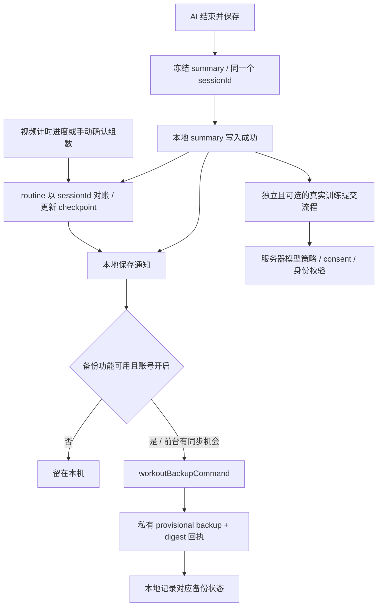

# Workout History、Progress、Report 与保存数据审计及优化计划

> **For agentic workers:** REQUIRED SUB-SKILL: Use superpowers:executing-plans to implement this plan task-by-task. Steps use checkbox (`- [ ]`) syntax for tracking. 本文件是审计和待评审计划，本次没有执行下面的产品代码修改。

**Goal:** 让用户清楚知道做了什么、结果来自哪种训练方式、哪些数据可比较，以及记录是否真正备份到 Firebase；让 History、Progress 和 Report 各自承担清晰的任务。

**Architecture:** 保留现有 account-local summary、routine checkpoint、Program journal 和独立云备份链路。先统一展示口径和历史记录组织，再补齐执行模式、评分适用性及保存状态的展示；不通过推测补造历史事实。

**Tech Stack:** Flutter/Dart、gainpath_domain、gainpath_pose、Syncfusion Charts、本地 JSON 文件、Firebase callable Functions / Firestore、Android PDF exporter。

**Spec:** 用户本次关于 History / Progress / Report / stored data / Firebase / Form Score 的审计要求；另参考 [导航审计](2026-11-11-workout-navigation-ux-audit.md)、[已完成的 Workout 优化](../../ux/workout-module-complete-optimization.md)、[Phase 5A](../../ux/module-2-phase5a-release-readiness.md)。冲突时以当前源码和本次要求为准。

## 0. 审计范围与证据边界

- 检查日期：2026-11-12；源码基点：`0da25e9`，分支 `codex/hybrid-workouts`。
- 优化主体：Squat、Biceps Curl、Calf Raise、Floor Push-up、Lateral Raise、Shoulder Press。历史数据仍包含旧动作，不按这六个动作过滤或删除历史。
- 实际检查 Member 正常账号路由、页面构建分支、数据映射、聚合、序列化、备份调度、后端存储与现有测试。额外交叉检查 Admin workout report 的数据与评分口径。
- 工作区存在其他未提交的 Admin、Home、pose timing 等修改。下面测试在此工作区运行，**不是 clean checkout 验证**；本次未改这些文件。
- 没有读取用户私有训练记录、查询线上 Firestore、检查手机账号备份设置或已安装 APK。因此不能证明用户那次 `testing` 结果已上传、已丢失或已同步。
- UI 检查以源码和 widget 测试为证据；没有把它描述为本次真机逐页视觉验收。测试中的数据全部为合成 fixture。

## 1. 结论：基础数据有区分，展示仍让人混淆

1. **训练先保存本机，不是完成就无条件写 Firebase。** 自动云备份需要 build flag、账号开启备份、有效身份和网络机会，最后还要收到成功回执。
2. **AI、Video Timed、Manual 在数据里有区分。** 但 Exercise sessions 列表只收 AI capture；视频和手动结果主要藏在 routine attempt，所以用户容易以为没有记录。
3. **当前正常账号页面没有用模拟图表填补空数据。** Member 路由传入本地 progress，优先进入真实数据分支；源码里的旧 demo 数字不是据此就能认定的线上假数据泄漏。
4. **AI 总次数没有把 routine 汇总再加一遍。** 但是“最近训练”同时列 routine 和内部 capture，形成重复的视觉表达。
5. **Estimated Form Score 是规则估算，不是姿势识别准确率。** 六个保留动作中，Lateral Raise、Shoulder Press 根本不产生评分；显示 unassessed 合理，解释不够具体。
6. **有需要优先处理的统计语义问题。** Training days 混合开始日和结束日；Curl 比较丢失左右臂模式；Member 与 Admin 的评分平均方式不同；视频训练在概览的重要性明显不足。

整体判断：保存和基础聚合已有较强保护，主要问题在于“同一笔活动被组织成什么”“这个数字究竟统计什么”“用户能否从界面理解记录的真实性”。不应通过增加漂亮图表掩盖这些问题。

## 2. 当前页面实际显示什么

| 页面 | 当前真实内容 | 数据来源 / 范围 | 评价 |
|---|---|---|---|
| Workout → History → Routines | routine 标题、完成/未完成筛选、完成动作数、时间 | 保存的 `RoutineAttempt`；按 finishedAt，否则 updatedAt 排序 | 适合查整次训练；缺日期筛选、模式概览、清楚的备份状态 |
| Routine result | 每个动作状态、AI 次数和 tracked time、手动组数、视频 active time、起止和 elapsed | 固定历史 routine snapshot + entry 结果；可打开有本地 summary 的 capture | 目前最完整的混合训练结果；需要减少术语并加强模式区分 |
| History → Exercise sessions | AI capture 的 full / partial、日期、上传认可状态，展开后看评分/coverage/版本 | 仅 `realCamera + poseMetrics`；7/30天、All time、动作筛选 | 实际是 AI session history；名称让人期待也包含视频/手动 |
| Progress → This week | Training days、Scheduled workouts completed、Adherence | 本地 capture + routine；排程读取独立 Program journal | 混合了活动事实、排程计划和不同时间锚点，需明确定义 |
| Progress → Recent workouts | 最多三条 report timeline 事件 | routine snapshots + AI captures | 同一 routine 的内部 capture 也占名额；纯视频卡片可能只见 0 手动组 |
| Progress → Explore progress | History、View reports、Estimated Form Scores、Points & streak、Workout backup | 跳转入口 | 入口偏多但缺少明确的“活动趋势”；重要 performance 入口在折叠区 |
| Measured workout trends | 最近/上次 capture、每周 capture 数、full/partial、coverage | 只有 AI capture；按日期/动作筛选 | 没有伪造重量或肌群训练量；但不是全部训练方式的 performance |
| Estimated Form Scores | 可比较的上次/最近记录、分版本平均分、分数趋势和缺失点 | AI capture 中可用的 nullable score | 分版本和缺失值处理正确；不支持评分与证据不足未清楚区分 |
| Workout report | 日期/routine/动作筛选、AI六类摘要中的相关项、评分分组、timeline、capture/routine明细、PDF | 同一 `MemberWorkoutReport` 和筛选快照 | 底层过滤与导出较完整；视频摘要缺位，内容重复，技术字段过早暴露 |
| Goal progress | 数字目标与已保存观察比较；体重来自 Profile | routine attempts + 数字目标/Profile；周频率用 UTC | 不等于排程 adherence；不能当相机测得的身体变化 |
| Weight & BMI（相关页面） | 当前 Profile 体重和 BMI；没有日期化体重趋势 | 用户自报 Profile | live 分支明确 measurement date unknown，未凭空推断减重趋势，应保留 |
| Points & streak | 独立奖励/签到系统数据 | 奖励系统 | 不代表本次训练已 server-accepted，不能与 workout completion 直接画等号 |
| Workout backup | 账号开关、成功时间、pending/conflict、逐条备份状态和重试 | 独立 backup metadata + summary/checkpoint | 有真实备份依据；结果页未携带这份状态，用户需自己找 |

正常路由证据：`member_progress_route.dart:475`、`progress_dashboard_screen.dart:118`。有些旧 dashboard 下半部分代码看起来提供了更多报告，但真实账号进入 `MemberProgressOverview` 后已经 return，不能按旧布局判断当前入口。

## 3. 一个 workout result 实际如何保存

### 3.1 不是只有一张“workout result”表

| 对象 | 粒度 / 内容 | 本地文件（application support directory 下） | 云备份 |
|---|---|---|---|
| `WorkoutSessionSummary` | 一段保存的 AI camera capture；sessionId、账号/组织、动作、起止、full/partial、tracked/rejected、nullable form、规则/模型/视角、同意版本、routineId；部分动作有专属标量汇总 | `workouts-v2/<encoded-org>/<encoded-user>/records.json` | 可选，`kind=session` |
| `RoutineCheckpoint` + `RoutineAttempt` | 一次 routine 的某一天；固定处方快照、索引、状态、capture链接、手动组数、视频计时进度、起止/完成/更新、恢复所需状态 | `routine-journeys-v1/` 或 `routine-journeys-v2/` 下对应账号的 `checkpoint-<id>.json` | 可选，`kind=routine` |
| `ProgramJournal` | 已加入 Program、当前选择、日期排程、slot→attempt 的链接和 skipped 等 | `workout-programs-v1/` 或 `workout-programs-v2/` 下的 `journal.json` | **当前 workout backup 不包含** |
| Real workout sync metadata | 专门的服务器认可 consent、capture intent、提交状态和回执 | 独立 account-scoped sync store | 不是备份状态 |
| Backup metadata | 是否开启、摘要 digest/baseline、冲突、最近成功时间等 | 独立 account-scoped backup store | 控制备份/恢复，不授予认可或奖励 |

目录中的账号分段是编码后的值，不是共用文件；不能据此声称应用做了额外的文件内容加密。文件写入使用现有锁、`.pending` 与替换；routine 另有 revision 检查。后台记录仍包含受账号保护的标识和训练标量，不能称为“完全匿名数据”。

### 3.2 三种执行方式的证据边界

| 方式 | 真正记录 | 不具备的证据 | 当前主要可见位置 |
|---|---|---|---|
| AI Tracking | 保存的 camera summary；full/partial；有效追踪与 rejected 时长；动作支持时的规则评分 | 没有训练负重、消耗卡路里、医学准确率或完整逐帧动作历史 | AI session、routine result、AI趋势、Report |
| Video Guided Timed | routine entry 的 `kind: timed`；runId、mediaIdentity、处方、completed sets、active time、pause/rest phase 等 | 没有 camera 验证、实际动作次数或 form；计时到目标不证明人确实完成动作，也不是“看完视频”的证明 | routine result / Report 的 routine部分 |
| Manual | 非 timed entry 的 self-reported 状态与 `manualSets` | 没有 AI 实测 reps、实际运动时长或 form | routine result / Report 的 routine部分 |

routine 快照含执行处方信息，timed entry 显式区分；非 timed entry 再以链接 capture / manualSets / 状态区分。它不是所有模式统一生成一个 camera summary。单纯打开教学/预览也不等于完成训练。

AI 的 `accuracy` 旧字段仍存在；无评分动作可存 0 作为兼容值。**真实报表必须继续读 `poseMetrics.formScorePercent`，不能把旧 `accuracy: 0` 显示成用户得了 0 分。** `StoredLocalMemberProgressRepository` 当前遵守这一点。

### 3.3 保存顺序与“自动”的具体含义



- AI 保存失败会保留同一冻结结果供重试；repository 相同 ID + 相同 summary 幂等，不产生第二笔 reps。
- routine 在打开 camera 前保存预留 sessionId；重开时能对账“summary 已落盘、routine 尚未更新”的中断窗口，避免重复计数。
- routine 完成、跳过和部分完成不同；只有整天要求的 entry 都 completed 且 finished 才是 `isComplete`。
- AI 尚未执行 end/save 的实时 reps 不等于已经写入 durable summary；进程被杀不能保证恢复全部未保存 AI 动作。计时/手动有自己的 checkpoint 保存路径。此处不把“有恢复机制”夸大为每帧都存盘。
- summary/checkpoint 是汇总事实，不保存 camera frames、视频文件或 raw pose histories。routine/mediaIdentity 可以有教学媒体标识，不能说所有与媒体有关的字符串都不存在。

## 4. 做完是否自动存 Firebase：准确回答

**有可选的自动备份机制，但没有“所有训练一完成就保证在 Firebase”的行为。**

| 条件 | 当前实现 |
|---|---|
| 构建支持 | `WORKOUT_CLOUD_BACKUP_ENABLED=true` 或 `USE_FIREBASE_EMULATORS=true`；源码默认 false |
| 常用 IDE 配置 | `.run/main.dart.run.xml`、`.idea/runConfigurations/main_dart.xml` 已传入 backup=true；不能仅因代码默认 false 就说当前开发版都没开 |
| 账号选择 | `BackupState.enabled` 默认 false，用户需明确开启 Automatic workout backup；AI camera consent 不代替它 |
| 身份与权限 | 相同账号/组织、有效 Member、verified email、App Check 与后端生命周期/权限检查 |
| 触发 | 本地保存通知、启动/恢复/网络机会；无需先手动进入 Progress；前台调度，失败做有界重试 |
| 成功依据 | 当前内容 digest 与保存的备份 baseline 匹配；一个全局“最近成功时间”不足以证明每条新记录已同步 |
| 失败/离线 | 本地结果保留；pending/retry/conflict 需要可见，不等于 saved-to-cloud |

后端位置：`orgs/{org}/members/{uid}/workoutBackups/{kind}-{id}`，历史版本在该文档 `revisions/{digest}`。它是 **provisional_member_backup**，不是 accepted workout。直接客户端 Firestore backup 读写被规则限制，通过 callable 完成。

另一个系统是 `submitWorkoutSessionCommand` / `orgs/{org}/workoutSessions/...`，需要独立 upload consent/intent 和服务器验收策略。当前源码的 `ENABLED_WORKOUT_TUPLES` 为空；普通 routine 的 consent fast path 把 upload choice 设为 false，Squat 仍保留可选提交设施。因此：

- 保存本地、云端备份、服务器认可、奖励发放是四个不同事实。
- `Pending upload` / `Server-accepted` 是 real workout 提交状态，**不是** automatic backup 状态。
- 现有 `records.json` 中通用 `WorkoutSyncStatus.pending` 也不能当作已经向 Firebase 排队成功的证明。
- 关闭 backup 停止后续同步，不删除云端旧备份；AI consent 撤回与备份选择分别管理，不能擅自合并隐私开关。
- 换设备可恢复支持版本的 summary/routine checkpoint；Program enrollment 和排程 journal 不在此 backup 中，不能承诺连训练计划一起恢复。
- 仓库运维文档记录备份后端曾激活。本次没有重新验证线上部署和手机 build/账号状态，不能据历史发布说明断言用户这次上传成功。

## 5. Estimated Form Score 到底怎么算、有什么用

| 保留动作 | 当前实现的估算 | 正确解读 |
|---|---|---|
| Squat | 每个识别到的完整/部分尝试，从100减躯干偏差与深度扣分，clamp 0–100，再对尝试取平均 | 当前侧视投影、规则下的动作估算；不是100%身体评估 |
| Biceps Curl | 完整程度、上臂偏移、躯干偏移规则扣分；双臂模式保存 left/right 并按各臂尝试数合并 | 需要显示 Left only / Right only / Both arms；总 reps 是各臂之和 |
| Calf Raise | 完整度及膝角规则扣分，对识别到的尝试平均 | 只反映当前可见侧规则，不证明双腿均衡或负重 |
| Floor Push-up | ROM 40% + body alignment 35% + movement control 15% + arm extension 10%；证据不足可整段不给分 | 可显示已保存四项与 issueCounts，不能补造每次动作细节 |
| Lateral Raise | analyzer 明确 `formScorePercent => null` | **此版本不提供评分**；仍有实测计数 |
| Shoulder Press | analyzer 明确 `formScorePercent => null` | **此版本不提供评分**；仍有实测计数 |

当前正确行为：

- 0 次尝试不冒充 0% 得分；缺分保持 null，图表留 gap。
- Member 按 exercise、scoringVersion、detectorId、detectorVersion、cameraView 分组；没有把不同动作分数合成一个身体能力总分。
- Member 组均分按 `full + partial` 尝试数加权。例：10次的80分与2次的50分 → 75分，不是简单平均65分。这是公式演示，非实际用户测量。
- coverage = tracked / (tracked + rejected)，不包含未测量的时间；它不是检测精度、得分或整次 routine 的完成率。
- “上次 vs 最近”只能描述两段 capture，不能证明力量/体能提升；capture 时长、目标、负重可能不同。

需纠正的细节：

1. Mobile 的 progress DTO 没有 Curl arm mode，`versionKey` 也没有它。单左臂、单右臂和双臂会落入同组；Both 的总 reps 又是左右相加。UI 虽提示处方可能不同，仍不能消除这种可比性缺失。
2. `scoredAttempts` 实际表示“有可用 session score 的 capture 内的尝试总数”，不是保存了每一次动作的独立打分证据。Floor 的缺分保护尤其应解释清楚。
3. Exercise result 已能说明 lateral/press 不评分；Form 页面和 Report 通常只有 unassessed。用户可能误以为相机坏了或动作太差。
4. Form 页、performance 页都放了同一个 Previous vs recent 模块，主次不清；技术版本字符串比有效训练解释更显眼。

### Member 与 Admin report 的交叉冲突

Admin workout report 从已备份的 provisional 数据读取，未备份本地记录不会出现。它按 **scored sessions 简单平均**，Member 按 **attempts 加权**；Admin Curl 分组还包括 armMode，而 Member 没有。即使日期和账号相同，也不能承诺两个页面得出同一个 Estimated mean。

证据：`functions/src/modules/analytics/admin-workout-reporting.ts:125`、`apps/admin_web/lib/features/analytics/application/admin_workout_reporting.dart:89`。

建议先标明本地/已备份总体和加权方式，不在本轮悄悄修改 Admin/backends 的指标契约。后续如需统一，单独做跨端契约变更和回归，不能仅改一个前端公式。

## 6. 已发现的问题、证据及优先级

优先级：P1 = 可能误导结果含义/可比性，应先做；P2 = 结构与操作成本，应随后做。本次没有据此认定数据丢失或隐私泄漏。

| ID | 优先级 | 发现 / 影响 | 证据 | 建议 |
|---|---|---|---|---|
| D01 | P1 | Training days 对 capture 用 endedAt、对有活动 routine 用 startedAt。同一个关联训练可贡献两个日期 | `member_progress_overview.dart:61–73`；合成 probe 已复现 | 先改成可证实的 `Workout start days`：有活动 routine 按保存开始日，关联 capture 不另计；standalone capture 按其开始日。明确这是开始日期，不声称是完整实际运动日历 |
| D02 | P1 | Curl 模式在汇总映射丢失，单/双臂放在同一比较组 | `local_member_progress_repository.dart:103`、domain `versionKey`、`curl_arm_metrics.dart` | 从已有 summary 读取模式并加入可比组；缺模式历史保留 unknown，不猜测 |
| D03 | P1 | Report 摘要六个指标没有视频 active time/timed sets；纯视频训练可见0 camera/0 reps/0 tracked | `workout_report_screen.dart:213–234`；PDF 反而有 video time | 按有数据的模式展示 AI、Video Timed、Manual 三块；视频进度也进入主要摘要 |
| D04 | P1 | 最近训练里的 routine 行总显示 self-reported sets，纯AI/纯视频可写0手动组 | `member_progress_overview.dart:325` | 从 entry 汇总生成模式相关摘要；没有手动组就不显示0手动组 |
| D05 | P1 | History 的 local only / Pending upload 与独立 backup 状态并不等价；结果页不能说明该条有没有备份 | `local_progress_widgets.dart:21`、backup coordinator | 展示独立的本机保存与对应内容备份状态；服务器认可放详情，失败也不否认本机已保存 |
| D06 | P1 | Member/Admin评分算法和数据总体不同，泛称“平均Form”会冲突 | 上节代码证据 | 写清 attempts-weighted / session-average、本地/云备份范围；跨端统一另立变更 |
| D07 | P1 | Goal 周频率用UTC；Progress/Report用MYT。Goal还数有活动的 started attempts，不只completed | `fitness_goal_comparison.dart:39–73` | 先醒目标注 `Attempts started · UTC week`；与 scheduled completion分区。未获新指标决策前保留既有目标规则 |
| D08 | P2 | Recent workouts 的三条可能是一个routine加其内部两个capture | overview `report.timeline.take(3)`；probe两行已复现 | 概览以routine为主，只保留未归属routine的独立AI；完整Report仍可按明确层级展开所有事件 |
| D09 | P2 | 同名History入口默认tab不同：Workout→Routines，Progress→Exercise sessions | `member_progress_route.dart:510–516` | 通用History默认Routines；有上下文时明确入口叫 `AI sessions` 并定位对应tab |
| D10 | P2 | 单日routine在History去掉Day1，在Report/timeline/backup又出现Day1 | history helper vs `member_workout_report.dart:233,406`、backup screen；probe已复现 | 全部复用 `routineDayTitle`；只有多日routine保留day标签。它是routine内部天次，不是训练日期或第几次完成 |
| D11 | P2 | Routines没有日期筛选；AI tab有7/30/all，返回同一History感觉口径变了 | history screen vs contextual filter | 日期窗口在History页统一可见；保留各tab自身状态；明确AI结束日、routine完成/更新日 |
| D12 | P2 | 最重要的performance入口藏于Measurement details；Form和Report却突出 | overview `Measurement details` | Progress一级操作放 Activity trends 与Form；Backup移至保存状态入口/设置，History直达 |
| D13 | P2 | Report默认30天，而多数子趋势默认All time，直接比较数字会疑惑 | report initialFilter vs contextual filter | 从趋势打开必须继承窗口；直接打开报告清楚显示默认窗口，统一Reset到同一个既定默认 |
| D14 | P2 | 报告重复timeline/camera详情/routine详情，大量session ID与版本串打断阅读 | report screen | 先模式摘要和趋势，再一份分层活动列表；ID/版本进入技术详情，PDF保留审计字段 |
| D15 | P2 | 不提供评分、没有尝试、当前capture证据不足都显示相似unassessed | form/report/current DTO | 展示 `Not provided for this exercise version` / `No attempts` / `Insufficient evidence` / 旧历史未知，不能从null反推出动作错误 |
| D16 | P2 | 关闭备份时 `statusFor` 返回localOnly，Backed up计数也可能归零，尽管云副本未删除 | coordinator `statusFor:67` | UI分开“同步开关已关闭”和“当前内容最后一次确认备份”；无匹配digest不能说已备份，禁止为呈现更改云端保留策略 |
| D17 | P2 | Adherence的分母包含本周未来排程，且当前汇总遍历所有已保存enrollment，不只active | `program_adherence_host.dart:62`、`weekAt` | 标签改 `Scheduled completion this week` 并说明完整周/所含计划；提供当前计划上下文。不要把周初低完成率评价成不遵守计划 |

### 不能靠当前数据准确回答的问题

- 手动组数是快照累计，没有逐组发生时间；跨多天恢复的attempt，不能拆出每天真实手动训练量。
- routine行按finish/update筛选，AI按capture结束筛选。同一attempt跨过筛选边界，routine快照汇总和窗口内capture总量可不同。现有“matching routine snapshots / whole day”说明是必要的，不能去掉后冒充同期实测总量。
- timed有起止和累计active，但不是每秒活动事件日志；跨日中断恢复不能凭一个结束时间精准拆分每日active。
- History的elapsed包含休息与离开应用的时间；不可以拿elapsed当active exercise time。
- 任意动作的负重、卡路里、肌群训练吨位、身体变化趋势，都不能从现有summary补出来。

如未来需要真正的每日活动日历/每组发生时间，应先设计版本化、账号隔离的事件契约及备份兼容；它不是本轮UI修整顺手添加的字段。

## 7. 建议的页面职责与用户流程

### 7.1 三个页面保留，但职责分开

- **History：那次训练发生了什么。** 默认routine列表，详情呈现AI/计时/手动证据；另一个明确命名的 `AI sessions` tab看独立capture。未完成、部分完成、completed分别表达，不把skipped算完成。
- **Progress：一段时间的行为变化。** 当前周/所选窗口、routine完成、明确命名的开始日、当前计划完成情况；AI趋势、计时汇总、手动组数彼此分开。重要趋势从这里一层可达。
- **Report：选定范围内的可导出事实。** 保留日期/routine/动作筛选和PDF；不再成为另一份内容重复的History。报告页面、图表与PDF使用同一不可变筛选快照。

建议结构：

```text
Workout
├─ Start / Continue workout
├─ Training plan
├─ History
│  ├─ Routines（默认）→ Routine result → AI capture detail
│  └─ AI sessions → Exercise result
└─ Progress
   ├─ 期间概览 + 当前计划完成情况
   ├─ Recent workouts（routine去重 + standalone AI）
   ├─ Activity trends（重要入口，不藏折叠区）
   ├─ Estimated Form Scores（仅支持评分的版本）
   ├─ Goal comparison（明确自己的时间/目标口径）
   └─ Workout report → Export PDF

保存/备份状态：结果页、History详情提供上下文入口 → Workout backup
Points & streak：保留独立奖励入口与来源，不当训练成就证明
```

完成routine后，主操作是回Workout/安排下一次；History和Progress作为次操作。用户不必先完成routine才能访问Progress，也不应为了找刚保存的结果经过多层报告页。

### 7.2 推荐卡片内容

**最近routine卡片：** routine标题（仅多日加Day）；完成/部分/进行中；真实完成时间或明确的last updated；`2/3 exercises`；有AI则显示实测full/partial；有计时则显示timer-recorded active；有手动则显示self-reported sets。附当前记录的保存/备份状态和查看详情。

**AI session卡片：** 动作名、结束时间、full/partial、支持时的Estimated Form、对应routine或Standalone；Curl带臂模式。coverage与版本留详情，不能使用单一绿色分数宣告姿势正确。

**Report顶部：** 日期/训练范围 → AI摘要、Video Timed摘要、Manual摘要 → 完成routine数（whole matching routine）→ 可比较评分和适量图表。无某类活动时用明确空态，不能把没有测量显示为0%或失败。

### 7.3 UI与无障碍验收原则

- 320px/360px、200%文字下卡片换行/纵向排列；重要按钮和筛选不能横向溢出。
- 状态同时用文字与图标，不只颜色；触控区域至少48 Flutter逻辑像素；屏幕阅读器读出数值、单位和来源。
- AI/Timer/Self-reported使用稳定、全模块一致的文字；Manual不能叫Measured。
- 图表提供文字总量/明细替代；缺失评分显示gap，不连成已知数据或当0处理。
- 返回保持tab、筛选和滚动位置；刷新失败显示旧数据及提示，不静默切示例或抹成0。
- 继续训练与历史查看分开；备份失败不阻止已本地保存后的安全继续流程。

## 8. 待实施任务（本次未执行）

### Task 1：修正概览活动组织与日期标签（D01/D04/D08/D10）

**Files:** 修改 `member_progress_overview.dart`、`member_workout_report.dart`、`workout_backup_screen.dart`；复用 `workout_presentation.dart`。测试 `progress_dashboard_compact_test.dart`、`member_workout_report_test.dart`、`routine_history_ui_test.dart`。

**Interfaces:** 现有 `MemberWorkoutReport.timeline` 保留完整事件；新增展示helper `overviewWorkoutEvents(MemberWorkoutReport report)` 返回 `List<WorkoutReportTimelineEntry>`，只用于概览，过滤已归属routine的capture；不改底层AI合计。`routineDayTitle(PublishedRoutine, int)`统一标题。

- [ ] 加失败测试：routine含两个已链接capture和一个standalone →概览两张训练卡，报告仍可查全部三段capture，fullReps不改变。
- [ ] 加失败测试：纯timed不显示0 self-reported；mixed只显示实际存在的模式；单日标题各页面一致。
- [ ] 加失败测试：跨MYT午夜的关联capture只跟随routine开始日用于`Workout start days`；standalone用capture开始日；空attempt不计；没有历史开始时间不猜补。
- [ ] 实现helper与卡片摘要，替换日期锚点和标签；保持原summary/checkpoint不变。
- [ ] 运行对应三组测试，人工对照卡片语义；独立提交本任务文件。

### Task 2：补齐Curl可比性和评分适用性（D02/D15）

**Files:** `packages/gainpath_domain/lib/src/analytics/local_member_progress.dart`、Mobile `local_member_progress_repository.dart`、`exercise_improvement.dart`、form/report/local progress widgets。测试 domain `local_member_progress_test.dart` 与 Mobile `local_member_progress_repository_test.dart`、`goal_comparison_report_test.dart`、`workout_report_ui_test.dart`。

**Interfaces:** 给 `LocalWorkoutProgressRecord` 增加可选 `String? armMode`，只从既有 `summary.poseMetrics.curlArms?.mode.name`映射，并加入`versionKey`与重复记录一致性检查；旧summary无字段保留unknown。增加`formAssessmentLabel(LocalWorkoutProgressRecord record)`展示helper，以已知scoringVersion与尝试数产生适用性说明，不修改分数。

- [ ] 加失败测试：leftOnly/rightOnly/both不进入同一个form/comparison组；旧unknown不混入已知模式；导出的分组标签保持模式。
- [ ] 加失败测试：lateral/press无评分显示版本不提供；0attempt与证据不足分开；null不成为0%；旧unknown不自称已评分。
- [ ] 从已有summary映射字段，更新组key/标签；维持现有attempt加权及姿势算法。
- [ ] 同组比较保留“处方/时长可能不同”说明；Curl总次数标注两臂合计，保留左右明细入口。
- [ ] 运行domain与Mobile对应测试；独立提交。不要为兼容而改旧JSON或Firebase schema。

### Task 3：让混合训练Report完整且不重复（D03/D06/D13/D14）

**Files:** `member_workout_report.dart`、`workout_report_screen.dart`、`contextual_progress_filter.dart`、`workout_performance_screen.dart`；测试 `member_workout_report_test.dart`、`workout_report_ui_test.dart`、`android_workout_report_exporter_test.dart`。

**Interfaces:** 复用 `WorkoutReportRoutine.guidedMicros/timedSets`，在`MemberWorkoutReport`提供对应`int? guidedMicros`、`int? timedSets`只读汇总getter（history unavailable时null）；`toDocument()`与页面消费同一report。视频/手动明确是matching routine snapshots，不改成逐日实测事件。

- [ ] 加失败测试：mixed fixture包含2段AI、1个timed、1个manual，AI只加summary一次，timed只加guided，manual不增加reps/form；纯timed报告主要摘要仍有有效资讯。
- [ ] 加失败测试：日期/动作/routine筛选、全部匹配行与PDF一致；65+行不截断；exercise筛选仍声明completed routine是whole-day上下文。
- [ ] 加失败测试：跨窗口routine的旧manual/timed累计显示为快照，不能标成该窗口真实逐日训练量。
- [ ] 实现三种证据摘要和分层活动明细；技术ID/版本折叠；直接打开使用既定30天，Reset也回30天，趋势带入的filter原样保留并可见。
- [ ] 给评分平均标明attempt-weighted；记录Admin session-average差异，不修改Admin指标契约。
- [ ] 运行报告与exporter测试；新UI再做320/360和200%检查；独立提交。

### Task 4：在正确层级显示保存与备份状态（D05/D16）

**Files:** `workout_result_screen.dart`、`routine_history_screen.dart`、`local_progress_widgets.dart`、`member_progress_route.dart`、backup screen；如需展示helper单独建 `workout_save_status.dart`。测试 `workout_backup_ui_test.dart`、`workout_backup_scheduler_test.dart`、`workout_report_route_test.dart`、`progress_report_refinement_test.dart`。

**Interfaces:** 展示层消费已有`WorkoutBackupRecord.key/digest`和`BackupState.baselines/enabled/conflicts`，不依据real outbox status猜backup。可新增`workoutSaveStatusLabel({required bool localSaved, required bool backupEnabled, required bool currentDigestBackedUp, required bool retryNeeded, required bool conflict})`，返回一致文字。

- [ ] 加失败测试：local已存但backup关闭/未上传/失败都不会显示Backed up；与当前digest匹配才可显示已确认备份；未知状态不伪装成功。
- [ ] 加失败测试：backup关闭后历史确认副本与关闭未来同步分别表达；内容改变则失效；Server-accepted不改变backup徽章。
- [ ] 加失败测试：延迟加载回执时切账号/退出不发布原账号状态；备份异常不阻塞本地保存后的继续。
- [ ] 接入结果/详情上下文入口，复用共享lease，避免新建相互竞争的sync；不自动替用户开启备份。
- [ ] 运行上述测试及相关账号隔离测试；独立提交。后端保留/删除策略与权限不变。

### Task 5：统一History/Progress入口与统计口径文案（D07/D09/D11/D12/D17）

**Files:** `member_progress_route.dart`、`workout_history_tabs.dart`、`routine_history_screen.dart`、`member_progress_overview.dart`、`goal_comparison_report.dart`、`program_adherence_host.dart`。

**Interfaces:** 保留`MemberProgressView`与共享History路由；通用History默认Routines，显式AI入口定位sessions；日期筛选复用`WorkoutReportFilter.includes`，routine用finish/update，AI用endedAt；各自口径可见。

- [ ] 加失败测试：通用History入口一致；AI上下文定位正确；返回恢复tab/filter/scroll；重要Activity trends一层可达。
- [ ] 加失败测试：Routines日期筛选与状态筛选可组合；旧记录缺日期有说明，不丢原始记录。
- [ ] 加失败测试：MYT周日午夜与UTC周边界同屏仍能正确解释不同数字；不改现有Goal UTC算法和计数标准。
- [ ] 加失败测试：Adherence显示完整周分母、未来排程与所含计划上下文；没有计划/加载失败为unknown，不假造0%。
- [ ] 重排入口和文案；Backup从结果状态可达；Points独立来源明确。继续使用当前会员访问控制，不借重排改变访问规则。
- [ ] 跑route/compact/history/goal/program adherence测试并检查窄屏；独立提交。

### Task 6：集成验收与设备待办

- [ ] 运行上述全部受影响Flutter/domain测试；再检查backup restore冲突、saved-summary reconciliation、completion exactly-once，失败先查明原因。
- [ ] 用合成fixture从routine完成→History→Progress→Report→PDF核对每个可见数字；覆盖六个AI动作及AI/Timed/Manual混合、无评分/无活动/缺旧时间/不可读数据。
- [ ] 静态分析所有实际修改文件，构建Android Debug APK；注明clean checkout或dirty工作区；安装/线上写入不属于这份分析任务。
- [ ] 在设备上验收PDF保存/打开、charts文字可读、字体缩放、返回/刷新、当前条目备份徽章；只用获准测试账号和操作，不将私有样本纳入报告。
- [ ] 跨设备备份验收应明确“支持的summary/checkpoint恢复，Program journal不恢复”；关闭开关不删除云副本。
- [ ] 更新实施报告、操作说明及变更文件清单/commit。若只改展示不改数据协议，应明确写出；如发现需要迁移，先单独设计兼容步骤。

## 9. 本次实际验证

已在现有工作区重新运行，未写入真实账号数据：

| 批次 | 内容 | 结果 |
|---|---|---|
| A | Member report、local progress repository、compact Progress、report refinement、report UI、backup scheduler、backup local store | **57 passed** |
| B | Routine history UI、local progress UI、goal comparison report + 3个只读合成审计probe | **27 passed**（24现有 + 3 probes） |
| C | Domain local member progress、fitness goal comparison | **36 passed** |
| 合计 | 现有行为与审计证据验证 | **120 passed：117现有测试 + 3审计probes** |

这些pass证明的是现有断言与本次复现，不代表D01–D17已经修复。probe特意断言当前两行timeline、当前不一致Day1、当前跨日两个training dates，以固定审计证据；未来回归应改成期望行为，并放到正式test目录。

现有报告UI测试包含320px/大字无overflow、筛选继承到PDF、缺失评分gap、取消/失败导出、账号切换丢弃迟到结果。现有compact测试包含窄屏大字。未宣称覆盖所有新设计或真机可读性。

命令（从各package目录执行）：

```powershell
# apps/mobile
flutter test test/member_workout_report_test.dart test/local_member_progress_repository_test.dart test/progress_dashboard_compact_test.dart test/progress_report_refinement_test.dart test/workout_report_ui_test.dart test/workout_backup_scheduler_test.dart test/workout_backup_local_store_test.dart --reporter expanded
flutter test ../../build/history_progress_audit_probe_test.dart test/routine_history_ui_test.dart test/local_member_progress_ui_test.dart test/goal_comparison_report_test.dart --reporter expanded

# packages/gainpath_domain
flutter test test/local_member_progress_test.dart test/fitness_goal_comparison_test.dart --reporter expanded
```

本地证据：`build/history-progress-data-audit-20261112-tests.log`、`build/history-progress-data-audit-20261112-probes.log`、`build/history-progress-data-audit-20261112-domain.log`、`build/history_progress_audit_probe_test.dart`。build是忽略的诊断目录，clone后不会自动带入probe；它不是已提交回归测试。正式实施Task1时要在受版本控制的测试中重建案例。

本次为文档审计，没有改产品Dart/后端代码，没有再跑全pose suite、静态分析或APK build，也没有安装APK或操作Firebase。SDK为Flutter 3.38.9 / Dart 3.10.8。最初受限SDK调用无输出被中止；随后通过获准SDK执行完成上述测试，没有把未启动的调用计作pass。

## 10. 源码定位索引

以下路径相对仓库根目录，行号以审计时工作区为准：

- `apps/mobile/lib/features/analytics/presentation/shared/member_progress_overview.dart:45`：真实概览、日期计数、最近事件与入口。
- `apps/mobile/lib/app/routing/member_progress_route.dart:475`：真实页面组合、History tab、Profile/goals/报告与权限。
- `apps/mobile/lib/features/analytics/presentation/member/workout_history_tabs.dart:25`：tab保持状态。
- `apps/mobile/lib/features/workout/presentation/member/routine_history_screen.dart:43`：routine列表与整次结果。
- `apps/mobile/lib/features/analytics/presentation/member/activity_timeline_screen.dart:37`：AI session history真实分支。
- `apps/mobile/lib/features/analytics/domain/member_workout_report.dart:104`：快照日期、AI/手动/计时汇总、过滤、timeline与PDF。
- `apps/mobile/lib/features/analytics/data/local_member_progress_repository.dart:36`：真实summary映射、异常警告、上传回执及账号检查。
- `packages/gainpath_domain/lib/src/analytics/local_member_progress.dart:140`：评分加权、group key、去重、MYT周统计。
- `apps/mobile/lib/features/analytics/presentation/member/workout_report_screen.dart:108`：报告真实屏幕摘要与明细。
- `apps/mobile/lib/features/workout/presentation/member/workout_result_screen.dart:239`：实测结果与各动作限制。
- `apps/mobile/lib/features/workout/domain/workout_pose_metrics.dart:158`：各版本标量序列化。
- `apps/mobile/lib/features/workout/domain/routine_attempt.dart:20`：三种执行结果、快照、complete判定。
- `apps/mobile/lib/features/workout/application/routine_journey_controller.dart:187`：summary对账及恢复；`:427`起构造snapshot。
- `apps/mobile/lib/features/workout/application/real_squat_session_controller.dart:478`：冻结、先本地保存与重试。
- `apps/mobile/lib/infrastructure/local/file_workout_session_store.dart:11`、`file_routine_journey_store.dart:8`、`file_program_enrollment_store.dart:11`：持久化位置与版本。
- `apps/mobile/lib/app/di/workout_backup_factory.dart:11`、`workout_store_io.dart:11`：构建开关、共享coordinator与保存通知。
- `apps/mobile/lib/features/workout/application/workout_backup_scheduler.dart:35`：前台机会、停用、重试。
- `apps/mobile/lib/features/workout/data/stored_workout_backup_local.dart:24`：实际备份/恢复的对象范围。
- `functions/src/modules/workouts/workout-backup.ts:41`：私有存储、digest、版本和权限；`workout-service.ts:18`：认可模型策略。
- `apps/mobile/lib/app/routing/real_squat_route.dart:127`、`squat_result_sync.dart:63`：可选提交；`workout_prep_screen.dart:870`：persistent consent与upload choice。
- `packages/gainpath_pose/lib/src/squat/squat_analyzer.dart:326`、`curl/curl_analyzer.dart:222`、`calf_raise/calf_raise_analyzer.dart:431`：各动作规则评分。
- `packages/gainpath_pose/lib/src/floor_push_up/floor_push_up_analyzer.dart:217`、Mobile `floor_push_up_metrics.dart:44`：证据不足与四项加权。
- `packages/gainpath_pose/lib/src/lateral_raise/lateral_raise_analyzer.dart:37`、`shoulder_press/shoulder_press_analyzer.dart:37`：明确不提供评分。
- `apps/mobile/lib/features/workout/domain/curl_arm_metrics.dart:1`：臂模式、左右汇总。
- `packages/gainpath_domain/lib/src/analytics/fitness_goal_comparison.dart:39`、Mobile `goal_comparison_report.dart:27`：目标UTC周与MYT说明。
- `apps/mobile/lib/features/analytics/presentation/program_adherence_host.dart:62`：本周已保存计划的分母与完成数。

**本次交付变更：** 仅此计划文件；忽略目录内新增合成probe及测试日志用于本地核对。未提交产品修改，也未创建实施commit。下一步按Task1–5逐个实现和验证，不能将本文件当作已修复或线上验收报告。
