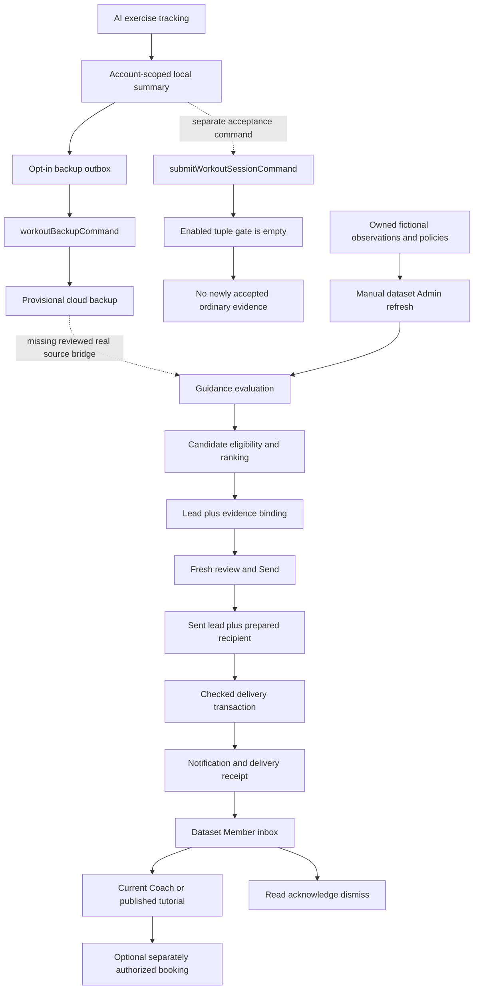

# GainPath Module 13 — comprehensive recommendation audit

Date: 14 November 2026, Asia/Kuala_Lumpur. Source baseline: `9e5d2f1`.

Repository: `C:/Users/Ngzhe/StudioProjects/gainpath`.

This is an analysis-only audit. Product sources, deployment configuration and records were not changed. No generation, Send, consent mutation, paid API call, deployment or commit was performed. Only this requested report was authored. Test files were inspected, and no test suite was executed. Historical test/deployment results remain historical evidence. Current deployed Firebase state and native/browser UI were not queried in this audit.

## 1. Executive summary

**Module 13 has a substantial, guarded recommendation implementation and a persistent fictional-cohort integration. It does not currently provide an automatic consumer recommendation service for ordinary Members.**

The controlled journey includes consent-scoped observations, manual Admin generation, candidate eligibility, ranking, persisted evidence bindings, review, an actual in-app notification and protected Member responses. This is more than a screen mock. Real Firebase persistence, however, does not establish genuine physical assessment data or live semantic AI ranking.

Ordinary Admin can inspect the isolated FYP recommendations through a read-only unified transport. Ordinary Members receive an unavailable recommendation repository, and their purpose-consent interface remains a disabled preview. No Module 13 Coach recipient workflow is composed. The normal Functions entrypoint contains no reactive `LeadEvaluator` or recommendation recovery worker.

Cloud backup remains `provisional_member_backup`. The accepted-workout service has an empty enabled model/rule tuple allowlist. No requested exercise becomes ordinary server-accepted recommendation evidence merely because it was saved or synced.

The main algorithm defect is that low-coverage scores influence the guidance average while being excluded from minimum-evidence qualification. Unrelated/incompatible sessions also affect duplicate identity. Recency weighting, weakest-exercise selection and Member-goal-based selection between content and coaching are absent.

Consumer readiness decision: **No-go for ordinary Member activation.** Reuse the existing privacy, eligibility, receipt and navigation architecture. Complete evidence admission, deterministic decision policy, ordinary Member integration, delivery recovery and observed UX acceptance first. Additional machine-learning models or paid AI APIs are unnecessary for those steps.

Priority convention: P0 denotes a blocker before real-user activation, not an observed production breach. Source-confirmed defects are distinguished below from requirements gaps, product choices and unverified visual risks.

## 2. Original specification versus actual implementation

Original documents were read directly and treated as specifications, not instructions to execute.

- `C:/Users/Ngzhe/Documents/A-FYP/Final Md file/c4.md`, especially 1592–1597, 1637–1644, 2517–2541 and 2905–2918.
- `C:/Users/Ngzhe/Documents/A-FYP/Final Md file/c3.md`, Module 13 UC-13.1–13.15, especially 6270–6305 and 6685–6741.
- Related aligned algorithm supplement and existing Module 13 implementation/acceptance reports were used for traceability. Current source controls implementation findings.

| Original obligation | Current implementation and exact evidence | Assessment |
| --- | --- | --- |
| Chapter 4 reactive `WorkoutSessionCompleted → LeadEvaluator`, idempotency before mutation | `functions/src/index.ts` exports no evaluator. `functions/src/modules/recommendation/recommendation-queue-generation.ts:createRecommendationQueueGeneration` accepts manual commands and continuations | Automatic journey missing |
| Recency-weighted `postureAccuracyScore` history, sustained decline | `exercise-insights-aggregation.ts:aggregateExerciseEvidence` uses arithmetic means. `evidence-learning-need.ts:49` checks latest compatible timestamp | Temporal window/freshness exists, weighting/decline absent |
| Adjustable `RiskThresholdConfig` | `recommendation-configuration.ts:createRecommendationConfigurationCommand` selects server-reviewed policy IDs and uses revision receipts | Safer versioned mechanism, different from a free numeric slider |
| Strength/form goals → Trainer, general fitness/weight-loss goals → Content | `demo-firestore-adapters.ts:engine` accepts Admin-selected kind. `demo-dataset.ts:48` fixes `technique_foundations/beginner` | Member-goal routing incomplete |
| High/Moderate/Low leaderboard, 70% example | `exercise-insights-presentation.ts:projectExerciseInsights` separates compatible groups and reviewed score-below attention | Educational amendment, no universal injury-risk ranking |
| Coach specialization and branch match | `trainer-candidate-eligibility.ts:168–243` checks curated expertise, publication, certification, branch and bookability | Library implemented, controlled fictional sources |
| Corrective exercise video | `content-candidate-eligibility.ts:125–211` permits steps and/or video with digest-bound suitability | Exercise tutorial matching, no supported fault diagnosis or video guarantee |
| Admin/Staff review, Send and Dismiss | `recommendation-queue-security.ts:32–36` requires literal Admin | Staff parity absent |
| Chapter 4 `CoachNotifier` on approved dispatch | `recommendation-delivery.ts:157–160` writes Member notification/recipient | No Coach notification workflow |
| Chapter 3 Member feed and optional booking | Member inbox → current Coach/tutorial → existing booking navigation | Controlled runtime implemented, ordinary Member unavailable |
| Chapter 3 client-side manual matching | Current comparison/evidence authorization is server-owned | Security improvement and explicit architecture amendment |

The originals conflict. Chapter 3 describes manual refresh and Member recipients, while Chapter 4 describes a reactive evaluator and CoachNotifier. Approve one operational contract and record the academic amendment. Do not silently claim both flows are implemented. Historical “risk”, “accuracy” and “compliance” language also needs a single educational measurement definition.

## 3. Feature inventory and actual role access

| Feature | Implemented scope | Ordinary account access | Limit / evidence |
| --- | --- | --- | --- |
| Evidence extraction and compatibility | Validated library, backup and fictional observation projections | No ordinary recommendation source | `workout-evidence.ts`, `fyp-evidence-reader.ts` |
| Exercise Insights, chart, filters, CSV, content coverage | Protected bounded projection and disclosure rules | Ordinary Admin views fictional cohort read-only | `exercise-insights.ts`, `exercise-insights-presentation.ts`, `exercise_insights_panel.dart` |
| Configuration | Reviewed-policy selection, receipts, default-off activation | Ordinary Admin settings disabled | `recommendation-configuration.ts`, `admin_shell.dart:89–110` |
| Generation | Manual bounded synthetic/FYP composition | Ordinary Admin Refresh disabled | `recommendation-queue-generation.ts`, `fyp-backend.ts:118–127` |
| Trainer/Content queues | Actual cohort Firestore leads and history | Ordinary Admin can inspect | `firebase_demo_recommendation.dart`, `fyp-scope.ts` |
| Send/Dismiss | Controlled dataset Admin, transactional audit and preparation | Ordinary Admin read-only; Staff excluded | `recommendation-lead-decisions.ts` |
| In-app delivery | Recipient, notification and receipt transaction | Dataset Member only | `recommendation-delivery.ts` |
| Read/acknowledge/dismiss | Owned revisioned commands and receipts | Dataset Member only | `recommendation-member-service.ts` |
| Current Coach/tutorial destination | Protected resolver and existing UI routes | Dataset Member repository composed | `member_recommendation_navigator.dart` |
| Ordinary Member purpose consent | Disabled preview | Unavailable | `recommendation_privacy_navigation.dart:18–29` |
| Live AI ranking | Gemini adapter exists, cohort injects structured mock | No current live inference proof | `demo-firestore-adapters.ts:84` |
| Coach notification/handoff | No Module 13 route/service | Missing | Coach shell, delivery recipient is Member |
| Automatic evaluator/recovery/retention worker | No normal registration | Missing | `functions/src/index.ts` |
| Legacy risk seed | Retained prototype classes and in-memory data | Neutral repository in ordinary Admin dependencies | `risk_policy.dart`, `recommendation_seed.dart`, `admin_presentation_dependencies.dart` |

Key dependency-injection evidence:

- `apps/admin_web/lib/app/shells/admin_shell.dart:89–110` constructs `FirebaseDemoAdminRepositories(UnifiedAdminTransport, readOnly:true)` for canonical Admin and dataset transport for fictional Admin.
- `functions/src/modules/dataset/fyp-backend.ts:38–40` allowlists canonical Admin read operations. Configuration writes, refresh and decisions are denied server-side.
- `apps/mobile/lib/app/di/member_recommendation_factory.dart:35–44` selects `UnavailableMemberRecommendationRepository` when `datasetScope == null`.
- `apps/mobile/lib/navigation/recommendation_privacy_navigation.dart:18–29` supplies consent repository/notice only for a dataset session.
- Stale comments saying all Module 13 services are “local only” are not sufficient evidence. The FYP release wrapper supplies a narrowly controlled deployed composition. Current live activation was not independently checked here.

## 4. Architecture and data flow

### Stage-by-stage implementation

| Stage | Source / entrypoint | Data and validation | Failure, retry and isolation |
| --- | --- | --- | --- |
| Tracking | Exercise registry and exercise analyzers | Exercise, metric schema, rule/model/view/mode, nullable Form Score; local camera/AI consent | Tracking/local result is not accepted cloud evidence |
| Local save | `floor_push_up_workout_session.dart:508,552`, other session `_save` methods; `file_workout_session_store.dart:11–13,74,92` | Organization/Member directory, record-scope check, atomic pending-file rename | Saved result and sync outcome remain distinct |
| Sync scheduling | `workout_backup_scheduler.dart:6–14,30–42,72–104` | Account/lifecycle checks, local-change debounce, launch/resume/network opportunities | 300ms debounce, bounded 5/15/45s retry delays; stale account stops work |
| Firebase gateway | `firebase_workout_backup_gateway.dart:14–15,27,67–90` | Current verified account, scoped callable, negotiated supported records | Remote response must retain ownership/schema meaning |
| Backup | `functions/src/modules/workouts/workout-backup.ts:25–65` | Payload/owner/digest validation, explicit backup consent, `provisional_member_backup` | Same digest replays; session conflict rejected; routine base revision enforced |
| Acceptance | `workout-service.ts:103–151`, `workout-callables.ts` | Verified active Member, workout consent, published routine/exercise and allowed tuple | Empty tuple allowlist rejects default admission before accepted session write |
| Extraction | `workout-evidence.ts:extractWorkoutEvidence`, `evidence-queue-source.ts:createEvidenceDrivenQueueSource` | Full payload/digest validation, exact compatibility, explicit capture attestation and purpose-scoped history | Null/unknown/incompatible data abstains; no automatic ordinary backup bridge |
| FYP source | `fyp-evidence-reader.ts`, `fyp-observations.ts` | Owned metadata/payload inventory, assignment, capability, policy and consent fingerprints | Reject unknown row, drift, out-of-window or unowned data; observations remain fictional |
| Evaluation | `evidence-learning-need.ts:deriveEvidenceLearningNeed` | Reviewed synthetic policy, samples/days/attempts/coverage/age/threshold | Typed abstention; no diagnosis |
| Generation | `recommendation-queue-generation.ts:62–115` | Admin, current Member purposes, trusted source; lead/run/page/binding writes | Page size 2, 60s lease, max 20 items; idempotent page/run receipts; provider work outside transactions |
| Review | `recommendation-read-services.ts`, `recommendation-lead-decisions.ts:62–142` | Fresh detail, source/candidate/Member fingerprint and expiry checks | Revision conflicts, stale/revoked/expired outcomes; durable command replay |
| Delivery | `recommendation-delivery.ts:122–160` | Fresh Admin, intended Member/Auth, immutable binding, current purposes/target | One transactional recipient update, notification and delivery receipt; deterministic replay |
| Member action | `recommendation-member-service.ts:loadProjection/createMemberRecommendationService` | Owner check before projection; current identity, purposes and destination | Redacted unavailable detail; read/ack/dismiss revision receipts |
| Destination | `member_recommendation_navigator.dart:59–96,99–187` | Re-resolve, current published verified Coach/shared branch or valid routine exercise | Optional booking rechecks subscription/fees/slots/security separately |

### Physical Firestore records

Generic services use logical `orgs/{org}` paths. `fyp-scope.ts:logicalFypPath` rewrites them beneath **`orgs/gainpath/cohorts/fyp-v1`** for the controlled dataset. Reading a logical path in a library does not establish real-user production access.

| Record | Purpose |
| --- | --- |
| `users/{uid}`, `orgs/{org}/members/{uid}` | Canonical account/organization membership |
| `orgs/{org}/members/{uid}/workoutBackups/{kind}-{id}/revisions/{digest}` | Provisional backup head and immutable digest revisions |
| `orgs/{org}/workoutSessions/{keyOf(member,sessionId)}` | Accepted sessions, currently blocked by default tuple gate |
| `orgs/{org}/recommendationConsent/{memberId}` | Four independent versioned purposes/history boundary |
| `recommendationConfiguration/current`, `recommendationConfigurationReceipts/{commandKey}` | Reviewed selected policy and idempotency |
| `recommendationLeads/{leadId}` | Need, Member/exercise, target, summary, ranking provenance, revision/status/expiry |
| `recommendationEvidenceBindings/{sourceFingerprint}` | Exact evidence/policy/candidate/Member binding |
| `recommendationRuns/{runId}/pages/{index}` | Durable generation pages and receipts |
| `recommendationRefreshLocks/{kind}`, `recommendationGenerationState/{kind}` | Lease and latest summary |
| `recommendationCommandReceipts/{commandKey}`, `recommendationDecisionAudits/{commandKey}` | Admin decision receipt and audit |
| `recommendationRecipients/{recommendationId}` | Prepared/delivered/withdrawn and Member response timestamps |
| `recommendationDeliveryReceipts/{recommendationId}` | Proof bound to immutable recipient/lead |
| `notifications/recommendation-{id}` | Member in-app notice |
| `recommendationMemberCommandReceipts/{digestOf(actorId,commandId)}` | Owned action/revision replay record; `recommendation-member-service.ts:110–123` |
| `datasetAssignments/{uid}`, `datasetRuntimeReleases/fyp-v1` | Server-only assignment/release authority |
| Cohort `module13DemoSource/current`, policy/expertise/suitability documents | Fixed source inventory/window and reviewed fictional curation |

Names without a root in this table are relative to `orgs/{org}` and are rewritten in the FYP scoped store. Historical design collections `trainerMatchingLeads` and `contentRecommendationLeads` are not the current physical queue contract.

## 5. Recommendation algorithm analysis

The source supplies a Member/exercise and reviewed policy. Derivation validates a bounded batch and exact compatibility, checks sample minima and latest age, compares the mean with `score_below`, then builds an allowed educational need. Admin-selected queue kind chooses Trainer or Content candidates. Only the top eligible ranked candidate becomes the lead.

| Concern | Actual behavior | Evaluation |
| --- | --- | --- |
| Eligibility | Exact model/rule/schema/view/mode; null/unscored abstain | Correct separation. Client provenance alone cannot establish capture trust |
| Minimum evidence | Synthetic policy: 3 scored sessions, 3 days, 30 attempts, per-session coverage ≥.8 | Fixture configuration, not approved consumer evidence standard |
| Threshold | Synthetic policy <65; equality abstains | Explainable educational rule, no clinical meaning |
| Recency | Latest compatible record within 7 days; request window bounded to 90 days | No recency weights or decline detection; old records still influence mean |
| Aggregation | Mean session score per Member, then equal Member weighting per group | Descriptive statistic, not cross-exercise risk ranking |
| Assessed attempts | Full + partial repetitions | Evidence quantity, not correct repetitions |
| Coverage | tracked/(tracked+rejected), unmeasured time excluded | Not detection accuracy or full-session visibility |
| Trainer ranking | 35 exercise, 30 objective, 10 level, 15 availability, 10 experience | Explainable experimental weights; many components are 1 after hard filtering |
| Content ranking | 50 exercise, 30 objective, 20 level | Curated matching foundation; no semantic video analysis |
| Unknown components | Baseline renormalizes remaining weights | Missing experience can outscore known low experience; policy needs explicit review |
| Optional AI | 40% baseline +60% relevance; exact class before compatible class | Experimental, not calibrated correctness/confidence |
| Provider in cohort | `gainpath-demo-structured-mock-v1`, index-based relevance | `ai_reranked` storage origin is not evidence of live Gemini usefulness |
| Personalization | Need objective/level from policy, source-selected exercise, kind from Admin request | Goal-based routing and weakest-exercise identification missing |
| Explanation | Controlled reason templates and evidence references | Avoids invented faults, but weak answer to “why this Member now?” |
| Idempotency | Run/page/decision/delivery/Member receipts and observation identities | Strong mechanics; no cross-key fatigue budget |
| Freshness | Evidence/candidate/consent/policy binding rechecked before sensitive actions | Safe blocking exists, may over-invalidate on broad source changes |

### Confirmed algorithm defect A01 — decision average includes excluded-quality scores

`functions/src/modules/recommendation/exercise-insights-aggregation.ts:27–39` adds every non-null supported score to `m.scores`. Coverage-qualified sessions alone enter `m.qualified`. Minimum sessions/days/attempts use `qualified`, but the mean uses all `scores`. `evidence-learning-need.ts:50–52` thresholds that mean.

Analytical counterexample, not an executed test: three coverage-qualified scores of 80 plus one short low-coverage score of 0 produce mean 60 and can cross threshold 65 despite qualified mean 80. The inverse suppresses guidance. A short poor-quality record need not materially lower aggregate coverage.

Expected: use one explicitly quality-qualified decision cohort for minimums and decision score, and show descriptive all-session averages separately. Impact: incorrect or suppressed outreach. **P0 before ordinary activation.**

### Confirmed defect A02 — unrelated data changes duplicate identity

`evidence-learning-need.ts:47` selects compatible sessions, but `:54–55` hashes all batch sessions into evidence identity. `evidence-queue-source.ts:97` combines this with candidate identity. Unrelated or incompatible activity can therefore recreate equivalent advice. Broad candidate changes can also create a new key.

Expected: stable need identity plus actual qualifying observations, with separate freshness and target revision binding. Add Member/need/target cooldown and dismissal suppression. Impact: repeated recommendations. **P1.**

### Matching validity

`trainer-candidate-eligibility.ts:168–243` checks active verified Member/Coach/Auth, current published profile, approved certification records, shared authorized branch, curated exercise/objective/level mapping, conflicts/capacity and a bookable unreserved option. Certification expiry has no authoritative schema here. There is no least-workload ranking criterion, cost preference or language fit.

`content-candidate-eligibility.ts:125–211` checks active exercise, published active routine, exact or reviewed compatible exercise, actual instructional steps/video and digest-bound objective/level suitability. An image-only catalog entry does not qualify. Valid URL syntax/publication does not prove playback or pedagogical quality.

Verdict: the framework is suitable for explainable educational rules after A01 correction, but insufficiently personalized and physically validated for consumer release. Estimated Form Score is neither injury likelihood nor pose-detection accuracy. Fault-specific statements such as knee-valgus correction need their own supported evidence and reviewed mapping.

## 6. Exercise and Form Score eligibility matrix

The six requested exercises are a primary optimization scope, not the exhaustive tracker registry. `docs/ux/module-2-phase0-implementation.md:7` says so; `packages/gainpath_domain/lib/src/workout/exercise_tracking.dart:54–79` retains nine trackers.

| Primary exercise | Local assessment | Module 13 compatibility | Current recommendation eligibility |
| --- | --- | --- | --- |
| Squat, `F3b8xIr8ynBDd3gEICKX` | Heuristic attempt mean, depth/trunk components | Schema1/side, `bodyweight-squat-side-v1`, scored | Exact synthetic reviewed policy only; no ordinary accepted evidence |
| Standing single-arm Curl | Estimated attempt mean | Schema2/side, `single-arm-curl-side-v1`, both/leftOnly/rightOnly kept separate | Exact synthetic mode policy only; schema1 unknown mode rejected |
| Standing Calf Raise | Estimated attempt mean | Schema1/side, `standing-calf-raise-side-v1`, scored | Exact synthetic policy only |
| Standard Floor Push-Up | Provisional visible-side weighted components; fallback/unscored attempts null | Explicit `unsupported_exercise` in `workout-evidence.ts:23–25`; mobile schema7 | No low-score need despite visible provisional score |
| Standing Lateral Raise | Always null Form Score | Schema6/front/both, unscored | No low-score need |
| Dumbbell Shoulder Press | Always null Form Score | Schema4/front/both, unscored | No low-score need |

All six can have local/provisional backup behavior under supported workout contracts. **All six have no default server-accepted recommendation evidence**, because `workout-service.ts:20` keeps `ENABLED_WORKOUT_TUPLES=[]` and checks it at 122–127.

Historical Wall Push-Up schema1 is scored and mapped to `wall_push_up`; Row schema3 and Reverse Lunge schema5 are unscored. Floor must not inherit Wall compatibility.

Exact supported detector tuple: `blazepose-tflite`, `mediapipe-full-e9a5c5cb-det-9ba9dd3d`. Different rule/model/schema/view/mode values abstain instead of being silently pooled.

Measurement evidence under `packages/gainpath_pose/lib/src`: `squat/squat_analyzer.dart:331,337,426`; `curl/curl_analyzer.dart:84–85,222`; `calf_raise/calf_raise_analyzer.dart:117–118`; `floor_push_up/floor_push_up_analyzer.dart:217–229,708–709`; `lateral_raise/lateral_raise_analyzer.dart:37` and `shoulder_press/shoulder_press_analyzer.dart:37`. Compatibility is authoritative in `functions/src/modules/recommendation/workout-evidence.ts:11–40`; need map in `evidence-learning-need.ts:19`.

## 7. Admin recommendation workflow

The active hub has Exercise Insights, Trainer Matching and Content Recommendations. The old High-Risk wording survives in class/domain names, while active explanations already disclaim clinical interpretation. Preserve that distinction.

| Workflow | Current behavior and source | Gap / expected improvement |
| --- | --- | --- |
| Insights | `exercise_insights_panel.dart:306–488`, compatible groups, dates, chart, CSV, missing/unscored state | Lead with evidence quality, period and educational opportunity; avoid dense policy vocabulary |
| Content gap | `exercise-insights-presentation.ts:projectExerciseInsights` compares active catalog to published instruction | Separate no published guide, no suitable candidate and no playable video |
| Configuration | `exercise_insights_panel.dart:115–214,333`, reviewed policy checkbox selection | Rename Guidance evidence policies; show actual cutoff/minimums/recency and activation scope |
| Queue | Pending/processed/unavailable counts and filters | Processed conflates preparation and dismissal. Show delivery/Member-action lifecycle |
| Fresh detail | `recommendation_queue_panel.dart:274–390`, source revalidation before sensitive detail; aggregate evidence, reasons, collapsed technical provenance | No bounded session dates/values/quality drill-down; add permission-rechecked supporting evidence |
| Send/Dismiss | `:407–554`, confirmation, stable command, meaningful dismissal reason | No alternate eligible target selection; distinguish approval/preparation/delivery |
| History | Decision actor/time/reason/revision and receipts persist | No complete prominent staff delivery/read/response timeline |
| Canonical Admin | `admin_shell.dart:89–110`, protected read-only cohort | Must not imply real Member processing is active |
| Loading/errors | Continuation, progress, retry, session invalidation and empty states implemented | Add explicit delivery recovery and blocked privacy states |

A Send decision marks the lead `sent` and writes a `prepared` recipient (`recommendation-lead-decisions.ts:119–139`). FYP wrapper subsequently invokes delivery (`fyp-backend.ts:124–127`). These are separate transactions. A prepared receipt or a sent lead is not proof of a visible Member message.

Current delivery proof verifies recipient, lead, actual notification and delivery receipt (`recommendation-delivery.ts:101–120`). Preserve that stronger check. Source comments saying no delivery is registered do not override the explicit wrapper.

## 8. Member and Coach experience

### Member

- `member_notifications_screen.dart:261–278` routes intended inbox recommendation to the protected sheet and refreshes after changes.
- `member_recommendation_sheet.dart:_load` fetches current detail and records read through the server. `_act` persists acknowledge/dismiss with stable retries; `_open` re-resolves destination.
- `member_recommendation_navigator.dart:99–187` opens the current published Coach profile or current routine exercise tutorial. Coach action can enter existing `openMemberBooking`; controlled demo composition can explicitly disable booking.
- A recommended tutorial may contain text steps without video. Do not promise every recommendation plays a video.
- Acknowledge saves a response. It does not book, complete a workout, demonstrate learning or grant marketing permission.
- Dismiss is durable for the current recipient. No demonstrated cross-lead cooldown/snooze or usefulness feedback loop exists.
- Expired/dismissed/withdrawn/unavailable states redact target/explanation. Browse Coaches is an existing alternative.
- Ordinary canonical Members cannot currently resolve personalized recommendations. The presence of Notification Center does not alter the unavailable repository.
- There is no contextual ordinary Home/Workout/Progress recommendation card tied to real qualifying assessment evidence.

### Coach

The Module 13 delivery recipient is `r.memberId`. No recommendation-specific Coach inbox, notification, acceptance action or Member handoff was found in the traced Coach shell/backend operations. Existing booking communication and booked-client posture access are separate.

This prevents automatic pre-booking disclosure of private workout history to an unchosen Coach. If a future product requires handoff, define Member permission, minimal shared fields, recipient authorization, expiry and response ownership first. Resolve the original CoachNotifier requirement explicitly.

No Firestore notification proves FCM, SMS or email delivery. Current code establishes in-app records, not external-channel receipt or fresh native UI acceptance.

## 9. Firebase security and privacy

### Existing protections

- `fyp-release-index.ts:11–25` enforces Auth/App Check. `recommendation-configuration.ts:authorizeRecommendationSession` rechecks fresh identity, verified email, disabled state and token-valid-after time.
- `recommendation-queue-security.ts:requireQueueAdmin` requires literal Admin and current organization membership. Account membership is not a paid subscription entitlement.
- `fyp-scope.ts` and `fyp-runtime-release.ts` bind opaque capabilities to project/database, assignment, source manifest and allowed fictional identities. Request fields cannot create role/root/dataset authority.
- `firebase/firestore.rules:779–800,918–1004` protects accepted sessions/notifications and isolated cohort records. No recursive private descendant allow is present for recommendation internals.
- `recommendation-consent-v2.ts` defines independent `exerciseInsights`, `recommendationGeneration`, `externalAiInference`, `recommendationDelivery`. Default is off and independent from camera/backup consent.
- Trusted notice policy owns retained-history authority and `historyStartAtMillis`; a grant payload cannot authorize arbitrary prior data. Legacy consent does not silently migrate.
- Evidence source rechecks permission fingerprints before reading payloads and in scoped source transactions. Unknown rows/digests/policies fail closed.
- Member owner check precedes sensitive projection; current target/consent is revalidated for actions; stale detail is redacted.
- Command/decision/Member/delivery receipts support replay. Safe error mapping avoids relaying raw provider/history errors.

### Findings

| ID / priority | Source / function | Current behavior | Expected correction and impact |
| --- | --- | --- | --- |
| S01 P0 activation gate | `workout-service.ts`; `workout-evidence.ts`; `firestore-exercise-insights-reader.ts:createFirestoreExerciseInsightsReader` | No reviewed production capture/history adapter; backup heads do not prove accepted evidence | Define trustworthy admission and consent-scoped capture metadata before real histories are processed |
| S02 P0 activation gate | `recommendation-consent-v2.ts`; canonical Member DI | Safe default-off library, ordinary policy/transport unavailable | Approve notices, retained-history rules, revocation and retention before canonical rollout |
| S03 P0 policy gate | `exercise-insights-presentation.ts:projectExerciseInsights` | Missing disclosure policy suppresses all observed groups; fictional policy uses minimum2 | Assess repeated filters/CSV/differencing before real aggregate disclosure. Fictional minimum is not universal privacy approval |
| S04 P1 | `recommendation-queue-reader.ts:createRecommendationQueueList` | One revoked/invalid Member in any lead of a kind can deny the whole list before date/filter slicing | Introduce privacy-safe blocked/partial shape without leaking revoked labels, facets or complements |
| S05 P1 | Delivery/member/consent services | Expiry/revocation restrict future access; records/audits retained | Define deletion/export/withdrawal and retention for derived data; no automatic purge found |
| S06 P1 acceptance | Release gate, assignment, Rules and historical live reports | Source has strong isolation; current deployed state unqueried | Verify exact deployed archives, release metadata and Rules before live readiness claims |

No cross-Member disclosure defect was confirmed by this source audit. Fail-closed behavior and tests are not proof of legal compliance or an approved real-user privacy policy.

## 10. Business logic and value

| Product question | Finding | Recommended direction |
| --- | --- | --- |
| Helpful guidance versus sales lead | Admin chooses separate Trainer/Content runs; both may target one need | Prefer suitable free guidance, offer coaching when Member wants it; evaluate usefulness rather than conversion alone |
| Goals and level | Current need comes from fixed reviewed policy | Explicit current Member goals/experience/preferred support, without inferring medical conditions |
| Coach relevance | Hard eligibility strong; soft factors mostly curated fit and experience | Add user-approved cost, branch/time/language preferences where available; current fees/slots rechecked |
| Free Member alternatives | Recommendation Member-state check is not a paid-tier gate; normal flow disabled | Make eligible educational content accessible, explain paid booking eligibility only at booking |
| Content utility | Steps/video and current curation required | Staff-reviewed educational objective, equipment and level; playable/accessibility checks |
| Repetition | Exact-key dedup, no cross-key fatigue policy | Member/need/target cooldown, frequency cap, dismissal suppression and optional snooze |
| Feedback | Read/acknowledge/dismiss retained, no demonstrated helpfulness outcome | Optional helpful/not relevant/already know this; opening does not imply advice followed |
| Unsupported scores | Null/unscored abstain | Still offer voluntary browsing/requested coaching, without labeling poor form |
| Fair labeling | Current educational framing safer than legacy risk tiers | Form Guidance Opportunities, limited evidence, estimated Form Score; no dangerous/injured-person labels |

## 11. UI/UX audit and redesign scope

This assessment uses source and current GainPath conventions. No fresh visual usability study was performed.

| Screen | Scope | Recommended changes |
| --- | --- | --- |
| Insights / former risk board | Moderate refinement | Educational name; evidence-quality and period first; exact compatible groups; separate content coverage and attention |
| Trainer/Content queue | Moderate card/status redesign | Member/exercise/why now/target; accurate source/read-only state; explicit delivery lifecycle |
| Admin review detail | Major functional redesign | Qualified session timeline, excluded evidence, match factors, alternatives, recipient and delivery recovery |
| Threshold dialog | Minor visual/policy clarity | Reviewed evidence policy name, applicable exercise/version/mode, minimums, cutoff and recency |
| Member sheet | Moderate refinement | Why this may help, clear guide/coach CTA, easy dismiss, expiry and feedback; preserve account/current-target guards |
| Home/Workout/Progress | Small new integration after real eligibility | One contextual guidance entry, sensible missing state and quiet frequency control |
| Coach handoff | Product/authorization design first | Explicit Member request and minimal authorized invitation |
| Admin shell | Minor | Reuse sidebar/tabs; source scope and read-only state apparent |

Confirmed copy issues: `recommendation_queue_panel.dart:254,554` says refresh/decisions completed “locally”; `member_recommendation_sheet.dart:300–306` says “Synthetic local preview” even for persistent fictional Firestore flow. Distinguish fictional data from local storage.

Technical metadata already sits in an expandable area (`recommendation_queue_panel.dart:383–390`). Keep this strength. Put human-readable reason and evidence quality before identifiers/model/prompt versions. Active UI already avoids clinical-risk claims; do not report legacy class names as a current user-facing diagnosis.

The narrow queue branch uses width380 cards around `recommendation_queue_panel.dart:865` inside Wrap. Constraints may already bound them, so overflow is an **unverified risk**, not a confirmed bug. Test actual 320/360/390dp, 200% system scaling including app scaling, long labels, keyboard, screen reader/focus and reduced motion before changing layout.

## 12. Confirmed bugs and implementation gaps

Paths in this table are under `functions/src/modules/recommendation` unless a full app path is given. Every row gives current versus expected behavior and impact.

| ID | Exact source / symbol | Current behavior | Expected correction | Impact | Priority |
| --- | --- | --- | --- | --- | --- |
| A01 | `exercise-insights-aggregation.ts:27–39`, `aggregateExerciseEvidence`; `evidence-learning-need.ts:50–52` | Quality-excluded scores affect decision mean | Same qualified decision cohort for minimums and score | Wrong/suppressed guidance | P0 |
| A02 | `evidence-learning-need.ts:47,54–55`; `evidence-queue-source.ts:97` | Unrelated sessions/candidate changes alter identity | Stable need/qualified-observation dedup, separate freshness | Repetitive advice | P1 |
| A03 | `evidence-learning-need.ts:49`; aggregation `:35` | Latest age check, unweighted historical mean | Qualifying horizon and explicit recency policy | Weak recent relevance, specification gap | P1 |
| A04 | `demo-dataset.ts:48`; `demo-firestore-adapters.ts:engine` | Fixed beginner/technique need, Admin-selected kind | Member goal/level/preference routing and free alternatives | Low personalization, upsell bias | P1 |
| A05 | `functions/src/index.ts`; `workout-service.ts:20,122–127` | No evaluator, ordinary acceptance disabled | Reviewed real-source bridge and chosen manual/reactive orchestration | Real journey stops before evaluation | P1 integration, P0 policy prerequisites |
| A06 | `apps/mobile/lib/app/di/member_recommendation_factory.dart:35–44`; privacy navigation `:18–29` | Canonical repository/consent unavailable | Protected real Member composition after release review | Cannot receive/use real suggestions | P1 |
| A07 | `functions/src/modules/dataset/fyp-backend.ts:124–127`; `recommendation-lead-decisions.ts:119–139` | Preparation and delivery separate commits, no general recovery worker | Durable delivery retry/reconcile and explicit status | Sent may still be prepared after failure | P1 |
| A08 | `recommendation-queue-reader.ts:createRecommendationQueueList` | One revocation can deny unrelated queue records | Privacy-safe blocked/partial presentation | Staff workflow unavailable | P1 |
| A09 | `workout-evidence.ts:11–25`; `evidence-learning-need.ts:19` | Floor unsupported, Shoulder/Lateral unscored, legacy Wall mapped | Exact reviewed scope and honest support states | Six-exercise coverage incomplete | P1 |
| A10 | `recommendation-delivery.ts:157`; FYP operations | Member-only notification | Resolve CoachNotifier conflict; Member-permitted handoff if approved | Original Coach workflow missing | P1 decision |
| A11 | `demo-firestore-adapters.ts:84`; `recommendation-engine.ts` | Mock provider can produce ai_reranked provenance | Truthful rule-based/demo labeling; deterministic consumer default | Overstated AI quality | P1 release truthfulness |
| A12 | `recommendation-queue-security.ts:32–36`, `requireQueueAdmin` | Literal Admin only | Approved Admin-only amendment or explicit scoped Staff capability | Original Staff exclusion | P1 decision |
| A13 | Delivery/member services | Expiry denies actions, no cleanup/cooldown policy | Retention/expiry/dismissal/suppression lifecycle | Stale inbox/recurrence | P1 |
| U01 | Queue panel `:254,554`; Member sheet `:300–306` | Persistent cohort called local preview/history | Accurate context-dependent wording | Staff/Member confusion | P2 |
| U02 | Queue detail `:341–390` | Aggregate summary, no exact observation drill-down | Minimal scoped evidence timeline | Difficult to justify recommendation | P1 explanatory data, P2 presentation |
| U03 | Queue panel `:865` | Fixed width in responsive branch | Runtime narrow/large-text acceptance, fix reproduced issue only | Potential usability limitation | P2 verification |
| U04 | `packages/gainpath_domain/lib/src/recommendation/policies/risk_policy.dart:8–18` | Legacy 70/+12 High/Moderate/Low | Keep prototype isolated; educational exact-group meaning | Unsupported medical interpretation if reused | P2 terminology; P0 if used clinically |

A07 is a recoverable implementation gap, not evidence that current notifications were lost. Exact original command replay can call delivery again through the FYP wrapper, but no general recovery loop is registered. A08 is intentional privacy denial; improve availability without exposing revoked records.

## 13. P0/P1/P2 optimization roadmap

### Phase 0 — evidence, privacy and product contract (P0)

1. Approve educational measurement meaning, supported exercise/version/mode and reliable source admission. Keep backup, acceptance and recommendations separate.
2. Fix A01; define qualified score set, minimum sessions/days/attempts, temporal horizon, boundary equality and nullable/unsupported handling.
3. Approve four-purpose notice/history/retention/revocation policies and aggregate disclosure safeguards.
4. Resolve manual versus reactive generation, Member versus Coach recipient, Admin versus Staff and content-first alternatives.
5. Specify rollout/rollback and reviewed canonical capture metadata/reader before ordinary processing.

Exit: deterministic known-answer decisions can be explained from authorized compatible evidence, with safe abstention. This report does not authorize activation.

### Phase 1 — real Firebase journey and relevance (P1)

Reuse extraction, compatibility, evidence bindings, candidate evaluators, queues, receipt services and current destination resolution. Add a reviewed canonical source adapter, not synthetic attestations masquerading as real capture proof.

Derive allowed need from actual qualifying history and Member goals/preferences. Prefer suitable free guides and offer optional coaching. Add stable need identity, cooldown and dismissal suppression. Use deterministic ranking initially. External AI remains optional and must demonstrate incremental value in blinded evaluation before release.

Exit: owned real test accounts traverse source → need → review → in-app Member action in controlled acceptance, including Free/paid booking alternatives.

### Phase 2 — operational reliability and staff review (P1)

Expose prepared/delivered/opened/acknowledged/dismissed states, idempotent recovery and safe diagnostics. Fix privacy-safe queue availability. Add supporting-session timeline and eligible alternatives. Implement Staff only after the role contract is approved.

Exit: concurrent actions and injected failures converge to one recipient/notification or a clear terminal blocked state; no unpermitted history disclosure.

### Phase 3 — presentation and observed acceptance (P2)

Refine Insights hierarchy, review detail and Member contextual guidance using existing GainPath purple/Barlow/components. Preserve shell/navigation and working empty/loading/error/current-session behaviors.

Test actual Admin Chromium/Firefox and Android at 320/360/390dp, 100/150/200% system text with app scaling, keyboard, screen reader/focus and reduced motion. Observe media playback, Coach detail and optional booking return.

Exit: staff and Members understand why guidance appeared, can use alternatives and recover from stale/unavailable states. Screens and automated tests alone do not establish relevance.

### Phase 4 — usefulness validation and limited release

Use opt-in participant tasks and qualified exercise review. Measure appropriate suggestions, abstentions, helpfulness, repeated advice, delivery failures and tutorial use. Voluntary booking can be measured alongside these, without becoming the sole success metric. Keep rule/model-version migrations explicit.

## 14. Regression and acceptance-test requirements

Existing suites inspected include `functions/test/evidence-learning-need.test.ts`, `evidence-queue-source.test.ts`, recommendation ranking/engine/candidate/queue/security/decision/delivery/member/consent/configuration/target suites, FYP integration/Rules tests; Admin recommendation tests and Member repository/UI/navigation/privacy tests. These demonstrate coverage intent, not fresh execution or consumer acceptance.

| Area | Required evidence before release |
| --- | --- |
| A01 quality cohort | 80/80/80 qualified plus short low-coverage0 cannot create low-form need; inverse cannot suppress it |
| Recency | Old-low/recent-good mix, exact horizon/cutoff, null/low-quality latest record cannot refresh qualifying evidence, Malaysia day boundaries |
| Compatibility | Six requested exercises, curl modes, detector/rule/schema changes, floor versus wall, null/unscored/missing states |
| Admission | Backup and client realCamera string cannot grant server acceptance or recommendation capture trust |
| A02 dedup/fatigue | Duplicate revision, shifted window, unrelated exercise, harmless catalog change, meaningful new evidence, prior dismissal and cooldown |
| Orchestration | If reactive approved, duplicate/concurrent events create one stable evaluation; consent-off/upload-only creates none |
| Privacy | Auth/App Check/role/org/owner/assignment/lifecycle and grant/revoke races; no out-of-bound history payload read |
| Disclosure | Small cohort, overlapping filter/CSV differencing, missing policy, explicit withheld state |
| Queue availability | Revoked records remain private while unrelated authorized reviews remain usable |
| Admin race | Two Send/Dismiss actions, stale revision, policy/source/Coach/certification/publication change |
| Delivery | Crash after preparation, before/after notification commit, response loss, exact replay, one recipient/notice/receipt |
| Member action | Read != acknowledgment; acknowledgment != booking/learning; dismiss retained and suppresses immediate equivalent advice |
| Subscription/business | Free guide alternatives; booking eligibility separate; expired tier/unavailable slot recovers without losing choice |
| Content | Steps-only label truthful, invalid/unreachable video, changed routine index/day/exercise, accessible playback |
| Coach | No pre-permission personal workout disclosure; any approved handoff has bounded fields and authorization |
| UI | 320/360/390dp, 200% OS plus app scale, long labels, keyboard, screen reader/focus, loading/error/expired/withdrawn states |
| Quality | Blinded deterministic baseline review; optional AI must improve useful relevance, participant understands measurement limits |

No new regression result is reported as passing in this audit.

## 15. Assumptions and unresolved decisions

1. Is manual Admin generation permanent, or must Chapter 4 reactive evaluation be implemented? Choose source event, retry/cost and freshness semantics explicitly.
2. Which current goals/preferences determine content versus coaching, and is a free guide always available as an alternative?
3. Which six exercises and exact rubrics may drive guidance? Registry, published catalog, backup support and recommendation policy differ.
4. What evidence minima, coverage, recency and scoring weighting are approved per exercise/mode?
5. What establishes trustworthy capture without equating cloud backup or a client provenance string with acceptance?
6. Does Staff have organization/branch-limited review authority or is Admin-only an approved scope amendment?
7. Should Coach ever receive a direct referral? Define Member permission, data minimization and eligible relationship first.
8. What are cooldown, expiry, suppression, retention/deletion and audit-access rules?
9. How should ordinary Admin identify the fictional scope, and what real Member analytical access is intended?
10. What does acknowledgment mean, and what optional response establishes helpfulness without coercion?
11. Which current deployed release/Rules/archives/UI bundle correspond to this source? Live state was not checked.
12. What independent physical measurement and recommendation usefulness evidence exists? Software tests and mock ranking cannot answer this.

### Additional traceability

| Area | Exact source |
| --- | --- |
| Original academic design | `C:/Users/Ngzhe/Documents/A-FYP/Final Md file/c4.md:1592,1637,2517,2905`; `c3.md` UC-13.1–15 |
| Production exports and FYP release | `functions/src/index.ts`; `functions/src/fyp-release-index.ts` |
| Policy/ranking | `functions/src/modules/recommendation/recommendation-{configuration,baseline,engine,ai-validation,candidate-service}.ts` |
| Evidence | `functions/src/modules/recommendation/{workout-evidence,evidence-learning-need,evidence-queue-source,exercise-insights-aggregation}.ts` |
| Queue/delivery | `functions/src/modules/recommendation/recommendation-{queue-generation,queue-reader,queue-security,lead-decisions,delivery,member-service,read-services,target-resolver}.ts` |
| Actual cohort scope | `functions/src/modules/dataset/{fyp-scope,fyp-runtime-release,fyp-evidence-reader,fyp-observations,fyp-backend,unified-admin-backend}.ts` |
| Admin UI | `apps/admin_web/lib/features/recommendation/presentation/admin/{admin_recommendation_screens,exercise_insights_panel,recommendation_queue_panel}.dart` |
| Admin DI/transport | `apps/admin_web/lib/app/shells/admin_shell.dart`; `infrastructure/firebase/{firebase_demo_recommendation,firebase_unified_admin}.dart` |
| Member UI/DI | `apps/mobile/lib/app/di/member_recommendation_factory.dart`; `app/notifications/{member_notifications_screen,member_recommendation_navigator}.dart`; `features/recommendation/presentation/member/{member_recommendation_sheet,personalized_recommendation_settings_screen}.dart` |
| Legacy prototype | `packages/gainpath_domain/lib/src/recommendation/policies/risk_policy.dart`; `packages/gainpath_data/lib/src/recommendation/in_memory/recommendation_seed.dart` |
| Historical acceptance, not refreshed here | `docs/integration/module13-final-completion.md`; `gainpath-fyp-live-integration.md`; `gainpath-unified-admin-integration.md` |

The controlled fictional journey has meaningful engineering completeness. The ordinary real-workout-to-guidance journey remains incomplete at evidence admission, approved policy, normal Member composition and operational delivery/feedback. Those are the consumer-readiness gates.
