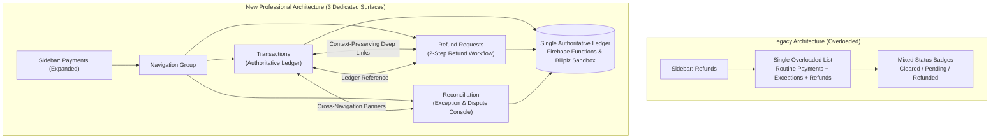
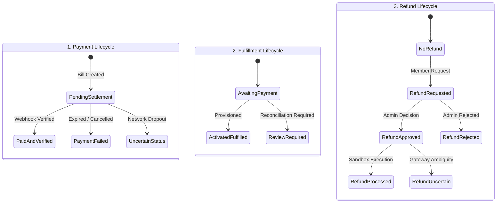
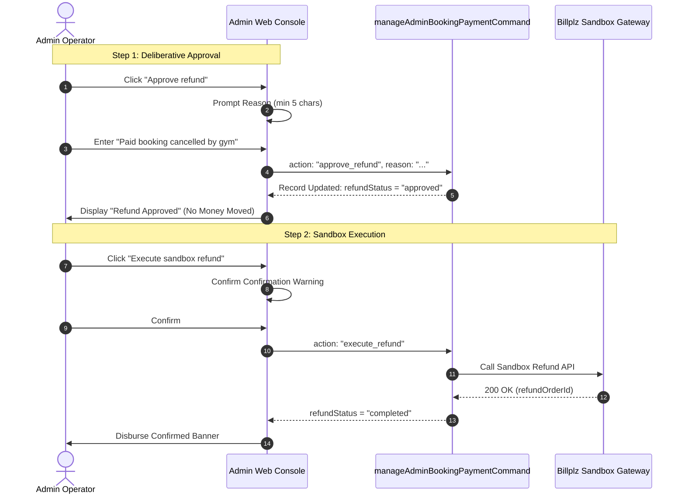

# GainPath Admin Web — Financial Operations & Transaction Management Redesign

## 1. Executive Summary

The GainPath Admin Web financial operations workspace has been redesigned and upgraded from an overloaded, single-list "Refunds" console into an enterprise, desktop-first **Financial Operations Workspace** featuring three dedicated administrative surfaces:

1. **Transactions** (`PaymentsMode.transactions`): The authoritative transaction ledger tracking both routine membership plan purchases/renewals and coach bookings.
2. **Refund Requests** (`PaymentsMode.refunds`): Dedicated operational workflow surface for reviewing, approving, and executing member refund requests with full audit evidence.
3. **Reconciliation** (`PaymentsMode.reconciliation`): Exception investigation workspace for resolving uncertain provider bills, missed webhook synchronizations, and fulfillment delays.

This architecture enforces strict separation of operational workflows while anchoring all records to a **single authoritative payment ledger** backed by the proven Firebase Cloud Functions (`listAdminBookingPaymentsCommand`, `getAdminBookingPaymentCommand`, `manageAdminBookingPaymentCommand`) and Billplz Sandbox payment infrastructure.

---

## 2. Before vs. After Information Architecture



### Key Structural Enhancements

| Area | Before | Redesigned Workspace |
| :--- | :--- | :--- |
| **Information Architecture** | Single overloaded list mixing routine checkouts with operational disputes. | Three dedicated administrative surfaces: Transactions, Refund Requests, Reconciliation. |
| **Sidebar Navigation** | Single "Refunds" sidebar link. | Grouped `Payments` folder with direct links to `Transactions`, `Refund Requests`, and `Reconciliation`. Backward-compatible aliases preserved. |
| **Operational Metrics** | Volatile list-wide summary cards without scope disclosures. | Four contextual metrics per surface with explicit loaded-batch scope disclosure and direct link to Financial Reports. |
| **Data Density & Table** | Giant mobile-style cards with technical UUID domination. | Desktop-first enterprise data table (Ant Design / Pine Labs inspired) with right-aligned currency, compact density, and responsive card fallback. |
| **Lifecycle Modeling** | Single flattened `status` badge confusing payment and fulfillment. | Three independent lifecycles: **Payment Lifecycle**, **Fulfillment Lifecycle**, and **Refund Lifecycle**. |
| **Cross-Surface Navigation** | None; required manual search across screens. | Context-preserving cross-navigation banners linking detail drawers directly between transactions and related exceptions. |
| **Audit & Safety** | Basic dialog with immediate execution risk. | Two-step refund approval / sandbox execution separation, mandatory reason validation, session guard, and vertical chronological audit timeline. |

---

## 3. Data Integrity & Lifecycle Modeling

A core requirement of this redesign is that **revenue figures and transaction records must never be duplicated or distorted**. Workflows are separated by operational lifecycle rather than data duplication.

### The Three Orthogonal Lifecycles

Every payment record in GainPath encapsulates three distinct states that must never be collapsed into a single label:



1. **Payment Lifecycle (`paymentLifecycleLabel`)**:
   - `Paid & Verified`: Confirmed bill settlement verified by provider signature.
   - `Pending Settlement`: Awaiting checkout completion or payment gateway confirmation.
   - `Payment Failed`: Explicit provider decline or expired bill.
   - `Uncertain Status`: Ambiguous gateway state requiring signature verification or recovery.

2. **Fulfillment Lifecycle (`fulfillmentLifecycleLabel`)**:
   - `Activated / Fulfilled`: Membership plan credited or coaching session booked.
   - `Activation Review Required`: Membership payment cleared, but member entitlement provisioning requires administrative review.
   - `Fulfillment Review Required`: Coaching fee cleared, but coach scheduling or calendar slot requires manual check.
   - `Awaiting Payment`: Service not yet provisioned pending payment settlement.

3. **Refund Lifecycle (`refundLifecycleLabel`)**:
   - `Refund Requested` / `Pending Review`: Active request submitted for administrative consideration.
   - `Refund Approved`: Formal approval recorded in audit ledger; funds have **not** yet been disbursed.
   - `Refund Uncertain`: Provider webhook or API call did not return deterministic success; manual sandbox check required.
   - `Refund Processed`: Provider sandbox refund confirmed and credited.
   - `Refund Rejected`: Request declined with recorded administrative justification.

### Human-Readable Business Identifiers

To prevent raw UUID domination on desktop displays:
- `businessTitle`: Intelligently derives descriptive titles such as `"Basic Membership Purchase"`, `"Premium Plan Renewal"`, or `"Coach Booking — Hafiz Aziz"`.
- `memberDisplay`: Derives member identifiers (`"Member usr-xxx"` or email) formatted for scanning.
- `shortId`: Formats compact transaction chips with a one-click clipboard copy utility.

---

## 4. UI/UX Implementation Details

### Desktop-First Table View (`>= 768px`)

Adhering to enterprise financial patterns (Pine Labs, Nuvei, Shopify, Ant Design):
- **Compact Density**: 12px padding, subtle hairline borders (`AppColors.hairline`), and light zebra hover highlights (`AppColors.primary` at 8% opacity).
- **Column Hierarchy**:
  1. `Transaction / Title` (flex: 4): Avatar badge icon (membership vs. coaching), descriptive title, truncated transaction ID, and copy icon.
  2. `Member` (flex: 3): Member name/ID and booking/membership type.
  3. `Amount` (flex: 2): Monospaced, right-aligned bold RM currency (e.g. `RM 120.00`).
  4. `Status / Issue` (flex: 3): Surface-appropriate badge (Payment Status in Transactions; Refund Status in Refunds; Exception Category in Reconciliation).
  5. `Date / Time` (flex: 3): Formatted date and time (e.g. `20 Oct 2026, 10:00 AM`).
  6. `Action` (width: 90px): Dedicated action buttons (`Details`, `Review`, or `Investigate`).

### Responsive Mobile Card View (`< 768px`)

- Uses nested `Wrap` widgets rather than rigid `Row` elements.
- Bounded chips and text containers prevent `RenderFlex` overflows at narrow screen viewports down to 390px (iPhone 12/13/14).

### Master-Detail Layout

- **Desktop (>= 1200px)**: Split-screen desktop layout allowing the operator to keep the ledger table visible while inspecting a transaction drawer on the right (480px fixed width).
- **Narrow Desktop / Tablet (< 1200px)**: Full-height sliding side drawer with backdrop dismissal.
- **Master-Detail Sections**:
  1. *Header*: Business title, transaction badge, close button.
  2. *Cross-Navigation Banner*: Contextual link to investigate related exceptions or return to the transaction ledger.
  3. *Financial Overview*: Gross fee, voucher discounts, gym-funded deductions, and net settled amount.
  4. *Lifecycle Breakdown*: Three distinct chips displaying Payment, Fulfillment, and Refund states.
  5. *Operational Attributes*: Coach name, branch, scheduled session time, provider bill reference.
  6. *Immutable Vertical Audit Timeline*: Chronological event log with expandable toggle.
  7. *Protected Actions*: Context-sensitive action buttons (`Verify payment`, `Recover bill`, `Approve refund`, `Reject refund`, `Execute sandbox refund`).

---

## 5. Security & Financial Operational Safety



1. **Two-Step Refund Execution**:
   - `approve_refund` records formal approval and justification in the audit ledger without initiating provider fund disbursement.
   - `execute_refund` is only enabled after formal approval is confirmed and provider parameters are validated.
2. **Mandatory Audit Justification**:
   - All approvals, rejections, and bill recoveries strictly require a non-empty administrative reason. Submissions are rejected before network transport if empty.
3. **Session Invalidation & Idempotency**:
   - `isCurrent()` checks guard against stale sessions; mid-flight network calls reject mutations if navigation changes.
   - Double-tap and concurrent execution are blocked via `_processing` lock flags.
4. **Honest Sandbox Boundaries**:
   - Transparently labels Billplz Sandbox transactions; warns against executing duplicate payouts when transactions are marked `uncertain`.

---

## 6. Verification & Test Evidence

### Test Execution Matrix

| Test Suite | Tests Run | Result | Key Capabilities Verified |
| :--- | :---: | :---: | :--- |
| `payment_review_screen_test.dart` | 9 | **PASS** | Mode switching, enterprise table rendering, right-aligned currency, cross-navigation banners, mobile 390px overflow elimination, reason validation, session drift prevention, unconnected empty state. |
| `payment_review_repository_test.dart` | 10 | **PASS** | Read-sharing cursor isolation, command mutation isolation, voucher finance breakdown, membership vs provider completion separation, stale session denial. |
| `admin_shell_test.dart` | 4 | **PASS** | Navigation group rendering, backward-compatible route aliases, constrained browser drawer reachability. |
| `admin_shared_unavailable_sections_test.dart` | 3 | **PASS** | Guarded sections and permission boundaries. |

### Scoped Static Analysis
```bash
flutter analyze apps/admin_web/lib/features/membership/payment_review_repository.dart \
                apps/admin_web/lib/features/membership/presentation/admin/refunds_screen.dart \
                apps/admin_web/lib/app/shells/admin_shell.dart \
                apps/admin_web/lib/app/di/payment_review_factory.dart \
                apps/admin_web/test/payment_review_screen_test.dart
```
**Output:** `No issues found! (ran in 1.9s)`

---

## 7. Modified Source Files

- `apps/admin_web/lib/features/membership/payment_review_repository.dart`: Extended domain models with three independent lifecycle labels, business title resolution, member formatting, and exception category derivation.
- `apps/admin_web/lib/features/membership/presentation/admin/refunds_screen.dart`: Complete redesign featuring `PaymentsMode`, enterprise desktop table, master-detail drawer, cross-navigation banners, responsive mobile wrap layout, and vertical audit timeline.
- `apps/admin_web/lib/app/shells/admin_shell.dart`: Expanded navigation group with `Transactions`, `Refund Requests`, and `Reconciliation` links and backward-compatible route aliases.
- `apps/admin_web/lib/app/di/payment_review_factory.dart`: Routed `PaymentsMode` parameters from route definitions into `PaymentsScreen`.
- `apps/admin_web/test/payment_review_screen_test.dart`: Added widget tests for sub-tab navigation, desktop table layout, cross-surface links, and 390px mobile viewports.
