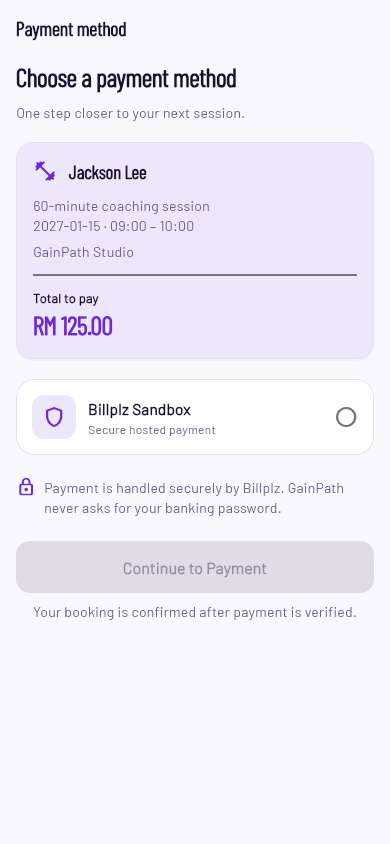
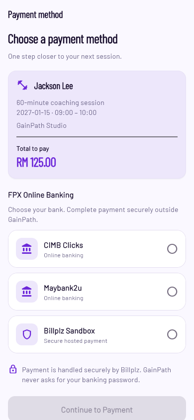
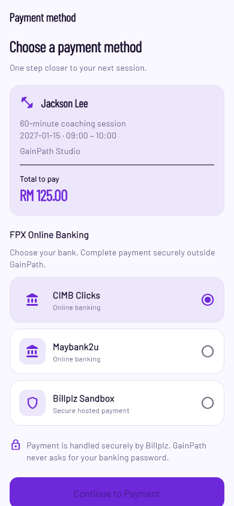
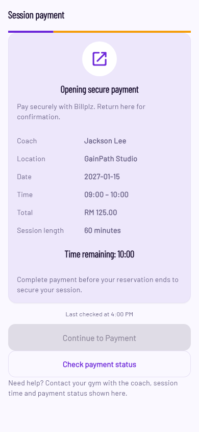
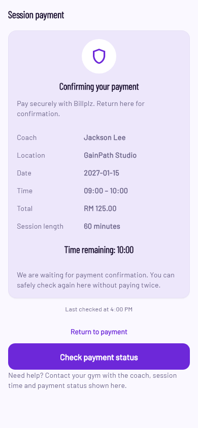
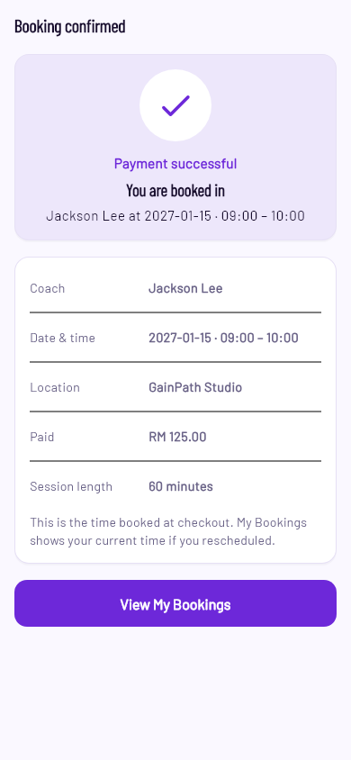

# Coach Booking — Billplz Sandbox payment experience

> The Member selection UI in this report is superseded by the [commercial checkout and recorded preferences](member-coach-booking-commercial-checkout.md). Existing provider-gateway contracts remain compatible; new clients record a separate canonical preference and use the established hosted payment path.

Implemented 13 November 2026. Code and local verification only; no Functions deployment, payment-setting change, live booking mutation or APK installation.

Implementation commits: **`de06ee5`** (provider methods, direct bill references, Domain/transport compatibility) and **`5129c0e`** (member checkout, receipt, regressions and screenshots). The documentation closeout is a separate commit.

## Member journey

Review a 60-minute session → choose an enabled payment method → Continue to Payment → Billplz's hosted Sandbox → return to GainPath → server verification → Booking confirmed. The method page shows the coach, time, location, reviewed total, voucher where applicable and selected method. After returning, checking payment status is the main action; reopening payment uses the original bill. GainPath never collects bank credentials or presents simulator success/failure controls.

Confirmation uses the server's confirmed booking/payment response, shows payment success, invoice session details, amount paid and View My Bookings. The existing invoice schedule remains distinguishable from subsequent rescheduling. Pending, expired, payment-received-but-unconfirmed, quote-changed and independent refund states remain supported. Returning from a browser cannot itself confirm a booking.

## Actual provider availability

Read-only authenticated Sandbox API checks at **2026-11-13 12:15 UTC** returned HTTP200 for Collection payment methods, v4 gateways and v3 FPX banks. The configured Collection enabled **only `billplz`**, with active gateway `BP-FKR01`. Consequently, the current configuration shows **Billplz Sandbox**, not Maybank, CIMB, Public Bank, cards or wallets. Global active gateways are insufficient evidence of Collection enablement.

The backend intersects Collection-enabled categories with active gateway codes. It currently supports known FPX bank names and Billplz Sandbox; unknown codes/categories are omitted. If FPX is enabled through a separately authorized configuration change, enabled active banks become selectable. Card/wallet gateways were present in the global list but were not enabled for this Collection and are not advertised. No settings were changed.

Official references: [API: Collection methods, gateways and direct payment](https://support.billplz.com/api), [Sandbox test banks and provider simulator](https://support.billplz.com/guide/sandbox-testing). Provider request/response fixtures follow those contracts; provider activation is always checked dynamically.

## Firebase and reference compatibility

- New Auth/App-Check-enforced `getBookingPaymentMethodsCommand` authorizes the booking owner, returns an existing invoice or currently enabled methods and an authoritative session/quote token, and rechecks ownership/hold after provider IO. The new logical command uses the existing endpoint selector's US fallback; no undeployed Singapore inventory entry was added.
- Creation accepts `gatewayCode`, validates availability server-side, retains reviewed quote/voucher protection, then reserves the transaction before exactly one provider POST. The selected gateway/name are persisted. An uncertain POST is quarantined rather than retried.
- Existing bills, Membership invoices and legacy30-minute appointments retain their existing references and behavior. No historical document is migrated. Only new explicitly selected direct bills get `providerReferenceVersion:2`: `reference_1_label=Bank Code`, `reference_1=gatewayCode`, `reference_2=SHA256(JSON(["booking-direct-v2",organizationId,bookingId]))`. Original organization/booking identifiers remain in the immutable transaction. Settlement, authorized Admin recovery and refunds match this complete binding alongside bill ID, Collection and amount. Legacy matching remains booking/org.
- New direct checkout URLs preserve the returned Bill URL/query and set `auto_submit=true`. Only the Sandbox HTTPS hosts are accepted. Provider fallback remains available if a gateway becomes unavailable; GainPath does not bypass it or infer success.
- Existing payment/callback signature verification, independent provider reads, hold/lock reconciliation, transaction idempotency and refund guards remain in use. Reopening an invoice recovers its original method, even if availability has since changed; gateway changes never create a replacement bill.

The matching create/read handlers, webhook settlement and Admin recovery/refund handler must be activated together before this client is distributed. No activation is included in this task. Deploying the client alone against old handlers would produce an availability/unsupported-field error, not a fake success.

## Verification

| Check | Result |
| --- | --- |
| Affected backend payments, callback, legacy Membership, vouchers and refunds |141 passed |
| Firestore Emulator payments/lifecycle/member changes, including concurrent direct checkout |13 passed |
| Mobile non-render booking suites (includes existing consumer layout cases) |136 passed |
| Full Domain tests |197 passed |
| Flutter analysis,11 affected files |No issues |
| Domain model/test analysis |No issues |
| TypeScript source and test type checks |Passed |
| New screenshot scenarios |54 passed:6 stages ×320/360/390px ×100/150/200percent text |
| Android Debug APK |Working-tree build passed (25.8s); isolated final-source build passed (80.2s) |

Regression work included failing tests before implementation for missing method discovery, gateway validation/transport, and reopening an unbilled hold. Independent code review found the unbilled-hold recovery issue; its regression now passes and follow-up review has no remaining actionable findings. The screen discovers an original invoice or offers selection on both fresh and resumed checkouts. Quote changes retain an explicit return-to-review path.

Evidence logs and all scrolling captures are in `build/booking-payment-ux-20261113/`. Rendering uses the actual Member Barlow/BarlowCondensed theme and offline test font loading; common test Poppins/Inter fallback aliases use repository Barlow assets. These are Flutter test fixtures, not evidence of an actual bank or Sandbox transaction succeeding.

An isolated export of committed `21bb637` plus only the29 intended source/contract/test files independently passed Mobile136, Domain197 and backend141 tests and built the final APK. Only existing dependency caches and machine SDK paths were shared. Unrelated working-tree files were not copied. The staged/committed source blobs are checked against this export. `source-files.json`/`source-hashes.json` record the inputs; `android-isolated.log`, `mobile-isolated.log`, `backend-isolated.log` and `domain-isolated.log` record results. The final APK is `build/booking-payment-ux-20261113/app-debug.apk`.

All29 verified inputs match their committed Git blobs at `5129c0e`. APK SHA256: `54512d1c398ccdc813ad9dfb9b3225020c8d3412dc2f50a34f62c7d7720472b1`. To reproduce, export/check out `5129c0e`, provide local Flutter/Android SDK paths, run `flutter pub get --offline`, then the booking suites and `flutter build apk --debug --no-pub` in `apps/mobile`. The emulator tests use only `demo-gainpath` with `firebase/booking.emulator.test.json`; no live project is required for test execution.

## Screenshots

Current Collection configuration:

Conditional FPX coverage only; these banks are **not enabled in the current Collection**:

Hosted-payment transition and verification:

## Remaining provider/device acceptance

Actual provider bill creation/direct redirect, manual successful Sandbox transaction, externally reachable signed callback and real-device return must be accepted after matching backend activation. They were not executed against live bookings. Emulator/fixture success proves application settlement logic, not provider uptime, bank availability or physical browser handoff. Billplz may still show its own Sandbox simulator; the user must operate it, and no auto-click is implemented. An emulator on localhost is not publicly reachable by Billplz callbacks.

The current account cannot demonstrate a genuine in-app FPX bank choice until FPX is enabled. No payment methods, credentials, IAM, production Functions or live financial records were changed. No real payment was executed. Other uncommitted Admin, Home, Rewards and pose changes are preserved.
