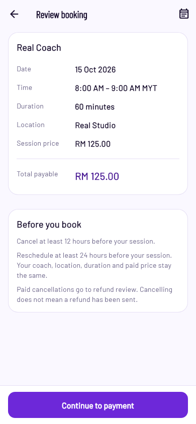
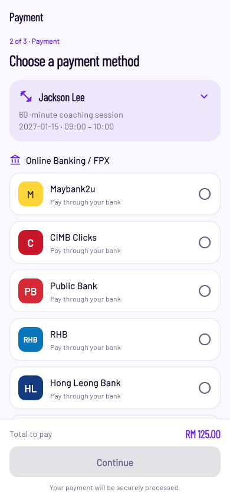
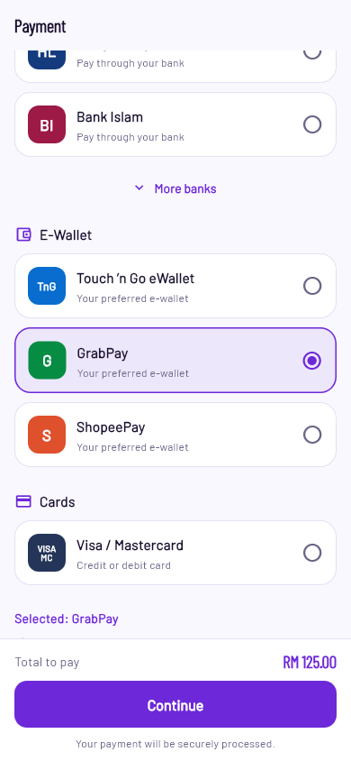
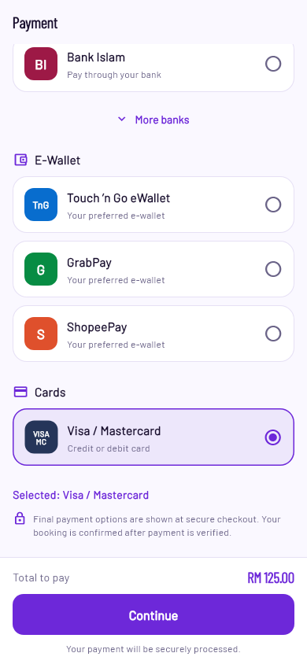
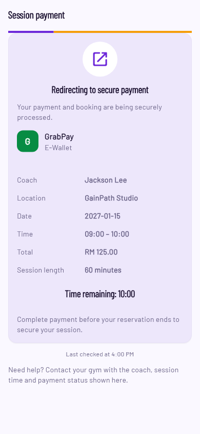
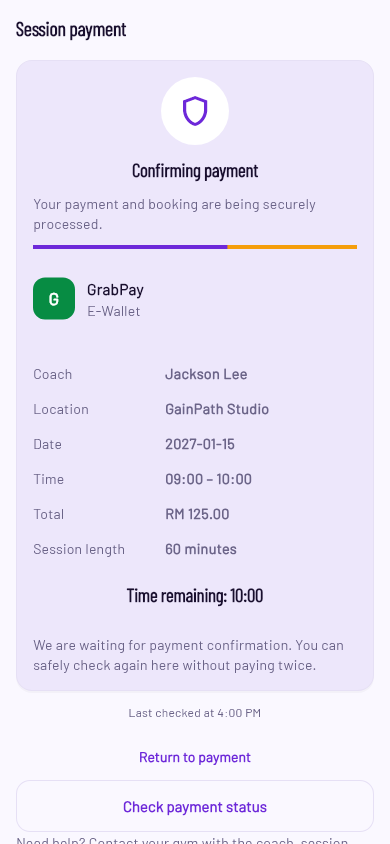
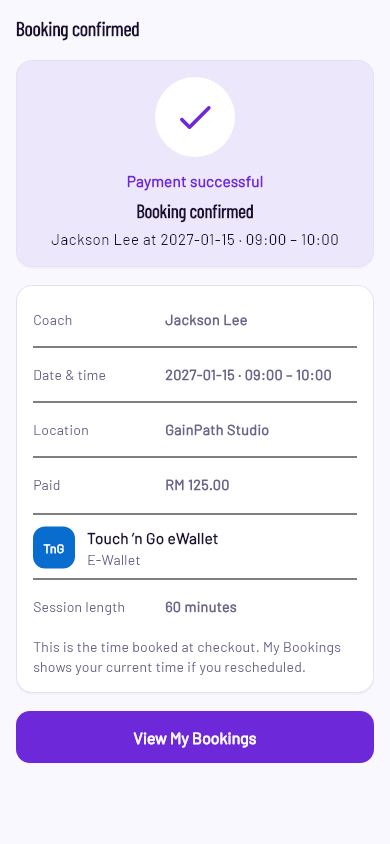
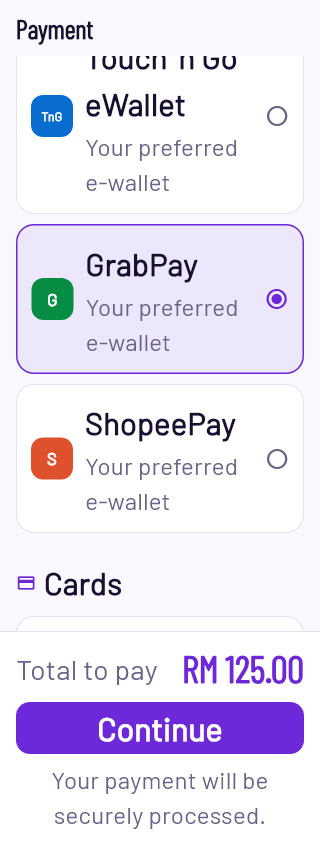
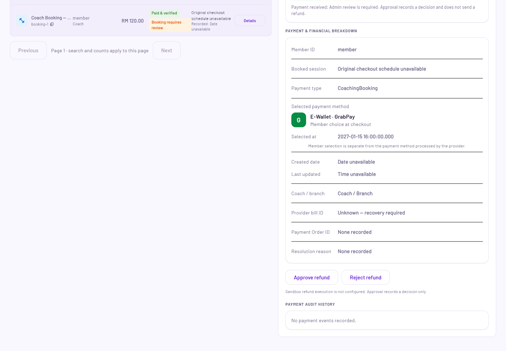
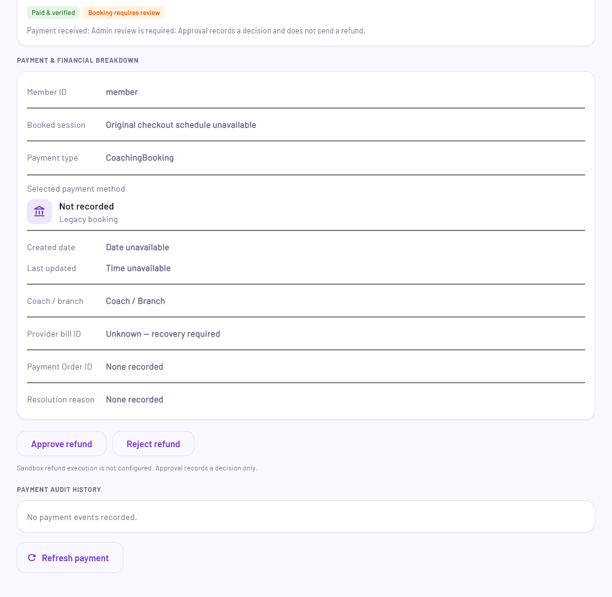

# Member Coach Booking — commercial checkout

Implemented13November2026. This supersedes the previous Member selection page that listed enabled provider gateways. The new page records a member's preferred payment method independently from the actual hosted payment rail. **Activation update:** the seven matching existing backend handlers are now active and routing fix `54e23e9` is installed on the existing Xiaomi. The owner confirmed that payment methods load. Initial acceptance and subsequent activation evidence are distinguished below. No provider payment or payment-setting change was performed.

Implementation commits: `0c7164e` (canonical preference persistence and compatible projections/transport) and `da31559` (Member/Admin UX, regressions and screenshots). Documentation closeout is separate.

## Experience

Review Booking keeps the60-minute session, coach, date/time, location, reviewed total/voucher and cancellation terms; its action is Continue to payment. Payment selection has a compact expandable booking summary, grouped cards, selected/pressed states, branded placeholder icon slots and a fixed Continue/total area. More banks expands additional bank choices. Member-facing screens contain no development/testing environment labels; final payment options are described as appearing at secure checkout.

The groups contain Maybank2u, CIMB Clicks, Public Bank, RHB, Hong Leong Bank and Bank Islam; More banks adds AmBank, BSN, Affin and Alliance. E-Wallet contains Touch ’n Go eWallet, GrabPay and ShopeePay. Cards contains Visa / Mastercard. These choices are product preferences. Billplz remains responsible for offering and processing its actual payment options; no unsupported gateway code is forced into Bill creation.

Continue records the selection on the server and uses the existing generic Billplz Bill URL path. Redirecting shows the selected label/icon and amount. Browser return starts/continues bounded server checks; it cannot produce success by itself. Confirmation displays Payment successful, Booking confirmed, session details, paid amount, selected method and View My Bookings. Existing bill retries reuse the original URL and immutable selection. Payment-received-but-unconfirmed, expired, quote-change, pending and refund states keep their established handling.

The cards use neutral brand-colored glyphs, not official logo artwork. Shared icon keys reserve consistent logo slots across Member and Admin. Selection/expansion motion respects reduced motion; reduced-motion rendering bypasses AnimatedSize instead of giving it a zero duration, fixing a reproduced layout assertion.

## Data and integrity

Clients send only `selectedPaymentMethodCode`. A fixed server catalog derives and records:

| Field | Stored value |
| --- | --- |
| `selectedPaymentMethodCategory` | `fpx`, `ewallet` or `card` |
| `selectedPaymentMethodCode` | Canonical code, e.g. `maybank2u`, `grabpay`, `visa_mastercard` |
| `selectedPaymentMethodLabel` | Canonical display label |
| `selectedPaymentMethodIconKey` | Shared icon/brand slot |
| `selectedAt` | Server Unix timestamp in milliseconds |

The original Firestore payment transaction/invoice is the source of truth (`orgs/{org}/transactions/{bookingId}`). The five fields are stored atomically with its initial reservation; no parallel booking financial copy or migration is introduced. Booking DTOs expose the same fields by joining that invoice, with organization/booking/member/coach/branch checks. Admin booking reads explicitly opt in with `includeSelectedPaymentMethod:true`; older clients retain their original projection.

`includeSelectionMethods:true` opts into presentation-catalog discovery. Prior gateway-aware clients retain the original enabled-gateway API. New selection mode uses the unchanged generic provider path and original booking/org references. It does not equate an e-wallet/card preference with provider enablement or verified payment evidence. Existing version2 direct bills and legacy30-minute invoices retain their original matching/recovery behavior. If an invoice already exists, the server returns it without changing its selection, timestamp, references, amount or provider bill. Unknown creation stays quarantined; no second provider POST is issued. Once an invoice response exists, the UI uses only its persisted selection, including an empty legacy selection.

Auth/App Check, current account/ownership, holds, reviewed quote/price checks, server confirmation, signed callbacks, reconciliation, refund protection and idempotency remain on the original path. Forged category/label/icon/timestamp fields are rejected. No banking credentials or provider simulator controls are collected or reproduced.

Admin payment detail and booking cards show category, label and icon. Old records show Not recorded / Legacy booking. Financial detail calls this the member choice and separately explains that the provider determines the processed payment method; it is not accounting proof of a payment rail.

## Verification

| Check | Result |
| --- | --- |
| Mobile booking regressions |144 passed |
| Full Domain suite |200 passed |
| Backend payment/booking/read/contracts suites |223 passed |
| Admin booking/financial regressions |14 passed |
| Firestore Emulator payment/lifecycle/member changes |14 passed |
| Static analysis |Mobile15, Admin7, Domain5 and shared icon file: no issues |
| TypeScript source and test type checks |Passed |
| Checkout Flutter renders |63 scenarios:7 stages ×320/360/390dp ×100/150/200percent text |
| Selection/review Flutter renders |24 scenarios:4 states ×3 widths ×100/200percent |
| Admin Flutter renders |4 scenarios:recorded/legacy ×1024/1440px |
| Clean-source Android Debug |Passed,85.5s |
| Clean-source Admin Web Release |Passed,70.3s |

A clean export of base `40613dd` plus only the45 intended source/contract/test files independently passed Mobile144, Domain200, backend223 and Admin14 tests and both builds. Dependency caches and local SDK paths were shared; unrelated dirty source was excluded. Source blobs are checked against the export before commit. Evidence, manifests and APK: `build/commercial-checkout-20261113/`. The main emulator ports were occupied, so this task used separate ports19893/19157/19433/19543 and exact copied Rules/indexes, without stopping the other service.

All45 inputs match committed blobs at `da31559`. Reproduce from a checkout/export of that commit using cached dependencies and local Flutter/Android SDK configuration. Run the affected suites and `flutter build apk --debug --no-pub` in `apps/mobile`, and `flutter build web --release --no-pub` in `apps/admin_web`. Build outputs are `build/commercial-checkout-20261113/app-debug.apk` and `build/commercial-checkout-20261113/isolated-source/apps/admin_web/build/web/`.

Regression coverage includes canonical code/timestamp validation, concurrent differing choices, immutable existing invoice recovery, unknown provider creation, late-paid expired holds, strict booking-party joins, legacy30-minute DTO roundtrip, stale accounts, quote recovery, fixed CTA and server-only success. Failing tests preceded implementation. Independent review and follow-up review reported no remaining important actionable findings. Renders use actual Flutter screens with synthetic fixtures and the Member Barlow theme; common test fallback fonts use the offline helper. No screenshot demonstrates an actual provider transaction.

APK SHA256: `a9d23471cd4c5fa95abb73144e9df5e4192e35aeda1376cf1ee23190f40d5741`. Builds retain native deprecation/unchecked and Cupertino font expectation warnings in their logs. These did not fail the builds or the captured UI checks.

## Screenshots

## Release and provider/device acceptance

The initial implementation needed matching backend activation before client distribution. That activation and the phone routing correction are now complete as recorded below. The implementation reuses the existing Sandbox provider integration; app copy does not change the provider environment. Provider-owned page wording and controls remain under Billplz's control. The prepared Admin Web bundle was not activated by the phone loading fix.

An actual hosted transaction, browser-to-app return, externally delivered signed callback and physical-device end-to-end acceptance remain pending. Emulator/fixture settlement is not provider or real-device acceptance. There is no automatic success, redirect-based confirmation, simulator auto-click or real payment. All unrelated uncommitted Admin Coach/Home/Rewards/pose work and existing document edits are preserved.

## Payment-method loading fix and activation —13November2026

The owner-reported failure was a client/release mismatch: `getBookingPaymentMethodsCommand` did not exist in either US or Singapore, while the phone was already running its caller and deployed payment read/create handlers still used `38234a4`. Fix `54e23e9` routes presentation discovery through the existing Singapore `getBookingPaymentCommand` using strict `includeSelectionMethods:true`. Ordinary invoice reads retain the original verification path. No new public endpoint or IAM binding was introduced.

Fresh verification:225 backend tests,30 focused Mobile tests in the working and clean committed-source export, source/test TypeScript checks, two-file Flutter analysis and clean Debug APK build72.6s. The sealed37-file package exports exactly six existing callables and the existing HTTP webhook; artifact checks and independent release review passed. Seven rollback source ZIPs and previous runtime/configuration/IAM snapshots were retained privately.

Activated source only for Singapore create/get payment, Admin list/get/manage payment and booking-list read, plus US `paymentWebhook`. All seven deployed ZIP hashes match source commit `54e23e9` and release SHA256 `6177358537d89c35b2813a1ac877a4a9e1885f5985f42943828ea077f4d74781`. Runtime, entrypoints, environment, secret bindings and IAM remain unchanged; unrelated Functions are unchanged. Standing owner deployment authority covers these source updates. No financial/provider configuration or IAM modification was needed.

Authenticated read-only probes using the existing synthetic fixture accepted both selection and legacy invoice routes, returning the expected application NOT_FOUND for random nonexistent booking IDs; the selection flag no longer fails as unsupported. Anonymous requests returned401 and webhook GET returned405. Automated smoke created no bookings/bills and made no provider operation.

The same-signer clean APK was installed in place and launched after the owner unlocked the phone and its Payment screen was observed. Installed SHA256 `bc724fd35a3ae7ad3863bb73d69a558b4780ef6c7329429e4b6ac0c1ae3f5637` matches the candidate; UID, data directory and first-install time are preserved, with the previous APK retained. No data clear or remote screen taps occurred. The owner manually re-entered booking and confirmed **payment methods now load**. Actual payment/provider-return acceptance remains separate; the owner was asked to stop before continuing to Billplz.

Private operational evidence: `build/checkout-load-fix-20261113/` (`endpoint-check.json`, `manifest.json`, `artifact-smoke.json`, `verified.json`, `live-smoke.json`, `device-verified.json`, test/build logs and rollback files).
