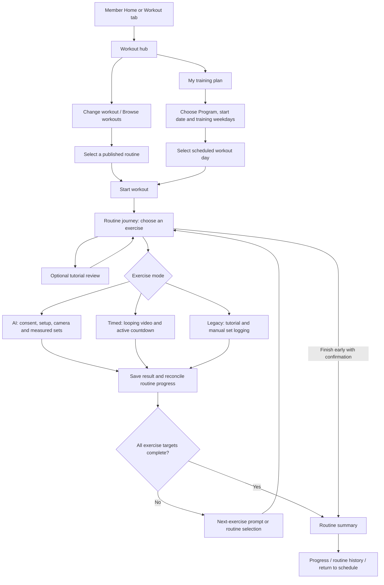

# GainPath Member routine experience: journey, workflow and UX analysis

> Historical pre-optimization source snapshot. The subsequent implemented behavior and verification are documented in [Member workout UX implementation](member-workout-ux-implementation.md). Findings below describe the audited version, not the completed redesign.

Date: 7 November 2026, Malaysia time. Source reference: `ceb232a` plus the current working source inspected during this review.

## Scope and evidence

This report describes how a Member interacts with the current routine implementation: discovery, preparation, Program scheduling, exercise execution, transitions, completion, recovery and history. It distinguishes implemented behavior from UX recommendations. No application behavior, content or deployment was changed for this report.

This is a source-based review, not a live phone usability session. Screen names and button labels below come from the current Flutter implementation. The presence of a route in source does not prove that every installed APK exposes the same version. Touch comfort, visual hierarchy on a physical phone, camera accuracy, video performance and assistive-technology behavior still need device testing. Earlier backend activation also does not establish mobile acceptance.

The UI/UX skill's navigation, feedback and accessibility checklist informed the review. Its local search utility could not run because the available Python launcher had no installed interpreter. Recommendations below therefore use direct source observations and clearly identified usability hypotheses, not claimed search results or measured user research.

## 1. What the Member is trying to do

The primary Member goal is: **choose the right workout, understand each exercise, complete it safely, and know what was saved and what to do next.**

The current product has three levels that Members need to understand:

| Concept | What it means to the Member | What it does not mean |
|---|---|---|
| Program / training plan | A four-week schedule that assigns published routine days to dates | A single camera workout session |
| Routine / workout | An ordered collection of exercises, potentially divided into days | Proof that every exercise was completed |
| Exercise session | One exercise performed with a camera, a timer, or manual set logging | Automatically verified form, workout acceptance or rewards |

There are two entry paths—free selection and a scheduled Program—but both reach the same routine journey. There are two main execution modes, plus a retained legacy/manual fallback. Members encounter all three as described below.

## 2. End-to-end journey map

The next-exercise bottom sheet is explicitly wired for completed measured and timed exercises. Manual set logging advances the selected exercise through the routine controller; it does not use the same automatic modal handoff. The diagram represents the shared progression concept, not an identical screen sequence for every mode.

## 3. Entry, discovery and preparation

### 3.1 Home and the Workout tab

The Member shell has Home, Workout, Rewards, Coaches and Profile destinations. A Home workout action switches to the Workout tab. Progress and routine history are reached through Home/progress actions and routine results rather than a separate bottom-navigation destination.

The Workout hub presents a selected workout with title, exercise count, total sets and an estimated duration where appropriate. Its primary action is **Start workout**, or **Continue workout** when a scheduled workout already has an attempt. Supporting text explains that the next step is choosing an exercise and that progress saves on the device.

Important behavior: tapping Start workout normally opens the routine journey; it does not immediately turn on the camera. The route provides a journey builder, which takes precedence over older single-exercise launch behavior.

### 3.2 Choosing a workout

**Change workout** opens a bottom-sheet browser. When nothing is selected, the Member sees **Find a workout**, **Browse workouts**, or **Refresh workouts**, depending on catalog state. The browser supports refresh and additional result loading.

The browser explicitly says that choosing a workout does not change the training plan. Where a scheduled workout exists, a separate planned-workout option lets the Member return to it. Selecting a free workout changes the hub's displayed choice without replacing an enrollment.

Loading, empty, failed and unavailable catalog states have different messages. An empty catalog is not represented as completed work or a synthetic sample routine in the live flow.

### 3.3 Previewing exercises

The hub lists **Exercises in this workout** and provides **View routine**. Tapping an exercise opens its tutorial. View routine opens a read-oriented exercise list whose rows also lead to tutorials.

The tutorial can show a cover, description, difficulty, equipment, numbered instruction steps, optional step images, published targets and training-mode information. Video playback has Play/Pause/Replay, a seek slider, loading/error feedback and Retry. A missing video does not remove the written instructions. Viewing a tutorial does not itself log sets or create a measured session.

There is no contextual Start exercise action in this tutorial viewer. The Member returns to the routine journey to execute/log the exercise. This is an important distinction between **learning about an exercise** and **starting its workout session**.

Other hub tools include **Review camera setup**, **Scan equipment**, **My training plan**, and saved-session access. They are useful detours, but they sit alongside the main routine path and can compete for attention.

## 4. Program-scheduled workflow

### First enrollment

1. Open **My training plan**.
2. Choose a published Program and level.
3. Choose a start date.
4. Select the required number of available training weekdays. Start program is disabled until the count matches.
5. Tap **Start program**. Schedule validation applies recovery constraints before saving.
6. Review the selected day and weekly progress.

Changing Programs retains earlier enrollments and workout history. If multiple enrollments exist, a saved-enrollment selector allows switching between them. The schedule is saved locally to the current account.

### Starting and managing a day

A workout day offers **Start scheduled routine** or **Resume scheduled routine**. The selected Program day carries its frozen routine snapshot and attempt identity into the same routine journey. Scheduled journeys lock the day selector to the assigned routine day and do not offer the free-workout Repeat action.

The Member can **Skip day** after confirmation or **Reschedule** through a date picker. A skipped day remains skipped without completion credit and can be resumed later. Rest and active-recovery days have explanatory text; they do not fabricate a workout completion.

Statuses distinguish Scheduled, In progress, Missed—not completed, Skipped, and completed/partially completed attempts. Weekly progress counts completed workout days. Simply opening a routine or skipping its exercises does not complete a Program day.

The hub selects the earliest unfinished, non-skipped scheduled workout. The selection logic is not restricted to today's date; Members must read the displayed scheduled date. The Program route is titled “Today's Workout” even when another date is selected, which is a potential orientation problem.

## 5. The routine journey screen

The journey is a control page for a routine day, not the camera or video player itself. It shows:

- Routine title and a day selector; scheduled day selection is locked.
- A local-progress notice.
- The full exercise list, numbered within the selected day.
- Target and status text for each exercise.
- A selected-exercise card with instructions/tutorial access and mode-specific controls.
- Completed-exercise count and a progress bar.
- **Skip exercise**, **Finish routine**, and a summary action.

Members can select another exercise rather than being forced through a rigid sequence. Selection is checkpointed. Finishing an exercise normally selects the first remaining unhandled exercise; a skipped exercise is handled for navigation but is not counted as completed.

Opening a previously unseen routine day creates an attempt/checkpoint. Consequently, routine history can include an in-progress attempt before any physical exercise has been saved. Reopening normally retrieves a matching saved attempt using account, routine, day and plan identity. A changed published plan is not silently merged into an incompatible checkpoint.

### What the three execution paths mean

| Path | Member action | Session experience | Evidence saved |
|---|---|---|---|
| Registered AI exercise | Start guided exercise | Consent/setup, live camera, readiness and measured sets | Saved measured session results; supported metrics remain provisional |
| Video-guided timed exercise | Start timed exercise / Resume timed exercise | Looping tutorial and active-work countdown; no camera | Active duration, completed timed sets, identity and timer provenance |
| Legacy guided-only exercise | Watch tutorial, then Mark set N done | Manual set logging on the routine page | Self-reported set completion; no AI repetitions or form score |

AI capability comes from the exact exercise identity and installed tracker registry, not the title. The current dispatcher has nine measured tracker implementations. If a registered tracker implementation is unavailable, the existing dispatcher describes a manual guided-only fallback; this is not the same as silently converting a camera/model failure into verified completion.

## 6. AI-tracked exercise interactions

1. Select the exercise and tap **Start guided exercise**.
2. Read the **Before we turn on the camera** consent/setup sheet. Instructions vary by exercise and capture angle; some require a setup confirmation.
3. Tap **Accept and start**, or choose **Not now** to remain outside capture.
4. Follow the exercise's setup/readiness screen. Some exercises require selecting a working arm/leg or mode. Do not assume identical calibration and side-selection behavior across all nine trackers.
5. Perform the prescribed sets and reps. Camera framing, readiness, rep counts, guidance and current routine position are presented during execution.
6. Use the shared session controls. The collapsible sheet exposes Pause/Resume, next-set or skip-rest controls, side-switch actions where applicable, save retry and discard. Expanded details include guidance, progress and privacy information.
7. On target completion, the routine-aware view automatically attempts to save and return. Saving must succeed before routine completion advances.

**Finishing early:** the view pauses counting and asks whether to save the partial result. Saving retains the measurement but leaves the exercise unfinished. The routine presents **Retry guided exercise** or allows skipping it. A retry starts the published targets again; earlier partial measurements remain in history rather than being silently added together as a completed target.

**Discarding:** the view confirms that an unsaved result will be lost. Saved records are distinct from unsaved camera work. An interrupted camera attempt is not advertised as automatically recoverable physical progress.

**After saving:** the routine reconciles durable results. A completed exercise can lead to a bottom sheet showing the previous exercise, local-save confirmation, completion count, next exercise and its targets. Actions are **Start next exercise**, **Review tutorial**, and **Back to routine**. Reviewing a tutorial returns to this handoff before the next exercise starts. The next camera exercise still passes through its own setup/consent path.

There is no universal between-exercise rest countdown in that handoff; the Member is told to take a moment to get ready. Per-set rest controls belong to the exercise session.

## 7. Video-guided timed exercise interactions

The selected card displays sets, seconds per set, rest and **Video guided · Timer**. It explicitly says repetitions and form are not measured.

| Current situation | What the Member sees/does | Effect |
|---|---|---|
| Video loading | Loading indicator | Timer does not accrue work time |
| Video ready | Start workout | Starts looping playback and active countdown |
| Working | Large remaining time; Pause and Rest | Active playback time advances the current set |
| Manual mid-set rest | Rest text and Resume set N | Preserves partial work; no set credit is awarded for resting |
| Completed set, more sets remaining | Between-set rest countdown | Member explicitly starts the next set, or skips the remaining rest |
| Paused | Resume | Continues the preserved working/rest state |
| Buffering/interrupted | Paused explanation; Resume or Retry video | Work time freezes until playback can resume |
| Final target reached | Saving, then Timer completed | Completion becomes usable only after persistence succeeds |
| Save failure | Retry feedback / Retry save | Stays in a recoverable state rather than advancing |
| Finished | Return to routine | Returns to the common progression flow |

The tutorial loops throughout the timed session rather than ending when the original video ends. A delayed timer tick does not award multiple sets at once. Between-set rest, including zero rest, still requires an explicit next-set action. The current mid-set-rest UI allows the Member to resume the unfinished set before the rest countdown ends.

Backgrounding, route obscuration, stopped playback, buffering and media errors interrupt work credit. Foreground return does not silently restart the workout. The player saves transitions and periodically checkpoints active work, approximately every five active seconds; a sudden process kill can lose the most recent unsaved interval. This is different from continuous cloud synchronization.

**Back navigation** pauses first and presents Continue workout, Skip exercise, or Save progress & exit. Save/exit and skip retain truthful partial timer evidence. In the current code, Continue workout closes the dialog but does not call Resume; the Member still needs the player's Resume button. This is a wording/interaction inconsistency rather than evidence that time continues behind the dialog.

Timed results contain duration and set completion, not fabricated rep counts, pose measurements or form scores. Returning to the routine uses the same run/attempt identity; reopening should not start a second timer run merely because navigation occurred.

## 8. Legacy manual exercise interactions

The Member watches/reads the tutorial and performs the exercise independently. The routine card provides **Mark set N done**, **Undo last set**, **Mark instructions reviewed**, and Skip exercise.

Marking all prescribed sets completes this exercise as **self-reported**. Mark instructions reviewed records that distinction but does not complete the exercise target. Tutorial viewing alone is not equivalent to either action. There is no guided timed-player contract for this fallback and no AI rep/form result is generated.

This retained path matters: “not AI tracked” currently describes both timed exercises and older manual exercises, which have different controls and completion rules.

## 9. Completion, leaving and returning

### Completion semantics

The completed-exercise count includes measured target completion, timer target completion and all manual sets marked done. Instructions reviewed, skipped, partial and not-started states do not count as target completion.

All targets complete → the routine can automatically finish and show its summary. **Finish routine** also permits an early finish after the Member confirms **Finish with unfinished exercises?**. This creates a finished but **Partially completed** attempt, not a successfully completed routine day.

The summary shows overall status, exercise completion count, measured reps and tracked time, self-reported sets, guided duration when present, and per-exercise status. It offers Resume unfinished exercises where applicable, Next routine day for eligible free routines, View progress, Routine history, Repeat this workout for free routines, and a context-appropriate return action.

Resume unfinished exercises clears skip flags so previously skipped exercises become available again. Repeat creates a new attempt and retains the old record. In a Program, returning to the weekly schedule refreshes the same scheduled attempt rather than creating an unrelated free-workout record.

### Persistence and account boundaries

Progress is local-first and scoped to the signed-in account/organization. Session changes revoke access to the previous account's routine/player. Compatible saved checkpoints allow resuming; incompatible plan versions retain separate identity instead of silently crediting new targets with old results.

Optional workout backup is managed from the progress/history area. It backs up compatible workout summaries and routine progress when enabled and connected. It does not upload raw video/landmarks, does not verify performance and does not award rewards. **Program enrollment itself is not synced**, so restoring routine results on another device is not the same as restoring the complete training schedule. Turning backup off stops future sync; it does not delete existing remote copies.

Membership access gates exist around execution but are disabled by default unless the build enables the enforcement flag. This review does not assume that every installed build has an active paywall.

## 10. Progress and history experience

Routine history represents routine-day attempts, including in-progress and partially finished attempts. Each detail view separates target prescriptions from outcomes. Timed entries show timed sets and active duration; measured entries show measured full/partial reps and tracked time; manual entries show self-reported sets. Elapsed attempt time can include breaks and time away and is labeled separately from tracked/active time.

Saved history provides routes back to unfinished work, repeat and the next day where supported. Results remain provisional. The routine summary currently also displays a disabled workout-rewards panel explaining the release hold; there is no active workout reward claim in this flow.

## 11. UX assessment

### What is working well

- The main hub provides a clear primary action and distinguishes changing a free workout from replacing a training plan.
- Exercise previews expose instructional media and published targets before capture.
- The journey supports flexible exercise selection, visible progress and returning after interruption.
- Mode-specific completion provenance is preserved. Timed/manual completion is not passed off as measured repetitions or scored form.
- Partial measured work, early finish, discard, timed save retry and account revocation have explicit handling.
- A next-exercise handoff connects durable saving with the next action rather than treating every exercise as an isolated workout.
- Program scheduling, skipped days and history retention support recovery from missed workouts.

### Source-confirmed inconsistencies and usability risks

Priority below is an assessment, not measured incidence. P1 means likely to confuse the core task or interpretation of results; P2 means a meaningful clarity/friction issue. No P0 safety or data-loss defect is asserted by this source-only review.

| Priority | Finding | Member impact | Evidence | Recommended direction, not implemented here |
|---|---|---|---|---|
| P1 | Program day preview always formats `raw['reps']` as repetitions | A timed exercise can appear as `3 sets × null reps` instead of a duration | `WorkoutProgramScreen._dayCard` | Use one typed target formatter across hub, schedule, journey and history |
| P1 | Program result rows use measured/manual result formatting for every entry | Timed duration/sets are not properly represented there; raw status names can leak into the UI | `WorkoutProgramScreen._dayCard` | Render measured, timed and manual outcomes separately |
| P1 | Some capability labels still resolve through the AI registry alone | A timed exercise can be labeled legacy guided-only in the journey list or tutorial while its selected card says Timer | `RoutineJourneyScreen` list; `ExerciseTutorialRoute` | Resolve the execution mode for every visible badge and description |
| P1 | Summary success icon only checks measured completion | Timer-complete and manually complete exercises can have an empty-circle icon despite completed status text | `RoutineJourneyScreen._summary` | Drive success styling from all completed target statuses while retaining provenance labels |
| P2 | “Guided” names multiple distinct things | Start guided exercise means camera tracking, while guided-only means manual and video-guided means a timer | Journey controls and dispatcher labels | Prefer consistent AI-tracked, Video-timed, and Manual terminology |
| P2 | Timed back-dialog Continue workout does not resume | Member dismisses a dialog expecting the timer to restart, then has to tap Resume | `GuidedTimedWorkoutRoute._back` | Either resume explicitly or label the dialog action Return to workout and retain a clear paused state |
| P2 | Repeated set/exercise transitions require phone interaction | Placement away from the phone creates travel/touch overhead during a workout | Timed next-set buttons, shared measured controls, next-exercise sheet | Test reachability and intentional hands-free options without removing safety/explicit-resume boundaries |
| P2 | Start workout opens a chooser, while tapping an exercise opens a tutorial-only page | Members may expect either action to begin execution immediately | Hub, routine preview, tutorial route | Make the next destination explicit and consider a contextual tutorial-to-journey action |
| P2 | Free-workout CTA does not expose checkpoint state in its label | A returning Member can see Start workout even though a matching attempt will reopen | Hub hero versus `RoutineJourneyController.openLatest` | Show Resume workout and a small saved-progress summary for free routines too |
| P2 | Summary shows zero AI metrics for timer/manual-only days | Truthful zeros may be read as poor performance rather than “not measured” | Routine summary aggregate panel | Hide irrelevant measured totals or explicitly mark them Not measured |
| P2 | Journey is a full list plus an action panel in one scroll | Long routines can push selected controls below the fold; small mode labels add reading effort | `RoutineJourneyScreen._journey` | Validate on small screens; consider a compact progress header and persistent selected-exercise CTA |
| P2 | Finished vs completed vs reviewed vs skipped requires careful reading | Member can “finish” without completing targets and may interpret it as success | Early finish dialog and attempt status rules | Keep a plain-language status explanation beside the final action and outcome |
| P2 | Local-only enrollment and plan-version boundaries are easy to miss | Restoring history may not restore the schedule; updated targets can look like a fresh workout | Backup copy, checkpoint signatures, enrollment store | Explain exactly what is restored and when a published plan has changed |
| P2 | Attempt creation happens when the journey opens | History may contain an in-progress entry for a workout the Member feels they never started | `_openDay` / `_newAttempt` | Distinguish planned/opened attempts from activity, or explain their presence |
| P2 | Disabled reward panel includes internal release-policy language | It adds non-actionable detail at the moment the Member needs a completion answer and next step | `RoutineWorkoutRewardPanel` | Keep Member-facing wording brief; retain policy/release details in Admin/support documentation |
| P2 | Upcoming work can appear under “Today's Workout” | Member may confuse the earliest pending scheduled day with today's prescription | Program route title and `nextWorkout` | Use date-aware Today / Upcoming / Missed headings |

### Items requiring device/user validation

The code alone cannot establish readable contrast, usable thumb reach, accessible scaling or a safe physical setup. Test the journey list and long tutorial at large text sizes; screen-reader focus on errors and state transitions; interrupted video announcements; video and countdown visibility together; visible controls while the phone is positioned for a full-body exercise; camera permissions and recovery; and the number of touches required across a complete mixed routine.

The hub's main CTA has an explicit52-pixel minimum height, and the timed countdown has a semantics label. These are useful foundations, not proof that every control meets accessibility or motor-use needs. The countdown does not use a continuously announcing live region, which avoids reading every tick; phase changes still need an assistive-technology check.

## 12. Example: how a Member performs a mixed routine

1. Member opens Workout and selects a routine containing Standing Lateral Raise, a timed mobility exercise, and a legacy manual exercise.
2. Start workout opens the day journey. The Member may review any tutorial first.
3. For Standing Lateral Raise, the Member starts the guided camera path, confirms setup, completes the measured targets and waits for the result to save. The next-exercise prompt appears after successful completion.
4. For mobility configured as3×45 seconds with30 seconds rest, the Member starts the timed player. A shorter tutorial loops. Only active work contributes to the prescribed135 seconds. Between sets the Member explicitly starts the next set or skips rest; pausing/backgrounding does not add work time.
5. After the final timed set saves, Return to routine leads back to the common progression. The routine records timer completion without AI reps/form.
6. For the legacy exercise, the Member performs the work and taps Mark set N done for each prescribed set. These are self-reported outcomes.
7. When all three exercise targets are completed, the day summary can show three completed exercises, but only one measured exercise. The timed and manual outcomes remain separately labeled.
8. The Member reviews history or returns to the Program schedule. A Program day is complete only when its linked attempt satisfies the routine-day targets. Optional backup is a separate preference, not a requirement to retain the local save.

## 13. Recommended follow-up validation

| Scenario | What to observe | Acceptance question |
|---|---|---|
| First-time Member, no Program | Find and begin a free routine without coaching | Can they predict that Start workout opens the exercise journey? |
| First-time Program enrollment | Choose dates/weekdays, understand recovery constraints | Do they understand what is scheduled and what remains local? |
| Mixed AI → timed → manual routine | Complete the day and explain its summary | Can they accurately distinguish measured, timed and self-reported work? |
| Timed3×45-second exercise using a short video | Looping, rests, pauses, set transitions | Are135 active seconds credited with no break/background credit? |
| Camera interruption and early save | Retry or skip after a partial result | Do they understand that a retry restarts prescribed targets? |
| Timed buffering, save failure and back dialog | Recovery and explicit resume | Is the paused state obvious, and is the next action understandable? |
| Reopen after leaving/killing the app | Recover the same compatible checkpoint | Does the Member know what was saved and what was not? |
| Account switch and another device | Isolation, backup and enrollment expectations | Is any stale account content visible, and are restore limits clear? |
| Long routine, small phone, large text | Scrolling, target labels, CTA visibility | Are the next action and current exercise always discoverable? |
| Finish with skipped or reviewed-only items | Partial summary and later resume | Does the Member avoid interpreting Finish as target completion? |

This report proposes follow-up work; it does not authorize or implement a redesign. The highest-value next review is the mixed-routine copy/target/status consistency pass, followed by an observed phone walkthrough of interruptions and set transitions.

## 14. Source map

| Area | Main inspected files |
|---|---|
| Member entry/navigation | [member_shell.dart](../../apps/mobile/lib/app/shells/member_shell.dart) |
| Workout hub and preview | [workout_prep_route.dart](../../apps/mobile/lib/app/routing/workout_prep_route.dart), [workout_prep_screen.dart](../../apps/mobile/lib/features/workout/presentation/member/workout_prep_screen.dart), [routine_screen.dart](../../apps/mobile/lib/features/workout/presentation/member/routine_screen.dart) |
| Catalog selection | [published_routine_catalog_controls.dart](../../apps/mobile/lib/features/workout/presentation/member/published_routine_catalog_controls.dart) |
| Program interaction | [workout_program_route.dart](../../apps/mobile/lib/app/routing/workout_program_route.dart), [workout_program_screen.dart](../../apps/mobile/lib/features/workout/presentation/member/workout_program_screen.dart), [workout_program_controller.dart](../../apps/mobile/lib/features/workout/application/workout_program_controller.dart), [workout_hub_program.dart](../../apps/mobile/lib/features/workout/application/workout_hub_program.dart) |
| Journey, checkpoint and completion | [routine_journey_route.dart](../../apps/mobile/lib/app/routing/routine_journey_route.dart), [routine_journey_screen.dart](../../apps/mobile/lib/features/workout/presentation/member/routine_journey_screen.dart), [routine_journey_controller.dart](../../apps/mobile/lib/features/workout/application/routine_journey_controller.dart), [routine_attempt.dart](../../apps/mobile/lib/features/workout/domain/routine_attempt.dart) |
| Tutorial review | [exercise_tutorial_route.dart](../../apps/mobile/lib/app/routing/exercise_tutorial_route.dart), [published_exercise_tutorial_screen.dart](../../apps/mobile/lib/features/workout/presentation/member/published_exercise_tutorial_screen.dart) |
| Measured exercise UX | [real_workout_view.dart](../../apps/mobile/lib/features/workout/presentation/member/real_workout_view.dart), [workout_session_sheet.dart](../../apps/mobile/lib/features/workout/presentation/member/widgets/workout_session_sheet.dart), [exercise_tracker_dispatcher.dart](../../apps/mobile/lib/features/workout/domain/exercise_tracker_dispatcher.dart) |
| Timed execution | [guided_timed_workout_route.dart](../../apps/mobile/lib/app/routing/guided_timed_workout_route.dart), [guided_timed_workout_screen.dart](../../apps/mobile/lib/features/workout/presentation/member/guided_timed_workout_screen.dart), [guided_timed_workout_controller.dart](../../apps/mobile/lib/features/workout/application/guided_timed_workout_controller.dart), [guided_timed_progress.dart](../../apps/mobile/lib/features/workout/domain/guided_timed_progress.dart) |
| Exercise handoff | [routine_next_exercise_sheet.dart](../../apps/mobile/lib/features/workout/presentation/member/routine_next_exercise_sheet.dart) |
| History, backup and release boundaries | [routine_history_screen.dart](../../apps/mobile/lib/features/workout/presentation/member/routine_history_screen.dart), [workout_backup_screen.dart](../../apps/mobile/lib/features/workout/presentation/member/workout_backup_screen.dart), [routine_workout_reward_panel.dart](../../apps/mobile/lib/features/workout/presentation/member/widgets/routine_workout_reward_panel.dart), [membership_access_gate.dart](../../apps/mobile/lib/navigation/membership_access_gate.dart) |
