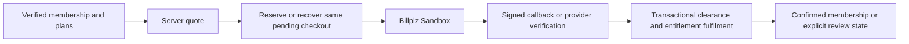

# Membership renewal, Premium rewards and demo payment UX

Verified locally on 12 November 2026. Application source was independently exported from `1dc2c7f`; `04ab8fa` subsequently corrects only offline Admin screenshot typography. No Firebase deployment, personal-device installation, production transaction, real balance mutation or live reward publication was performed.

## Scope and original issues

The existing backend already supported early same-tier renewal. The UI did not explain it clearly, repeated technical Sandbox notices dominated payment pages, and Admin reward editing did not expose the existing Premium eligibility field. Member reward eligibility needed clearer badges, reasons and actions.

The implementation reuses the commerce service, unified entitlement resolver, existing `premiumOnly` field, reward publication revisions, inventory transactions and shared GainPath components. It introduces no recurring billing, automatic active-tier conversion, new wallet, new reward collection, unapproved Premium bonus or discount.

## Membership rules and renewal

| Tier | Effective access |
| --- | --- |
| Free | Digital fitness, daily check-in and retained earned points; physical reward redemption requires paid membership |
| Basic | Free features, gym access, Mini Games, Coach booking and regular rewards |
| Premium | Basic features plus configured VIP benefits and eligible Premium-exclusive rewards |

Unresolved entitlement is a verification state and fails closed for paid actions. Expired paid accounts retain history and points. Configuration remains authoritative for bonus and discount benefits.

Both active Basic and active Premium can renew the same tier at any time. There is no seven-day renewal restriction. The existing seven-day refund eligibility policy is a separate rule. Unsupported active Basic-to-Premium and Premium-to-Basic conversion is rejected before bill creation.

Every distinct verified, cleared renewal applies:

```text
newExpiry = max(priorExpiry, clearanceTime) + 30 * 24 * 60 * 60 * 1000
```

This is exactly 30 elapsed days. Pending bills do not extend access. A repeated callback does not extend it twice. Concurrent requests recover one pending bill; distinct valid cleared renewals serialize and preserve each extension. The phone does not authorize the expiry or payment amount.

The new 12-case flexible-renewal suite covers Free purchases of both paid tiers, renewal immediately after activation, 20 days / 13 days / one day before expiry, exact expiry, expired renewal, clearance after expiry despite earlier reservation, concurrent pending requests, callback replay and both unsupported tier conversions. Other payment/security suites cover ownership, stale sessions, recovery, provider mismatch and quote changes.

Example: an active member with expiry **25 Nov 2026, 18:00 MYT**, renewing on 12 Nov, receives an estimated **25 Dec 2026, 18:00 MYT**. Clearance after the former expiry instead starts the additional term at clearance.

## Overview, checkout and payment flow

The overview names the verified tier (`Basic Membership` / `Premium Membership`), identifies expired membership, offers `Explore Membership Plans` for Free accounts and explains anytime renewal to active paid members. Unknown state directs verification rather than presenting Free as a known fact.

Renewal review shows current or previous tier/expiry, the additional 30 days, server-supplied price and an explicitly estimated expiry. Its explanatory text states that final expiry is calculated when payment clears. The display projection uses the server-resolved entitlement timestamp, never device time, and cannot grant membership.

The authorized flow remains:



A browser return alone never settles payment. Ambiguous checkout preserves the request identity for recovery. A confirmed payment with unresolved fulfilment explicitly requires review; it does not claim membership activation. Cross-account reads and recovery remain denied.

Repeated prominent Sandbox/Mock banners were removed from routine member pages. Checkout and results retain discoverable **About demo payments** details explicitly describing Sandbox and no real funds. Billing uses **View receipt (PDF)**; the receipt remains factual about the payment environment. One-time payment copy makes the absence of recurring charges clear. Billplz Sandbox host validation, signature checking and provider verification remain intact.

## Admin reward catalog

The direct reward editor exposes **Member Eligibility** with **Basic & Premium** and **Premium Exclusive**. Catalog cards show eligibility independently of publication state. A filter supports all, regular and exclusive rewards. Admin can create, edit, publish and remove rewards using the existing repository and publication workflow.

Eligibility participates in the saved payload and stable retry signature. Editing preserves the existing value. Optional legacy missing `premiumOnly` is interpreted as regular; a provided malformed value is rejected. No migration overwrites old records.

Changing a published reward explains that the change affects future redemptions and existing vouchers retain their terms. The server continues checking organization, role, account lifecycle, item revision, publication state, stock and points. Stock additions, audit/history and existing voucher terms remain protected.

## Member reward experience

Premium-exclusive cards and details carry a visible badge. Free retains its point balance and receives paid-membership guidance. Basic can redeem regular rewards; exclusive rewards remain locked with an informational membership link, without offering unsupported immediate conversion. Premium still needs sufficient points, available stock and a valid current item revision. Unknown entitlement offers verification. Failed redemption does not fabricate a voucher and retries the same request. Existing vouchers and history remain accessible according to their existing ownership rules.

The dedicated backend Premium suite verifies denial for Free, Basic and unresolved entitlement and the effect of changed publication eligibility while preserving prior vouchers. Transactional reward tests continue protecting the final stock unit, wallet deduction and idempotent retry.

## Flutter visual evidence

These are actual local Flutter renders with synthetic accounts and transactions. Screenshots are ignored build artifacts, not production captures. Offline tests substitute bundled Barlow for Poppins/Inter; Admin default text uses a locally loaded Arial alias. Production typography and assets are unchanged.

- Membership: **276 PNGs**, 23 states across 320×760, 360×800, 390×844 and 844×390, each at 100%, 150% and 200% text scale.
- Member rewards: **96 PNGs**, eight eligibility/error states across the same 12 size/scale combinations.
- Admin: **16 PNGs**, mixed catalog, Premium filter, exclusive editor and new reward form at 768, 1024, 1280 and 1440 px.
- Representative renders were opened and inspected, including Basic renewal, Premium renewal at 320 dp / 200%, Basic locked reward, Admin mixed catalog and exclusive editor. These checks are representative, not a claim that every PNG received individual human-style review. Widget cases also check scrolling, enlarged text and stale-session hiding.

| Area | Before | After |
| --- | --- | --- |
| Membership | [Previous Free overview](../../build/membership-commercial-20261112/renders/360x800-1.0-free.png) | [Free overview](../../build/membership-renewal-premium-rewards-20261112/membership/360x800-1.0-free.png) |
| Checkout | [Previous checkout](../../build/membership-commercial-20261112/renders/360x800-1.0-checkout.png) | [Basic renewal](../../build/membership-renewal-premium-rewards-20261112/membership/360x800-1.0-renew-basic.png), [Premium at 200%](../../build/membership-renewal-premium-rewards-20261112/membership/320x760-2.0-renew-premium.png) |
| Member rewards | [Previous Free rewards](../../build/membership-commercial-20261112/renders/360x800-1.0-free-rewards.png) | [Basic locked](../../build/membership-renewal-premium-rewards-20261112/member-rewards/360x800-1.0-basic-locked.png), [Premium](../../build/membership-renewal-premium-rewards-20261112/member-rewards/360x800-1.0-premium.png), [Retry](../../build/membership-renewal-premium-rewards-20261112/member-rewards/360x800-1.0-retry.png) |
| Admin rewards | Prior editor did not expose membership eligibility | [Catalog](../../build/membership-renewal-premium-rewards-demo/admin/1024-mixed-catalog.png), [Exclusive editor](../../build/membership-renewal-premium-rewards-demo/admin/768-edit-exclusive.png), [Premium filter](../../build/membership-renewal-premium-rewards-demo/admin/1440-premium-filter.png) |

## Verification results and limitations

| Check | Observed result |
| --- | --- |
| Clean-source backend | **141 passed**, eight files: flexible renewal, payment, commerce security, entitlement, Billplz Sandbox, points-only rewards, Premium redemption and verified rewards |
| TypeScript | Source and test `tsc --noEmit` checks exited 0 on clean source |
| Clean-source shared Domain | **192 passed** |
| Clean-source Mobile | **43 passed**, commercial UI, membership renders, reward eligibility renders and verified reward screens |
| Clean-source Admin | **26 passed**, management, repository and catalog tests |
| Admin render mode after typography correction | **17 passed**, including four viewport cases |
| Local Firestore emulator | **8 passed**, membership payment and Coach directory suites; real transaction contention, promo capacity, distinct renewals, financial-write denial and cross-account read denial |
| Scoped Dart analysis | Zero errors or warnings; one existing brace-style info in `membership_support_screen.dart:39` |
| Working checkout Android Debug | Build passed |
| Clean-source Android Debug | Arm64 build passed from `1dc2c7f` |
| Working checkout Admin Web | Release build passed |
| Clean-source Admin Web | **Failed on a pre-existing committed Coach integration mismatch**, detailed below |

Clean verification used `git archive 1dc2c7f` in `build/membership-renewal-premium-rewards-20261112/clean-1dc2c7f`, reusing installed dependency caches and Android SDK configuration. It excluded unrelated uncommitted source. Screenshot support deliberately reads local offline font assets. No new dependency resolution or production credentials were required.

The clean Admin failure is `admin_shell.dart:528`, passing `onReviewChanged` to `CoachesScreen`, whose committed constructor does not declare it; the subsequent `List<dynamic>` error follows that constructor failure. Both sides were inspected at unrelated earlier commit `33297e5`: the caller already passes the argument and its matching constructor is absent. The working checkout contains the uncommitted Coach implementation and builds successfully. Those unrelated files were neither altered nor included in this task's commits. Consequently the committed tree is **not yet a self-contained passing Admin release**, even though the scoped membership/reward tests pass. The Coach work needs its own reviewed integration before release.

Transient verification failures were resolved or recorded: running Mobile tests from the repository root omitted app SVG assets; rerunning from `apps/mobile` passed all 43. An initial clean Admin command named a nonexistent test file; the corrected three existing files passed all 26. Early screenshot fixtures used missing default fonts and an inappropriate lazy-scroll assertion; corrected fixtures passed and were visually inspected. Emulator default and reused ports could not bind; a fresh loopback port set with an in-directory copy of the actual Rules passed all eight cases. An earlier temporary rules-path warning was eliminated in the final emulator run. Expected permission-denied logs belong to negative authorization assertions.

The broader backend suite was not rerun for this scoped change. The preceding membership report records two existing broader failures (fixed-port emulator registry and Node 22 release-package expectation under Node 24); these are not represented here as newly passing checks.

A separate read-only reviewer inspected the scoped implementation commits and found no concrete important defects in renewal estimates/actions, payment disclosure, optional reward eligibility compatibility or redemption authorization. That review did not rerun tests and does not remove the clean Admin build blocker.

### Build artifacts

[Clean-source Android Debug APK](../../build/membership-renewal-premium-rewards-20261112/clean-1dc2c7f/apps/mobile/build/app/outputs/flutter-apk/app-debug.apk)

SHA-256: `f6bd420c143487b438dbd559f686ff0d4803b3852151ed10157a8f72622563cf`.

[Working-checkout Admin Web output](../../apps/admin_web/build/web/index.html). This artifact includes the pre-existing uncommitted Coach changes; do not attribute it solely to the membership commits or treat it as the clean-source build.

Billplz remains Sandbox. Authenticated provider checkout, real-device browser return/recovery, receipt PDF save/open, screen-reader/TalkBack navigation and production font loading still require device UAT. Local fixture clearance demonstrates application behavior, not real financial settlement. Deployment and any live Premium discount, bonus or reward inventory activation require their own authorized release.

## Task commits

| Commit | Scope |
| --- | --- |
| `50be1a1` | Flexible renewal and checkout boundary regressions |
| `c8d6e39` | Consumer payment presentation and honest demo disclosure |
| `11e7e3f` | Premium reward authorization and prior-voucher regression |
| `1e777f1` | Browser return cannot settle payment regression |
| `4f3d741` | Anytime renewal overview and estimated-expiry review |
| `3b3424d` | Member Premium-exclusive eligibility experience |
| `d32e6bc` | Admin eligibility editor/filter and legacy compatibility |
| `1dc2c7f` | Responsive membership/reward render fixtures; clean application export |
| `04ab8fa` | Offline Admin screenshot typography correction |

The documentation commit follows these changes. Unrelated `33297e5` financial operations work and the remaining dirty Coach, workout and homepage files are outside this task.

## Follow-up: clean Admin build blocker resolved

Commit `8b6b20c620e3c01e2c93df1eb007f9167d294032` fixes the Coach interface integration described above. `CoachesScreen` now accepts the intended `onReviewChanged` callback and synchronizes the shell with loaded or cleared review state. It compares against the last reported Coach ID so a failed review switch also clears stale breadcrumbs/return scope. The callback was retained because the shell uses it for review navigation; no Coach redesign was included.

The missing parameter was first reproduced with a new failing compilation test against the original committed source. A separate failed-switch regression also reproduced the stale-scope issue before correction. Final verification used a fresh `git archive` of the exact fix commit in `build/admin-clean-build-fix/clean-8b6b20c`, reusing installed package caches and excluding all uncommitted application source:

- **28 Flutter tests passed** across Admin shell, shared people, Coach review alerts/overview, publication flow and discard guards. New cases cover initial review, selecting another Coach, refresh clearing, denied access and failed review switches.
- Scoped analysis of `coaches_screen.dart`, `admin_shell.dart` and the regression test: **no issues**. Full Admin analysis: **zero errors/warnings**, with **28 existing informational brace-style lints**; `flutter analyze --no-pub --no-fatal-infos` exited 0.
- `flutter build web --release --no-pub`: **passed**, including the Wasm dry run. The existing CupertinoIcons font warning remains. [Committed-source build output](../../build/admin-clean-build-fix/clean-8b6b20c/apps/admin_web/build/web/index.html).
- Independent review found no remaining important issues after the failed-switch correction. The pre-existing uncommitted Coach screen was preserved byte-for-byte; the fix commit contains only the minimal committed Coach integration and tests. No deployment was performed.

This follow-up resolves the earlier clean-build blocker; the earlier failed result remains as historical verification evidence.
