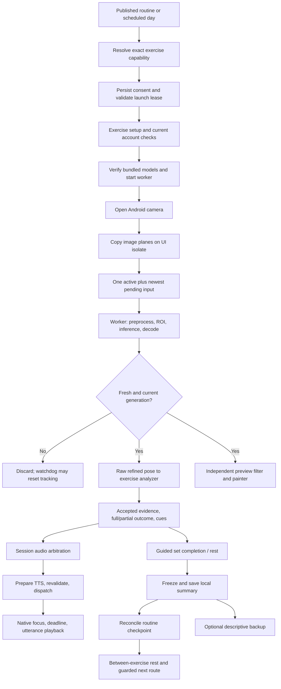

# Module 2 — Performance, Voice and Workout UX Audit

**Date:** 10 November 2026 (Asia/Kuala_Lumpur)
**Status:** Original audit snapshot. Phases 0–3 have subsequent implementation reports. The findings below describe the original inspected source.
**Source:** `C:/Users/Ngzhe/StudioProjects/gainpath`, HEAD `1082e12d2eb1c6b6326cfaf0c6e420f3e6c4b6e4`, including the existing working-tree changes. This is the Flutter repository; the chat's `Documents/ChatGPT/GainPath` directory is a separate documentation checkout.

**Scope update (Phase 0, 10 November):** future optimization focuses on **Squat, Biceps Curl, Calf Raise, Floor Push-up, Lateral Raise and Shoulder Press**. Reverse Lunge, Dumbbell Row and Wall Push-up are discontinued as future optimization targets, but their implementations, catalog eligibility and existing routine/enrollment/history references are retained pending a separate safe-retirement assessment. Nine-tracker descriptions and audit measurements below remain the original inspection record. Current implementation/verification is tracked in [the Phase 0 report](module-2-phase0-implementation.md); later Phase 1/2 work is separately authorized and must not be conflated with Phase 0 evidence.

## 1. Executive summary

**Phase 3 update (11 November 2026):** The shared camera viewport now repaints the skeleton independently and projects each landmark once per paint. Deterministic results, additional scalar diagnostics and the ML Kit comparison are recorded in the [Phase 3 rendering report](module-2-phase3-rendering.md).

**Implementation update (11 November 2026):** Phase 0 privacy/testing work is committed separately. Phase 1 tracking/resource recovery and Phase 2 voice/event readiness fixes for the retained six are recorded in [the implementation and verification report](module-2-phases1-2-implementation.md). Physical performance and audible-latency acceptance remain unmeasured. Later roadmap items, legacy retirement and live catalog changes are not included.

Module 2 has a substantial on-device implementation: nine explicitly dispatched exercise trackers, background BlazePose preprocessing/inference, bounded latest-frame processing, exercise-owned calibration/counting, Android offline TTS, account-scoped consent/preferences, local-first results, routine checkpoints, timed/manual execution and separate backup/upload policies. The coach is a deterministic event/cue system, **not a generative personal trainer**. No LLM is needed to address the findings here.

The highest-value work is at component boundaries:

1. **Close the standalone preview authorization/consent gap (P0 review priority).** The preview launcher does not retain the original consent/account/lifecycle lease, and its route checks the Member role only at initialization. Persistent AI-consent withdrawal is not observed on this path. The source gap is confirmed; a live unauthorized-capture scenario was not exercised.
2. **Make tracking continuity consistent without relaxing admission (P1).** A synthetic lateral-raise replay counts one rep with immediate delivery and zero with steady 200 ms delivery plus watchdog ticks. Its capture-age watchdog resets calibration even though each delivered frame satisfies the 250 ms input-age limit. Six trackers have this pattern; squat and shoulder press already separate accepted delivery from capture freshness.
3. **Preserve meaningful voice at set boundaries (P1).** An audit probe confirms the same shoulder-press movement speaks “Good repetition” when the target is five, but is cancelled when the target is one. Counting and set progression succeed in both cases. The session pauses audio immediately after observing the completing rep. Rest/completion announcements are largely absent.
4. **Apply fresh event/deadline policy consistently (P1).** Squat, floor push-up and shoulder press use bounded speech starts. The other six trackers still use transient cues without a native start deadline. Geometry/watchdog invalidation is also inconsistently propagated to audio.
5. **Make failure/save recovery bounded (P1).** A failed detector is retained for Retry, and drain/close waits can precede the detector's timeout. AI reps remain in memory until final save; routine checkpoints recover saved results, not an interrupted live set.
6. **Profile before optimizing buffers, filters or reuse (P2).** Camera plane copies happen before scheduler admission; model loading/hash checks happen before spawning the worker; inference continues during between-set rest. These are confirmed work locations, not measured causes of jank, heat or battery drain.

**Fresh verification:** 750 pose tests passed. A selected 33-file mobile run produced **229 passed, 3 skipped, 4 failed**. All four failures are consent-sheet fixtures missing `AuthBloc`; they are recorded below and were not fixed. Three additional audit-only probes passed, reproducing the two behavioral defects above. No camera, phone session, APK installation, backend deployment or cloud write was performed. No real-device FPS, p95 inference, audible latency, battery or thermal result is claimed.

## 2. Method, evidence and limits

### Evidence labels

- **Confirmed / reproduced:** observed in a fresh deterministic probe or test.
- **Confirmed / source:** follows directly from inspected implementation. This can describe an intentional limitation or a failure path without proving its frequency on hardware.
- **Hypothesis:** plausible performance/race/user impact requiring profiling or reproduction.
- **Enhancement:** optional capability or UX improvement, not an existing correctness defect.

Priorities describe impact: **P0** consent/privacy, unsafe activation, crashes or data-loss exposure; **P1** tracking/voice failures or major interruption; **P2** efficiency, usability and customization; **P3** minor polish. A P0 source gap is not a claim of an observed privacy incident. No general duplicate-counting, memory-leak or GPU-regression allegation is made without evidence.

The review traced app composition, all nine session/analyzer pairs, shared camera/detector/scheduler/filter/audio code, native Java audio/GPU ownership, consent, routine/timed/manual progression, local stores, backup/outbox and related screens/tests. Existing dirty source was inspected as-is, including the untracked `pose_runtime_timing.dart` and its preview-controller integration. Existing status documents were treated as historical context rather than new test or deployment evidence.

UI assessment is based on widget/layout/state source and existing widget tests. No physical screen readability assessment, new screenshot review or gym usability session was performed. UI/UX skill principles were applied for hierarchy, targets, feedback and accessibility; its local search script could not run because Python is not installed. Recommendations use the existing GainPath tokens, not an unverified generated design system.

Audit execution created this report and ignored local verification/probe artifacts under `build/module2-audit-20261110/`. No production source, existing tests, model assets, thresholds, Firebase schema or service was edited. Dependency resolution was not requested (`--no-pub` for Flutter tests). Existing tracked/untracked work was preserved.

## 3. Architecture and ownership

Repository paths below are relative to its root. Linked paths resolve from this report's `docs/ux` directory.

| Layer | Actual components and responsibility | Communication / boundaries |
|---|---|---|
| Discovery and schedule | [workout_prep_screen.dart](../../apps/mobile/lib/features/workout/presentation/member/workout_prep_screen.dart), `workout_program_screen.dart`, `WorkoutProgramController`, catalog cubit | Published routine/program data; state-derived resume/start; no inference here |
| Capability resolution | [ExerciseTrackerDispatcher](../../apps/mobile/lib/features/workout/domain/exercise_tracker_dispatcher.dart), [ExerciseExecutionResolver](../../apps/mobile/lib/features/workout/domain/exercise_execution_resolver.dart), domain `ExerciseTrackingRegistry` | Exact registered IDs and installed implementations; no name-based arbitrary tracker selection; measured, timed, legacy manual or unavailable |
| Routine orchestration | [routine_journey_route.dart](../../apps/mobile/lib/app/routing/routine_journey_route.dart), [RoutineJourneyController](../../apps/mobile/lib/features/workout/application/routine_journey_controller.dart) | Pins account/attempt/day/entry; writes capture ID before navigation; reconciles matching durable result after return/restart |
| Capture consent | [showWorkoutCaptureConsent](../../apps/mobile/lib/features/workout/presentation/member/workout_prep_screen.dart), [WorkoutPreferencesController](../../apps/mobile/lib/features/workout/application/workout_preferences_controller.dart), [WorkoutAiConsentGuard](../../apps/mobile/lib/features/workout/presentation/member/workout_ai_consent_guard.dart) | Local version `1`, account scoped; grant persists before use, withdrawal immediately invalidates listeners; separate from OS camera permission and server consent |
| Exercise route | `real_squat_route.dart`, `{curl,calf_raise,wall_push_up,floor_push_up,lateral_raise,shoulder_press,row,reverse_lunge}_workout_route.dart` | Constructs scoped store/repository, camera, detector factory, audio, clock and session; owns auth/lifecycle/disposal and exercise setup |
| Camera | [AndroidPoseCamera](../../apps/mobile/lib/infrastructure/pose/android_pose_camera.dart) | Front preferred, fallback first available; medium YUV420, microphone disabled; immutable plane snapshots and callback timestamp; revision rejects stale callbacks |
| Preview/scheduling | [PosePreviewController](../../apps/mobile/lib/features/workout/application/pose_preview_controller.dart), [LatestPoseProcessor](../../packages/gainpath_pose/lib/src/pose/pose_stream.dart) | One active inference + one replaceable newest pending input; 250 ms admission/result freshness; orientation generation invalidation; drain on pause/close |
| Detection | [BlazePoseDetector](../../apps/mobile/lib/infrastructure/pose/blazepose_detector.dart), `blazepose_assets.dart`, `blazepose_geometry.dart`, `blazepose_decode.dart` | Verified bundled detector + full landmark model; persistent Dart worker; preprocessing, ROI, inference and decoding off UI isolate |
| Native acceleration | [BlazePoseGpuSession](../../apps/mobile/lib/infrastructure/pose/blazepose_gpu.dart), [BlazePoseGpuPlugin.java](../../apps/mobile/android/app/src/main/java/com/zyang/gainpath/BlazePoseGpuPlugin.java), `GpuSessionOwner.java` | Normal builds prefer required-OpenCL transport; initialization failure can fall back to separate validated 2-thread CPU path; native thread owns interpreters/delegates |
| Exercise analysis | `packages/gainpath_pose/lib/src/<exercise>/*_analyzer.dart`, geometry/rule helpers | Receives fresh inverse-ROI **unmirrored raw/refined landmarks**, not held/smoothed preview. Calibration, finite-state cycle, health, partials and supported scores/cues |
| Session aggregation | [RealSquatSessionController](../../apps/mobile/lib/features/workout/application/real_squat_session_controller.dart), `SquatProcessingController`, eight other workout sessions | Scope/model guard, analysis, guided sets/rest, voice policy, frozen summary/save retry; implements `MeasuredWorkoutSession` |
| Coaching and audio | [WorkoutAudioController](../../apps/mobile/lib/features/workout/application/workout_audio_controller.dart), `WorkoutFeedbackEvent`, [AudioCueArbiter](../../packages/gainpath_pose/lib/src/pose/audio_cue_arbiter.dart), [AndroidWorkoutAudio](../../apps/mobile/lib/infrastructure/audio/android_workout_audio.dart) | Bounded vocabulary/events, warning > correction > encouragement; generation-based cancellation; optional prepare/timed port |
| Native TTS | [WorkoutAudioPlugin.java](../../apps/mobile/android/app/src/main/java/com/zyang/gainpath/WorkoutAudioPlugin.java), `AudioPlaybackEpoch.java`, `AudioStartDeadline.java` | Offline English voice, focus/foreground checks, QUEUE_FLUSH, utterance callbacks, start/playback deadlines, stop/shutdown |
| Workout UI | [RealWorkoutView](../../apps/mobile/lib/features/workout/presentation/member/real_workout_view.dart), `WorkoutSessionSheet`, `PoseCameraViewport`, `PoseLandmarkPainter` | Full-screen camera, overlay, anchored sheet, progress/control display; camera viewport in RepaintBoundary; no counting in paint |
| Camera-free execution | [GuidedTimedWorkoutController](../../apps/mobile/lib/features/workout/application/guided_timed_workout_controller.dart), timed route/screen, routine manual logger | Timer requires ready/playing/non-buffering tutorial; 5 s active-progress save cadence and transition saves; manual sets explicitly self-reported |
| Persistence and backup | [WorkoutSessionRepository](../../apps/mobile/lib/features/workout/data/workout_session_repository.dart), `FileWorkoutSessionStore`, `FileRoutineJourneyStore`, `FileProgramEnrollmentStore`, backup coordinator/scheduler, real-workout outbox | Atomic local snapshots, exclusive operations, scope/idempotency/conflict checks; descriptive backup and trusted upload are distinct |

### Important separations and duplication

- Preview is drawing only. Default direct preview still computes its filter and then chooses the refined pose; squat deliberately uses a 3 Hz display filter. Analyzer smoothing is independent. Two filter paths are intentional evidence/display separation, but warming a hidden display filter is optional CPU work.
- The scheduler does not grow an inference backlog. `droppedFrames` counts pending replacement/invalidation, `staleFrames` includes pre-processing and result expiry. These do not measure camera sensor/preview FPS.
- Detector and landmark models are two stages of one pipeline, not two duplicate pose engines. Detector runs when ROI is missing or after 15 ROI frames; landmark inference runs with usable ROI. Heatmap/world outputs support decoding and geometry; do not remove them just because the UI draws 2-D joints.
- Pause/restart of one session keeps the detector and resets ROI, while disposing/reinitializing the camera. Moving to another exercise constructs another detector/audio/session. No workout-wide resource lease exists.
- Eight similar session implementations duplicate lifecycle, timer, summary, audio preference and save code; squat has a separate processing layer. Existing differences (floor event recovery, press delivery timing, lunge camera-check countdown, curl arm switching) show policy drift. Share lifecycle/event contracts cautiously; retain exercise-owned evidence rules.
- Legacy `application/workout_session_bloc.dart`, `application/live_session/workout_session_bloc.dart` and prototype screens also exist. `WorkoutRoute` explicitly injects `SimulatedPoseDetector` and marks simulation; normal measured routes pass real sessions into `RealWorkoutView`. The no-argument `LiveWorkoutScreen` branch and non-measured `WorkoutResultScreen` contain simulated/form/points copy. Do not treat those branches as the real coach, or move their fabricated feedback into measured UI. Reachability should remain regression-tested.

## 4. End-to-end tracking, voice and completion flow



For video timed/manual entries, execution branches before camera/consent: video initialization and durable timed progress, or explicit manual-set logging. No timer or navigation result is converted into measured pose evidence.

**Timing boundaries matter.** `AndroidPoseCamera.start` stamps the input after copying planes (line 108). The camera package callback does not expose sensor exposure time here. Input-to-result age therefore excludes sensor/driver delay and copy time. Accepted poses must be no older than 250 ms at delivery. Shared preview holds drawing for up to 250 ms delivery absence or 500 ms absolute input age, checked every 100 ms; timer scheduling adds granularity. Held display is never fed back to counting. A visible skeleton is not proof the analyzer is ready.

Event speech uses `WorkoutFeedbackEvent.maximumAgeMicros = 500000` from observation, subtracting age/wait time before native dispatch. This 500 ms policy is **a configured limit, not a measured latency**. Native clock sampling conservatively maps the remaining budget; Dart and Android clock origins must not be directly subtracted.

## 5. Current performance assessment

| Area | Confirmed implementation | Assessment / missing evidence |
|---|---|---|
| Camera startup | Models are prepared before camera start; `availableCameras`, initialize, stream start are sequential | Time to permission prompt/first preview/first assessable pose is unmeasured; a single “startup” number would hide the stages |
| Preview FPS | Camera texture plus accepted skeleton updates, no requested FPS parameter | Actual negotiated resolution/FPS and texture presentation unknown; camera FPS, inference FPS and skeleton paint FPS are separate |
| Inference | Persistent worker; CPU `threads = 2`; preferred OpenCL owned on dedicated native thread | No reason to recommend “move all inference off UI” as new work. GPU vs CPU superiority on the target phone is unverified |
| Throughput | Latest-only scheduler; 250 ms old-input/result rejection; one detector command at a time | Bounded backlog is good. If pipeline exceeds age budget, work can be discarded repeatedly despite high camera FPS |
| UI isolate | Camera plane copies, lifecycle/model hashing orchestration, preview filtering, analyzer update, notifications and JSON serialization | Expensive **possible** work on UI remains. Native inference itself is elsewhere. Need CPU samples, allocation/GC and frame timelines |
| Worker CPU | Bilinear YUV/RGB tensor sampling, ROI math, decode/heatmap refinement, output copies | `preprocessImage` is already optimized with cached row/column products; compare equivalence before any replacement |
| GPU transport | Landmark input 256×256×3 floats; returns output indices 0/1/3/4, including 64×64×39 heatmap | Input is 786,432 bytes and heatmap 638,976 bytes by tensor shape, not a throughput measurement. Codec/native/worker copies can matter; transport might dominate small native inference |
| Initialization | `prepareBlazePoseAsset` always loads/hash-verifies bundled bytes and may read/hash cached model before worker spawn | Bundled models total 9,399,558 bytes. Cache avoids rewriting/loading from unowned buffer, but not repeat asset/file validation. UI impact unmeasured |
| Rest | Analyzer paused, but preview scheduler/camera/inference continue within AI session | Useful if live readiness/preview is needed; otherwise potential CPU/GPU/battery cost. No battery saving is quantified |
| Exercise change | Old session closes; new route creates camera/worker/TTS; model files reused | Repeated startup cost is confirmed structurally. Pooling could improve it, but must invalidate ROI/filter/side/audio/consent state |
| Jank | Full-screen stable camera constraints, RepaintBoundary, stable sheet key; many sessions coalesce notifications in microtasks | Some sessions still notify every 100 ms plus pose delivery; squat can notify from analysis and preview. Build cost is unmeasured; repaint isolation does not eliminate builds |
| Memory | Bounded frame queue, diagnostic rings/maps and score aggregates; explicit camera/detector/TTS disposal | No measured leak established. Track Dart heap **and** native Java/TFLite/direct/GPU memory through repeated routes |
| Long sessions | Watchdogs/timers, active-time metrics, bounded event IDs and diagnostics | No fresh 45–60 minute soak, thermal or battery evidence; timeouts and whole-history JSON need stress tests |

### Existing instrumentation and its limits

- `BlazePoseDetector.diagnostics`: cumulative mean native/worker time and frame count; native inference excludes whole pipeline. It does not provide a universal p95.
- `PosePreviewController.diagnostics`: received/processed/displayed/drop/stale counts, overlay FPS over active time. It does not measure sensor FPS or presentation.
- `PoseQualityDiagnostics`: opt-in bounded stage samples, queue age, discard reasons, worker stages and optional rendering/lag diagnostics. The standalone preview wires quality to camera/detector and Flutter timings; ordinary exercise factories call `BlazePoseDetector.create()` without that object. Enabling a flag alone does not guarantee complete ordinary-workout traces.
- `RealSquatPerformance`: bounded samples/p50/p95, delivered FPS, first **CPU paint** age and analyzer time, opt-in outside release. CPU paint is not screen presentation or physical camera latency.
- Existing dirty `PoseRuntimeTiming`: debug-only, at most 60 reports; maxima/cumulative deliveries/stale-result counts and delivery silence. It is not a long-session histogram or benchmark baseline.
- `WorkoutAudioTrace`: bounded 256 scalar records outside release, stage/request/cue IDs and explicit native timestamps. Normal inspected route composition constructs `AndroidWorkoutAudio()` without trace injection; floor's optional session trace seam alone does not capture native audio callbacks.
- Diagnostic flags can disable responsive preview or introduce shadow CPU/GPU comparison and joint tracing. Benchmark the ordinary configuration separately, and record every define. A traced debug run cannot establish normal release performance.

## 6. Tracking accuracy and evidence quality

### Exercise-by-exercise contract

These are implementation facts and provisional engineering defaults, not medically validated movement standards. Full/partial behavior is tested synthetically; person/device accuracy remains a separate validation task.

| Exercise / source directory | View and evidence | Counting/calibration/feedback constraints |
|---|---|---|
| Squat — [squat](../../packages/gainpath_pose/lib/src/squat/squat_analyzer.dart) | Side selected from usable confidence; knee/trunk projected geometry and additional world evidence where supported | `SquatRuleSet`: confidence .7, 500 ms neutral calibration, ready 160°, depth 90°, reversal 150 ms, cycle 0.6–10 s. Full vs partial attempts; trunk/depth deviations and provisional score. Delivery watchdog already fixed; versioned rules retained |
| Curl — [curl](../../packages/gainpath_pose/lib/src/curl/curl_analyzer.dart) | One anatomical arm, selected/locked; shoulder/elbow/wrist/hip | .65 confidence; 800 ms arm-down calibration; flexion ≤60° held 100 ms and return ≥150°; duration/sample guard. Upper-arm/trunk drift corrections and provisional score. Both-arm session aggregates separate arms and requires an explicit switch |
| Calf raise — [calf_raise](../../packages/gainpath_pose/lib/src/calf_raise/calf_raise_analyzer.dart) | Side with usable .7 confidence; hip/knee/ankle/heel/toe, baseline/noise/forefoot geometry | Flat-foot 800 ms window; relative heel/ankle excursion and controlled return. Brief uncertainty/rearm logic; knee steadiness cue. Only visible leg assessed; equal bilateral effort/balance/load not measured |
| Wall push-up — [wall_push_up](../../packages/gainpath_pose/lib/src/wall_push_up/wall_push_up_analyzer.dart) | Side .65 confidence; arm/body-line projection, calibration window | Arms-extended wall setup, phase/depth/return guards, full/partial and body-line correction/estimate. Wall contact is a user confirmation, not detected physical contact |
| Floor push-up — [floor_push_up](../../packages/gainpath_pose/lib/src/floor_push_up/floor_push_up_analyzer.dart) | Selected left/right side; image geometry, optional world/projection crosschecks | `FloorPushUpRules`: .65 visibility, TOP155°/BOTTOM105°, 300 ms ready hold, 120 ms phase hold, ≥900 ms rep. Bounded dropout/limb recovery discards unsupported credit; fallback counting can remain unscored. ROM40/alignment35/control15/extension10 estimate; no floor contact, elbow flare, load or symmetry claim |
| Lateral raise — [lateral_raise](../../packages/gainpath_pose/lib/src/lateral_raise/lateral_raise_analyzer.dart) | Front, both shoulders/elbows/wrists/hips; .65 usable confidence and geometry | Stable arms-down baseline; bilateral abduction with raw/filtered agreement, peak/return dwell, symmetry/projection checks. Counts only; **no form score**. Capture-age watchdog issue reproduced |
| Shoulder press — [shoulder_press](../../packages/gainpath_pose/lib/src/shoulder_press/shoulder_press_analyzer.dart) | Front, both arms/hips; .65 confidence, front-upright/forearm geometry | Bent-elbow neutral hold → bilateral overhead → return; raw/filtered evidence and dwell; brief dropout requires bottom reset. Counts only; **no form score**. Accepted-delivery watchdog covered by existing 200 ms replay |
| Row — [row](../../packages/gainpath_pose/lib/src/row/row_analyzer.dart) | User-selected arm, .65 confidence; shoulder/elbow/wrist/hip, bent torso | 650 ms stable hanging-arm baseline with ≥5 samples; elbow angle **and** normalized pull travel; peak/return dwell and torso/limb drift guards. Counts only; no weight/bench-contact/spinal assessment |
| Reverse lunge — [reverse_lunge](../../packages/gainpath_pose/lib/src/reverse_lunge/reverse_lunge_analyzer.dart) | Selected planted front leg; both hips/ankles, front knee/heel/toe; supported geometry visibility checks | Stable stance window and verified camera check before a 3 s countdown; movement/loss resets countdown. Selected-leg reps only, no alternation inside set; front movement/return evidence, no far-knee/balance/load/form-score claim |

### Accuracy conclusions

- Monotonic timestamps, model identity, geometry validity, confidence and complete observed trajectories guard against duplicated/out-of-order or fabricated reps. Scheduler generations reject results from old orientation/pause. Do not weaken these checks to make a replay “count better.”
- Synthetic tests cover occlusion, timestamps, partial/full distinction, jitter, perspective, calibration, false motion and interruption for individual analyzers. They are strong logic coverage, not sensitivity/specificity on people.
- Front/back mirroring is display-only. Geometry expects anatomical unmirrored landmarks. Explicit selected arm/leg must remain stable across mirrored preview, recovery and pause. Automatic sides must not switch mid-attempt to combine evidence from different limbs.
- Side-view confirmation is partly user-reported. Several geometry checks reject unsuitable projection, but no universal camera-angle/person-identity/lighting classifier exists. Confidence cannot prove safe posture or validate every joint's physical position.
- Poor lighting, partial body, clutter/occlusion and multiple people can change detector confidence/ROI. Single-person ROI tracking is not authenticated person tracking. Need labeled real-camera tests, including a bystander crossing; no person-specific accuracy claim is established.
- Some corrections are instantaneous (for example curl drift), while other analyzers use dwell/baseline evidence. Speech cooldown suppresses repetition but does not validate a noisy correction. Review false positives against labeled evidence before changing any persistence rule.
- Watchdog source-age/delivery-age inconsistency is a **confirmed mechanism for undercounting**, not evidence that every tracker has an angle defect. True rejected frames, capture gaps and lost trajectories must continue to reset incomplete attempts.
- Current truthful limits in setup and measured results are valuable. An absent score must remain absent, never rendered as 0% failure or inferred clinical accuracy. “Good repetition” should be understood as the measured cycle completing; prefer range-specific acknowledgment where form is not assessed.

## 7. Voice feedback audit

### Policy and lifecycle already present

`WorkoutAudioController.consume` rejects out-of-order batches, clears pending frame cues, filters preferences/tracking, selects one eligible priority and discards other stale candidates. It does not maintain a long narration FIFO. Higher-priority cues preempt lower-priority active cues; same/equal/lower priorities do not interrupt. Native `QUEUE_FLUSH` and generation/utterance IDs prevent old callbacks from completing a new request. Warming is lazy after voice is enabled.

`AudioCueArbiter` has bounded pending/cooldown maps and per-ID cooldown. Default is 2 s. Squat, floor and press opt into 6 s. Cooldown begins at **selection**, even if prepare/focus/start fails; this avoids retries flooding speech, but can hide a short-lived useful event after an unavailable attempt. There is no global minimum silence/duty-cycle budget across different cue IDs, so multiple different corrections can still be frequent. Equal-priority selection has no explicit coaching-category/fairness policy.

`WorkoutVoiceMode` already offers **Full Coaching, Alerts Only and Muted**, with app-private organization/member scoped persistence. Alerts Only excludes all encouragement-priority cues; it is priority-based, not a semantic safety classifier. Generic partial messages are still encouragement in several analyzers, so they disappear in Alerts Only. UI mode changes override late-loaded account preferences. Preference-load errors leave voice muted; runtime preference-write failure can leave current selection working with an explanatory error.

Native audio selects installed non-network English voices (US preferred, then name), requests transient may-duck audio focus with navigation-guidance/speech attributes, stops on focus loss and Activity pause/stop, resolves done/stop/error, times out initialization at 10 s and playback at 20 s, and shuts down per session. No explicit rate, pitch, per-utterance volume or user language/voice setting is supplied; engine/system defaults apply. No application-specific Bluetooth route/headset-disconnection policy or preflight exists. Android system routing is relied upon; actual phone/music/headset behavior must be tested. There is no basis to claim Bluetooth is broken or unsupported.

### Per-exercise voice differences

| Session | Completed-observation event / bounded native start | Main current behavior |
|---|---|---|
| Squat | Yes / yes, 6 s cooldown | Fresh identified rep/depth outcomes, concise next-rep depth action; explicit lost-tracking warning. Guided stage transition calls processing pause and cancels audio |
| Floor push-up | Yes / yes, 6 s | Accepted full/partial outcome events survive temporary phase reset. Geometry invalidation explicitly calls `audio.invalidateSource`; rest pauses analyzer without cancelling last event. Explicit finish/save still cancels |
| Shoulder press | Yes / yes, 6 s | Setup warnings plus independent full/partial events; partial overhead instruction is actionable. Set-completing event immediately cancelled by `_suspendAnalysis` (reproduced) |
| Curl, calf, wall, lateral, row | Transient frame cues / no | Typically numeric rep/“Partial movement recorded”, supported corrections where implemented. One-frame cue may disappear while prepare/stop is pending. No native freshness deadline after ordinary dispatch |
| Reverse lunge | Transient frame cues / no | Above behavior plus automatic setup countdown numbers and “Ready. Begin.”; countdown resets on loss. It is an existing hands-free readiness example worth reusing carefully |
| Timed/manual/between-exercise rest | No shared coach audio owner found | Visual controls/countdown; tutorial video may have its own audio. No general set/rest/next-exercise/completion narration, countdown beep or haptic system |

### Timing and naturalness

There is no measured event-to-audible-speech latency. For six transient-cue trackers, the controller cancels its Dart start timer **before** awaiting ordinary `play`, and `_waitingForPlayback` becomes false before native `onStart`. A native delayed start can therefore escape the intended 500 ms pre-dispatch wait bound. The 20 s native playback timeout is not an acceptable freshness guarantee. Bounded paths solve much of this already; make it a shared verified contract rather than selecting a new provider.

Useful event policy: one instruction tied to accepted evidence, action first, then quiet until the user has a chance to respond. Retain future-looking phrasing for completed partials (“On the next repetition…”), reserve tracking warnings for positioning/confidence recovery, and avoid claiming invisible mechanics. Numeric reps, corrective evidence and transitions need separate categories; completion praise should not compete with “show your wrist” from the next setup. Phrase variation alone does not solve repetition.

Native `onStart` is an engine playback proxy, not proof sound reached Bluetooth headphones. Capture that timestamp, dispatch/prepare/selection, plus external acoustic observation when assessing perceived latency. Retain cancellation/expiry/unavailable rates alongside latency percentiles: suppressing late speech can improve p95 while silently dropping all guidance.

## 8. Workout continuity and screen-by-screen UX

**Can a whole workout be completed with minimal phone interaction today?** Partly. Completed AI exercises automatically save/reconcile and, when enabled, enter between-exercise rest then the next execution route. Timed completion can return automatically. But between-set rest requires explicit Start/Next in both measured and timed modes; exercise-specific setup can still require Start camera, side/arm choice or acknowledgment. Curl arm switching also requires touch. Auto-Continue is not a universal hands-free mode.

First use records versioned consent; returning measured users skip privacy acceptance until withdrawal/version change, but retain current setup checks. Default Auto-Continue is true with 30 s suggested between-exercise rest unless the routine prescribes a value. Backgrounding interrupts launch intent/rest; returning to rest requires explicit resume. These are useful safety controls, not friction to remove indiscriminately.

| Screen/subpage / actual source | Existing strengths | Findings and recommended direction |
|---|---|---|
| Workout hub and published catalog — `workout_prep_screen.dart`, catalog controls, `workout_hub_visuals.dart` | State-aware Start/Continue/View Summary; real saved progress; explicit mode/target badges; Settings/tools | Preserve current dirty visual work. Surface whether Auto-Continue applies between exercises versus sets. Avoid another decorative redesign; confirm loading/empty/retry and offline saved-plan entry |
| Programs/schedule — `workout_program_screen.dart`, enrollment cards/controller | Explicit enrollment/slot identity and resume; local schedule separate from backup | Avoid implying schedules will restore with workout backup; retain partial/skipped status and same-attempt resume. Check narrow/large-text cards and end-plan confirmation |
| Routine execution — `routine_journey_screen.dart`, `routine_journey_route.dart` | Real measured/timed/manual outcomes remain separate; pending ID persisted before capture; explicit partial/skip/manual state | Make mode/next required camera view visible before rest ends. Manual next entry returns to logger rather than fabricating completion; users need a clear audible/visual handoff |
| Camera help — `camera_setup_screen.dart` | Four supplied images, whole-aspect display, scrolling text, required front/side view explanation | General help suggests hip-height upright camera; floor setup requires near floor height. Add exercise-specific linking/context so users do not follow general squat placement for floor push-up |
| Privacy consent/settings — `workout_privacy_settings_screen.dart`, `_ConsentSheet` | Versioned local acknowledgment, separate OS permission, withdrawal, backup/Auto-Continue controls | Remove conflicting side-view boilerplate from front-view launch. Keep camera consent, optional descriptive backup and server acceptance explanations distinct. Standalone preview must follow the same account/withdrawal policy |
| Squat/wall/floor preparation — common consent and `real_squat_route.dart` / floor session | Required stable side view and supported evidence explained; floor automatic near-side selection | Current repeated acknowledgments can be shortened after a verified returning-user setup, while still rechecking actual visibility/view. Do not silently reuse physical setup confirmation when the camera must move |
| Curl/row preparation — `curl_arm_setup_screen.dart`, `row_setup_screen.dart` | Explicit arm targets and stable anatomy; unsupported load/contact claims excluded | Clearly distinguish per-arm curl sets from selected-arm row counts. A saved preference can preselect, but must not silently change the working arm or skip a safe switch |
| Calf/front-view preparation — `calf_raise_setup_screen.dart`, `lateral_raise_setup_screen.dart`, `shoulder_press_setup_screen.dart` | Visible joints and provisional/unsupported measures described; clear Start camera | Repeated Start camera remains on automatic next-exercise handoff. Front-view instructions conflict with common side-view footer. Provide focused current-view checklist instead of long repeated paragraphs |
| Lunge camera check — `reverse_lunge_camera_check.dart` | Actual usable geometry, hold and 3 s countdown; no setup movement counts; side change/loss resets; live-region status | Best existing readiness pattern. Preview uses 9:16 inside scrolling page and substantial text; distance readability and countdown audio reliability need phone validation |
| Standalone preview — `pose_preview_view.dart`, `pose_preview_route.dart` | Explicit no-workout-recording label, pause/retry, local overlay, diagnostics separated by flags | It repeats one-shot consent instead of shared persisted state/lease. Apply route-level privacy/current-role policy; avoid diagnostic metric labels being mistaken for real performance benchmarks |
| Live AI camera — `real_workout_view.dart`, `workout_session_sheet.dart`, `PoseCameraViewport` | Full-screen camera; stable constraints/key; 56×56 primary and 48×48 stop; recalibration, voice mode, expanded detail/privacy; top tooltips | Counter is only 26 logical px, set label 11, cue 14 with two-line ellipsis. At 2–3 m, essentials may be unreadable. Propose a workout distance presentation with large rep/rest value (trial 56–72 logical px), 18–22 cue, clear READY/LOST/PAUSED text, stable one-action cue and visible set/next info; validate rather than assume these sizes suffice |
| Recalibration — `workout_alignment_guide.dart`, session `canConfirmRecalibration` | Fresh geometry required before confirm; draggable/width-adjustable guide is presentation only | Body outline is not measured alignment. Explain current missing gate; keep manual fallback, consider verified-hold auto-resume only with interruption cancellation |
| Between-set rest — guided progress + sheet / timed screen | Counting stops, countdown visible, explicit skip/start, rest target can be chosen | Countdown reaches zero without automatically starting another set; same “Next” primary may mean skip rest. No generic rest/completion speech. Make behavior/preferences explicit and avoid a surprise immediate restart |
| Between-exercise rest — `between_exercise_rest_screen.dart` / route/controller | 88 px countdown, next mode/target, 56 px controls; foreground/current-route/account guards; explicit pause/resume; saved-result messaging | Stronger distance timer than live sheet. Add short transition/view-change announcement with cancellation, not recurring narration. Preserve paused return from interruptions |
| Video timed — `guided_timed_workout_screen.dart` / controller | No camera or AI claims; media readiness, pause/buffer handling, durable timer progress, 56 px action | Needs phone touch between sets. Tutorial audio and future coach audio need shared focus/duck policy. Do not credit buffering/background intervals or replace a media failure with inferred reps |
| Manual logger/tutorial — routine page, `published_exercise_tutorial_screen.dart`, `exercise_tutorial_screen.dart` | Self-reported sets separate from measured reps; user-controlled tutorial; retry/error/authorization checks | Keep manual confirmation/undo accessible and mode label prominent; no automatic set credit from navigation or elapsed time |
| Measured result — `workout_result_screen.dart:_measured` | Local save versus acceptance/rewards is honest; full/partial, unassessable time, absent score and exercise limits | Routine flow bypasses per-exercise result in favor of saved continuation, which is sensible. Keep final workout summary reachable and explain interrupted set versus completed exercise without invented motivation/metrics |
| History/attempt details — `routine_history_screen.dart`, saved-session routes, `workout_history_screen.dart` | Partial/manual/timed/measured categories, resume unfinished, backup/progress links | Preserve scoring/detector version separation, nullable scores and dated attempt identity; keep local, pending backup and server-accepted states legible |
| Backup and sync — `workout_backup_screen.dart`, `real_workout_sync_panel.dart` | Explicit local-first/private-summary policy, conflicts/retries, no video/raw landmarks, schedules excluded | Never label local save as cloud success. Distinguish descriptive backup from optional trusted workout acceptance. Recovery must keep existing copies and require no duplicate exercise credit |
| Equipment browse/detail/scanner/tutorial — `equipment_browse_screen.dart`, `equipment_detail_screen.dart`, `equipment_scanner_screen.dart`, tutorial video | Catalog browse/retry fallbacks and linked instructions | Scanner is a separate network/image workflow, not the on-device pose pipeline. Preserve separate disclosure and resource ownership; no evidence that its network latency affects active pose inference |

### Premium purple usability direction

Reuse [AppColors/AppTheme](../../packages/gainpath_ui/lib/src/tokens/app_theme.dart): primary `#6D28D9`, dark violet `#4C1D95`, light surfaces/tint and ink. Existing aqua `#00E5C0` skeleton is intentionally functional; keep its camera contrast rather than recoloring it purple for decoration. Use a stable opaque/high-contrast status backing over live video; semantic icon + text for readiness/loss, not color alone. Retain at least 48 logical px ordinary controls and existing larger primary/stop controls, with adequate spacing. Place essential state above detail, and test 320×640, 200% text, landscape/safe areas, TalkBack, motion sensitivity, bright gym lighting and dark clothing. Source sizes are evidence; actual contrast against camera content and 2–3 m readability remain unmeasured.

## 9. Reliability, privacy and persistence assessment

**Working protections:** normal measured routes validate account, role, consent/setup and exact exercise capability; `WorkoutAiConsentGuard` unmounts capture on withdrawal and never remounts a revoked session. Scope guards exist at frame, timer, storage and asynchronous boundaries. Camera revisions invalidate late callbacks; source geometry changes invalidate in-flight results; microphone capture is disabled. Native audio stops on Activity/focus loss even if Dart is delayed. Permission denial produces a specific retry/settings message and no fabricated pose.

`FileWorkoutSessionStore` uses per-account paths, an exclusive lock/queue, validation, flushed `.pending` write and rename. `saveLocal` compares same-ID summaries and rejects collisions; acknowledged records cannot be reset by a local retry. Session save freezes the summary for same-result retry. Camera shutdown errors are generally caught so an already frozen summary can still save.

`RoutineJourneyController.prepareCapture` persists the session ID first. `_reload` links only matching same-scope real-camera result, exercise and published routine; plan signatures/revisions and program-slot IDs prevent accidental cross-attempt merging. Thus a process death **after summary save but before route return** can be reconciled. It does **not** persist every accepted live rep/phase. Guided timed execution instead checkpoints active time about every 5 s and on transitions; after process death the last in-memory interval may be lost, never invented.

Backup is separate from server acceptance and from AI consent. Backup scheduler offers foreground/debounced bounded retry opportunities (5/15/45 s), preserving local work offline. Real-workout outbox has separate acknowledgment/revocation/idempotency policy; most exercise routes deliberately use unavailable trusted upload. Do not “fix” local-only status by enabling rewards or cloud acceptance. No live server state was queried in this audit.

**Remaining failure/race concerns:** standalone preview lease/role/withdrawal gap; source/watchdog invalidation not consistently cancelling speech; set-boundary speech cancelled by shared pause; automatic result navigation closing audio before last event can finish; failed detector reuse; indefinite drain blocking save; in-memory AI progress lost on process death; whole-history JSON work at saves/transitions. The backlog below gives evidence and verification for each, with runtime likelihood labeled separately.

## 10. Prioritized optimization backlog

Complexity: **S** = narrow component/policy work, **M** = several components plus focused regression work, **L** = orchestration/storage/resource ownership change. These are relative estimates, not delivery commitments. Every proposal remains subject to review before implementation.

### A01 — P0: Bind standalone preview to current consent, account and foreground

- **Status/current behavior:** Confirmed/source authorization gap; no live incident reproduced. Preview uses a one-shot `_ConsentSheet`, then reads AuthBloc only after the sheet returns. It does not use `_CaptureLaunchLease`, persisted consent or `WorkoutAiConsentGuard`. `PosePreviewRoute` checks Member role initially but subsequently supplies only current scope to the preview controller and starts with literal `consented: true`.
- **Evidence/components:** [workout_prep_screen.dart](../../apps/mobile/lib/features/workout/presentation/member/workout_prep_screen.dart):500 `_startPosePreview`; [pose_preview_route.dart](../../apps/mobile/lib/app/routing/pose_preview_route.dart):49,65,97. Compare guarded measured launch at `showWorkoutCaptureConsent`:890 and `_realSession` in `workout_prep_route.dart`.
- **Root cause/impact:** Authorization/consent logic duplicated in preview. An acceptance begun for one account or before interruption can be applied to a later account/context; same-scope role withdrawal or AI-consent withdrawal has no preview listener. OS permission remains required, but is not the same as app consent.
- **Proposed solution:** Reuse original-scope/lifecycle lease, versioned consent and current-role guard for preview; pass actual authorization state, stop immediately on withdrawal and never auto-resurrect a revoked route. Clarify whether preview has separate consent; do not leave it implicitly outside “AI Tracking off.”
- **Complexity / regression risk:** M / medium (preview launch and returning-user expectations).
- **Verification/acceptance:** Inject A→B account switch while consent waits, role withdrawal with same scope, withdrawal while capture/initialization pending, background/foreground and delayed camera callback. Zero new/continuing capture or pose delivery after invalidation; fresh authorized re-entry required. Keep preview camera-free persistence and existing measured consent tests passing.

### A02 — P1: Capture-age watchdog causes avoidable continuity loss

- **Status/current behavior:** Confirmed/reproduced for lateral raise; source pattern in curl, calf, wall, row and reverse lunge. Accepted 200 ms-old results arrive every 100 ms, but an 80 ms-later watchdog sees age 280 ms and resets despite only 80 ms without delivery.
- **Evidence/components:** `LateralRaiseAnalyzer.tick`:112; `CurlAnalyzer.tick`:96; `CalfRaiseAnalyzer.tick`:156; `WallPushUpAnalyzer.tick`:92; `RowAnalyzer.tick`:109; `ReverseLungeAnalyzer.tick`:113 in their linked exercise directories. Compare `ShoulderPressAnalyzer.tick`:114 and `squat_delivery_timing_test.dart` / `shoulder_press_delivery_timing_test.dart`. Audit probe: immediate one rep, delayed zero reps + calibration required.
- **Root cause/impact:** Timer liveness is tied to capture/callback age rather than accepted-result delivery. Steady allowed latency can repeatedly erase setup/attempt evidence, appearing as lag, disappearance or failure to count.
- **Proposed solution:** Plan a shared timing contract separating input age/capture gap from absence of valid delivery, then adapt exercise-owned watchdogs only after approval. Preserve all existing 250 ms admission, real dropout, geometry, dwell and interrupted-cycle restrictions; do not simply increase thresholds.
- **Complexity / regression risk:** M–L / high (changes analyzer lifecycle behavior).
- **Verification/acceptance:** Identical immediate/200 ms delivery trajectories with interleaved ticks have identical full/partial outcomes for all six, no artificial calibration reset. ≥300 ms stale input, true delivery silence, backward time, geometry rejection and hidden movement still reject/reset as specified. Labeled physical repetitions must not regress.

### A03 — P1: Last-rep voice is cancelled by set completion

- **Status/current behavior:** Confirmed/reproduced for press. `audio.consume` is followed synchronously by `guidance.observe`; stage change calls `_suspendAnalysis`, which calls `audio.pause` before asynchronous playback begins. Squat and the six transient-cue sessions share analogous cancellation. Floor permits final bounded event during between-set rest, but routine auto-save/close can still cut speech short.
- **Evidence/components:** [shoulder_press_workout_session.dart](../../apps/mobile/lib/features/workout/application/shoulder_press_workout_session.dart):232–276; `RealSquatSessionController._analysisChanged/_syncProcessingState`; floor `_consume`; [RealWorkoutView._sessionChanged/_end](../../apps/mobile/lib/features/workout/presentation/member/real_workout_view.dart):60,90. Probe: target1 → one counted rep/no praise; target5 → one counted rep/one praise.
- **Root cause/impact:** Analysis suspension, user interruption and audio cancellation use the same pause operation; automatic navigation has no transition-audio ownership. Set completion can feel silent or truncated.
- **Proposed solution:** Separate “stop accepting movement” from explicit user/background/source cancellation; let a fresh final event finish or replace it with one concise set/rest announcement. Transition owner must remain scoped and cancel on interruption; never delay durable save waiting for speech.
- **Complexity / regression risk:** M / medium–high (lifecycle/cancellation).
- **Verification/acceptance:** First/middle/final set and final exercise produce at most one intended completion cue with no overlapping stale correction. Manual pause, stop, consent loss and app background still stop immediately; speech failure cannot block result persistence/navigation.

### A04 — P1: Six trackers lack native speech-start freshness

- **Status/current behavior:** Confirmed/source. Curl, calf, wall, lateral, row and lunge use default `boundedStarts:false` and transient cues. Dart wait timer ends before normal native `play`; native `onStart` is not reported back to ordinary controller state. Delayed native start is a runtime hypothesis, not measured.
- **Evidence/components:** [WorkoutAudioController._play](../../apps/mobile/lib/features/workout/application/workout_audio_controller.dart):273–287; respective session constructors/`_consume`; `AndroidWorkoutAudio._play`; `WorkoutAudioPlugin.SpeechSession.play/onStart`. Squat/floor/press already provide a bounded pattern.
- **Root cause/impact:** Freshness enforced only through preparation/dispatch for ordinary cues; one-frame outcomes can also vanish while waiting. Users may miss a rep cue or hear correction after movement ended.
- **Proposed solution:** Explicit completed-observation IDs and native absolute start deadlines for supported events across all exercises; current-state warnings require separate revalidation. Retain no-FIFO behavior; count cooldown only according to a reviewed selection/start policy.
- **Complexity / regression risk:** M / medium (speech frequency and drop policy).
- **Verification/acceptance:** Fake/native delayed preparation, focus and start >remaining budget cannot speak obsolete cues. Exactly-once fresh event handling; no replay from watchdog snapshots. Report start latency **and** expired/unavailable/drop rate, by event class.

### A05 — P1: Watchdog/source loss does not consistently invalidate audio

- **Status/current behavior:** Confirmed/source, audible race unmeasured. Several session timers call `_analyzer.tick` and notify UI but do not send changed health to `audio.consume`/invalidate. Their geometry callbacks pause only the analyzer. Floor explicitly invalidates source; squat pauses processing/audio; press geometry callback does not.
- **Evidence/components:** `_timer`, `onGeometryInvalidated`, `_consume` in `lateral_raise_workout_session.dart`, `shoulder_press_workout_session.dart`, `row_workout_session.dart`, `calf_raise_workout_session.dart`, `wall_push_up_workout_session.dart`, curl/lunge sessions; compare floor constructor lines65–67 and tick path.
- **Root cause/impact:** Audio learns tracking state only when a new pose batch arrives, while geometry/watchdog state changes independently. A queued/active correction can outlive its source even while UI says reset/lost.
- **Proposed solution:** One synchronous source-invalidation/liveness notification contract from session to audio; differentiate valid completed observations during brief recovery from unsupported current corrections. Do not replay old cues on foreground return.
- **Complexity / regression risk:** M / medium–high (must preserve floor's valid partial-event recovery).
- **Verification/acceptance:** Pending speech cancelled on rotation, permanent loss, model failure, account/consent change before another frame. Accepted bounded outcome may survive only explicitly permitted temporary dropout. Delayed callbacks cannot revive it.

### A06 — P1: Retry retains a terminally failed detector

- **Status/current behavior:** Confirmed/source failure path. `BlazePoseDetector._fail` marks `_failed`; future `_request`, including reset, throws. Preview error path suspends/drains/resets but does not clear `_detector`; `start` constructs only when `_detector == null`. GPU invocation failure marks detector failed.
- **Evidence/components:** [blazepose_detector.dart](../../apps/mobile/lib/infrastructure/pose/blazepose_detector.dart) `_fail`, `_request`, `_onMessage`; [pose_preview_controller.dart](../../apps/mobile/lib/features/workout/application/pose_preview_controller.dart) `onError`/`start`/`resume`. Existing preview tests exercise fakes/permission retry, not a native-terminal detector recovery contract.
- **Root cause/impact:** Retriable camera and terminal model/worker failures share Retry UI but different resource health. A dead worker can leave Retry repeatedly failing until route exit.
- **Proposed solution:** Explicit terminal/retriable detector state; retire failed worker/native lease and recreate verified resources on deliberate retry. Preserve measured counters outside the detector and reset incomplete movement calibration safely; no silent fabricated fallback.
- **Complexity / regression risk:** M / medium (resource overlap/late results).
- **Verification/acceptance:** Simulate worker exit, GPU error and reset failure; one retry obtains one fresh resource owner, old results ignored, no counts lost/duplicated, safe generic error if recreation fails. Physical CPU fallback and GPU teardown tested separately.

### A07 — P1: Unbounded inference/drain wait can prevent local save

- **Status/current behavior:** Confirmed/source missing deadline; actual native hang unverified. Detector `close` waits active requests before starting its 10 s closed-future timeout. Preview pause/close waits scheduler `drain()` first. Session save generally awaits audio/preview shutdown before `saveLocal`.
- **Evidence/components:** [BlazePoseDetector.close](../../apps/mobile/lib/infrastructure/pose/blazepose_detector.dart):216–230; [LatestPoseProcessor.drain](../../packages/gainpath_pose/lib/src/pose/pose_stream.dart); `PosePreviewController.pause/close`; `ShoulderPressWorkoutSession._save` and squat `_save`.
- **Root cause/impact:** Cleanup timeout does not cover the whole cleanup path. A never-completing detect/native invocation can leave pause, end/save or navigation waiting indefinitely; in-memory result is then vulnerable to process death.
- **Proposed solution:** Define bounded whole-operation shutdown, invalidate input synchronously, persist an already frozen result independently from hardware teardown success, and serialize retirement so another camera/GPU owner cannot overlap. Native owner cleanup must be safe; killing a Dart isolate alone is not enough.
- **Complexity / regression risk:** L / high (save ordering and native ownership).
- **Verification/acceptance:** Never-completing detector/audio fake + real native fault harness: control returns within reviewed deadline, frozen result saved exactly once, no late result credit or newly active camera, retry/discard remains available. Existing post-commit-save-failure/idempotency tests remain passing.

### A08 — P1: Setup text contradicts front-view trackers

- **Status/current behavior:** Confirmed/source. Common real-workout sheet always says “Use a side view” after exercise-specific text. Press/lateral instructions require front view. Generic camera help also needs floor-height contextualization.
- **Evidence/components:** [workout_prep_screen.dart](../../apps/mobile/lib/features/workout/presentation/member/workout_prep_screen.dart):1065 `_ConsentSheet`; front-view setup screens; `camera_setup_screen.dart`.
- **Root cause/impact:** Squat-specific safety copy reused globally. Users can reposition incorrectly, lose calibration and receive repeated visibility warnings.
- **Proposed solution:** Derive required view and relevant positioning text from resolved tracker metadata; retain current physical setup confirmation and truthfully supported measurements. No analyzer change required.
- **Complexity / regression risk:** S / low.
- **Verification/acceptance:** Every tracker launch shows exactly one consistent required view; floor mentions stable floor-height side placement; press/lateral never instruct side view. Tests cover normal/automatic launch and large text.

### A09 — P1: Live AI progress is not a durable checkpoint

- **Status/current behavior:** Confirmed/source recovery limitation. Completed AI summaries save at `endAndSave`; accepted live reps, set progression and deviations remain in session memory. Pending capture ID exists but contains no live rep recovery. Saved results do reconcile after return interruption.
- **Evidence/components:** AI session `_consume/endAndSave/_save`; `RoutineJourneyController.prepareCapture/_reload`:343/174; file session/journey stores. Contrast timed controller's 5 s progress persistence.
- **Root cause/impact:** Routine checkpoint and measured-session checkpoint are different guarantees. Process death/power loss before final save can lose the current exercise, even after completed sets. Frequency is unknown; this is not evidence existing saved history is lost.
- **Proposed solution:** Design an account/version-scoped **interrupted aggregate** checkpoint (bounded cadence/set boundaries) reusing local storage patterns. Resume must reacquire consent/setup and neutral calibration; never restore an unfinished pose FSM as evidence or automatically label interrupted work complete. Decide current-set retention policy explicitly before implementing; no backend/schema change is part of this audit.
- **Complexity / regression risk:** L / high (identity, merging and double credit).
- **Verification/acceptance:** Process termination before/after checkpoint/summary/reconciliation yields documented bounded loss, same session ID, exactly-once rep aggregates and no fabricated cycle. Existing completed records remain byte-equivalent; account switch and stale-version restore fail closed.

### A10 — P2: Auto-Continue still requires between-set/setup interactions

- **Status/current behavior:** Confirmed/source; enhancement. `GuidedWorkoutProgress.tick` only decrements rest; `startNextSet` must be called. Timed controller has the same explicit next-set requirement. Automatic next-exercise route still opens exercise setup/side selection; manual entries remain logger actions.
- **Evidence/components:** [guided_workout_progress.dart](../../apps/mobile/lib/features/workout/application/guided_workout_progress.dart); timed controller/screen; `RoutineJourneyRoute._nextExercise/_trackOnce`; exercise setup screens; curl switch and lunge countdown.
- **Root cause/impact:** Auto-Continue covers a subset of journey transitions; user expectation may exceed behavior, requiring repeated walks to phone.
- **Proposed solution:** Clarify current preference wording first. Then offer optional readiness-gated next-set countdown and concise view-change preparation. Reuse lunge's verified-hold/interruption pattern; never auto-resume after explicit pause/background or auto-credit manual work. Keep arm/leg choice explicit when it changes evidence ownership.
- **Complexity / regression risk:** M–L / high for automatic activation.
- **Verification/acceptance:** Record interactions per full mixed workout. Proposed target: no routine/set navigation touch once a same-view AI setup is safely verified, with intentional manual/arm/view changes counted separately. Loss/motion/permission/background cancels countdown; opt-out retains exact existing explicit flow.

### A11 — P2: Between-set rest continues expensive inference

- **Status/current behavior:** Confirmed/source work; power impact hypothesis. Guidance pauses analyzer/audio but leaves camera preview/scheduler active. `_consume` rejects analysis during rest, after inference has already happened.
- **Evidence/components:** session `_canAnalyse/_suspendAnalysis/_syncProcessingState`; `PosePreviewController` scheduler and camera lifecycle; `GuidedWorkoutProgress`.
- **Root cause/impact:** Preview and analysis resource lifetimes coupled. Potential unnecessary sustained camera/CPU/GPU cost during repeated 30–120 s rests.
- **Proposed solution:** Profile preview-only/no-inference rest and bounded readiness sampling against continuous inference and full camera stop. Retain live visual reassurance if useful; reset ROI/analysis appropriately on return and respect generation/freshness. Choose a policy from measured restart/readiness/power tradeoffs.
- **Complexity / regression risk:** M / medium (readiness/start latency and overlay expectations).
- **Verification/acceptance:** Reduced native invocations/CPU during rest, no stale skeleton or counted rest movement, no worse agreed p95 time-to-ready. Battery/thermal improvement must be measured on phone under matched conditions.

### A12 — P2: Copies, hashing, filters and notification work need attribution

- **Status/current behavior:** Confirmed/source work; material jank hypothesis. Planes copied in camera callback before scheduler can replace/discard. Bundled and cached model hashes computed on UI isolate before worker starts. Direct preview always warms a filter it may not display. Notifications include pose and watchdog/rest timers. Whole-history JSON is encoded/decoded on the calling isolate.
- **Evidence/components:** [android_pose_camera.dart](../../apps/mobile/lib/infrastructure/pose/android_pose_camera.dart):83,108; [blazepose_assets.dart](../../apps/mobile/lib/infrastructure/pose/blazepose_assets.dart):11–19; preview `onResult`; `FileWorkoutSessionStore.read/write`:63,88; `RoutineJourneyController._reload` reads all history.
- **Root cause/impact:** Bounded inference queue does not eliminate pre-admission allocations, UI work or history-size scaling. Startup/transition GC/jank is plausible but unmeasured.
- **Proposed solution:** Add scalar stage spans first. Evaluate early sampling/admission before plane snapshot, safe transferable input transport, verified-model asset memoization/worker hashing, lazy preview-filter warming and narrower/coalesced listeners. Profile history sizes before redesigning storage; preserve exact preprocessing outputs and atomic/idempotent saves.
- **Complexity / regression risk:** M–L / medium–high (camera buffer lifetime, filter switching, crash recovery).
- **Verification/acceptance:** Allocation/GC/UI-time and p95 stage improvements versus same baseline; bytes/tensors and full/partial outcomes equivalent. No reuse of mutable camera buffers after callback, no invalid/foreign/stale result, save-retry/conflict tests unchanged.

### A13 — P2: Exercise transitions repeat model/camera/TTS startup

- **Status/current behavior:** Confirmed/source; delay unmeasured. Each route constructs new worker, model interpreters and audio session. In-session pause reuses detector but disposes camera. Preparation is sequential model-before-camera, so initial model work also precedes permission handling.
- **Evidence/components:** route `_open` constructors, `PosePreviewController.start/pause/close`, `BlazePoseDetector.create`, `AndroidWorkoutAudio.prepare/close`.
- **Root cause/impact:** Exercise-scoped resource lifetime simplifies isolation but may impose repeated long waits, especially cold TTS. No evidence justifies an app-global always-on camera.
- **Proposed solution:** First measure cold/warm model/camera/TTS phases. If worthwhile, design a foreground workout lease that keeps verified models and prepared TTS through rest/next setup, with bounded idle expiry and strict scope/consent retirement. Consider safe initialization overlap only after cancellation/disposal contracts are tested.
- **Complexity / regression risk:** L / high (cross-exercise/person/model/side/source contamination).
- **Verification/acceptance:** Meaningful p95 transition reduction; exactly one owner; new exercise resets ROI, calibration, selected anatomy, filters, timing and event/cooldown policy as specified; logout/withdrawal/background stop camera/audio and release on deadline.

### A14 — P2: Feedback relevance, repetition and priority are inconsistent

- **Status/current behavior:** Confirmed/source; enhancement to quality. Six sessions use numeric rep/“Partial movement recorded” rather than an action. Several partials have encouragement priority, so Alerts Only removes them. Per-ID 2 s cooldown has no cross-ID speech budget; squat/floor/press use 6 s. UI often shows first cue without explicitly matching audio arbitration's highest priority.
- **Evidence/components:** exercise analyzer `CueRequest` generation; [AudioCueArbiter](../../packages/gainpath_pose/lib/src/pose/audio_cue_arbiter.dart); audio `consume`; `RealWorkoutView._cue`.
- **Root cause/impact:** Meaning, priority, frequency and presentation are encoded differently per producer. Generic partial information may be unhelpful; changing IDs can produce too much speech; visual/audio message selection may diverge.
- **Proposed solution:** Establish typed readiness/correction/outcome/transition categories plus supported-evidence identifiers; short action text only where the analyzer proves the condition. Use stable cue IDs and global/category quiet periods. Align visible primary cue with selected priority while preserving other details in the sheet. Prefer “Movement counted” over a claim of perfect form for count-only trackers.
- **Complexity / regression risk:** M / medium (copy/priority can affect timing and Alerts Only).
- **Verification/acceptance:** Labeled evidence→message matrix for all nine; no spinal/load/balance/contact claim beyond measured support. At most one actionable primary cue; no contradictory instructions; record repetition rate and speech duty cycle across scripted sets. Alerts Only's documented semantics match tests.

### A15 — P2: Voice enabled can remain silently unavailable

- **Status/current behavior:** Confirmed/source. `AndroidWorkoutAudio.prepare` caches `_ready`, including false; native requires an installed offline English voice. Errors/`lastOutcome` are not exposed by `MeasuredWorkoutSession` to the live view. Speaker icon can show enabled while no engine/focus playback is available. Late account-preference loading happens after camera start and may leave initial cues silent.
- **Evidence/components:** `AndroidWorkoutAudio.prepare/_create`; native `onInit/completeReady`; [MeasuredWorkoutSession](../../apps/mobile/lib/features/workout/application/measured_workout_session.dart); route `_preferences`; live voice menu.
- **Root cause/impact:** Preference state is represented but engine availability/start outcome is not. No repeated auto-retry is a useful anti-flood choice, but users have no deliberate recovery/preflight.
- **Proposed solution:** Expose preparing/ready/unavailable status and one explicit retry/test action; distinguish Muted from unavailable. Prepare during authorized setup once voice preference is known. Keep on-device-only behavior; provide clear system/offline voice guidance and visual fallback, not a network TTS provider.
- **Complexity / regression risk:** M / low–medium.
- **Verification/acceptance:** Missing voice/engine timeout/focus denial clearly indicated without blocking workout; user retry can recreate once prerequisites recover, no retry storm. Persisted mute never warms/speaks; late preferences do not override current user choice.

### A16 — P2: Distance readability and live status hierarchy

- **Status/current behavior:** Confirmed/source sizes; actual unreadability hypothesis. Live value 26 px, set label11, cue14; top status truncates to two lines. Between-exercise timer is much larger (88 px). Controls have good 48/56 px minima but header packs several icon menus.
- **Evidence/components:** [workout_session_sheet.dart](../../apps/mobile/lib/features/workout/presentation/member/widgets/workout_session_sheet.dart):230–300; `real_workout_view.dart`:196–204,366; `between_exercise_rest_screen.dart`.
- **Root cause/impact:** Live information is optimized for phone-in-hand density; essential progress/state may require approaching the phone, and errors/readiness share a compact cue slot.
- **Proposed solution:** Trial distance presentation using existing purple/surface/ink tokens, prominent rep/rest number, stable READY/LOST/PAUSED state and one short correction; show secondary form/detail in expandable sheet. Preserve full camera constraints and clear pause/stop. Keep visual and voice cues redundant for mute/headset failure.
- **Complexity / regression risk:** M / low–medium (small screen/text scaling and camera obstruction).
- **Verification/acceptance:** At 2 and 3 m, participants correctly identify rep, rest and paused/lost state within 2 s in ≥90% of test prompts (proposed UX gate). No overflow at 320×640/200% text, accessible action labels/focus, and camera framing unchanged by sheet interaction.

### A17 — P2: Restore consent test fixtures and ordinary-workout observability

- **Status/current behavior:** Confirmed/fresh test failures and source gaps. Four consent widget tests lack AuthBloc; focused run is not green. Many diagnostics are opt-in, debug/preview/squat-specific or not injected into ordinary native audio routes. There is no reviewed physical baseline for all nine exercises.
- **Evidence/components:** `calf_raise_workout_session_test.dart`, `curl_workout_session_test.dart`, `floor_push_up_workout_session_test.dart`, `wall_push_up_workout_session_test.dart` consent cases; `showWorkoutCaptureConsent`:897 reads AuthBloc before its try block. Performance/trace sources in §5.
- **Root cause/impact:** Tests still use an earlier sheet contract; observability composition differs from actual user execution. Passing isolated audio/analyzer tests can miss set-boundary, native and privacy races.
- **Proposed solution:** Update fixtures with injected authenticated state/preferences and cover first-use plus persisted-consent paths. Add scalar timing/correlation hooks to actual session composition behind explicit diagnostics, without raw images/joints or visible developer clutter. Build benchmark/long-session/lifecycle suites described below.
- **Complexity / regression risk:** M / low–medium (diagnostics overhead/privacy).
- **Verification/acceptance:** All four restored cases green for the right consent/setup behavior; no skipped protection assertions. Ordinary-workout traces correlate startup/frame/event/native outcomes, bounded retention and no personal/image payload. Baseline/after runs use same configuration and recorded device state.

### A18 — P3: Optional voice personalization and subtle cues

- **Status/current behavior:** Enhancement. Three voice modes exist; no user rate/language/volume/frequency choice or general countdown/start/rest/completion cues were found. Native uses offline English/system rate and volume.
- **Evidence/components:** `WorkoutVoiceMode`, voice preference store/menu; native `onInit/play`; timed/rest screens lack audio owner.
- **Root cause/impact:** Different gym noise, ability and coaching preferences are not represented beyond coarse mode. Some users may prefer transition-only speech or a short beep/haptic.
- **Proposed solution:** After freshness/priority fixes, add small frequency/rate controls and optional transition cues; language support only for installed offline voices with reviewed localized evidence-backed copy. Evaluate naturalness on existing engines before any provider change.
- **Complexity / regression risk:** M / low–medium (localization, cue masking, accessibility).
- **Verification/acceptance:** Account-isolated preferences, mute cancels every cue, missing language handled explicitly, volume/focus follows platform policy. User study rates comprehension/usefulness and repetition; no extra speech by default solely for polish.

## 11. Measurable benchmark and regression plan

All targets below are **proposed acceptance gates**, not achieved measurements. First establish baseline on each supported device/configuration, then agree budgets. Do not tune admission or counting to satisfy a speed number.

### Capture a complete timeline

Use one monotonic app timeline with correlated frame/event/session-local IDs and explicitly mapped native clocks:

`launch accepted → preference/consent ready → model verification → worker/native creation → permission/camera initialize → first preview → first input callback → plane copy → scheduler enqueue/start → preprocess → native detector/landmark → decode → accepted delivery → analyzer outcome → cue selected → stop barrier → TTS prepare → native request → native start → completion/cancel/expiry → local save → checkpoint reconciliation → next setup ready`.

Keep only bounded scalar samples/reason counts. Do not log account identifiers, camera frames, landmark histories or free-form personalized health data into shared reports. Separate setup, working, rest, interruption and transition samples. Include rejected/dropped work in denominators; do not report only successful deliveries or audible successes.

| Metric | Procedure/tool and sample design | Proposed acceptance / reporting |
|---|---|---|
| Camera startup | Physical Android profile build; 20 cold opens and 30 warm resumes per device; instrument initialize→stream and first rendered preview separately from model/permission | Report median/p95 and failures for each phase; trial total returning-user setup→preview p95 ≤2 s, revise from baseline with no hidden permission-time mixing |
| First assessable pose | Hold required neutral position; mark first valid delivery and completed readiness separately | Report model/camera/preparation versus required calibration duration; never call deliberate hold time “inference lag” |
| Native/pipeline inference | ≥1,000 processed inputs/device/exercise/view, with ≥10% reacquisition segments; worker stage spans and native duration; profile CPU and GPU fallback separately | Mean/median/p95/p99 for native, preprocessing, transport, decode and full callback→delivery; trial p95 input→delivery ≤200 ms, no accepted input >250 ms. Include stale-result rate |
| Effective tracking FPS | Count valid analysis-accepted poses per foreground working second plus delivery-gap histogram; separately measure camera callbacks, inference completions, paints | Trial ≥10 usable poses/s for validated cadence, p95 accepted-delivery gap ≤150 ms; verify capture-gap/dwell sufficiency and real labeled counts. Do not inflate with held frames |
| Camera preview/render FPS | Flutter FrameTiming + DevTools performance trace, platform/System Trace or high-speed external observation for texture presentation | Report preview presentation and skeleton paint separately; physical preview can be smooth while inference is slow |
| Flutter jank | Profile real working/rest/sheet/transition gestures for ≥5 min; build/raster duration histograms and missed refresh deadlines | At60Hz trial UI/raster p95 each below16.7ms, <1% janky frames, no repeat >100ms stalls. Use8.3ms refresh budget for120Hz; stage times are not summed as a single UI budget |
| Rep/event→voice | ≥100 events/category with warmed engine; ≥20 cold TTS starts; request ID→native `onStart`, external microphone/video for actual sound; include Bluetooth | Trial fresh correction start p95 ≤350ms from supported observation and never after existing500ms event deadline; report engine/route delays, expiry/drop/unavailable percentage and speech duty cycle |
| TTS init and prepare | Cold/warm, offline voice installed/missing, focus denied, app interruption; native callback deadline probes | Report ready latency/timeout and false-ready state. No stale playback after cancel; user gets explicit unavailable state; no save dependency on TTS |
| Exercise transition | ≥30 transitions: same/different view, side/floor/front, curl arm change, AI→timed→manual, cold/warm resource state | Report save, reconcile, rest and next-ready independently; compare interaction count. No skipped consent/readiness or result completion; trial non-rest software overhead p95 ≤2s after prerequisites |
| CPU / GPU / memory | Flutter CPU profiler per isolate; Android System Trace/Perfetto, Java/native allocations, `dumpsys meminfo`; 20 route cycles after warm-up | Report per-thread/utilization, heap/native/PSS/direct memory, GC and live workers/camera/TTS owners. No sustained monotonic retained-memory growth after warm cycles; agree numeric bound from baseline |
| Long session | 45–60min mixed nine-exercise routine; repeat view changes,1–2min rests,10 background/foreground cycles, permission/focus interruption and offline period | No crash/stuck save, duplicate result or leaked active owner; counts/partials match labeled evidence; memory/p95 gap trend and event drop rate reported in5min buckets |
| Battery / thermal | Physical release/profile matched A/B, fixed brightness/refresh/volume/network, similar starting charge/ambient and30min duty cycle; Android power/thermal tools | Report charge/energy/current where supported, thermal state and latency drift, not just percentage. Compare continuous versus rest-gated inference; target lower energy without tracking/start regression |
| Persistence scaling | Synthetic private histories at10/100/1,000 sessions and routine checkpoints; profile save/load/reconcile with disk failure injection | Median/p95 encode/IO/lock/reconcile and jank; same-ID retries and crash boundaries preserve exact records. No cloud writes needed |
| Rep/form accuracy | Consented labeled videos/live runs from diverse users; two independent human labels for full/partial/interrupted and supported deviations, adjudicate disagreements | Report count error per set, duplicate/false/missed reps, precision/recall for each supported correction and unassessable fraction by condition. Gate: zero invented reps across loss/background and zero unsupported correction claims; exercise-specific accuracy thresholds agreed before release |

Flutter advises physical devices and profile mode for representative performance analysis; use DevTools frame and CPU views, not debug-mode visual impressions. See [Flutter performance profiling](https://docs.flutter.dev/perf/ui-performance) and [CPU profiler](https://docs.flutter.dev/tools/devtools/cpu-profiler). Android System Trace/Power Profiler adds native scheduling/power context; ODPM rails have device-specific availability (documented for Pixel6+), so do not assume the existing Xiaomi supplies per-rail power. Use supported charge/current gauges or controlled battery estimates otherwise. See [Android Power Profiler](https://developer.android.com/studio/profile/power-profiler).

### Device and environment matrix

- Physical Android: existing target Xiaomi **only after safe idle is established**, plus a lower-end CPU-fallback device and a GPU-capable comparison device. Record model/SoC, Android/API, camera/lens, TTS engine/offline voice, build hash/mode/defines, battery, refresh rate, resolution, ambient condition and thermal state. No physical device was accessed for this audit.
- Profile for per-stage/frame/CPU traces; release for ordinary audio/perceived latency/battery/long-session confirmation. Debug is suitable for logic/replay diagnostics, not product performance claims. Emulator/widget tests cannot validate camera/GPU/Bluetooth/thermal timing.
- Front and rear fallback lenses, portrait/landscape/180° orientation, mirrored preview/anatomical side, 2/3m placements and floor-height camera; required joints fully visible versus controlled occlusion.
- Good/dim/backlit light, low/high contrast clothing/background, camera shake, slow/normal/fast but supported cadence, bystander crossing and temporary exit/re-entry. No painful or unsafe movement is required to provoke a warning.
- Speaker/wired/Bluetooth, headset connect/disconnect, music ducking, focus denial/incoming call/alarm, engine missing/English voice absent, mute/unmute during pending init/start, offline/poor network, low-memory/process recreation and lock/background.
- Inspect safe state before **any** build-install/launch/profiling action affecting a phone. Do not interrupt unsaved workout/game, uninstall, clear data or overwrite the current APK for convenience. Preserve signer/data/previous artifact for any later reviewed installation.

### Regression suites to extend after review

1. **Timing continuity:** all nine trajectories replayed with controlled latency/jitter, watchdog interleaving, real empty frames, stale/duplicate/out-of-order data, rotation and worker failure. Assert full/partial counts, calibration and accepted-duration accounting separately.
2. **Voice contract:** each supported event evidence/phrase/priority; native delay/start deadlines, cold prepare, final rep/set/exercise, warning preemption, cooldown/global budget, Alerts Only, source/lifecycle invalidation and unavailable/retry state. Test utterance-start/completion, not just that `play` was invoked.
3. **Journey continuity:** two sets × three exercises, then mixed AI/timed/manual; Auto-Continue enabled/disabled, zero/prescribed/suggested rest, explicit skip, view change, arm/leg choice, interruption at every await. No automatic movement credit from route results.
4. **Save/recovery:** disk write before/after commit, delayed/hanging teardown, process death before/after summary save and before checkpoint link, duplicate return, conflicting summary/session ID, stale revision, account switch, backup conflict/retry/offline. Frozen result exactly once, original completed history preserved.
5. **Consent/authorization:** first use, persisted version, updated version, withdraw during pending load/grant/camera/TTS, same-scope role denial, A→B switch, standalone preview and measured route launch leases. Zero capture/audio after invalidation.
6. **UI/accessibility:** camera constraints and stable draggable controller through opening/tracking/save; 320×640/200% text, safe areas, no cropped primary errors, TalkBack labels/focus and true 2–3m readability. Include muted/no-headset scenarios.

## 12. Fresh test evidence and reproducibility

Local logs are retained under ignored `build/module2-audit-20261110/`; they are not device benchmarks or committed fixtures. Source SDK reports Dart3.10.8. Tests used existing resolved packages. No test/production file was changed to make a suite pass.

| Run | Result | Interpretation |
|---|---|---|
| `packages/gainpath_pose`: existing `test` runner, all tests | **750 passed**, exit0 | Synthetic analyzer/scheduler/audio-arbiter/fixture logic passes, including CLI cases |
| Focused mobile33 files listed below | **229 passed,3 skipped,4 failed**, exit1 | Four consent widget fixtures lack AuthBloc; other selected logic/UI/persistence tests passed. Not a clean full-mobile result |
| Audit-only `build/module2-audit-20261110/audit_diagnostic_test.dart` | **3 passed**, exit0 | Reproduces lateral watchdog count1→0 at constructed latency; press target1 cancels outcome speech versus target5 control. Assertions describe current defects, not fixes |

Initial sandbox attempts could not access temporary compiler output and Flutter's SDK lockfile. A local writable TEMP directory and approved local test execution resolved those execution-environment failures. The full pose rerun then passed all750. The four mobile failures remain real test-fixture failures in the inspected tree, not sandbox failures. Earlier repository-wide counts in AGENTS/status documents were not rerun or presented as fresh.

### Selected mobile file manifest

```text
workout_audio_controller_test.dart       android_workout_audio_test.dart
workout_audio_lifecycle_test.dart        workout_feedback_event_test.dart
pose_preview_controller_test.dart       pose_runtime_timing_test.dart
real_squat_session_test.dart            squat_processing_controller_test.dart
shoulder_press_session_test.dart        floor_push_up_workout_session_test.dart
floor_push_up_voice_feedback_test.dart   lateral_raise_session_test.dart
calf_raise_workout_session_test.dart     wall_push_up_workout_session_test.dart
curl_workout_session_test.dart           row_workout_session_test.dart
reverse_lunge_session_test.dart          workout_continuity_flow_test.dart
workout_preferences_test.dart            workout_privacy_settings_test.dart
guided_workout_progress_test.dart        guided_timed_workout_controller_test.dart
routine_journey_controller_test.dart     routine_attempt_test.dart
workout_camera_sheet_test.dart           workout_backup_scheduler_test.dart
workout_backup_test.dart                 real_workout_outbox_test.dart
features/workout_account_scope_test.dart features/workout_sync_test.dart
features/workout_pose_persistence_test.dart
between_exercise_rest_test.dart          between_exercise_prescription_test.dart
```

To reproduce in a normally configured local terminal, use `dart test --reporter expanded` in `packages/gainpath_pose`, and `flutter test --no-pub --reporter expanded` followed by the manifest paths prefixed with `test/` in `apps/mobile`. The audit used the cached test snapshot/direct Flutter tool to avoid a stalled SDK launcher, with explicit SDK-cache access for local tests. Native Java/Android instrumentation, static analysis, full mobile suite, build and device benchmarks were **not** run.

The four failing cases are:

- Calf: `calf consent describes foot visibility with no upload option`.
- Curl: `curl consent names the single-arm session and offers no upload opt-in`.
- Floor: `floor setup requires acknowledgement and has no accepted-upload control`.
- Wall: `wall contact setup needs acknowledgement and offers no upload option`.

Their stacks enter `showWorkoutCaptureConsent` at line897 (`context.read<AuthBloc>()`) from isolated MaterialApp fixtures with no provider, before the expected setup text appears. Restore appropriate authenticated/preference fixture composition; do not remove consent checks to appease them. The three skipped cases in this run are existing optional diagnostics in `pose_preview_controller_test.dart` (gated by quality/render diagnostic defines).

Existing additional tests reviewed or identified for next validation include `blazepose_asset_cache_test.dart`, `blazepose_gpu_test.dart`, `blazepose_preprocessing_equivalence_test.dart`, `pose_rendering_test.dart`, `pose_refined_skeleton_test.dart`, `workout_launch_contract_test.dart`, `guided_workout_flow_test.dart`, `guided_timed_workout_flow_test.dart`, `file_workout_voice_preferences_test.dart`, backup integration/negotiation tests, and package pose exercise-specific reliability/recovery tests. Presence is not a fresh pass claim for files outside the executed manifest/package suite.

## 13. Phased implementation roadmap (proposal only)

| Phase | Scope / backlog | Exit gate and measurable benefit |
|---|---|---|
| 0 — Establish safe baseline | A01 privacy/launch tests and narrow guard correction; A17 fixture repair and ordinary-session scalar trace design | Preview and measured launch/withdrawal tests green; reproducible device/build baseline and complete timing/cancellation denominators. No device installation until safe idle |
| 1 — Tracking and failure reliability | A02 timing semantics, A05 source/audio invalidation, A06 terminal retry, A07 bounded shutdown/save; A08 copy correction can ship independently | All latency/dropout/geometry regressions pass without threshold relaxation; no phantom reps, stale speech or indefinite save; previously saved history unchanged |
| 2 — Timely coach voice | A03 boundary ownership, A04 event deadlines, A14 relevance/priority/budget, A15 engine status/preparation | Final-set and transition cues work once; stale starts impossible in controlled native tests; p95/drop/failure rates and comprehension improve. No new provider/model |
| 3 — Measured resource efficiency | Baseline-led A11 rest policy, A12 copies/hash/filter/rebuild/history work; A13 resource lease only if traces justify it | Lower measured CPU/allocations/rest energy and startup/transition p95 with byte/pose-output equivalence, unchanged count/scoring behavior and single-owner teardown |
| 4 — Continuity and usable distance UI | A10 readiness-gated continuation, A16 live hierarchy; A09 checkpoint design/implementation as separate higher-risk workstream | Fewer measured phone interactions; safe interruption and view/limb change handling; readable at2–3m; explicit bounded crash recovery without duplicate credit |
| 5 — Physical acceptance and optional polish | Full device matrix/soak/audio/accuracy/persistence gates; A18 only after core evidence | Labeled exercise/feedback results and profile/release metrics recorded by device; no unresolved P0, no known P1 correctness/save/late-audio failure; document remaining limitations before release |

Implement narrow independent changes first; do not combine a new resource pool, analyzer lifecycle rewrite, audio redesign and checkpoint schema in one unreviewable batch. Benchmarks and regression probes should precede each change, then compare the exact same labeled input/configuration afterward.

## 14. Architectural constraints and decision risks

- **Correctness over FPS:** retaining stale pose or lowering confidence/dwell gates can make the skeleton smoother while making counts false. Display smoothing/holding and measured evidence must remain separate.
- **Resource reuse needs ownership:** a pool can reduce startup but must not carry ROI/person/side/filter/FSM/audio events or account consent between exercises. Do not add a second camera/inference queue to hide a teardown hang.
- **Speech is optional:** no result/save/transition may depend on a working engine, audio focus, headphones or network. Explicit interruption always wins over natural-sounding narration.
- **Truthful claims:** projected geometry, provisional score and absent score stay distinct. No new spinal/load/contact/balance/clinical correction from unsupported landmarks; no invented performance figures or workout rewards.
- **Recovery has two layers:** routine checkpoints recover durable activity links; live aggregates need their own carefully reviewed interruption contract. Snapshotting an analyzer phase is not proof of an unobserved movement.
- **Privacy scope stays separate:** AI consent, OS camera permission, voice preference, descriptive backup, trusted-upload acknowledgment and account/role policy are independent controls. A single boolean cannot replace them.
- **Local-first remains authoritative:** keep IDs, atomic replace, locks/revisions, frozen summaries and collision rejection. Storage changes need process-death and post-commit-failure tests; backend/schema changes are outside this audit.
- **Android-specific reality:** real inference/native TTS here are Android implementations. No iOS/cross-platform camera/audio performance or feature parity is established.
- **Evidence limits:** no clean full-mobile/static-analysis/build/release/device claim is made. No installed APK/source equivalence or current Firebase deployment state was verified. Existing uncommitted work remains a potential changing baseline; pin exact source/build hashes for implementation and physical comparisons.

**Review decision requested by this document:** prioritize A01 and the reproduced A02/A03 defects, approve the shared timing/audio invalidation contract, then choose the first device baseline. All optimization and implementation remains pending review; this audit itself changes no production behavior.
