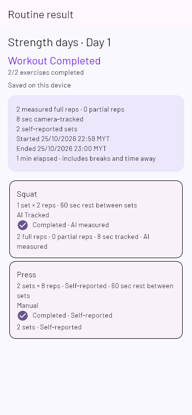
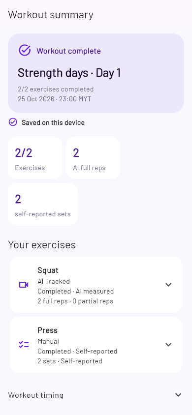
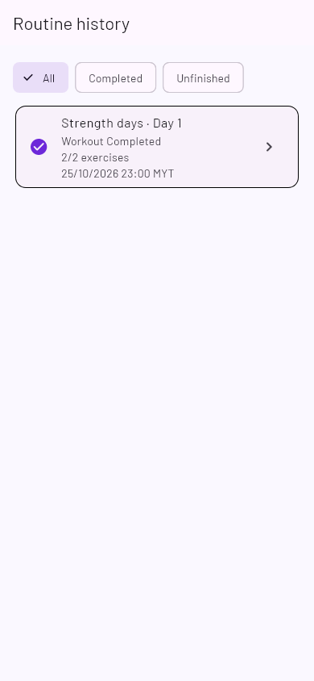
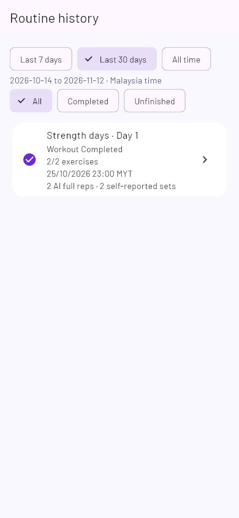
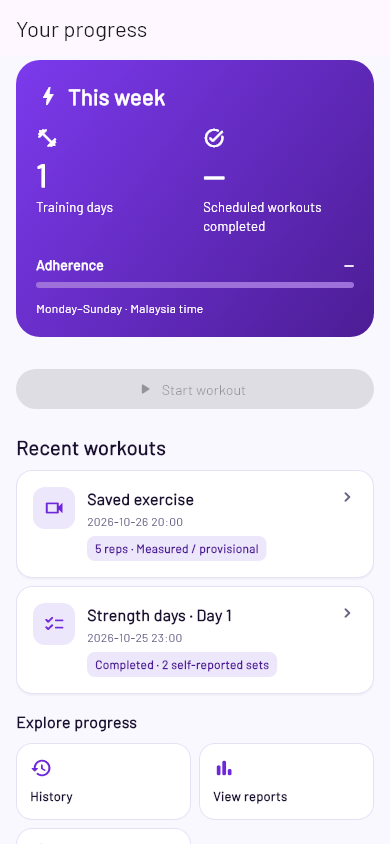
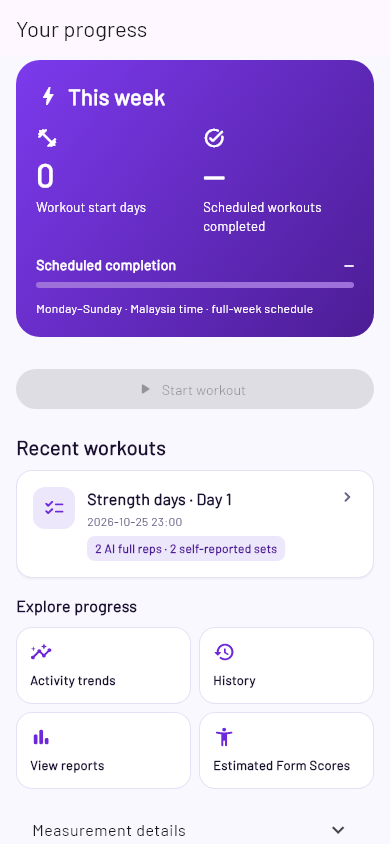
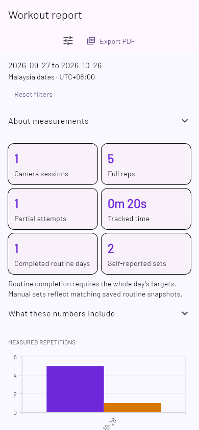
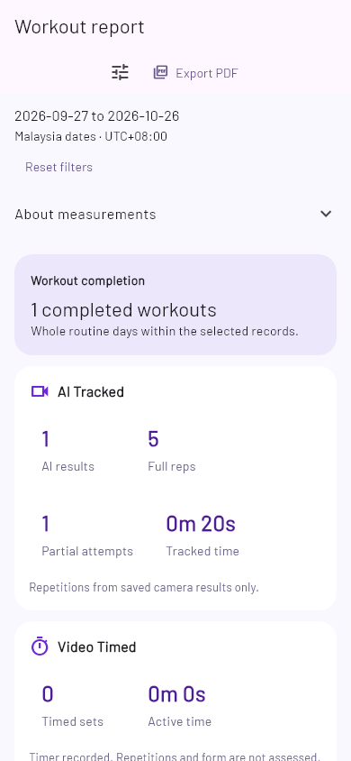

# Workout analytics and automatic cloud sync — implementation

All five phases are implemented. The final application source `6573957` passed a clean-checkout gate: 775 affected Mobile, 192 Domain and 759 Pose tests; scoped analysis, three stress runs and Android Debug build passed. Physical/Firebase/PDF acceptance remains pending as listed below.

Source baseline: `0da25e9`. Implements the owner's five-phase request and [data audit](../superpowers/plans/2026-11-12-workout-history-progress-report-data-audit.md). No live deployment, real-account writes or device installation is part of this change.

## Phase 1 — local-first automatic sync

- Reused the existing shared account lease, foreground save/network/startup scheduler and Firebase callable. Committed local summaries/checkpoints plus acknowledged content baselines form the durable pending queue: a process restart rediscovers unacknowledged content without relying on in-memory notifications.
- New result-status composition acquires the same account-scoped coordinator; the summary never awaits network initialization. Status is based on the current summary digest or an exactly matching routine snapshot, never on workout acceptance/rewards or a global last-success time.
- Consumer states: Saved on this device, Syncing, Synced, Sync failed — Retry. Conflicting copies retain local data and ask for review. Disabling future sync preserves confirmation of an unchanged existing cloud copy; changed content is not marked synced.
- Added a backward-compatible optional `consentChoiceMade` metadata field. A new store can offer informed setup; any legacy persisted preference is treated conservatively as an existing choice. Neither camera consent nor a new screen enables cloud sync. Existing disabled preferences remain disabled.
- All supported AI, timed, manual and checkpoint writes continue to use the existing durable stores and save notifications. Scheduler refreshes its local view even without network/opt-in; bounded retries, foreground lifecycle and account guards remain.
- Program journals are not accepted by the deployed session/routine-only backup contract. Restored routine results remain reviewable; resume is fail-closed when scheduling provenance is unavailable. Full Program recovery remains unsupported. A future negotiated envelope/kind must add versioned Program journals, dependency ordering, CAS restore and old-client filtering before enabling schedule restore; no existing cloud record is rewritten here.

Verification: 39 focused sync/store/scheduler/integration tests passed, including startup without Progress, offline retries/restart, duplicate opportunities, in-flight opt-out/account switching, receipt matching and restored summaries. Scoped analysis and Flutter render evidence are recorded per phase in the final verification section.


## Phase 2 — consumer workout summary

Added a shared purple/ivory completion header, responsive activity facts and expandable exercise cards used by both the live journey summary and saved routine results. AI reps, timer-recorded sets/time and self-reported sets remain separate. Cards expose only linked, matching-account exercise assessments; individual result routes retain original movement evidence and put model/identity/upload verification behind Technical details. No unrelated scores are averaged. Lateral Raise/Shoulder Press show assessment unavailable, never legacy 0%; historic assessed Wall Push-up data remains inspectable.

The primary summary no longer leads with reward/acceptance internals. Completion motion is finite and respects reduced motion. Elapsed time is disclosed separately because it includes breaks/time away. The existing workout continuation, partial/skipped statuses and safe resume/repeat actions are preserved.

Verification: 26 summary/history/mixed/continuity tests passed (including 5 new product tests); six-file analysis clean. Actual 390dp Flutter summary render inspected against the before image. The first run exposed stale copy assertions and an offscreen test finder, corrected without dropping evidence assertions.

## Phase 3 — routine-centered History and meaningful Progress

History now defaults consistently to Routines; its AI-only tab is named AI Sessions. Routine cards include mode-aware activity summaries and use the shared, read-only sync coordinator for per-content status. Date (7/30/all) and completion filters compose; both tabs remain mounted to preserve navigation context. Dates default to 30 days throughout detailed analytics.

Progress uses workout-centered recent cards, retaining unlinked AI captures but hiding linked captures from duplicate top-level activity. Workout start days use saved routine starts (standalone capture starts only when not represented by a known routine); empty attempts do not count. This is explicitly not a reconstructed active-time calendar. Activity trends is a direct primary link and includes completed routines, recorded video time and manual sets, with AI-only charts clearly scoped. Scheduled completion identifies the full-week denominator, including upcoming slots; numeric goals retain their existing UTC semantics and display them explicitly instead of silently changing a contract.

Curl arm mode is read from existing summary evidence, carried in the progress DTO, included in comparison keys and shown in comparisons/form groups. Left/right/both/unknown remain separate; no historical values are invented. Technical versions and workout verification states remain inspectable behind details. Single-day names reuse one domain title helper.

Verification: 43 focused Mobile tests plus 36 Domain tests passed; 19-file scoped analysis clean. Actual History/Progress Flutter renders inspected. A broader analytics directory scan also reported a pre-existing coach earnings style info; final scoped analysis excludes that unrelated file. No scoring, scheduling backend or Firebase schema/formula was changed.

## Phase 4 — mixed-workout report and PDF

Report now leads with whole-workout completion and separate AI, Video Timed and Manual sections. AI reps/time come only from capture records, timed sets/active time only from guided records and manual sets only from self-reports. Primary activity is routine-centered; all matching captures and exercise breakdowns remain available without being double-added to totals. Internal IDs and detailed record/state metadata live in the technical section. Reset and direct entry use 30 days; inherited filters and immutable export snapshots are preserved.

PDF adds a useful mixed-evidence summary and assessment scope/method before the technical appendix. The native renderer places charts between that summary and appendix, adds section typography and a consumer header/footer, preserves wrapping/pagination/cancellation and keeps its legacy seven-line layout for old payloads. Friendly chart labels retain separate compatible groups; rule/model/arm evidence remains in the appendix. Member attempt-weighted/local scope versus Admin session-average/cloud-backed scope is explicit; Admin contracts are unchanged.

Verification: 32 report/export/route tests passed, including coherent four-mode fixtures, missing scores, large output, matching filters/chart points, export failure/cancel/retry and account drift. Three-file analysis clean; actual report Flutter rendering inspected. Native PDF compilation is covered by the final Android build; device PDF picker/render/open acceptance remains pending, not inferred from widget tests.

## Phase 5 — quality, reliability and release verification

- Reviewed Home/Rewards/Workout theme tokens and existing renders before styling. New surfaces use GainPath purple, light backgrounds, restrained warm accents, consistent rounded cards and finite Flutter motion; reduced-motion users receive immediate completion/status changes. No decorative animation loops were added.
- Executed a matrix of 320/360/390dp, 100/150/200% text, portrait and corresponding landscape layouts: 18 configurations × 7 screens, checking initial and scrolled content. Summary actions remain reachable; long names wrap. Actual 390dp, 320dp/200% and landscape Flutter screenshots were inspected.
- Fixed a confirmed persistence race: a failed consent-preference write could leave automatic sync enabled in memory. Same-account/generation failures now roll back to the previous state; stale-account failures cannot restore old preferences. The settings page reports the failure without losing workout data.
- Independent branch review found three defects and supplied precise reproductions: filtered activity cards reused unfiltered routine facts; all-mode trends offered only AI exercises in their filter; fictional observations claimed local saving. Red→green regressions cover all three. Routine facts now use selected entries, filters include recorded timed/manual entries and read-only fixture provenance suppresses save/uploadable-record construction. A follow-up review found no remaining Important defect in those fixes.
- Unsupported-only form history no longer draws an empty chart. Actual form assessments lead the page before optional comparisons; version/link/coverage evidence is disclosed in details. Single-result time axes are bounded to their real dates instead of a misleading epoch-scale range. No score or rep algorithm changed.
- Updated affected UI assertions to the new headings, details and 30-day default without removing their persistence/retry/privacy/count assertions. Lateral Raise/Shoulder Press consent fixtures now use the existing AuthBloc/preference harness for both first-time and accepted consent. A stale Hub test expected the training plan above exercises; the existing committed Hub puts it below, and that test now checks the current layout without changing the Hub.

### Verification record

| Check | Current working checkout evidence |
|---|---|
| Broad related Mobile batch | 762 passed, 30 existing gated skips before the last two form-only regressions; final integrated committed-source gate follows below |
| Final source guards/report subset | 18 passed |
| Form/UI/goal subset | 27 passed |
| Deterministic stress | 31 tests × 3 consecutive passes; no sleeps added to hide races |
| Full Domain | 192 passed |
| Full Pose | 759 passed with `dart test` |
| Static analysis | 65 owned Mobile Dart source/test files clean; domain progress file clean |
| Android Debug | Dirty-checkout build passed with cloud sync and existing check-in flags; exact committed-source build follows below |
| Rendering | Actual Flutter before/after and mixed-mode/large-text/landscape images inspected |

The first full Pose invocation used Flutter's runner; three CLI tests timed out because those tests spawn `Platform.resolvedExecutable` expecting Dart VM. The complete suite was rerun with `dart test`: all 759 passed, including all three CLI cases. No timeout was raised, test skipped or assertion weakened. Initial Mobile failures were investigated: old copy/navigation assertions, missing consent fixture dependencies and the confirmed display bugs above were corrected. Original failing logs remain under ignored `build/analytics-*.log`.

The implementation checkout contains unrelated dirty Admin/Home/pose work, excluded from commits. These working-checkout passes are not presented as clean-checkout passes. The final committed-source run is recorded separately after it completes.

Reproduce from committed source, without installing an APK or accessing real workout data:

```powershell
powershell -ExecutionPolicy Bypass -File tools/verify_workout_analytics.ps1
# Optional faster check: add -SkipBuild; default includes three stress runs.
# Render sanitized fixtures from apps/mobile:
flutter test test/workout_analytics_product_render_test.dart --dart-define=GAINPATH_RENDER_ANALYTICS=true --dart-define=ANALYTICS_STAGE=phase5
```

The verification script selects all committed affected test files (including existing gated cases), runs Mobile, full Domain, full Pose with the correct Dart runner, the checked-in scoped analysis manifest, three stress passes and the Android Debug build. Logs and APK SHA-256 are retained under `build/workout-analytics-verification/` in that checkout. Existing opt-in render/device/recording skips are reported, not counted as physical validation.

### Before / after UI evidence

These are actual Flutter renders of synthetic fixtures, not screenshots of a real Member account or physical performance measurements. The paired group uses the same earlier audit fixture; the additional Everyday Strength fixture is a coherent AI + Video Timed + Manual example. No screenshot asserts live Firebase success.

| Screen | Before | After |
|---|---|---|
| Workout summary |  |  |
| History |  |  |
| Progress |  |  |
| Report |  |  |

Additional reviewed renders: [mixed workout summary](assets/workout-analytics-product/phase5-mixed-summary.png), [mixed report](assets/workout-analytics-product/phase5-mixed-report.png), [actual form assessment](assets/workout-analytics-product/phase5-mixed-form.png), [320dp summary at 200% text](assets/workout-analytics-product/phase5-mixed-summary-320-200.png), [320dp report at 200% text](assets/workout-analytics-product/phase5-mixed-report-320-200.png), [landscape summary at 200% text](assets/workout-analytics-product/phase5-mixed-summary-landscape-200.png).

### Limitations and physical acceptance checklist

- [ ] Authorized test account: enable informed automatic sync, complete a mixed routine online, verify acknowledgments for current content and the corresponding private cloud records. No real Firebase UAT or deployment was performed here.
- [ ] Offline: complete/save, terminate and reopen the app, restore connectivity in foreground and confirm exactly one cloud result per stable identity, including updated timed/manual checkpoints.
- [ ] Switch account/log out during an in-flight request; verify no prior-account results, late status or camera capture appears in the new account.
- [ ] With sync disabled, verify existing preference stays off; with an old acknowledged copy, distinguish that copy from newer device-only content. Confirm withdrawing camera consent does not implicitly grant/revoke a separate cloud preference.
- [ ] On a second authorized device, recover supported session/routine records; inspect collisions and newer-local protection. **Program enrollment/schedule journals are not synchronized**, so do not promise full Program recovery or silently reassign a recovered attempt to a free/scheduled identity.
- [ ] Android PDF picker: export/open a long filtered report, inspect real pagination/fonts/charts and cancellation across account switch. Native PDF build and transport tests do not establish device rendering acceptance.
- [ ] Physically validate all six AI exercises, voice/continuation, camera recovery and hardware resource performance. Deterministic tests/rendering do not establish tracking accuracy, latency or CPU/GPU/device behavior.

No frames, raw pose histories, fabricated calories, load/volume, inferred medical outcomes or overall cross-exercise Form Score were added. AI per-capture set boundaries are not invented where only cumulative reps and routine targets exist. Manual/timed snapshots cannot reconstruct exact daily active events across multi-day recovery. Legacy unscored/unknown-arm records remain accessible; retired tracker/history data is preserved.

### Commits

| Phase | Commit |
|---|---|
| 1 — automatic sync and consent/status | `5dd4e64` |
| 2 — workout summaries | `9f1f35b` |
| 3 — History/Progress and comparability | `fa95d94` |
| 4 — mixed reports/PDF | `e723c16` |
| 5 — reliability, visual quality and verification tooling | `01fcf33` + clean-gate provenance correction `6573957` |

### Modified files at the five-phase source checkpoint

Paths relative to the repository root. Unrelated working-tree files are excluded.

<details><summary>Complete file list</summary>

- `apps/mobile/android/app/src/main/kotlin/com/zyang/gainpath/WorkoutReportPlugin.kt`
- `apps/mobile/lib/app/routing/member_progress_route.dart`
- `apps/mobile/lib/app/routing/real_squat_route.dart`
- `apps/mobile/lib/app/routing/routine_journey_route.dart`
- `apps/mobile/lib/app/routing/squat_result_sync.dart`
- `apps/mobile/lib/app/routing/workout_cloud_save_status.dart`
- `apps/mobile/lib/features/analytics/data/local_member_progress_repository.dart`
- `apps/mobile/lib/features/analytics/domain/exercise_improvement.dart`
- `apps/mobile/lib/features/analytics/domain/member_workout_report.dart`
- `apps/mobile/lib/features/analytics/domain/workout_activity_overview.dart`
- `apps/mobile/lib/features/analytics/presentation/member/activity_timeline_screen.dart`
- `apps/mobile/lib/features/analytics/presentation/member/goal_comparison_report.dart`
- `apps/mobile/lib/features/analytics/presentation/member/posture_accuracy_screen.dart`
- `apps/mobile/lib/features/analytics/presentation/member/widgets/contextual_progress_filter.dart`
- `apps/mobile/lib/features/analytics/presentation/member/widgets/exercise_improvement_card.dart`
- `apps/mobile/lib/features/analytics/presentation/member/widgets/local_progress_widgets.dart`
- `apps/mobile/lib/features/analytics/presentation/member/widgets/routine_progress_card.dart`
- `apps/mobile/lib/features/analytics/presentation/member/widgets/workout_report_overview.dart`
- `apps/mobile/lib/features/analytics/presentation/member/workout_history_tabs.dart`
- `apps/mobile/lib/features/analytics/presentation/member/workout_performance_screen.dart`
- `apps/mobile/lib/features/analytics/presentation/member/workout_report_screen.dart`
- `apps/mobile/lib/features/analytics/presentation/shared/member_progress_overview.dart`
- `apps/mobile/lib/features/workout/application/workout_backup_coordinator.dart`
- `apps/mobile/lib/features/workout/application/workout_backup_scheduler.dart`
- `apps/mobile/lib/features/workout/domain/routine_attempt.dart`
- `apps/mobile/lib/features/workout/domain/workout_backup.dart`
- `apps/mobile/lib/features/workout/presentation/member/routine_history_screen.dart`
- `apps/mobile/lib/features/workout/presentation/member/routine_journey_screen.dart`
- `apps/mobile/lib/features/workout/presentation/member/widgets/workout_result_content.dart`
- `apps/mobile/lib/features/workout/presentation/member/widgets/workout_save_indicator.dart`
- `apps/mobile/lib/features/workout/presentation/member/workout_backup_screen.dart`
- `apps/mobile/lib/features/workout/presentation/member/workout_result_screen.dart`
- `apps/mobile/lib/features/workout/presentation/workout_presentation.dart`
- `apps/mobile/test/calf_raise_workout_session_test.dart`
- `apps/mobile/test/curl_workout_session_test.dart`
- `apps/mobile/test/floor_push_up_workout_session_test.dart`
- `apps/mobile/test/goal_comparison_report_test.dart`
- `apps/mobile/test/lateral_raise_integration_test.dart`
- `apps/mobile/test/lateral_raise_session_test.dart`
- `apps/mobile/test/local_member_progress_ui_test.dart`
- `apps/mobile/test/member_local_progress_flow_test.dart`
- `apps/mobile/test/member_progress_route_test.dart`
- `apps/mobile/test/progress_dashboard_compact_test.dart`
- `apps/mobile/test/progress_report_refinement_test.dart`
- `apps/mobile/test/real_workout_ui_test.dart`
- `apps/mobile/test/routine_completion_actions_test.dart`
- `apps/mobile/test/routine_history_ui_test.dart`
- `apps/mobile/test/routine_journey_flow_test.dart`
- `apps/mobile/test/row_workout_session_test.dart`
- `apps/mobile/test/shoulder_press_integration_test.dart`
- `apps/mobile/test/shoulder_press_session_test.dart`
- `apps/mobile/test/support/workout_analytics_fixture.dart`
- `apps/mobile/test/wall_push_up_workout_session_test.dart`
- `apps/mobile/test/workout_activity_product_test.dart`
- `apps/mobile/test/workout_analytics_product_render_test.dart`
- `apps/mobile/test/workout_analytics_responsive_test.dart`
- `apps/mobile/test/workout_backup_integration_test.dart`
- `apps/mobile/test/workout_backup_test.dart`
- `apps/mobile/test/workout_backup_ui_test.dart`
- `apps/mobile/test/workout_cloud_status_route_test.dart`
- `apps/mobile/test/workout_cloud_sync_product_test.dart`
- `apps/mobile/test/workout_hub_dashboard_test.dart`
- `apps/mobile/test/workout_phase4_ux_test.dart`
- `apps/mobile/test/workout_report_product_test.dart`
- `apps/mobile/test/workout_report_ui_test.dart`
- `apps/mobile/test/workout_summary_product_test.dart`
- `docs/superpowers/plans/2026-11-12-workout-history-progress-report-data-audit.md`
- `docs/ux/assets/workout-analytics-product/before-history.png`
- `docs/ux/assets/workout-analytics-product/before-progress.png`
- `docs/ux/assets/workout-analytics-product/before-report.png`
- `docs/ux/assets/workout-analytics-product/before-summary.png`
- `docs/ux/assets/workout-analytics-product/phase5-history.png`
- `docs/ux/assets/workout-analytics-product/phase5-mixed-form.png`
- `docs/ux/assets/workout-analytics-product/phase5-mixed-report-320-200.png`
- `docs/ux/assets/workout-analytics-product/phase5-mixed-report.png`
- `docs/ux/assets/workout-analytics-product/phase5-mixed-summary-320-200.png`
- `docs/ux/assets/workout-analytics-product/phase5-mixed-summary-landscape-200.png`
- `docs/ux/assets/workout-analytics-product/phase5-mixed-summary.png`
- `docs/ux/assets/workout-analytics-product/phase5-progress.png`
- `docs/ux/assets/workout-analytics-product/phase5-report.png`
- `docs/ux/assets/workout-analytics-product/phase5-summary.png`
- `docs/ux/workout-analytics-cloud-sync-product-optimization.md`
- `packages/gainpath_domain/lib/src/analytics/local_member_progress.dart`
- `tools/verify_workout_analytics.ps1`
- `tools/workout-analytics-analysis-files.txt`

</details>

### Initial clean-checkout finding and correction

The first clean run at `01fcf33` completed 773 Mobile tests with 30 gated skips and two failures in unchanged guided/save-retry assertions. `recordedFixture` can describe a deterministic replay that was actually committed to the local store; it does not by itself mean a remote read-only observation. The result screen now uses the explicit `fictionalObservation` context supplied by the scoped remote-data route. Read-only observations still suppress save claims; all recorded replays remain ineligible for cloud-backup construction. The original durability/retry assertions were retained, and all 23 focused replay/real-result/FYP/status/summary tests passed after correction; two-file analysis is clean. The failed clean log is retained. Final committed-source verification reruns the entire gate after this correction.

## Final committed-source verification

Verified application commit: **`6573957838204f83b4c08b47bf7db7f1be305320`**, after all five phase commits and the clean-gate provenance correction. The independent local clone at `build/workout-analytics-clean/source` had an empty `git status --porcelain` before and after verification; no unrelated Admin/Home/pose/equipment working-tree edits were copied into it.

The committed `tools/verify_workout_analytics.ps1` completed successfully:

| Gate | Final clean result |
|---|---|
| Affected Mobile | **775 passed**, 30 existing gated skips, **144 committed test files** |
| Full Domain (`dart test`) | **192 passed** |
| Full Pose (`dart test`) | **759 passed**, including CLI subprocess validation |
| Mobile static analysis | **65 files, no issues** |
| Domain static analysis | **No issues** |
| Deterministic stress | **31 passed × 3 consecutive runs** |
| Responsive widget coverage | **320/360/390dp × 100/150/200% × portrait/landscape**, seven screens at initial and scrolled states |
| Android Debug APK | **Built successfully** with existing cloud-sync/check-in defines; no install |

The final gate represents 1,726 non-stress passing tests across the three suites. Repeated stress checks are additional executions, not additional unique tests. Optional render/recording/device-gated skips were left visible; no failing case was excluded to obtain a pass. Native build notes are existing Firestore unchecked-operation/WorkoutAudioPlugin deprecation notes, not build failures.

Retained local evidence: `build/workout-analytics-clean/verification-summary.json`, `verification-run.log`, `verification-evidence/`, the initial failed clean log `mobile-initial-01fcf33.log` and the final `app-debug.apk`. The verification checkout is retained for reproducibility. Build evidence is ignored and is not a production dataset.

Final clean APK SHA-256: `a51cf6d3e8b71aee9de26fc275db3ab90eca59a21c1d2ba5db49919fe03f8f90`.

The final documentation-only commit records these outcomes and refreshes the operational references. Application/backend/schema source is unchanged from the verified application commit. Implementation remains on `codex/hybrid-workouts`; no merge, push, deployment, device install or real Member-data operation was performed.

Additional operational references refreshed, preserving their unrelated uncommitted content: `AGENTS.md`, `README.md`, `docs/ARCHITECTURE.md`, `docs/OPERATIONS.md`, `docs/STATUS.md`, `docs/SUPERVISOR_DEMO_GUIDE.md`, `docs/PROGRESS_REPORT.md`, `docs/integration/module2-workout-programs-report-and-manual.md`.
