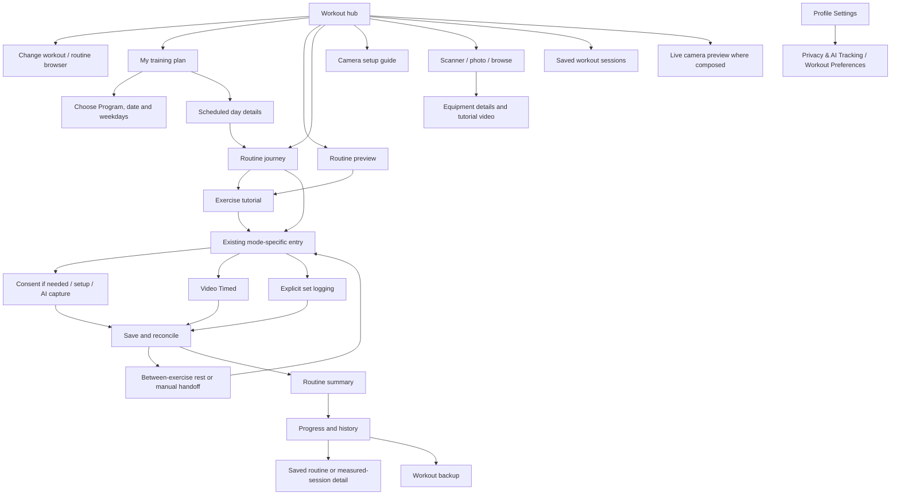

# Workout page and subpage review and optimization plan

Date: 7 November 2026. Reviewed source: `7affa0a`, with unrelated pending Admin/pose work excluded from the proposed scope. **Review and plan only: no application, catalog, enrollment, permission or device changes.**

## 1. Scope and evidence

This review traces the live Workout composition, its direct subpages and downstream workout/history/settings destinations. It supersedes the recommendations in the historical [initial journey audit](member-routine-experience.md) where subsequent implementation has already addressed them. Read alongside [Member UX implementation](member-workout-ux-implementation.md), [workout continuity](workout-continuity-implementation.md) and [current Beginner Program](beginner-foundations-program.md).

Evidence is source inspection plus the retained phone screenshots and verified installation evidence from the immediately preceding tasks. Those screenshots show real examples of the Workout hub's layout and saved-enrollment confusion. This task did **not** perform a new interactive walkthrough of every phone screen, camera exercise, TalkBack flow or network failure. Proposed improvements are not usability-study results. Contrast, reachability and native camera/video performance need device measurement.

The UI/UX skill's native/mobile interaction, information hierarchy and accessibility guidance informed the review. Its Python search tool could not run because no Python interpreter is installed; no search-derived findings are claimed. Existing test results are historical evidence, not tests rerun for this documentation task.

## 2. What already works—preserve it

- State-derived Start, Continue, Resume Unfinished Exercises and Summary actions.
- Shared AI Tracked / Video Timed / Manual capability and target presentation.
- Same-attempt contextual tutorials and flexible exercise selection.
- Versioned account-scoped consent, withdrawal and separate camera permission.
- Saved-result rest countdown, suggested/prescribed rest distinction and safe mode dispatch.
- Explicit resume after interruptions and no advance after failed saves.
- Sticky journey/timer/rest controls and truthful timed/manual completion.
- Local history, optional backup and preserved Program snapshots.
- Four bundled Camera setup images, correct step ordering, full-image display and large-text scrolling.

Do not rebuild these capabilities. Improve how Members discover, understand and operate them.

## 3. Reachable screen map



Not every branch is a separate route: manual logging and the routine summary are states of the journey screen; onboarding/day panels are states of the Program screen. Some preview, saved-result and legacy/demo widgets coexist in source. Their existence alone does not establish that a production Member sees demo data.

## 4. Screen-by-screen review

| Screen or state | Current experience | Proposed improvement |
|---|---|---|
| Workout hub | Large photo hero, selection controls, targets, exercise list and tools below; scheduled/free states share the layout. | Reduce hero height and repeated copy. Put source of workout, date/status and primary action first. Keep essential tools discoverable. |
| Routine browser | Bottom sheet with published choices, refresh/pagination and scheduled/free selection. | Clearly label Free workout versus Scheduled workout; show difficulty, exercise count, estimate, modes and selected state. A change should confirm the selection without implying Program enrollment changed. |
| Routine preview | Exercise list, targets and tutorial access. | State “Preview” explicitly; distinguish viewing from beginning an attempt. Use the same compact exercise row as the journey. |
| Program selection/onboarding | Program/level dropdown, date, weekday choices and Start program. | Preview the three routine names, weekly sequence, session count and recovery pattern before enrollment; validate day count inline. |
| Active Program/week overview | Published version, schedule, progress, saved-enrollment selector and choose-another action. | Lead with next actionable date. Put version metadata in Details. Separate current plan from past enrollments and offer End current plan. |
| Program day details | Date/category/status, exercises, result details, start/resume, skip and reschedule. | Separate Planned targets from Saved results; show reschedule provenance and an explicit primary action. Keep recovery days actionable without suggesting capture. |
| Routine journey | Compact progress, selectable exercises, selected exercise actions and summary access. | Make active exercise and upcoming selection more obvious; surface save/retry status and interrupted-resume reason beside the primary action. |
| Manual logging | Explicit Mark set done and undo behavior. | Show recorded/target sets and “Self-reported”; require deliberate logging. Do not hide the current set count in a long card. |
| Exercise tutorial | Steps/media/details and contextual Start Exercise/Open Set Logger. | Order targets, equipment and start action before optional background details. Distinguish missing video from playback failure. |
| Privacy acknowledgement | First-use versioned notice; setup and upload remain separate. | Use concise plain-language headings and review link; keep meaningful consent information intact. Clarify that accepting does not start a camera immediately. |
| Exercise-specific setup | Front-view shoulder/lateral setup; arm/leg choices for unilateral trackers; other exercise-specific confirmations. | Shared visual layout: required view, positioning illustration, selected side and checklist; retain required confirmations and per-exercise constraints. |
| AI capture/readiness | Camera feed, calibration/readiness, counts, cues and draggable controls. | Make Ready/Working/Paused/Rest/Saving states unambiguous; prioritize count/set/action and one actionable cue. Move detailed diagnostics into an optional panel. |
| Video Timed | Looping video, work/rest/paused phases, active duration and persistent controls. | Label active work time separately from per-set and between-exercise rest; differentiate loading, buffering, playback failure and save failure. |
| Between-exercise rest | Saved confirmation, large countdown, upcoming exercise, Pause/Resume, Skip Rest and routine return. | Say “Next: camera setup” when setup is still required, rather than suggesting immediate counting. Preserve the visible countdown/controls at large text sizes. |
| Manual next-exercise sheet | Existing fallback when Auto-Continue is off. | Match rest screen terminology and next-exercise summary; show why it awaits an explicit action. |
| Routine summary | Typed status/results and anchored resume/next-day/return action. | Lead with Completed / Partial / Skipped counts and saved status; reduce repeated result text and distinguish elapsed versus credited time if both exist. |
| Measured session result | Saved measured data, tracker-specific limits and conditional scores/sync details. | Present key supported results first, then expandable measurement details. Maintain unscored states; never substitute zero for missing score. |
| Saved sessions / routine history | Separate entries into measured sessions and routine attempts. | Add clear labels and cross-links so a saved exercise session is not mistaken for a complete routine; preserve both identities. |
| Progress dashboard/activity/performance/form/goals/report | Downstream analytics from local records, with separate measured/score availability paths. | Explain each metric's included records, period and denominator. Keep timer/manual activity distinct from measured reps and eligible form scores. |
| Workout backup | Opt-in status, queue/retry/recovery and local-only schedule warning. | Put Last successful backup, Pending items and What is included above detailed rows. Keep account/device limits and restore consequences clear. |
| Camera setup guide | Four local images, horizontal steps and Next/Back. | Keep the supplied images; clarify that side-view examples apply to particular exercises. Link to exercise-specific front/side setup instead of presenting one universal view. |
| Live camera preview | Standalone preview with separate permission/lifecycle ownership. | Prominent “Preview only—no workout recorded”; a clear exit and permission-retry path. Do not imply preview earns progress. |
| Equipment scan/photo/browse | Camera/gallery recognition, possible/multiple matches, manual browse and detail pages. | Explain that recognition is a suggestion; separate matching, unavailable service and no-match states. Preserve manual browsing. |
| Equipment detail/video | Live equipment image, instructions/tutorial media; honest missing related-exercise linkage. | Make safety/setup/media hierarchy clear. Only add exercise links with stable catalog IDs; do not infer compatibility from names. |
| Privacy & AI Tracking / Workout Preferences | In Profile Settings: consent status/review/withdraw, Auto-Continue and suggested rest. | Add a direct Workout Settings entry from the hub/journey. Keep the same scoped controller and a single settings destination. |
| Access, loading and error screens | Auth/membership/scope, catalog, media and persistence gates already exist. | Each needs a specific reason, retained-progress statement when true and one useful recovery action; avoid generic unavailable screens with no next step. |

## 5. Confirmed findings and priorities

P1 means the information or navigation can mislead a Member; P2 improves efficiency/readability. No pose/counting correctness defect is asserted by this review.

| ID | Priority / evidence | Finding | Required result |
|---|---|---|---|
| F01 | P1; hub `_WorkoutHero`, `journeyFirst` footer | The unconditional “Choose an exercise next” footer can appear under a completed workout and View Workout Summary. | Derive supporting copy from the same attempt state as the primary action. |
| F02 | P1; recent actual enrollment issue, Program journal/controller/UI | A withdrawn catalog listing and a saved active enrollment are separate. The UI does not make that distinction obvious, and no normal End current plan action is exposed. | Explain catalog availability versus saved schedule; add explicit end-plan confirmation that clears active selection while retaining history. Never automatically delete or deactivate every retired enrollment. |
| F03 | P1; camera guide step 3 versus front-view setup screens | Generic “Face the camera side-on” guidance can be read as universal, while Shoulder Press/Lateral Raise require front views. | Label this example as side-view guidance and explain that the exercise setup screen chooses the required view. Keep all four supplied images. |
| F04 | P1; shared formatter and setup strings | Targets use unconditional `sets`/`reps`, creating “1 sets”; time/rest labels do not always state their scope. | Centralize singular/plural and explicit work-per-set/rest-between-sets wording. |
| F05 | P1; `_nextExercise` and setup routes | Auto-Continue may legitimately stop at required setup; current messaging can sound more automatic than the next destination permits. | Distinguish “Next exercise starts after rest” from “Camera setup opens after rest”; no setup/permission bypass. |
| F06 | P2; hub tools and Settings navigation | Auto-Continue/rest preferences live outside Workout; camera/equipment/history tools are below substantial content. | Add Workout Settings shortcut and a compact tools section; retain existing route and controller. |
| F07 | P2; `_WorkoutHero` and exercise list | Hero repeats title/metadata/status/explanation, consumes vertical space and pushes tools down. | Use a compact state-aware card and denser exercise rows without hiding the primary action. |
| F08 | P2; Program onboarding | Choosing a Program does not provide a strong upfront summary of the contained routines and recurring weekly pattern. | Preview routine sequence, frequency and estimates before Start program; expose start-date/weekday errors inline. |
| F09 | P2; specific setup screens and result screen | Several paragraphs of necessary safety/measurement information compete with immediate positioning and results. | Show required positioning and key results first; group supporting details in accessible expandable sections, retaining important limits. |
| F10 | P2; result/history routes and MemberProgressView | Routine history, exercise sessions, performance and form views can be reached through different labels and levels. | Establish a consistent history entry and scoped cross-links; do not merge incompatible record types. |
| F11 | P2; equipment detail live branch | Equipment-to-exercise links are explicitly not connected in the live detail view. | Keep the honest empty state; only implement links after a stable-ID content contract and valid published-target checks exist. |
| F12 | P2; generic photo-backed hero | Decorative photography can communicate an exercise different from the selected routine; text contrast depends on composition. | Prefer relevant catalog cover or neutral branded fallback, with verified contrast. Treat the photo as decoration, not evidence. |

Additional validation targets, rather than confirmed bugs: near-simultaneous route/lifecycle transitions, screen-reader focus during rest, extremely long routine names, all-empty analytics periods, metric aggregation across scoring versions and native video buffering. Existing safeguards must be tested before attributing failures to them.

## 6. Information contract

### Hub: what appears first

```text
WORKOUT                         [Settings]
[Scheduled workout] or [Free workout]
Today / Upcoming Mon 9 Nov / Missed Wed 4 Nov
Beginner Full Body Foundations
4 exercises · 8 sets · Estimated 20 min
0 of 4 exercises completed
[Start workout]                 [Change workout]

Exercises (compact rows: mode, target, status)
Training plan · History · Camera guide · Equipment
```

This example illustrates information order, not a new hardcoded dataset. Counts, dates and targets must come from the selected routine/checkpoint. On a rest day, lead with recovery and View training schedule; any overdue/next workout below must be separately labelled.

| State | Primary action | Supporting information |
|---|---|---|
| No selection | Browse workouts | No workout selected; catalog retry if loading failed |
| New selected workout | Start workout | Targets and planning estimate; no claim it has started |
| Open compatible checkpoint | Continue workout | Saved completion count; last saved timestamp if actually recorded |
| Finished partial attempt | Resume unfinished exercises | Completed/unfinished/skipped counts |
| Target-complete attempt | View workout summary | Workout completed; saved locally |
| Recovery/rest day | View training schedule | Today is a recovery/rest day; next scheduled date separately |
| Save failure | Retry save | Unsaved or pending state; automatic progression blocked |
| Withdrawn free selection | Choose another workout | No longer available for new selection; saved history retained |

### Exercise rows and execution

- AI: `2 sets × 8 reps` plus per-arm/selected-leg/bilateral qualifier when applicable; `60 sec between sets`.
- Timed: `2 sets × 30 sec per set`; `Active time recorded`, with no repetitions or form score.
- Manual: prescribed targets plus `Self-reported`; recorded sets must be explicit.
- Display prescribed targets separately from actual recorded results. “2 / 4 exercises completed” is not a form score or percentage of valid movement time.
- Avoid “AI verified”, “accuracy” or universal form quality claims. A supported estimated form score needs its tracker/scoring context and sample denominator. Missing score means Not assessed, not 0%.
- Distinguish planning estimate, active timed work, measured tracking duration, per-set rest and between-exercise rest. Do not add them into an invented total.
- Saved locally, backup pending and backed up are separate states. Never show a cloud-success icon for a merely local save.
- Use absolute date plus Today/Upcoming/Missed where useful. Scheduling continues to use the existing Malaysia calendar rules.
- Never call browsing, a tutorial view, preview camera or an expired rest timer a completed workout.

## 7. Proposed implementation sequence

### Phase 1 — Information corrections

1. Extend shared presentation helpers for grammar and scoped time/rest labels.
2. Derive hero footer, icon and CTA from one presentation state; cover completed, partial and recovery cases.
3. Clarify generic camera-view guidance and Auto-Continue setup-required copy.
4. Add targeted tests before changing rendering. Do not touch pose algorithms or time-credit logic.

Acceptance: no “1 sets”; completed hero has no next-exercise instruction; front-view instructions cannot conflict with the general guide; setup-required transitions are accurately described.

### Phase 2 — Hub and Program usability

1. Compact the hub while retaining browsing, paging, refresh, equipment, camera and resume capabilities.
2. Add Workout Settings shortcut to the existing account-scoped page.
3. Show Program routine sequence and weekly pattern during onboarding.
4. Implement End current plan through `WorkoutProgramController`/store, not an operational device-file edit. Require confirmation, clear only active selection, retain enrollments and results, respect revision conflicts and account boundaries. Clarify what can be reselected as saved history.
5. Refresh catalog availability without overwriting an active attempt or silently enrolling in a replacement.

Acceptance: a Member can identify scheduled versus free work, find settings without leaving Workout, inspect three routine assignments before enrollment, and end a plan without losing a single saved result. Test null activeId and later enrollment in another Program.

### Phase 3 — Exercise preparation and execution polish

1. Reuse a setup presentation shell for view/side/required positioning/targets; preserve exercise-owned setup decisions.
2. Make tutorials easier to scan and distinguish unavailable media from playback errors.
3. Tighten readiness and interruption messages; retain camera feed priority and sticky controls.
4. Keep the rest screen's current controls; tailor the upcoming action description to Manual, Timed or required AI setup.

Acceptance: no additional privacy prompt with valid consent; explicit resume after interruption; no repeated session creation; no time during loading/buffering; Manual remains explicit; no camera starts from a rest/preview screen.

### Phase 4 — Results, history and supporting tools

1. Lead summaries with saved status and supported results; move detailed tracker limits below an accessible Details control.
2. Add navigation between a routine attempt and its saved exercise sessions without treating either as duplicate work.
3. Explain analytics period, included modes and scoring-version compatibility. Audit aggregation before changing any calculation.
4. Simplify backup status and equipment detours. Equipment-to-exercise linking is a separately scoped contract task, not a cosmetic quick fix.

Acceptance: mixed-mode routine summaries remain truthful; unscored exercises never gain form scores; old snapshots open after catalog withdrawal; restoring backup does not imply schedule sync or accepted workout/reward evidence.

## 8. Exact code areas for a future implementation

All paths below are relative to repository root. This is a modification map, not authorization for a broad rewrite.

| Area | Files |
|---|---|
| Hub presentation and state | `apps/mobile/lib/features/workout/presentation/member/workout_prep_screen.dart`; `apps/mobile/lib/app/routing/workout_prep_route.dart`; `apps/mobile/lib/features/workout/application/workout_hub_attempt.dart`; `apps/mobile/lib/features/workout/application/workout_hub_program.dart` |
| Shared labels and browsing | `apps/mobile/lib/features/workout/presentation/workout_presentation.dart`; `apps/mobile/lib/features/workout/presentation/member/published_routine_catalog_controls.dart`; `apps/mobile/lib/features/workout/presentation/member/routine_screen.dart` |
| Program UX/end-plan action | `apps/mobile/lib/features/workout/presentation/member/workout_program_screen.dart`; `apps/mobile/lib/features/workout/application/workout_program_controller.dart`; `apps/mobile/lib/app/routing/workout_program_route.dart`; existing `domain/program_enrollment.dart` and `infrastructure/local/file_program_enrollment_store.dart` only if required by the reviewed contract |
| Journey/summary | `apps/mobile/lib/features/workout/presentation/member/routine_journey_screen.dart`; `apps/mobile/lib/app/routing/routine_journey_route.dart`; existing `application/routine_journey_controller.dart` only for necessary state projections |
| Tutorials/camera guide | `apps/mobile/lib/features/workout/presentation/member/published_exercise_tutorial_screen.dart`; `apps/mobile/lib/app/routing/exercise_tutorial_route.dart`; `apps/mobile/lib/features/workout/presentation/member/camera_setup_screen.dart` |
| AI setup | `apps/mobile/lib/features/workout/presentation/member/lateral_raise_setup_screen.dart`; `shoulder_press_setup_screen.dart`; `curl_arm_setup_screen.dart`; `row_setup_screen.dart`; `reverse_lunge_setup_screen.dart`; `calf_raise_setup_screen.dart` in that same directory; other tracker-owned confirmations retained |
| AI presentation | `apps/mobile/lib/features/workout/presentation/member/real_workout_view.dart`; `apps/mobile/lib/features/workout/presentation/member/widgets/workout_session_sheet.dart` |
| Timed/rest presentation | `apps/mobile/lib/features/workout/presentation/member/guided_timed_workout_screen.dart`; `between_exercise_rest_screen.dart`; `routine_next_exercise_sheet.dart` in the same directory; corresponding existing routing files for state-aware copy only |
| History/results | `apps/mobile/lib/features/workout/presentation/member/workout_result_screen.dart`; `routine_history_screen.dart`; `apps/mobile/lib/app/routing/saved_squat_sessions_route.dart`; `member_progress_route.dart` |
| Related analytics | `apps/mobile/lib/features/analytics/presentation/shared/progress_dashboard_screen.dart`; `apps/mobile/lib/features/analytics/presentation/member/activity_timeline_screen.dart`; `workout_performance_screen.dart`; `posture_accuracy_screen.dart`; `goal_progress_screen.dart` in the same Member directory; `apps/mobile/lib/app/routing/member_workout_report_route.dart` |
| Settings and backup | `apps/mobile/lib/features/workout/presentation/member/workout_privacy_settings_screen.dart`; `workout_backup_screen.dart` in the same directory; reuse existing `application/workout_preferences_controller.dart` and backup coordinator |
| Equipment | `apps/mobile/lib/features/workout/presentation/member/equipment_scanner_screen.dart`; `equipment_browse_screen.dart` in that directory; `apps/mobile/lib/features/workout/presentation/shared/equipment_detail_screen.dart`; `equipment_tutorial_video.dart` in the shared directory |

## 9. Verification matrix for implementation

| Dimension | Required cases |
|---|---|
| Hub state | Empty, loading, catalog error, new selection, partial, finished partial, complete, scheduled today/upcoming/missed, recovery day, withdrawn free choice |
| Program lifecycle | Preview all routines; valid/invalid weekday count; enroll; change Program; end plan; reopen with null activeId; recover old history; failed write/revision conflict; account switch |
| Mixed execution | AI → AI, AI → Timed, Timed → Manual; selected side; tutorial entry preserves attempt; unavailable tracker; no fabricated completion |
| Interruptions | Pause, background, lock, route obscured, permission revoked, consent withdrawn, app restart, save failure and retry during preparation/completion |
| Information | Singular/plural, long names, per-arm/leg qualifiers, two rest kinds, planning versus active/tracked durations, no unsupported scores, no false backup/sync claims |
| Screens | 320/360px widths, 640px height, 200% text, bottom inset, keyboard where applicable, scroll-to-last-row, visible controls; physical TalkBack and gym-light contrast checks |
| Compatibility | Existing checkpoints, frozen Program snapshots, mixed schema versions, optional backup, organization isolation and held reward behavior |

Run focused tests for each phase, then changed-file analysis and an Android build. Existing useful suites include `workout_presentation_test.dart`, `workout_prep_action_hierarchy_test.dart`, `workout_hub_visual_flow_test.dart`, `workout_program_ui_test.dart`, `workout_program_controller_test.dart`, `workout_program_local_store_test.dart`, `member_journey_ux_test.dart`, `workout_continuity_flow_test.dart`, `timed_continuity_test.dart`, `between_exercise_rest_test.dart`, `camera_setup_images_test.dart`, `routine_history_ui_test.dart`, `workout_privacy_settings_test.dart` and backup integration tests. Add end-plan/no-data-loss and state-specific-copy regressions rather than relying only on screenshots.

## 10. Recommended scope decision

Start with Phases 1–2: correct conflicting information, reduce hub clutter, preview Program contents and provide a real End current plan action. These address observed Member confusion with the smallest change to the existing architecture. Then refine setup/execution and history presentation using the established controls and data contracts. No new backend schema, voice subsystem, tracker, fabricated demo data or reward activation is part of this plan.
